# SD-03 · Event counting and billing rollups — reference design

<!-- Generated by video/src/gen.py (kit dsl.write_reference_markdown) from the same slides and narration as the video. Edit video/src/*.py, then re-run gen.py; never edit this file. -->

> Count once, from one log, with one piece of code run twice: fast and provisional for the dashboard, exact and pinned for the bill. Never increment a number you can recompute — replace it.

**Contents**

- [1 · Prompt, questions and context](#1--prompt-questions-and-context)
- [2 · Estimates](#2--estimates)
- [3 · API and data model](#3--api-and-data-model)
- [4 · Design, driven by challenges](#4--design-driven-by-challenges)
- [5 · When you don't need all this](#5--when-you-dont-need-all-this)
- [6 · Recap](#6--recap)
- [Implementation Lab & Reproducible Workspace](#implementation-lab--reproducible-workspace)

## 1 · Prompt, questions and context

*Count ad events that are money*

Counting clicks sounds like n equals n plus one. It is one of the most asked questions at Google and Meta, because at thirty million events a second the hard part is not counting fast. It is counting once, in the right hour, and being able to prove it.

> **Interviewer:** Design the system that counts ad impressions and clicks. Advertisers watch their numbers live on a dashboard, and they are billed on the hourly totals.

#### One hour's number, three times

<sub>Why it is harder than it looks</sub>

*fast and provisional · exact and billed · corrected, never edited*

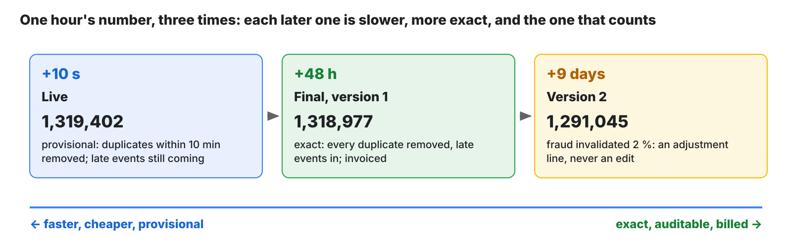

Here is the hook, as one picture: the same hour of one campaign has three numbers. Ten seconds in, the live number: fast and provisional, because duplicates and late events are still arriving. At forty-eight hours, the final number: exact, and invoiced. Nine days later fraud invalidates two percent, and a third number must become an adjustment, never an edit. The whole design is about producing all three from one source, and saying which one you are looking at.

#### What this question grades

<sub>Before the design</sub>

| Axis | Weak signal | Strong signal |
|---|---|---|
| **Requirements** | “Count clicks”, one number for everything | Asks which numbers are money, how late events arrive, who can invalidate them |
| **Correctness** | `n = n + 1`; “exactly-once” by name | IDs minted at the source; dedup; event time; replace, never increment |
| **Trade-offs** | Lambda or Kappa, recited | One aggregation code run twice, and what each run gives up |
| **Depth** | Stops at “Kafka and Flink” | Watermarks, keyed state with a TTL, two-stage sums, pinned re-runs |
| **Operations** | CPU and consumer lag | Conservation checks, live against final, canaries, an audit trail |

> [!IMPORTANT]
> **Coach · what is graded here.** The bill is the product; the dashboard is a preview of it.

> [!IMPORTANT]
> **Coach:** What this question grades. Requirements: which numbers are money, and who can take them back. Correctness: an ID minted at the source, event time, numbers replaced rather than incremented. Trade-offs: what you run twice, and what each run gives up. Depth: watermarks, keyed state and pinned re-runs, not just Kafka and Flink. Operations: checks on the numbers, because lag and CPU stay green while the count is wrong.

And the rule I'll keep for the whole round: the bill is the product. The dashboard is a preview of it, and must say so.

#### Three numbers every estimate starts from

<sub>Requirements · the scale line</sub>

- ****25 T · 250 B**** — impressions · clicks a month
- ****6 months**** — of raw events kept: ~150 trillion
- ****30 M/s**** — evening peak; one ad at 2 M/s

Every number later in this video starts from one of these three, and I'll say which.

The interviewer gives me the scale, and I write it down first. Twenty-five trillion impressions and two hundred and fifty billion clicks a month. A one percent click-through rate. Raw events are kept six months, about a hundred and fifty trillion of them. And the peak: thirty million events a second in the evening, three times the average. Inside it, one prime-time ad during a sports break takes two million impressions a second on its own. Every number I use later starts from one of these three, and I'll say which.

How fresh does the dashboard have to be, and the bill?

> **Interviewer:** Within about ten seconds for the dashboard. The bill is hourly totals, final within two days.

So two clocks. If someone asks for sub-second, I'd ask back: for one headline number, maybe; for slicing by country and hour, it costs a different system.

Which numbers have to be exact?

> **Interviewer:** The bill: exact, and auditable. The dashboard can be slightly off, but it has to converge to the bill.

That sentence is the design. One exact run for money, one fast run for people, and the fast one never disagrees for long.

Can the same event arrive twice, or late?

> **Interviewer:** Yes. SDKs retry on network errors. Phones buffer offline for hours, sometimes days. And client clocks are skewed.

Duplicates mean an ID per event. Late means event time, not arrival time. Skewed means I can't trust that time blindly. Three challenges already.

Who decides that a click was fraud, and when?

> **Interviewer:** A separate system. It can invalidate events after the invoices have gone out.

So a closed hour can change. I need versions of an hour, and a way to bill the difference without editing an invoice.

#### Four things the system must do

<sub>Requirements · functional</sub>

- **FR1 · Record.** Accept impression and click events; acknowledge once durable; a retry changes nothing.
- **FR2 · Live.** Per ad and campaign: impressions, clicks, spend and approximate reach, within 10 seconds.
- **FR3 · Bill.** Exact hourly totals per campaign and ad, final at a cutoff, versioned, exported.
- **FR4 · Correct.** Late events and invalidations reach closed hours as new versions and adjustment lines.

Four functional requirements. One, record: accept the events, acknowledge only once they are durable, and a retry changes nothing. Two, live: impressions, clicks, spend and an approximate unique reach per ad and campaign, within ten seconds. Three, bill: exact hourly totals, final at a cutoff, versioned, and exported to invoicing. Four, correct: late events and invalidations reach a closed hour as a new version and an adjustment line. A sent invoice is never edited.

#### The numbers, and what each is for

<sub>Requirements · non-functional</sub>

*all initial targets, not measurements*
- ****30 M/s**** — ingest at peak; ack p99 50 ms
- ****10 s**** — live freshness, p99
- ****H + 48 h**** — bill final; re-run bit for bit
- ****99.99 %**** — ingest: a dropped event is lost money

An acknowledged event survives the loss of a zone.

The numbers, and they are initial targets. Thirty million events a second at peak, acknowledged within fifty milliseconds at the ninety-ninth percentile. Live counts within ten seconds. The bill final forty-eight hours after the hour, and a re-run of any day gives the same numbers, bit for bit. Raw events are kept six months; disputes run ninety days. Four nines on ingest, because an event we drop is revenue we cannot bill. And an acknowledged event survives losing a whole zone.

#### What must never happen, and what must eventually happen

<sub>Requirements · properties</sub>

- **`[S1-count-once]`.** Never lost, never billed twice.
- **`[S2-right-hour-right-version]`.** Billed in its hour; not at all once invalid; an invoice is never edited.
- **`[S3-reproducible]`.** Every billed number recomputed and traced to its events.
- **`[L1-final-in-48h]`.** Every event reaches a final hour or an adjustment within 48 h.
- **`[L2-fresh-in-10s]`.** Live counts reflect an event within 10 s.

As properties, so every fix can say which one it protects. Safety first.

> [!TIP]
> **If asked, I'd say:** `[S1-count-once]`: an accepted event is never lost, and never billed twice. `[S2-right-hour-right-version]`: billed in the hour it happened, not at all once invalidated, and a sent invoice is never edited. `[S3-reproducible]`: every billed number can be recomputed and traced to its events.

Liveness. `[L1-final-in-48h]`: every event reaches a final hour or an adjustment within forty-eight hours. `[L2-fresh-in-10s]`: live counts within ten seconds. The only one with seconds in it: that is the tension.

#### In, and out on purpose

<sub>Requirements · scope</sub>

- **In scope.** Ingest, dedup, live counts, approximate reach, hourly billing totals, versions, corrections, an audit trail, reconciliation.
- **Out, on purpose.** Fraud detection itself. Ad serving and auctions. Budget pacing. Invoicing and payment. Attribution.

Budget pacing is a consumer of the live counts: it is why they must be fast.

In scope: ingest, dedup, live counts, approximate reach, the hourly billing totals with versions and corrections, an audit trail and reconciliation. Out, on purpose: fraud detection itself, ad serving and the auction, budget pacing, invoicing and payment, and conversion attribution. One of those I'd say aloud: budget pacing reads the live counts to stop a campaign that has spent its budget. That is why the live numbers must be fast, even though they are not the bill.

#### The system in its context, before any boxes inside it

<sub>C4 level 1 · system context</sub>

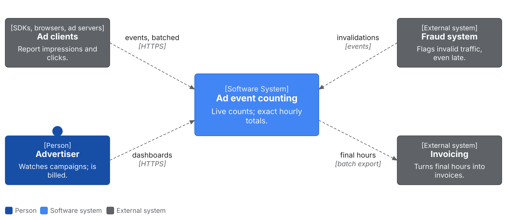

Before any boxes inside it, the system in its context. I draw this first, in every round. Ad clients: SDKs in apps, browsers, and ad servers. They send every impression and click, in batches, over HTTPS. Ninety-nine percent of the traffic. In the middle, the system, one box for now: live counts and exact hourly totals. Advertisers read dashboards, and are billed. A fraud system invalidates events, and it can do that late, after the bill. That arrives as events, not calls. And invoicing reads our final hours as a batch export. Nothing on the ingest path waits for any of them.

> [!TIP]
> **If asked, I'd say:** The core is three things. An idempotent, durable intake. One aggregation, run twice. And versioned final hours, with a correction path.

> [!IMPORTANT]
> **Coach:** Notice the candidate fixed the scale, named the properties and drew the context before any internals. That is the scoping signal.

## 2 · Estimates

*Each number from the scale line, and the constraint it forces*

Numbers next. Each starts from the scale line, and each ends in a constraint on the design: what it rules out, and what it forces. They are illustrative, not anyone's real figures.

#### Ten million a second, thirty at the peak

<sub>Estimates · traffic</sub>

| Number | From | Arithmetic | Forces |
|---|---|---|---|
| Events | monthly volume | 2.5 × 10¹³ ÷ 2.6 × 10⁶ s ≈ **10 M/s**; × 3 = **30 M/s** | a partitioned log; no database write per event |
| Clicks | monthly volume | 2.5 × 10¹¹ ÷ 2.6 × 10⁶ s ≈ **100 k/s**; peak 300 k/s | the same pipeline; a billable click keyed by its impression |
| Bandwidth | peak | 30 M × 200 B = **6 GB/s**; × 3 replicas = 18 GB/s | about 1,024 partitions and 80 brokers |

Traffic, from the monthly volumes. Twenty-five trillion impressions over two point six million seconds is about ten million a second. Three times that in the evening: thirty million a second. No database takes a write per event at that rate. That rules out a counter per event, and forces a partitioned log. Clicks are a hundredth of that: a hundred thousand a second, three hundred thousand at peak. They ride the same pipeline, and a billable click is keyed by the impression it came from, so a double-click bills once. At two hundred bytes an event, the peak is six gigabytes a second, eighteen with three replicas. About a thousand partitions and eighty brokers: illustrative, but it sets the order of magnitude.

#### Days in the log, months in the lake, minutes in memory

<sub>Estimates · storage and state</sub>

| Number | From | Arithmetic | Forces |
|---|---|---|---|
| Log, 3 days | average | 2 GB/s × 259,200 s ≈ 520 TB; ÷ 4 compressed × 3 ≈ **390 TB** | brokers keep 3 days; older replays read the lake |
| Lake | volume, retention | 2.5 × 10¹³ × 25 B ≈ **0.6 PB** a month; × 6 ≈ 3.8 PB | object storage, partitioned by event hour |
| Dedup state | peak | 30 M/s × 600 s = 1.8 × 10¹⁰ IDs × 40 B ≈ **0.7 TB** | keyed state over 512 tasks, not one Redis set |

Where the bytes live. Three days of log at the two-gigabyte average is five hundred and twenty terabytes; compressed and replicated, about three hundred and ninety. So brokers keep three days, and a replay older than that has to read somewhere else. That somewhere is a lake: about twenty-five bytes an event in columns, point six petabytes a month, three point eight for six months. Object storage, by event hour. And dedup. Ten minutes of event IDs at the peak is eighteen billion IDs, about point seven terabytes. Spread over five hundred and twelve stream tasks, one point four gigabytes each. In one Redis set it would be eighteen billion keys on one shard's thread. That rules Redis out for dedup.

#### Two numbers that decide the hard parts

<sub>Estimates · the hot ad and the money</sub>

| Number | From | Arithmetic | Forces |
|---|---|---|---|
| Hot ad | the peak | 2 M/s on one key; one task does ~300 k updates/s | combine before the shuffle: 512 partial sums a second |
| Duplicates | monthly clicks | 0.3 % retried × 2.5 × 10¹¹ = 7.5 × 10⁸ clicks × $0.50 ≈ **$375 M** a month | dedup is the crux, not an optimisation |

Two numbers that decide the hard parts. The hot ad: two million impressions a second on one key, against roughly three hundred thousand updates a second for one stream task. Keyed by ad, one task drowns, and more machines don't help a single key. That forces combining before the shuffle. And the money. If three tenths of a percent of click batches are retried, that's seven hundred and fifty million duplicate clicks a month. At fifty cents a click, about three hundred and seventy-five million dollars of overbilling. Illustrative, but it says dedup is the crux of this question, not an optimisation.

#### Ten seconds, from an impression to the dashboard

<sub>Estimates · the freshness budget</sub>

*initial target · worst case*

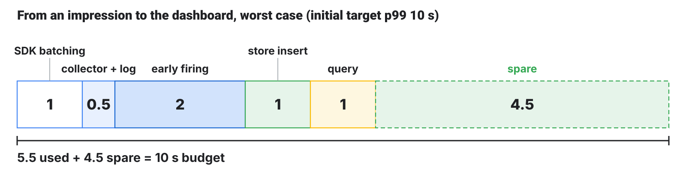

The freshness budget, worst case. One second of batching in the SDK. Half a second through the collector and the log. Two seconds for the stream job's early results. A second to insert, a second to query. About five and a half seconds against ten. The spare is for a slow minute, not for a synchronous call. And it forces early results every two seconds, rather than waiting for a minute to close.

## 3 · API and data model

*What crosses the wire, and what is stored*

The API next, then the data. Every endpoint is tagged with the requirement it serves.

#### One write endpoint: a batch, IDs minted at the source

<sub>API · record events (FR1)</sub>

*serves FR1 · 202 only after the log has it*

```json
POST /v1/events
{"events": [{
  "event_id": "0190f3c2-7d1e-7a4b-…",
  "type": "click",
  "impression_id": "0190f3c1-0b9a-…",
  "ad_id": 77,
  "client_ts": "2026-11-22T14:05:07Z"
}, …]}

202 Accepted  {"accepted": 500}
```

One write endpoint, and it serves FR1. A batch of up to five hundred events. Three fields matter. The event ID is a UUIDv7, minted by the SDK at the moment the event happens, not when it is sent, so a retry carries the same ID. A click names the impression it came from, so a double-click is two click events but one billable click. And the client time is kept as the client said it; the pipeline decides later how much to trust it. The answer is 202, and only after the log has acknowledged the batch. The ID makes retries harmless, and the impression ID makes clicks billable once.

#### Three more endpoints, each tagged

<sub>API · reads and corrections</sub>

| Endpoint | Serves | Touches | What the response says |
|---|---|---|---|
| `GET /v1/campaigns/{id}/live?step=1m` | FR2 | live minutes | `asOf`, `provisional: true` |
| `GET /v1/billing/hours?advertiser=&month=` | FR3 | billing hours | `version`, `manifest_id`, `final: true` |
| `POST /v1/invalidations` (fraud) | FR4 | invalidations | event IDs with their hours, a reason, the rule version |

Three more endpoints. The live read, for FR2. Every response carries an as-of time and the word provisional. The dashboard says what it is. The billing read, for FR3: each hour with its version and the ID of the manifest that produced it. That ID is how we answer a dispute. And corrections, for FR4: the fraud system posts invalidated event IDs with their hours, a reason and the version of the rule that flagged them. Append only.

#### Where each entity lives, and its key

<sub>Data · physical model</sub>

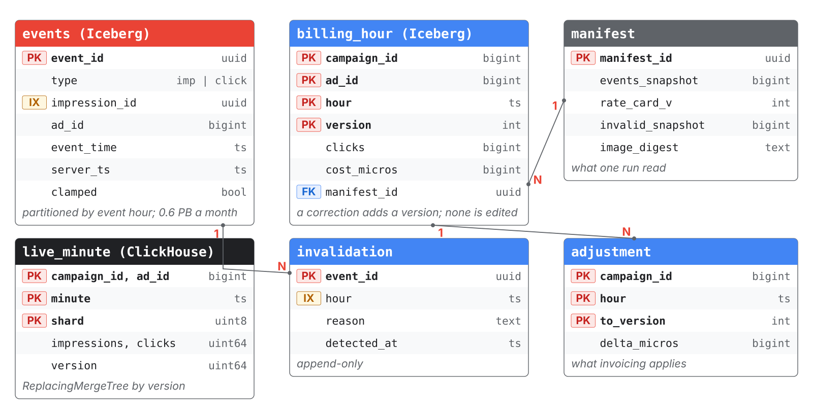

The physical tables, one at a time. Events, in an Iceberg table on object storage, partitioned by event hour. Point six petabytes a month. Billing hour: the primary key is campaign, ad, hour and version. A correction adds a row; none is updated. It points to a manifest. The manifest records what one billing run read: the events snapshot, the rate-card version, the invalidation snapshot, and the job's image digest. Live minute, in ClickHouse: keyed by campaign, ad, minute and a shard number, with a version column. A newer version replaces an older one. Invalidations, append only. And adjustments: per campaign, hour and version, the difference that invoicing applies. Notice that no table is ever incremented. Every number is keyed by what it counts.

#### An hour is opened, closed, and only ever re-versioned

<sub>Data · the life of one billing hour</sub>

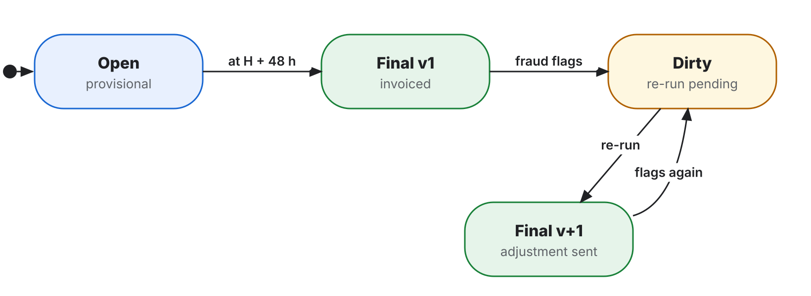

And the lifecycle of one billing hour, because it is the thing we bill. It starts open: live counts only, marked provisional. At forty-eight hours a snapshot is pinned and it becomes final, version one. That is what gets invoiced. If fraud flags events in it, it becomes dirty. And a re-run makes it final again, as the next version, with an adjustment sent. It can loop: another invalidation, another version. It never goes back to open, and it is never edited. Challenge five lives on this diagram.

## 4 · Design, driven by challenges

*V1 is the C4 container view; every challenge changes it*

The design. I start directly with the container view, version one: the simplest thing that is correct. Then the interviewer breaks it, six times, and each fix is a change to this one picture, or a zoom into one of its boxes.

#### V1The simplest thing that is exact: a log, a lake, an hourly job

<sub>C4 level 2 · containers</sub>

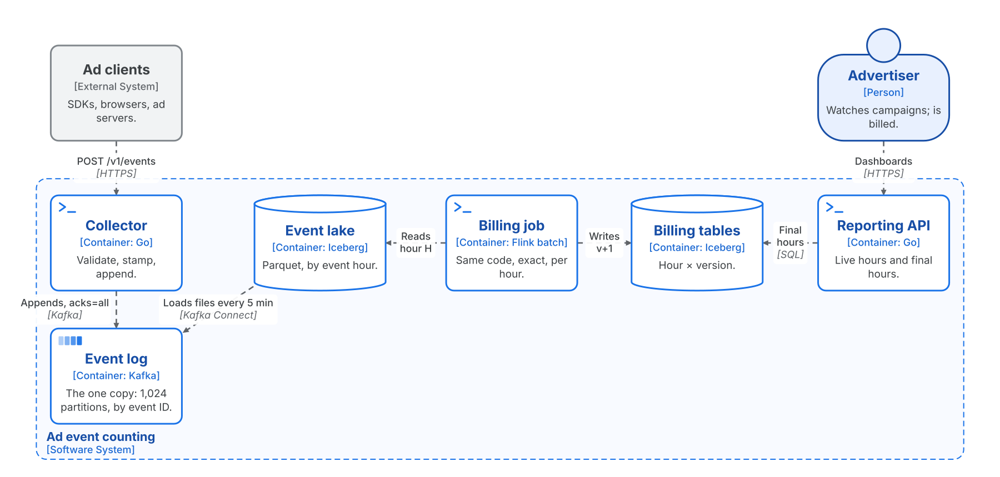

Version one, in the order an event travels. Ad clients send batches of events. A collector validates them, stamps the server time, and appends them. To a partitioned, replicated event log. This is the one copy everything else is derived from. Every five minutes the log is loaded into an event lake, partitioned by the hour the event happened. A billing job reads one closed hour, removes duplicates and counts. And writes billing tables, one version of each hour. A reporting API serves them. To the advertiser. It is exact and replayable, because every number is derived from the log.

#### An event, from the phone to the bill

<sub>Flow · FR1 and FR3 on V1</sub>

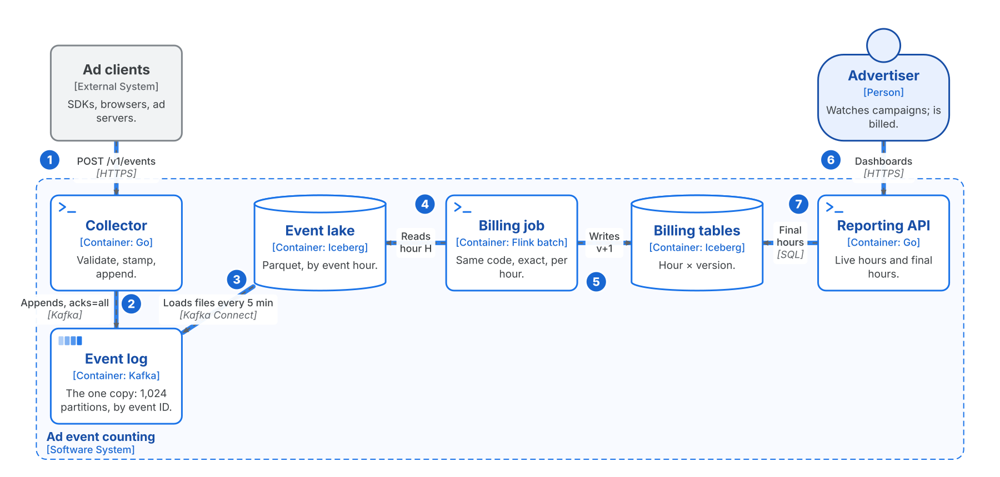

The happy path, numbered, once. One: the SDK posts a batch to the collector. Two: the collector appends it, all replicas acknowledging, then answers 202. Three: the lake loads it every five minutes into the partition of each event's hour. Four: at the cutoff, the billing job reads that hour at a pinned snapshot. Five: it writes the hour as a version. Six: the advertiser asks. Seven: the API reads the final hour. FR1 and FR3, end to end.

#### Kafka: 1,024 partitions, keyed by event ID, three days on the brokers

<sub>Technology · event log</sub>

- **How it is built.** Topic `events.raw`: partition = hash(event ID) mod 1,024, RF 3 over three zones, `min.insync.replicas=2`. Brokers keep three days.

| Option | Why it is chosen, or why not |
|---|---|
| **Kafka, 1,024 partitions, RF 3 over 3 zones** | A replayable log is the one copy everything is derived from; keyed by event ID, load is even and a retry lands beside its original. |
| Google Pub/Sub | An honest equal on Google Cloud; rejected for per-key placement and portability. |
| Amazon Kinesis | 1 MB/s a shard: about 6,000 shards to manage at 6 GB/s. |

Background: building-blocks course, part 10 §10.2–10.5 (inside a partitioned log, delivery semantics)

Topic events.raw: partition = hash(event ID) mod 1,024, RF 3 over three zones, min.insync.replicas=2. Brokers keep three days. Why: A replayable log is the one copy everything is derived from. Rejected: Google Pub/Sub. An honest equal on Google Cloud. Amazon Kinesis. 1 MB/s a shard.

### 4.1 · Challenge 1: An hour is too late

> [!IMPORTANT]
> **Coach:** Challenge one is the freshness requirement, held back on purpose. It decides the shape of the whole design.

> **Interviewer:** Advertisers want to see a campaign's spend within ten seconds, and budget pacing needs it to stop campaigns. Your V1 answers in two days. Now what?

#### V1 cannot answer in ten seconds

<sub>Challenge 1 of 6 · the break</sub>

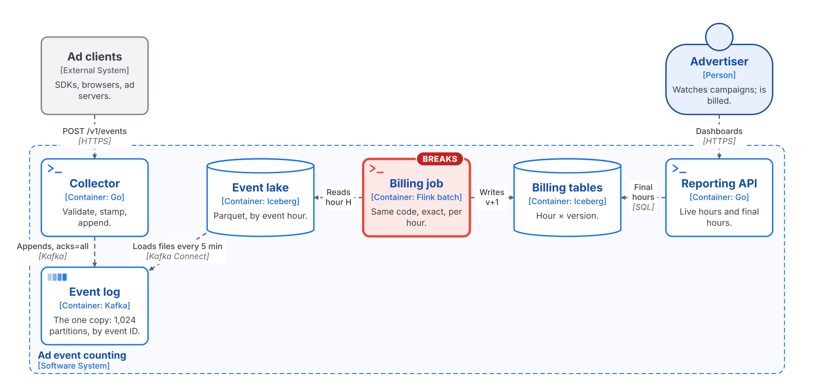

Version one, with the problem marked. The billing job only runs when an hour is closed. That protects `[S3-reproducible]`, but it can never meet `[L2-fresh-in-10s]`: ten seconds.

#### One aggregation, run twice

<sub>Mechanism · 1 of 4</sub>

- **Protects.** `[L2-fresh-in-10s]` fresh, without giving up `[S3-reproducible]`
- **How it works.** The same aggregation code runs twice over the same immutable log: streaming for the dashboard, then bounded over each closed hour for the bill.
- **Rules out.** A fast number that disagrees with the bill forever; two codebases that drift.
- **Costs.** Computing twice; the bill still waits 48 hours.

The mechanism, just in time. It protects `[L2-fresh-in-10s]`, without giving up `[S3-reproducible]`. The same aggregation code runs twice over the same immutable log. Streaming for the dashboard, and then, in batch mode, over each closed hour for the bill. It rules out a fast number that disagrees with the bill forever, and two codebases that drift apart. It costs computing twice, and the bill still waits forty-eight hours.

#### Five ways to count, one picked

<sub>Challenge 1 of 6 · the options</sub>

| Approach | Fresh | Exact, replayable | Fails when |
|---|---|---|---|
| A · a counter per event in a database | yes | no | 30 M writes a second; hot rows; every retry counts |
| B · batch only, over the lake (V1) | no | yes | the dashboard is two days behind |
| C · stream only: the stream result is the bill | yes | partly | late events past the state lifetime are lost; a fix means replaying months |
| D · Lambda: a stream job and a batch job, two codebases | yes | yes | two implementations drift; every difference is a mystery |
| **E · one aggregation code, run twice** | yes | yes | compute twice; the bill waits 48 h |

Kappa in code, Lambda in time: one codebase, two runs over the same log.

Five ways to do it. A, a counter per event in a database: the estimates already ruled it out. B is version one: exact, but two days behind. C, stream only: late events past the state's lifetime are lost, and a fix means replaying months. D, Lambda written twice: it works until the two codebases drift. E, which I pick: one aggregation code, run twice.

> [!TIP]
> **If asked, I'd say:** Kappa in code, Lambda in time. I give up computing twice, and a bill that waits forty-eight hours.

#### V2A live aggregator and a live store, on the same log

<sub>Challenge 1 of 6 · the fix</sub>

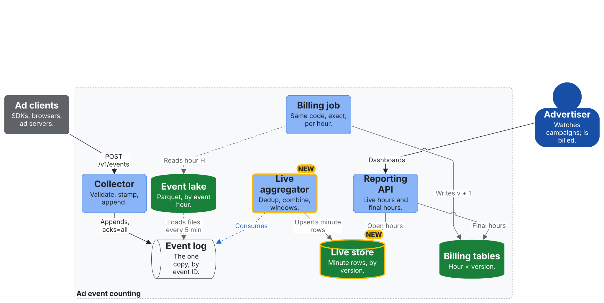

Version two. Everything from version one stays exactly where it was. New: a live aggregator. A stream job on the same log, with the same aggregation code. It counts by the minute and emits early results. New: a live store, holding live minutes. The API now reads open hours from it, and closed hours from the billing tables, and always says which.

#### An impression, from the phone to the dashboard

<sub>Flow · FR2 on V2</sub>

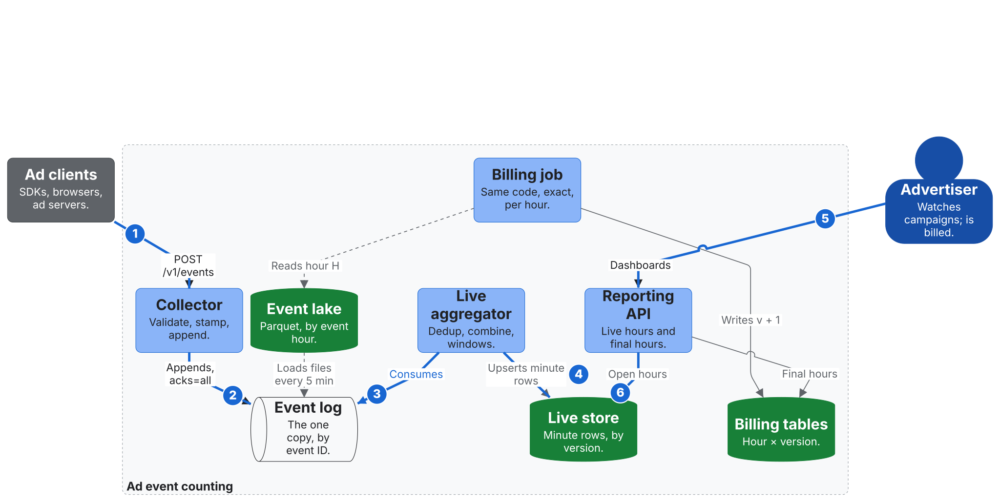

The live path, numbered. One: the SDK posts a batch. Two: the collector appends it and answers 202. Three: the live aggregator consumes it. Four: it upserts minute rows, early every two seconds, final when the watermark passes. Five: the advertiser opens a dashboard. Six: the API queries the live store. About five seconds end to end, inside the budget.

#### Flink: deduplicate, combine, then count by event time

<sub>Technology · live aggregator</sub>

- **How it is built.** Dedup keyed by event ID (TTL 10 min), a per-subtask combiner flushed every second, then ad × minute windows: early results every 2 s, final on the watermark. Checkpoints every 30 s.

| Option | Why it is chosen, or why not |
|---|---|
| **Apache Flink, 512 subtasks, RocksDB state** | Keyed state with a TTL, event-time windows, and checkpoints that hold state and offsets together. The same job runs in batch mode for the bill. |
| Kafka Streams | Re-keying to the ad writes a repartition topic: another 6 GB/s through the brokers. |
| Spark Structured Streaming | A near-equal; micro-batches eat into the 10 s budget. |

Background: building-blocks course, part 10 §10.11–10.13 (event time, stateful processing, Lambda and Kappa)

Dedup keyed by event ID (TTL 10 min), a per-subtask combiner flushed every second, then ad times minute windows: early results every 2 s, final on the watermark. Checkpoints every 30 s. Why: Keyed state with a TTL, event-time windows, and checkpoints that hold state and offsets together. Rejected: Kafka Streams. Re-keying to the ad writes a repartition topic. Spark Structured Streaming. A near-equal.

> **Interviewer:** Why not make the stream job's numbers the bill, and drop the billing job?

#### The stream is a preview; the bill is a pure function

<sub>Challenge 1 of 6 · one level deeper</sub>

- **State has a lifetime.** Dedup keeps 10 minutes of IDs; a retry at minute eleven is counted twice live. The hour-wide batch dedup is not.
- **Late events have a cutoff.** The stream accepts an hour of lateness; phones deliver for two days. The bill waits for them.
- **Reproducible by construction.** A billing run is a function of a pinned snapshot; a stream's output depends on arrival order and timing.

Three reasons. The stream's state has a lifetime. Dedup keeps ten minutes of IDs, so a retry at minute eleven is counted twice on the live path. The billing run deduplicates the whole hour. Late events have a cutoff. The stream accepts an hour of lateness, and phones deliver for two days. The bill waits for them. And `[S3-reproducible]`: a billing run is a function of a pinned snapshot. A stream's output depends on arrival order and timing, so it cannot be re-run bit for bit.

> [!TIP]
> **If asked, I'd say:** One aggregation, run twice over one log. Streaming for a provisional dashboard within ten seconds, and the same code over each closed hour for an exact, reproducible bill. The dashboard says which one you are looking at, and the fast number converges to the final one.

> [!IMPORTANT]
> **Coach:** That fix creates the next question: two runs over a log that contains repeats. Who removes them?

### 4.2 · Challenge 2: The same click, three times

> [!IMPORTANT]
> **Coach:** Challenge two is the crux of this question. Most answers name a guarantee here. The grade is for the mechanism.

> **Interviewer:** A retrying client sends the same click three times, two seconds apart. Walk me through it.

#### One click, a lost answer, two retries

<sub>Challenge 2 of 6 · the trace</sub>

| When | What happens |
|---|---|
| 10:00:00.000 | the SDK sends batch B17 with click `e7f3…` |
| 10:00:00.040 | the collector appends it at offset 81,220; Kafka acknowledges |
| 10:00:00.900 | the 202 is lost on the cell network |
| 10:00:02.900 | the SDK retries B17: offset 81,977, a second copy |
| 10:00:04.900 | and again: offset 82,610, a third |

- **At scale.** 0.3 % of batches retried is about 750 million duplicate clicks a month: about $375 M billed twice, illustrative.

The trace. At ten o'clock the SDK sends batch B17, with click e7f3. Forty milliseconds later it is at offset eighty-one thousand two hundred and twenty, acknowledged. The 202 is lost on the cell network. Two seconds later the SDK retries: a second copy. And again: a third. Nobody did anything wrong. At three tenths of a percent of batches, that's three hundred and seventy-five million dollars a month, billed twice.

#### Inside the live aggregator: who notices a repeat?

<sub>Challenge 2 of 6 · the break</sub>

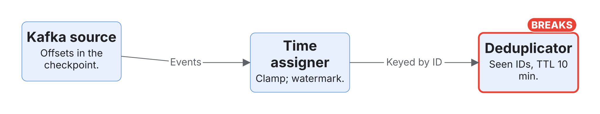

- **Naive answer.** “Kafka is exactly-once, so duplicates can't happen.”
- **Break.** The copies were made before Kafka: nothing remembers an ID, so three are counted.

I zoom into the live aggregator, its first three components. The deduplicator is marked. In the naive design it isn't there, because of the naive answer. Kafka is exactly-once, so duplicates can't happen. But the duplicates were made before Kafka. Three copies arrive, nothing remembers an ID, and three are counted, on the dashboard and on the bill.

#### Idempotency by event ID

<sub>Mechanism · 2 of 4</sub>

- **Protects.** `[S1-count-once]`
- **How it works.** The SDK or ad server mints an ID when the event happens. Every later stage keeps the first copy of each ID and drops the rest.
- **Rules out.** A retry, a redelivery or a replay counted twice.
- **Costs.** An ID minted upstream; state per ID for the dedup window: 0.7 TB for ten minutes.

The mechanism: idempotency by event ID. It protects `[S1-count-once]`. The SDK or the ad server mints an ID at the moment the event happens, not when it is sent. Every later stage keeps the first copy of each ID and drops the rest. It rules out a retry, a redelivery or a replay being counted twice. It costs an ID minted upstream, which we do not control, and state per ID for the dedup window. We sized that: point seven terabytes for ten minutes.

#### Three copies in, one count out

<sub>Mechanism 2 · as a sequence</sub>

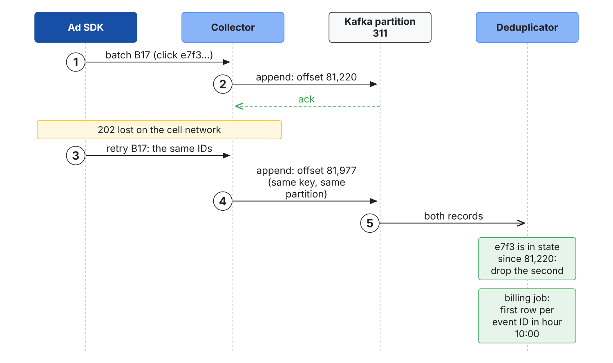

As a sequence. Batch B17. Appended. Acknowledged. The answer is lost. The retry, same IDs. Appended again, on the same partition, because the log is keyed by event ID. Both reach the deduplicator. E7f3 is already in state: the second copy is dropped. And the billing run keeps the first row per ID in the hour. Once, by construction.

#### Drop a repeat by the ID minted at the source

<sub>Challenge 2 of 6 · the fix</sub>

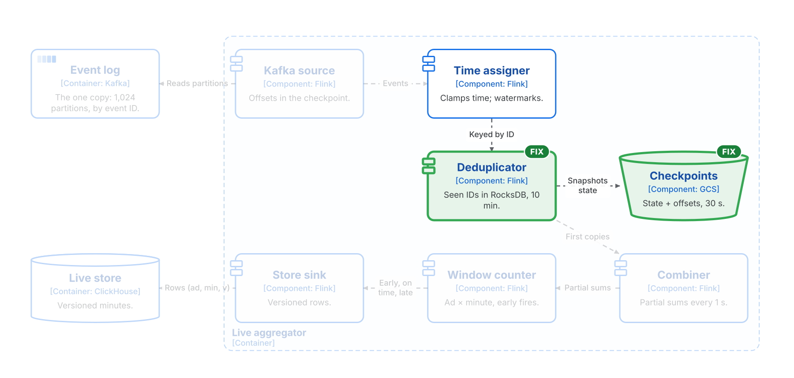

- **Mechanism.** Keyed state by event ID in RocksDB, TTL 10 min, checkpointed with the offsets. The billing run keeps the first row per ID over the whole hour.
- **Covers, and does not.** Every retry, redelivery and replay of one event. Not a client minting new IDs per click: that is fraud's job.
- **Rejected:** **Kafka exactly-once (idempotent producer and transactions)**: it removes a producer's own retry inside one session; an SDK retry over HTTP is a new request, and only dedup on the event ID removes it.

The fix, on the same zoom. The deduplicator. And the checkpoints that keep its state. One level down: state keyed by event ID, in RocksDB, with a ten-minute lifetime. A record whose ID is already there is dropped. The state is checkpointed together with the Kafka offsets. The log is keyed by event ID, so all three copies land on the same partition and meet the same state. It covers every retry, redelivery and replay of one event. Not a client that mints a new ID per click: that's fraud's job. Rejected: Kafka's exactly-once, with transactions. It removes a producer's own retry inside one session. An SDK retry over HTTPS is a new request, and only dedup on the event ID removes it.

> **Interviewer:** You find a bug, redeploy, and replay the stream from four hours ago. Is anyone billed twice?

#### Replace by key and version: a second run rewrites the same rows

<sub>Challenge 2 of 6 · one level deeper</sub>

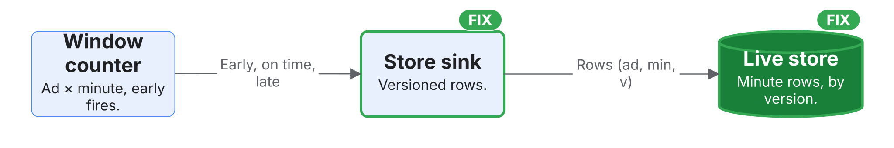

- **Mechanism.** Live rows are keyed (ad, minute, shard) with a version: a newer version replaces, never adds. A billing hour is committed as a whole partition, a pure function of its manifest.
- **Covers, and does not.** Replays, restarts and re-runs with new code. It does not make a buggy run right: it makes the next run safe.
- **Rejected:** **Flink's two-phase-commit sink alone**: it makes one run's output atomic; a second run from four hours earlier still adds on top unless the write replaces by key.

The engine's exactly-once is about one run; a replay is a second run. So the fix is at the end of the job. The store sink. And the live store. A live row is keyed by ad, minute and shard, with a version; ClickHouse keeps the highest. A re-emitted minute replaces the old row. A billing hour is committed whole, a pure function of its manifest. It covers replays, restarts and re-runs with new code. It doesn't make a buggy run right; it makes the next one safe. Rejected: Flink's two-phase-commit sink on its own. It makes one run's output atomic. A second run from four hours earlier still adds on top, unless the write replaces by key.

> [!TIP]
> **If asked, I'd say:** Every event carries an ID minted where it happened, so a retry is recognisable. The live path drops repeats in keyed state for ten minutes, and the billing run drops them over the whole hour. And I never increment a number I can recompute: rows are replaced by key and version, so a replay rewrites the same rows.

> [!IMPORTANT]
> **Coach:** That fix creates the next question: the ID says which event it is. It doesn't say when it happened.

### 4.3 · Challenge 3: Yesterday's events at 6 a.m.

> [!IMPORTANT]
> **Coach:** Challenge three: time. Which clock decides the hour an event is billed in?

> **Interviewer:** A phone was offline overnight. Three hundred impressions from Tuesday evening arrive on Wednesday at six. Which hour gets billed?

#### A flight, a campaign that ended, and a clock in 2031

<sub>Challenge 3 of 6 · the trace</sub>

| When | What happens |
|---|---|
| Tue 21:10–23:40 | 300 impressions on a phone with no signal, buffered |
| Tue 23:59 | the campaign's flight ends |
| Wed 06:00 | the phone reconnects; counted at arrival: billed after the campaign ended |
| Wed 06:01 | another phone says `client_ts` = 2031-01-01: an hour that never closes |

- **What it costs.** A charge outside the flight dates is a dispute. A clock in 2031 is a window held open for years.

The trace. Tuesday evening, three hundred impressions on a phone with no signal. At midnight the campaign's flight ends. At six on Wednesday the phone reconnects. Counted at arrival, those impressions are billed after the campaign ended. And another phone says its clock is in twenty thirty-one. Trust that, and an hour opens that never closes. So I need event time, and I can't trust it blindly.

#### Which clock decides the hour?

<sub>Challenge 3 of 6 · the break</sub>

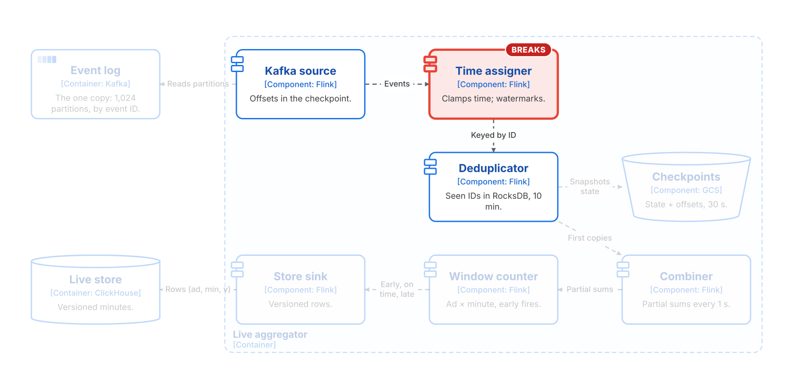

- **Naive answer.** “Count them when they arrive.”
- **Break.** Arrival time bills Tuesday's impressions in Wednesday 06:00.

The same zoom. The time assigner is marked. The naive answer: count them when they arrive. Then the time assigner uses arrival time. Tuesday's hours come up short, and Wednesday six o'clock is over.

#### Event time, with watermarks

<sub>Mechanism · 3 of 4</sub>

- **Protects.** `[S2-right-hour-right-version]` and, with early results, `[L2-fresh-in-10s]`
- **How it works.** Count by the time in the event. A watermark says “nothing older is still coming”; a window fires when it passes, early results before.
- **Rules out.** A late or replayed event landing in the hour it arrived.
- **Costs.** Waiting; state for open windows; a cutoff, after which a late event becomes a correction.

The mechanism: event time, with watermarks. It protects `[S2-right-hour-right-version]`, and with early results, `[L2-fresh-in-10s]`. I count by the time in the event, not the time it arrived. A watermark is the job's claim that nothing older is still coming; a window's final result fires when it passes, early results before. It rules out a late or replayed event landing in the hour it happened to arrive in. It costs waiting, state for every window still open, and a cutoff. After the cutoff, a late event becomes a correction, not a count.

#### A watermark, an early result, an on-time result, a late update

<sub>Mechanism 3 · at protocol level</sub>

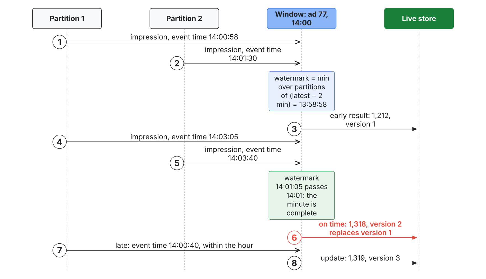

At protocol level: one window, ad seventy-seven, the minute starting at fourteen hundred, fed by two partitions. Partition one delivers an impression with event time fourteen hundred and fifty-eight seconds. Partition two, one at fourteen oh one thirty. The watermark is the minimum over partitions of the latest time minus two minutes: thirteen fifty-eight fifty-eight. The minute is still open. But the dashboard should not wait, so the window emits an early result: twelve hundred and twelve, version one. Later events arrive, from both partitions. Now the watermark is fourteen oh one oh five. It has passed the end of the minute. So the on-time result fires: thirteen eighteen, version two. It replaces version one; it does not add to it. Then a late event for that minute, within the allowed hour. Version three, thirteen nineteen. No lock and no wall clock: event times, a minimum, and a version.

#### Event time, clamped; a watermark for the dashboard

<sub>Challenge 3 of 6 · the fix</sub>

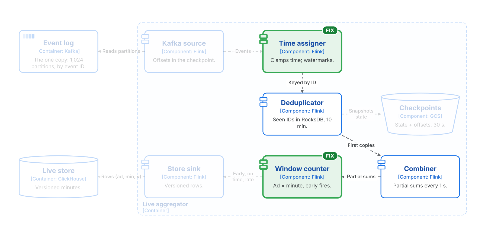

- **Mechanism.** Event time = client time if within 72 h before to 5 min after server time; else server time, flagged. Watermark = min over partitions of latest − 2 min; 1 h of lateness.
- **Covers, and does not.** Late and skewed events up to the billing cutoff. After it, a new version of the hour: challenge five.
- **Rejected:** **Processing-time windows**: they bill a phone's Tuesday-evening impressions in Wednesday's 6 a.m. hour.

The fix, one level down. The time assigner. And the window counter. The event time is the client's time if it lies between seventy-two hours before and five minutes after the server's time. Otherwise it's the server time, and the event is flagged as clamped. The watermark is the minimum over partitions of the latest event time minus two minutes, and a minute window accepts an hour of lateness after that. It covers late and skewed events up to the billing cutoff. After the cutoff, an event changes a closed hour, and that's challenge five. Rejected: processing-time windows. They bill a phone's Tuesday evening in Wednesday's six a.m. hour.

#### Clamp, then let the slowest partition set the pace

<sub>Challenge 3 of 6 · the rule, as pseudocode</sub>

```text
t = e.client_ts
if t < e.server_ts - 72h or t > e.server_ts + 5m:
    t, e.clamped = e.server_ts, true
e.event_time = t

watermark = min(latest(p) - 2m for p in active)
when watermark >= w.end: emit(w, version + 1)
when e is late and watermark < w.end + 1h:
    add(w, e); emit(w, version + 1)
else: count_late(e)       # the lake still has it
```

As pseudocode, the key lines marked. Line two: a client time outside the window is replaced by the server time. Line six: the watermark is a minimum over active partitions, two minutes behind. Line eight: a late event inside the hour of allowed lateness updates its window, emitted again with a higher version. Anything later is only counted as late. The lake still has it, so the bill still will. Why it works: a minimum means one fast partition can't close a minute that a slow one is still filling, and the clamp bounds what a bad clock can do.

#### The bill waits for the hour to be complete

<sub>Challenge 3 of 6 · the bill's half</sub>

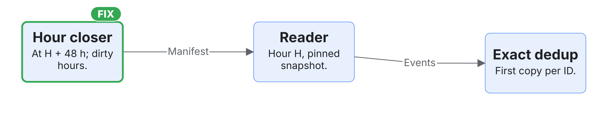

- **At H + 48 h.** The hour closer pins a snapshot of hour H's partition: every file landed so far, late ones included. The run reads exactly that.
- **Why 48 hours.** An initial target, to measure: if 99.99 % of events arrive within 36 h, the rest become version 2 at the cost of one adjustment.

The live path is one half. The bill is the other, so I zoom into the billing job. The hour closer. At forty-eight hours it pins a snapshot of that hour's partition: every file landed so far, the late ones included, because the lake is partitioned by event hour, not by arrival. The run reads exactly that snapshot, and nothing that lands later. Why forty-eight hours: it's an initial target, to be measured. If ninety-nine point nine nine percent of events arrive within thirty-six hours, the rest become a version two, at the cost of one adjustment.

> **Interviewer:** One partition goes quiet. Or a bad SDK release sends every clock a day off.

#### An idle timeout, a flag, and versions

<sub>Challenge 3 of 6 · one level deeper</sub>

- **A quiet partition.** Excluded from the watermark after 30 s of silence, so one idle partition cannot freeze every dashboard.
- **A bad SDK clock.** Clamped to server time and flagged; an alert when the clamped share passes 0.1 %, by SDK version.
- **Honest limit.** An event past the cutoff changes a closed hour: version 2 and an adjustment, never a silent edit.

A quiet partition would hold the minimum back forever, so it is excluded from the watermark after thirty seconds of silence. A bad SDK clock is clamped to server time and flagged, and an alert fires when the clamped share passes a tenth of a percent, broken down by SDK version, so the release is found in minutes. And the honest limit: an event past the cutoff does change a closed hour. It becomes version two and an adjustment, never a silent edit.

> [!TIP]
> **If asked, I'd say:** The event's own time decides its hour, clamped against server time so a broken or hostile clock can't move it far. The dashboard waits two minutes and accepts an hour of lateness. The bill closes at forty-eight hours from a snapshot of everything that landed for that hour, and anything later becomes a new version.

> [!IMPORTANT]
> **Coach:** That fix creates the next question: the windows are keyed by ad. What if one ad is the whole stream?

### 4.4 · Challenge 4: One ad at 2 million a second

> [!IMPORTANT]
> **Coach:** Challenge four: overload, but not the kind more machines fix.

> **Interviewer:** A sports break puts one ad on every screen: two million impressions a second. What happens to your job?

#### Ninety seconds of one ad

<sub>Challenge 4 of 6 · the trace</sub>

| When | What happens |
|---|---|
| 20:14:00 | the break starts; ad 77 jumps from 3,000 to 2,000,000 impressions a second |
| 20:14:05 | the window task holding ad 77 at 100 % CPU; its input buffer fills |
| 20:14:20 | backpressure: every source slows; lag grows on all 1,024 partitions |
| 20:15:30 | every advertiser's dashboard is 90 s stale; budget pacing flies blind |

- **Not a hot partition.** The log is keyed by event ID, so its partitions are even. The hot spot is one thread.

The trace. At twenty fourteen, ad seventy-seven goes from three thousand to two million impressions a second. Five seconds later, the one window task holding it is at a hundred percent. Backpressure. Every source slows, and lag grows on all thousand and twenty-four partitions. Ninety seconds later every advertiser's dashboard is stale, and budget pacing is flying blind, not just for ad seventy-seven. Note what is not hot: the log is keyed by event ID, so its partitions are even. The hot spot is one thread.

#### One key is one task

<sub>Challenge 4 of 6 · the break</sub>

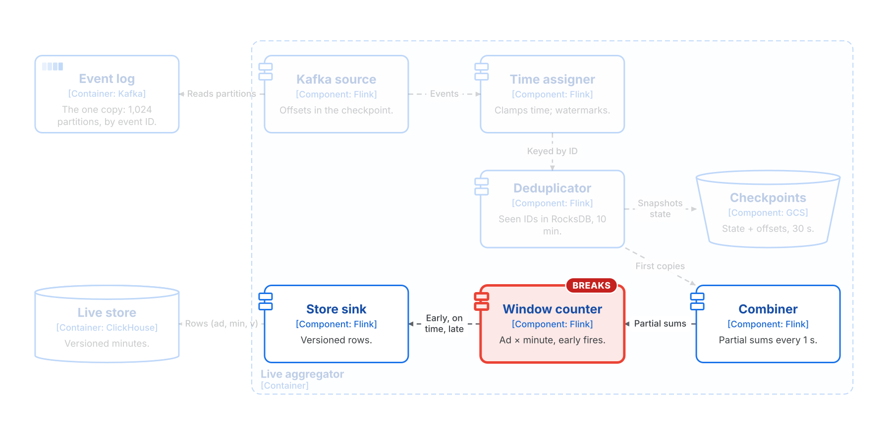

- **Naive answer.** “Key by ad, and add machines.”
- **Break.** A key lives on exactly one task: it gets all 2 M/s, and its backpressure slows every partition.

The middle of the live aggregator. The window counter is marked. The naive answer: key by ad, and add machines. But a key lives on exactly one task. Machines don't help it. That one task gets all two million a second, and its backpressure slows every partition.

#### Two-stage aggregation: sharded counters

<sub>Mechanism · 4 of 4</sub>

- **Protects.** `[L2-fresh-in-10s]` under skew
- **How it works.** Sum locally where events already are, for a second; then merge the partial sums by key. Store a hot counter as N shard rows; sum on read.
- **Rules out.** One hot key stalling one task, and with it the whole job.
- **Costs.** One more stage; a sum on every read; a second of delay.

The mechanism: two-stage aggregation, the sharded counter applied in time. It protects `[L2-fresh-in-10s]` when the load is skewed. Each task sums the events it already has, for one second, and only then sends a partial sum to be merged by key. In the store, a hot counter is N shard rows, summed on read. It rules out one hot key stalling one task, and with it the whole job. It costs one more stage, a sum on every read, and a second of delay.

#### Sum where the events are, then merge

<sub>Challenge 4 of 6 · the fix</sub>

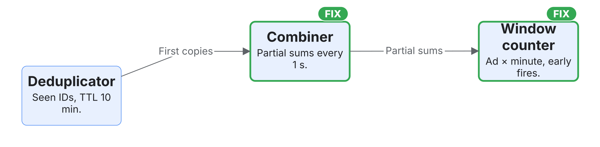

- **Mechanism.** Each of 512 subtasks sums per (ad, minute) for 1 s, then sends one partial; the merge sees 512 updates a second. The store keeps up to 16 shard rows per ad-minute, summed on read.
- **Covers, and does not.** Any number of hot ads: the cost follows active keys, not events. It adds 1 s of delay, inside the 10 s budget.
- **Rejected:** **Redis `INCRBY` on one counter key**: one key is one shard's thread, about 100,000 operations a second against 2 million, and a replay increments again.

The fix, in the middle of the job. The combiner. And the window counter, which now merges partial sums. One level down. Each of the five hundred and twelve subtasks sums its own events per ad and minute for one second, then sends one partial sum. The window task for ad seventy-seven sees five hundred and twelve updates a second instead of two million. And the store keeps up to sixteen shard rows per ad and minute, summed when the dashboard reads. It covers any number of hot ads, because the cost now follows active keys, not events. It adds a second of delay, inside the ten-second budget. Rejected: Redis increment-by on one counter key. One key is one shard's thread, about a hundred thousand operations a second against two million. And a replay increments again.

#### ClickHouse: minute rows that are replaced, never incremented

<sub>Technology · live store</sub>

- **How it is built.** `live_minute ORDER BY (campaign_id, ad_id, minute, shard)` with a `version` column, inserted in batches. Reads take the latest version per key and sum the shards.

| Option | Why it is chosen, or why not |
|---|---|
| **ClickHouse, ReplacingMergeTree, 2 replicas a shard** | Columnar scans answer a dashboard in milliseconds; a row keyed by what it counts, with a version, makes a re-emitted minute a replacement. |
| Apache Druid / Pinot | Honest equals; more moving parts for no property we need. |
| Redis counters | An increment is not replay-safe, and history does not fit in memory. |

Background: building-blocks course, part 14 §14.9 (columnar storage) and part 8 §8.10 (split counters)

Live_minute ORDER BY (campaign_id, ad_id, minute, shard) with a version column, inserted in batches. Reads take the latest version per key and sum the shards. Why: Columnar scans answer a dashboard in milliseconds. Rejected: Apache Druid or Pinot. Honest equals. Redis counters. An increment is not replay-safe, and history does not fit in memory.

> **Interviewer:** Now five hundred ads are hot at once, in every break.

#### Bounded by active keys, not by events

<sub>Challenge 4 of 6 · one level deeper</sub>

- **Partial maps stay small.** One entry per active ad and minute per subtask: 500 hot ads are 500 entries, flushed every second.
- **The merge scales by key.** 500 hot ads × 512 partials = 256,000 updates a second, spread over the merge subtasks by key.
- **Honest limit.** Every count arrives a second later. Worth it: the budget has the room.

Five hundred hot ads. Each subtask's partial map holds one entry per active ad and minute: five hundred entries, flushed every second. Small. The merge sees five hundred ads times five hundred and twelve partials: about two hundred and fifty-six thousand updates a second, spread over its subtasks by key. That scales with machines, because now there are many keys. The honest limit: every count arrives a second later. The budget has the room.

> [!TIP]
> **If asked, I'd say:** A hot key is a hot thread, not a hot partition, because my log is keyed by event ID. So I sum where the events already are, once a second, and merge five hundred and twelve partial sums instead of two million updates. On the read side, a hot counter is sixteen shard rows, summed on read.

> [!IMPORTANT]
> **Coach:** That fix creates the next question: if an hour can be re-run, what happens when its inputs change after it was billed?

### 4.5 · Challenge 5: Fraud after the invoice

> [!IMPORTANT]
> **Coach:** Challenge five: the past changes. How you record that is the grade.

> **Interviewer:** Nine days after the invoices go out, fraud invalidates two percent of October's clicks for one advertiser. What happens?

#### An invoice that no longer matches anything

<sub>Challenge 5 of 6 · the trace</sub>

| When | What happens |
|---|---|
| 1 Nov | October invoiced: advertiser A, 155 M clicks, $77.5 M |
| 9 Nov | fraud flags botnet 17: 3.1 M of A's October clicks, 2 % |
| 9 Nov | naive: billed rows updated in place |
| 15 Nov | A disputes a line; no stored version matches the invoice they hold |

- **Two needs at once.** A credit for the invalid clicks, and an untouched record of what was invoiced.

The trace. On the first of November, advertiser A is invoiced: a hundred and fifty-five million clicks, seventy-seven and a half million dollars. On the ninth, fraud flags botnet seventeen: three point one million of those clicks, two percent. The naive fix updates the billed rows in place. A week later A disputes a line, and we have no stored version that matches the invoice in their hand. So I need two things at once: a credit for the invalid clicks, and an untouched record of what was invoiced.

#### V3Invalidations arrive as events, into the billing job

<sub>Challenge 5 of 6 · the C4 delta</sub>

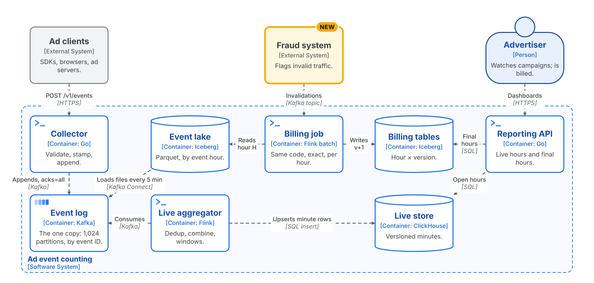

This one changes the container view, so it is version three. Version two, carried, with one box new. The fraud system. Its invalidations arrive on an append-only topic, each with its event's hour, and only the billing job consumes them. Nothing on the live path changes.

#### Edit the past, or add to it?

<sub>Challenge 5 of 6 · the break</sub>

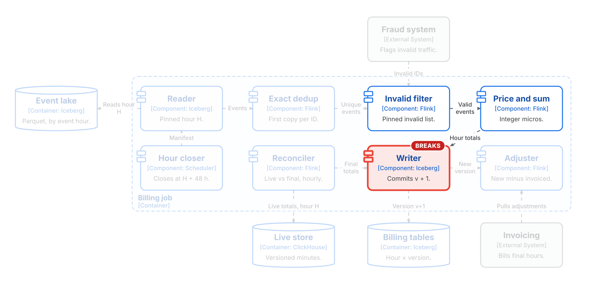

- **Naive answer.** “Delete the invalid rows and re-send the invoice.”
- **Break.** The writer edits billed hours: the invoice already sent now matches nothing stored.

Inside the billing job: the invalid filter, the pricing step, the writer. The writer is marked. The naive answer: delete the invalid rows and re-send the invoice. Then the writer edits hours that were billed, and the invoice already sent matches nothing we have stored.

#### A new version, and an adjustment line

<sub>Challenge 5 of 6 · the fix</sub>

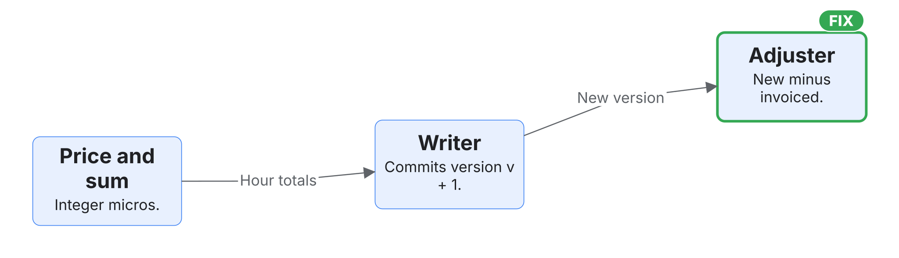

- **Mechanism.** The closer marks invalidated hours dirty and re-runs each as version n + 1; version n stays. The adjuster sends v(n + 1) − invoiced as a credit line.
- **Covers, and does not.** Fraud, events past the cutoff and rate-card fixes: one path. Every invoice line still matches a stored row.
- **Rejected:** **Updating billed rows in place**: the invoice then matches no stored version, and the audit trail ends at the edit.

The fix, at the end of the billing job. The adjuster, between the writer and invoicing. One level down. The closer marks the invalidated hours dirty and re-runs each as the next version, with a manifest pinning the new invalidation snapshot. Version one stays. The adjuster sends the new version minus what was invoiced as a credit line: minus one point five five million dollars. That protects `[S2-right-hour-right-version]`: a sent invoice is never edited. One path covers fraud, events past the cutoff, and rate-card fixes. And because the invoiced version is never touched, every invoice line still matches a stored row. Rejected: updating billed rows in place. The invoice then matches no stored version, and the audit trail ends at the edit.

#### Dirty hours become new versions; differences become lines

<sub>Challenge 5 of 6 · the re-run, as pseudocode</sub>

```text
on invalidations(b): mark_dirty(hours(b))
rerun(h):
    m = manifest(h, events_snap, rates_v, invalid_snap)
    v = latest_version(h) + 1
    rows = price(dedup(read(h, m)) - invalid(m))
    commit(h, v, rows, m)          # version v - 1 stays
    for r in rows:
        d = r.cost - invoiced(r.key)
        if d != 0: adjustment(r.key, v, d)
```

As pseudocode, key lines marked. Line three: a new manifest pins the new invalidation snapshot. Line six: the commit writes version v, and version v minus one stays. Line nine: any difference from what was invoiced becomes an adjustment. Why it works, and why it protects `[S3-reproducible]`: a correction is the billing job with a newer manifest. There's no second code path, so a correction can't be computed differently from a bill.

> **Interviewer:** Fraud invalidates an event from seven months ago.

#### A contract, not a mechanism

<sub>Challenge 5 of 6 · one level deeper</sub>

- **Past the raw retention.** Events are kept six months; the dispute window is 90 days. Older invalidations are refused, and the refusal is logged.
- **Inside the window.** Any hour, any number of versions; the adjustment is always against what was invoiced.
- **Who may do it.** Only the fraud system, with a rule version on every invalidation; the manifest pins the list.

Seven months is past the raw retention. Events are kept six months and the dispute window is ninety days, so an older invalidation is refused, and the refusal is logged. That's a contract, not a mechanism, and I'd say so. Inside the window: any hour, any number of versions, and the adjustment is always computed against what was actually invoiced. And only the fraud system may invalidate, with a rule version on every record, so a manifest can say which rules a version used.

> [!TIP]
> **If asked, I'd say:** Nothing billed is ever edited. A correction re-runs the hour as a new version, and the difference from what was invoiced becomes an adjustment line on the next invoice. The same path carries fraud, events past the cutoff and rate-card fixes, so every invoice still matches a stored version.

> [!IMPORTANT]
> **Coach:** That fix creates the last question. Every part can now be right. How would you know when one of them isn't?

### 4.6 · Challenge 6: “Your numbers are 3 % high”

> [!IMPORTANT]
> **Coach:** Challenge six is observability, and in this question it is about a wrong number, not a down server.

> **Interviewer:** An advertiser says our clicks are three percent higher than their own logs. What do you do, and how would you have known first?

#### A units typo, three days of green

<sub>Challenge 6 of 6 · the trace</sub>

| When | What happens |
|---|---|
| Mon 09:00 | a config push sets the dedup lifetime to 10 seconds instead of 10 minutes |
| Mon 09:00 → | lag, CPU, errors: green; live clicks 3 % above their usual ratio to impressions |
| Wed 09:00 | Monday's final hours are right: the billing run dedups the whole hour |
| Thu | an advertiser compares live screenshots with their logs: +3 % |

- **What the dashboards saw.** Nothing. Every system was healthy; one number was wrong for three days.

The trace. Monday at nine, a config push sets the dedup lifetime to ten seconds instead of ten minutes. A units typo. Lag, CPU and errors stay green. Live clicks run three percent above their usual ratio to impressions, and nothing watches that. On Wednesday, Monday's final hours are right, because the billing run deduplicates the whole hour. On Thursday an advertiser compares their screenshots with their logs and calls. Every system was healthy. One number was wrong for three days.

#### A reconciler that checks numbers, not machines

<sub>Challenge 6 of 6 · the fix</sub>

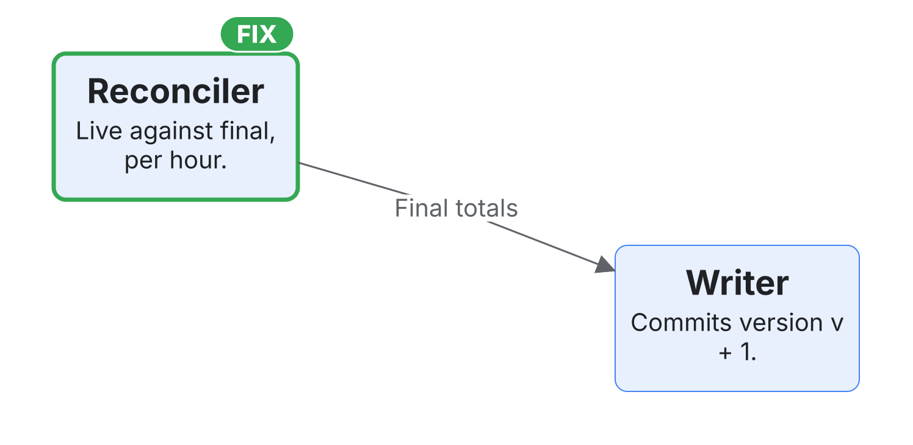

- **Rejected:** **Lag and CPU dashboards**: they stay green while the pipeline counts wrong; only conservation checks and canaries see a wrong number.

The fix is a component in the billing job, because that is where the final number is known. The reconciler. Rejected: lag and CPU dashboards. They stay green while the pipeline counts wrong. Only checks on the numbers themselves see a wrong number.

#### Three checks on the numbers, and a trail for every line

<sub>Challenge 6 of 6 · the fix, one level down</sub>

- **Conservation per hop.** Per minute: accepted = appended = landed − duplicates.
- **Live against final.** Every closed hour, per campaign: alert above 0.5 %.
- **Canaries.** Events with known IDs every minute: exactly once in both.
- **Answering the advertiser.** Invoice line → hour version → manifest → the event IDs, exportable for their line.

One level down, three checks on the numbers themselves. Conservation at every hop, per minute: accepted equals appended equals landed, minus duplicates. Live against final for every closed hour, alerting above half a percent. That one would have fired on Wednesday. And canary events with known IDs every minute, each expected exactly once in the live store and in the final hour. And to answer the advertiser: the invoice line points to an hour version, the version to its manifest, the manifest to the event IDs. We can export the IDs behind their line and compare.

#### Symptoms in pairs: what each one means

<sub>Challenge 6 of 6 · reading the signals</sub>

| Symptom | Paired with | Means |
|---|---|---|
| Live clicks up 3 % | final for the same hour flat | duplicates on the live path |
| Live and final both up | impressions up too | real traffic |
| Accepted above landed | log lag flat | the lake loader is losing files |
| A canary seen twice | — | a duplicate path, wherever it is |
| Clamped share above 0.1 % | one SDK version | a client clock bug |

Read symptoms in pairs; a number alone is not a diagnosis. Live up three percent, final flat: duplicates on the live path. Our case. Both up, impressions too: real traffic. Accepted above landed, lag flat: the lake loader is losing files. A canary seen twice: a duplicate path. A clamped share above a tenth of a percent from one SDK version: a client clock bug.

> **Interviewer:** And if the reconciler itself is wrong?

#### Check the checker

<sub>Challenge 6 of 6 · one level deeper</sub>

- **Canaries check the checker.** A known number of canaries a minute: the reconciler must count exactly that many, or it pages about itself.
- **Silence is a failure.** No comparison for 15 minutes pages: an alert that cannot fire is not an alert.

The canaries check the checker. A known number of them a minute, so the reconciler must count exactly that many, or it pages about itself. And silence is a failure. If no comparison has run for fifteen minutes, that pages too. An alert that cannot fire is not an alert.

> [!TIP]
> **If asked, I'd say:** I'd answer the advertiser with the event IDs behind their line: invoice line, hour version, manifest, events. And I'd want to have seen it first: conservation at every hop, live against final every hour, and canary events whose count I know, so a wrong number pages even when every system is healthy.

## 5 · When you don't need all this

*The simpler design, and the number where it stops being enough*

Before the recap: a much smaller design is correct at a smaller scale, and I should say where the line is.

#### One ClickHouse cluster: buffer, truth and dashboard

<sub>Alternate path</sub>

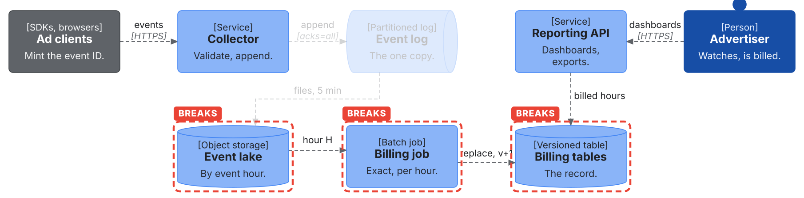

- **How it works.** Collectors insert batches with a dedup token; a materialised view keeps minutes; a nightly query bills each hour from the deduplicated table.
- **What it gives up.** No independent log to replay; a heavy query slows ingest; corrections are mutations; dedup is eventual.

The alternate path: no log, no lake, no stream job, no billing job. One ClickHouse cluster does everything, marked alternate. Collectors insert batches with an insert dedup token. A materialised view keeps minute rollups for the dashboard. And a nightly query bills each hour from the events table, deduplicated by event ID. What it gives up, precisely: there is no independent log to replay, because the table is the only copy. A heavy query slows ingest. A correction is a mutation. And dedup happens on merges, so it is eventual.

Where is the line? From chapter two, our average is ten million events a second. A cluster of about twenty ClickHouse nodes takes on the order of one to two million rows a second. We are past it by an order of magnitude.

> [!TIP]
> **If asked, I'd say:** Below about two hundred thousand events a second, with room to spare, I'd ship the one-cluster version, and I'd say out loud the number where I'd switch.

## 6 · Recap

*The final design, the trade-offs, and what comes next*

The recap. One picture with the mechanisms on it, the stack against its rivals, and the mistakes that cost most.

#### V3Where each mechanism ended up

<sub>Recap · the final container view</sub>

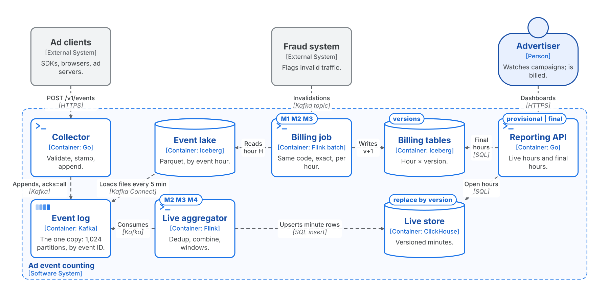

Version three, the final design: the same picture as version one, with three boxes more. The collector keeps the ID the SDK minted; it never makes one up. The mechanisms go back on the rest, one at a time. The live aggregator runs dedup, event time and two-stage sums. The live store replaces by version. It never increments. The billing job runs the same code at the close, over a pinned snapshot, with the reconciler inside it. The billing tables hold versions, so a correction is a new row and an adjustment, never an edit. And the reporting API always says provisional or final.

#### The stack, against its rivals

<sub>Recap · the trade-offs</sub>

| Container | Choice | Rejected | The deciding reason |
|---|---|---|---|
| Collector | Go, stateless, disk spool | warehouse streaming inserts | the ack means the log has it |
| Event log | Kafka, keyed by event ID | Pub/Sub (equal), Kinesis | replayable; even load; retries co-located |
| Live aggregator | Flink, event time | Kafka Streams, Spark | state TTL, watermarks, one engine for both runs |
| Live store | ClickHouse | Druid/Pinot (equal), Redis | replace by version; columnar slice-and-dice |
| Lake + billing | Iceberg on GCS | Hive folders, Delta (equal) | snapshots to pin; atomic overwrite |

> [!IMPORTANT]
> **Coach · what is graded here.** Naming a product is not the signal. Naming the property that rules out its rival is.

The stack on one slide, as I would leave it on the whiteboard. Collector: Go, stateless, disk spool. Not warehouse streaming inserts. The ack means the log has it. Event log: Kafka, keyed by event ID. Not Pub/Sub (equal), Kinesis. Replayable; even load; retries co-located. Live aggregator: Flink, event time. Not Kafka Streams, Spark. State TTL, watermarks, one engine for both runs. Live store: ClickHouse. Not Druid/Pinot (equal), Redis. Replace by version; columnar slice-and-dice. Lake + billing: Iceberg on GCS. Not Hive folders, Delta (equal). Snapshots to pin; atomic overwrite.

> [!IMPORTANT]
> **Coach:** Naming a product is not the signal. Naming the property that rules out its rival is. Interviewers go one level down on whichever box you name, so name only what you can defend.

#### What costs most in this round

<sub>Recap · the mistakes</sub>

| Mistake | Instead |
|---|---|
| `n = n + 1` per event, in a database | a log first; counts derived from it |
| “Exactly-once” said as a name | at-least-once plus dedup on an ID minted at the source |
| Counting by arrival time | event time, clamped; a watermark; a cutoff |
| One run for the dashboard and the bill | one code, run twice: provisional, then final |
| Editing billed rows | versions and adjustment lines |
| No way to show the events behind a line | a manifest per hour; canaries; conservation checks |

> [!IMPORTANT]
> **Coach:** The mistakes that cost most in this round. N equals n plus one, per event, in a database. Instead, a log first, and counts derived from it. Exactly-once said as a name. Instead, at-least-once plus dedup on an ID minted at the source. Counting by arrival time. Instead, event time, clamped, with a watermark and a cutoff. One run for both the dashboard and the bill. Instead, one code, run twice. Editing billed rows. Instead, versions and adjustment lines. And no way to show the events behind an invoice line. Instead, a manifest per hour, canaries and conservation checks.

#### Questions you should be ready for next

<sub>Recap · follow-ups</sub>

| Follow-up question | Where this video answers it |
|---|---|
| Unique reach per campaign, live: how, and how wrong? | HyperLogLog per campaign-minute, ~1.6 % error, merged on read; never on the bill |
| A second region: where does each box go? | one log per region, billing per region of the event; invoicing merges finals |
| An advertiser wants hourly totals by country | a dimension in the window key: state and rows × countries; check the 10 s budget |
| Retention drops to 30 days for privacy | the bill is reproducible from billing rows after that, not from events — say so |
| Budget pacing needs 1-second numbers for one campaign | a dedicated fast path for one headline number, not the whole pipeline |

The follow-up questions an interviewer asks next, and where I'd start. Unique reach: a HyperLogLog sketch per campaign-minute, about one and a half percent off, never on the bill. A second region: a log per region, billing by the event's region. Totals by country: a dimension in the window key; re-check the budget. Thirty-day retention: the bill is then reproducible from billing rows, not events. One-second pacing numbers: a fast path for one headline number, not the whole pipeline.

> [!TIP]
> **If asked, I'd say:** Count once, from one log, with one piece of code run twice. Never increment what you can recompute. Replace it, and keep every version you billed.

Thanks for watching. The written design, generated from this same script, is linked below.

## Implementation Lab & Reproducible Workspace

Everything in this design is reproducible from files in this folder:

| File | What it is |
|---|---|
| [`workspace.dsl`](workspace.dsl) | the one Structurizr workspace behind every C4 picture (context, containers, components) |
| [`views.json`](views.json) | every version (V1 … Vn), flow, challenge break/fix zoom and the recap, derived from that workspace |
| [`stack.json`](stack.json) | each container's technology, how it is built, the rivals rejected and why |
| [`video/src/`](video/src/) | the slides and narration this document and the video are both generated from |

Rebuild: `python3 .claude/skills/reference-solution/scripts/ref_solution.py all SD-03` (stages: diagrams · deck · markdown · video · publish · clean).
