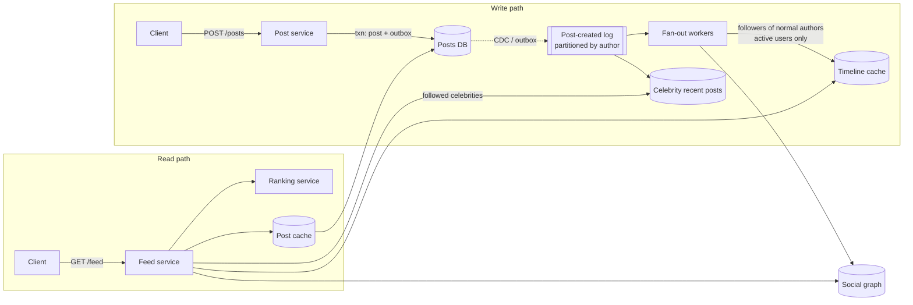

# SD-08 · News feed / home timeline

*A reference solution, stage by stage, for a 45–60-minute round. Cue sheet:
[`questions/B-social-feed-content.md`](../questions/B-social-feed-content.md) · theory:
[Caching](../theory/05-caching.md), [Messaging](../theory/06-messaging-and-streams.md),
[Storage & partitioning](../theory/03-partitioning-and-storage.md).*

{: .spoiler }
> Run the round cold first: `Mock me: SD-08, Meta, em, full round.` Read this afterwards.

**The prompt:** *"Design the home feed for a social network with a billion users — the ranked list of
posts a user sees when they open the app."*

{: .key-title }
> The one-sentence insight to land by minute 12
>
> **Neither fan-out on write nor fan-out on read works alone.** Precomputing every follower's timeline
> breaks on the celebrity with 100 M followers; computing every feed at read time breaks the 200 ms
> budget for everyone else. The answer is a **hybrid with a stated threshold**: push post IDs into the
> timelines of normal accounts' followers, and **pull** celebrities' recent posts at read time from a
> hot cache — then rank the merged candidate set.

---

## Stage 1 · Clarify requirements · 0:00–0:06

| I ask | Interviewer answers | Why it matters |
|---|---|---|
| Users? | 1 B total, 500 M DAU | read QPS and timeline storage |
| Read:write ratio? | reads ~100× post writes | optimise the read path, pay on write |
| Following distribution? | avg ~200; **max 100 M+** | the tail decides the architecture — asking signals seniority |
| Latency? | p99 < 200 ms | ranking and hydration must fit inside it |
| Ranked or chronological? | ranked; a scoring service exists | ranking is a stage, not the problem |
| Freshness? | seconds for close follows; a minute generally | async fan-out is fine |
| Depth? | first ~50 on open, paginated | bounded timelines |
| Content? | text + images; video out of scope | bodies and media are hydrated separately |
| *Which is worse: seeing a post twice or missing one?* | (ask it) | forces a correctness stance — usually dedup on read, tolerate rare misses |

**In scope:** publish post, build and serve the home feed, pagination, follow/unfollow effects,
deletes and blocks. **Out of scope (say it):** the ranking model itself, ads insertion, media
upload/transcoding, search, notifications (SD-12).

**Non-functional:** feed p99 < 200 ms; new posts visible to followers within seconds (p95 < 5 s);
availability 99.95% for reads; deleted/blocked content gone within seconds.

## Stage 2 · Back-of-the-envelope · 0:06–0:11

| Quantity | Arithmetic | Result | Consequence |
|---|---|---|---|
| Feed reads | 500 M DAU × ~5 opens ÷ 10⁵ s | **~25 k/s avg, ~75 k/s peak** | served from caches, not databases |
| Posts | 500 M × ~0.1 posts/day | ~50 M/day ≈ 600/s | writes are small… |
| Fan-out writes | 600/s × 200 followers | **~120 k timeline inserts/s** | …but fan-out multiplies them 200× — fine for normal users |
| **Celebrity post** | 1 post × 100 M followers | **100 M inserts** — ~100 s even at 1 M/s | **kills pure fan-out-on-write** — and celebrities post often |
| Timeline storage | 500 M active × 500 entries × ~16 B (post ID + score) | ~4 TB, ×3 replicas | fits in a RAM tier — but **only if we store IDs, not bodies** |
| Bodies duplicated (the mistake) | 500 M × 500 × ~1 KB | ~250 TB | 60× larger — never copy bodies into timelines |

{: .say }
> "The celebrity number is the one that matters: a hundred million writes for one post. So I'll push
> for normal accounts and pull for celebrities. And I'll store only post IDs in timelines — copying
> bodies would multiply storage sixty-fold."

## Stage 3 · API and data model · 0:11–0:17

```text
POST /v1/posts            { text, mediaIds[], idempotencyKey }        -> { postId }
GET  /v1/feed?cursor=…&limit=50                                       -> { items[], nextCursor }
POST /v1/follows/{userId}       DELETE /v1/follows/{userId}
DELETE /v1/posts/{postId}
```

The cursor encodes `(score, postId)` of the last item, so pagination is **stable while new posts
arrive** (offsets would skip or repeat).

| Store | Key | Content | Technology |
|---|---|---|---|
| Posts (source of truth) | `post_id` (Snowflake-style, time-sortable) | author, text, media refs, created_at, visibility | sharded relational or wide-column; cached |
| Author's posts index | `(author_id, created_at desc)` | post IDs | wide-column — used for pull and rebuilds |
| Social graph | `(user_id) → followees`, `(user_id) → followers` | edge lists + follower counts | graph/KV store, cached (SD-14) |
| **Timeline cache** | `user_id` | bounded list (~500) of `(post_id, author_id, ts)` | Redis-class sorted list, partitioned by user |
| Celebrity recent posts | `author_id` | last ~100 post IDs | small hot cache, replicated widely |
| Post cache | `post_id` | hydrated post | distributed cache |

## Stage 4 · High-level design · 0:17–0:27



**Walk-through — a post by a normal user (2,000 followers):**

1. Post service writes the post and an outbox row in one transaction; returns the `postId`.
2. The relay publishes `PostCreated` to the log, partitioned by author.
3. A fan-out worker reads the follower list in pages, **skips followers inactive for 30 days**, and
   inserts `(postId, authorId, ts)` into each active follower's timeline, trimming to 500.

**Walk-through — reading the feed:**

1. Feed service reads the user's timeline (~500 IDs) — one cache read.
2. It reads the user's followed **celebrities** (cached list) and their recent post IDs from the
   celebrity cache — a handful of reads.
3. Merges, dedups, filters blocked/deleted, takes the top ~200 candidates by recency.
4. Calls ranking with a budget (e.g. 80 ms); **falls back to recency order** if it's slow.
5. Hydrates the top 50 from the post cache (multi-get), returns with a cursor.

Budget: timeline ~5 ms · celebrity merge ~5 ms · ranking ≤ 80 ms · hydration ~20 ms → **~110 ms p50,
under 200 p99 with fallback.**

## Stage 5 · Technology choices

| Component | Choice | Reason |
|---|---|---|
| Timelines | in-memory sorted structures (Redis-class), partitioned by `user_id` | read-dominated, bounded, rebuildable from sources — loss is a latency hit, not data loss |
| Fan-out transport | partitioned log | absorbs bursts, replayable, many consumers (search, notifications) |
| Posts | sharded store keyed by time-sortable ID, plus author index | the source of truth for pull, rebuild and the 48-hour view |
| Graph | dedicated service with cached adjacency | both directions are queried constantly |
| Ranking | separate service with a latency budget | independent model iteration; feed must degrade, not fail, without it |

## Stage 6 · Deep dives · 0:27–0:45

### 6.1 The celebrity post — the crux

- **Threshold:** authors with more than ~10 k–100 k followers (tunable; pick by the write cost you're
  willing to pay per post) are **not fanned out**. Their posts go into a per-author recent-posts cache.
- **Read-time merge:** each reader follows on average a handful of celebrities; reading 5–20 small
  cached lists is cheap.
- **Crossing the threshold:** when an account grows past it, mark it celebrity — new posts stop
  fanning out; existing timeline entries stay and age out. Falling below: resume fan-out (no
  backfill needed — the merge covers recent posts during the transition).
- **The mid-tier** (10 k–100 k followers) can be fanned out **only to followers who were active in the
  last day**, which cuts its cost by an order of magnitude.

{: .say }
> "I'll pick the threshold empirically — it's where the fan-out cost of one post exceeds the extra
> read cost across that author's followers. Start at ten thousand, measure, and make it a config value."

### 6.2 What's in a timeline row, and why it's bounded

Only `(post_id, author_id, ts)` — ~16–24 bytes. Bounded at ~500 because nobody scrolls further from
cache; deeper pages fall back to pulling from followees' author indexes (slower, rare). Bodies are
hydrated through the post cache, so an **edit or delete** is a single write to the source of truth.

### 6.3 Deletes, blocks and unfollows

Fanned-out IDs are **denormalised copies**. Rather than chasing them into millions of timelines:
filter at read time — the hydration step drops deleted posts (post cache invalidated via CDC), and
the merge step drops authors the user has blocked or unfollowed (small per-user set). Optionally,
a background job lazily removes them. **Correctness lives on the read path; cleanup is cosmetic.**

### 6.4 Cache loss and rebuild

A timeline shard is lost → affected users' first read finds no timeline → the feed service **builds
one by pull** (followees' author indexes, merged), serves it, and writes it back. Protect the author
index from the stampede with request coalescing and a rebuild rate limit; serve a degraded
"celebrity + recent" feed if rebuild capacity is exhausted.

### 6.5 Ranking under budget

Ranking scores ~200 candidates. Give it a hard deadline; on timeout use recency (or a cached ranking
from the last session). Prefetch and pre-rank on app-background events so the open is instant.

## Stage 7 · Mid-round requirement — "catch up on the last 48 hours"

The bounded, ranked timeline can't answer a **chronological 48-hour** query reliably. Don't distort
the cache — go to the **source of truth**: merge followees' author indexes for the window (the same
pull path used for rebuilds), cache the result per user for minutes. Cost: a heavier read for an
occasional feature; say so.

## Stage 8 · Failure modes · 0:45–0:50

| Failure | Effect | Response |
|---|---|---|
| Fan-out lag (log backlog) | new posts appear late | priority lanes (close friends first); alert on lag; freshness SLI |
| Timeline shard loss | slow first loads for some users | pull-rebuild with coalescing and rate limits |
| Ranking down/slow | ranking quality drops | recency fallback inside the deadline |
| Post cache stampede after deploy | DB overload | warm caches; coalescing; shed hydration of low-ranked items |
| Celebrity viral spike | hot cache key | replicate the celebrity list across cache nodes; client-side caching |

## Stage 9 · SLOs, observability, cost · 0:50–0:54

- **SLIs:** feed load success under 200 ms · **freshness** — p95 time from post to visible in an active
  follower's feed (synthetic accounts posting and reading) · deleted-content visibility time.
- **Silent quality degradation** (feed works but is worse): engagement per session, ranking fallback
  rate, empty-feed rate.
- **Cost:** the timeline tier (~12 TB RAM with replicas) and fan-out writes. **Biggest lever: don't fan
  out to inactive users** (roughly halves writes); second: the threshold.

## Stage 10 · The level layer

{: .level }
> **Staff:** go deep on the threshold mechanics, the transition when an account crosses it, and
> rebuild under stampede; write the fan-out worker's idempotency (re-delivered events must not
> duplicate entries — sorted sets keyed by post ID make inserts idempotent). **EM:** MVP is **pure pull
> with caching** at today's scale, then push for active users, then the celebrity split — sequenced by
> measured load; team seams: *publish & graph* · *fan-out & timelines* · *feed serving & ranking
> integration*; on-call on freshness. **Director:** cost per DAU of the feed tier and the investment
> case for ranking vs infrastructure.

## Stage 11 · The close

> "It's a hybrid fan-out feed: post IDs are pushed into bounded timelines for followers of normal
> accounts, while celebrities' posts are pulled from a hot cache and merged at read time. The
> celebrity write amplification — a hundred million writes per post — is avoided by that split, and
> storing IDs instead of bodies keeps the timeline tier to a few terabytes of RAM. I traded strict
> freshness for seconds of eventual consistency, with deletes enforced on the read path. Next I'd
> tune the threshold with real data and stop fanning out to inactive users to halve the write cost."

## Stage 12 · Self-check

- [ ] Did I ask about the follower distribution and find the celebrity number?
- [ ] Did I store IDs, not bodies, and size it?
- [ ] Did I name the threshold and the crossing behaviour?
- [ ] Did I handle deletes/blocks on the read path?
- [ ] Did I keep ranking inside a budget with a fallback?
- [ ] Did I mention inactive users and cursors?

---

## Cheat card

**Insight:** hybrid push/pull with a threshold. **Numbers:** ~75 k feed reads/s peak; 120 k
fan-out inserts/s; one celebrity post = 100 M writes. **Timeline:** ~500 IDs per user, ~4 TB. **Read
path:** timeline + celebrity merge → rank (deadline) → hydrate. **Deletes:** filtered at read.
**Lever:** skip inactive users. **Trap:** bodies in timelines; strong consistency for a feed.
