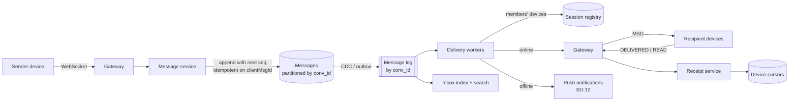

# SD-09 · Chat / messaging — 1:1 and groups

*A reference solution, stage by stage, for a 45–60-minute round. Cue sheet:
[`questions/B-social-feed-content.md`](../questions/B-social-feed-content.md) · theory:
[Real-time & connections](../theory/09-real-time-and-connections.md),
[Messaging & streams](../theory/06-messaging-and-streams.md),
[Correctness under failure](../theory/07-correctness-under-failure.md).*

{: .spoiler }
> Run the round cold first: `Mock me: SD-09, Meta, em, full round.` Read this afterwards.

**The prompt:** *"Design a messaging system — one-to-one and group chats, for a billion users, with
delivery and read receipts and support for clients that go offline."*

{: .key-title }
> The one-sentence insight to land by minute 12
>
> **Start from the mailbox, not the socket.** A message is **durably stored in its conversation log
> with a server-assigned sequence number before anything is acknowledged**; every device then catches
> up by **cursor** ("everything after #1,234"). Pushing over a WebSocket is just an optimisation that
> delivers early — so online and offline become the same code path, and nothing is lost or duplicated.

---

## Stage 1 · Clarify requirements · 0:00–0:06

| I ask | Interviewer answers | Why it matters |
|---|---|---|
| Scale? | 1 B users, **100 M concurrently connected** | the connection tier is a major cost |
| Message rate? | 1 M msg/s peak | log and storage sizing |
| Group size? | up to 1,000 | fan-out model; receipt traffic |
| Guarantees? | never lose, never show twice, consistent order for all participants | server sequencing, idempotent send, store-before-deliver |
| Receipts? | sent, delivered, read | a second message flow, potentially larger than the first |
| History? | full, indefinite, searchable by the user | storage tier and a search index |
| Devices? | up to 5 per user, all converge | per-device cursors |
| Encryption? | assume not end-to-end; say what it would change | server-side search vs E2E is a real trade-off |
| Media? | out of scope | |
| *Worse: losing a message or showing a duplicate?* | (ask) | both are banned — the design must satisfy both, so: durable write + idempotency |

**Out of scope (say it):** media, voice/video calls, E2E encryption (discussed as a delta), spam
detection, the push-notification platform itself (SD-12).

**Non-functional:** message delivered to online recipients p99 < 500 ms; zero loss after the sender's
✓ (sent); per-conversation total order; history durable for years; availability 99.99% for send.

## Stage 2 · Back-of-the-envelope · 0:06–0:11

| Quantity | Arithmetic | Result | Consequence |
|---|---|---|---|
| Connections | 100 M × ~20 KB | ~2 TB RAM; at ~500 k per host **~200–300 gateway hosts** + zone headroom | a dedicated, stateless-as-possible gateway tier |
| Storage | 1 M msg/s × ~200 B (text + metadata) × 10⁵ s | **~20 TB/day raw**, ~60 TB/day replicated, ~20 PB/year | wide-column store partitioned by conversation; tiering of old history |
| Group fan-out | 1 msg to a 1,000-member group | 1 log write vs 1,000 inbox writes | **shared conversation log + per-member cursor** for groups |
| **Read receipts** | 1,000 members each reading → 1,000 receipts per message, each to up to 999 others | ~10⁶ receipt deliveries per group message | **aggregate receipts** ("read by 412") — never fan out per-reader receipts in big groups |
| Heartbeats | 100 M ÷ 30 s | ~3.3 M/s | handled at the gateway, never in the message path |

{: .say }
> "Two numbers matter. Storage: about twenty terabytes a day, so history goes into a partitioned
> wide-column store keyed by conversation. And receipts: in a thousand-person group, read receipts
> are a million deliveries per message, so in large groups I aggregate them instead of fanning them out."

## Stage 3 · API and data model · 0:11–0:17

**Client ↔ gateway (WebSocket frames):**

```text
→ SEND    { convId, clientMsgId, body }                    ← ACK { clientMsgId, seq, serverTs }
← MSG     { convId, seq, senderId, body, serverTs }        → DELIVERED { convId, upToSeq }
→ READ    { convId, upToSeq }
→ SYNC    { cursors: { convId: lastSeq, … } }              ← MSG… (missed messages), then LIVE
```

**REST (history, setup):** `GET /v1/conversations/{id}/messages?beforeSeq=…` ·
`POST /v1/conversations` · `POST /v1/conversations/{id}/members`.

| Store | Key | Content |
|---|---|---|
| **Messages** | partition `conv_id`, clustering `seq` | sender, `client_msg_id`, body, server_ts, edit/delete flags |
| Conversation sequencer | `conv_id` | `last_seq` (owned by one partition leader) |
| Membership | `conv_id → members`; `user_id → conversations` | roles, join seq |
| **Per-device cursors** | `(user_id, device_id, conv_id)` | `delivered_seq`, `read_seq` |
| User inbox index | `user_id` | conversations with activity since a time — "what changed" for sync |
| Session registry | `(user_id, device_id)` | gateway node, TTL |
| Search index | per user | message text (async from the log) |

## Stage 4 · High-level design · 0:17–0:27



**Walk-through — Alice sends to Bob, who is offline:**

1. Alice's app sends `SEND {convId, clientMsgId, body}` over its socket.
2. The message service routes to the **conversation's partition leader**, which assigns `seq =
   last_seq + 1` and writes the message — **durably, replicated** — keyed by `(convId, seq)`, with a
   uniqueness check on `clientMsgId`.
3. Only now does Alice get `ACK {seq}` → ✓ *sent*.
4. The delivery worker (from the log) finds Bob's devices in the registry: none online → sends a push
   notification ("New message from Alice") and updates Bob's inbox index.
5. Bob opens the app later; it sends `SYNC {cursors}`; the server streams every message after his
   cursor for each changed conversation; the app stores them and sends `DELIVERED {upToSeq}` → Alice
   sees ✓✓.

**Same message, Bob online on two devices:** step 4 finds two gateway entries and pushes `MSG` to
both; each device acks independently; each device's cursor advances separately.

## Stage 5 · Technology choices

| Component | Choice | Reason |
|---|---|---|
| Gateways | WebSocket servers holding only connection state | connection count is the scaling dimension; keep logic out |
| Messages | wide-column store (Cassandra/Bigtable-class), partition `conv_id`, cluster `seq` | append-heavy, read by conversation in order, enormous volume |
| Sequencer | per-conversation leader (e.g. the partition's Raft leader, or a sequencer service sharded by `conv_id`) | one authority per conversation = one consistent order |
| Log | partitioned by `conv_id` | ordered per conversation, replayable for delivery, search and push |
| Registry | in-memory KV with TTLs, refreshed by heartbeats | hot, small, tolerates staleness |
| Search | per-user inverted index, async | not on the send path |

## Stage 6 · Deep dives · 0:27–0:45

### 6.1 Ordering — who decides?

Two members send at the same instant. **Client timestamps are useless** (clocks skew, users change
them). The conversation's **single sequencer** assigns `seq` in arrival order at the leader; that
order is the truth for every participant on every device. A sender's own messages show locally as
*pending* until the ACK returns the `seq`, then slot into place.

{: .why }
> **Why one sequencer per conversation and not a global one?** A global order would be a bottleneck
> and is meaningless across conversations. Per-conversation ordering is what users perceive, and it
> partitions perfectly — 1 M msg/s spread over hundreds of millions of conversations.

**Hot conversation** (a 1,000-member group in a frenzy): one leader handles it — thousands of
messages per second per conversation is well within one partition leader's capacity.

### 6.2 Idempotent send and the lost ACK

The phone sends, the server stores, the ACK is lost (tunnel, crash). The app retries with the **same
`clientMsgId`**; the uniqueness check on `(convId, clientMsgId)` returns the **original `seq`** — no
duplicate. The sender sees ✓ only after a real ACK, so a message is never shown as sent when it
wasn't.

### 6.3 Groups: fan-out on write vs shared log

| | Per-member inbox copies | **Shared conversation log + cursors** |
|---|---|---|
| Write per message | 1,000 writes | **1 write** |
| Read | read own inbox | read conversation after cursor |
| Edits/deletes | update 1,000 copies | **update one row** |
| Storage | ×group size | ×1 |

Chosen: **shared log**. The per-user **inbox index** only records *which conversations changed*, so
sync is "list changed conversations, then read each after my cursor". Small 1:1 conversations use the
same model — one code path.

### 6.4 Receipts

- **Delivered/read** = per-device cursors (`upToSeq`), so one receipt covers many messages.
- 1:1 and small groups: forward cursor updates to the other participants' devices.
- Large groups: store cursors; **aggregate on demand** ("read by 412 of 1,000") when a user opens
  message info — never broadcast per-reader receipts.
- Receipts travel on a separate, lower-priority path so they can't delay messages.

### 6.5 A gateway dies with 500 k connections

All 500 k reconnect at once → TLS handshakes, auth, `SYNC` storms. Mitigations: **client jittered
backoff**, TLS session resumption, **cursor-based sync** so catch-up is "deltas since seq N" (cheap),
admission control on the sync service, and **graceful drain** on deploys (reconnect gradually over
minutes). Messages are safe throughout — they're in the log, not in the dead gateway.

### 6.6 Coming back after a month offline

`SYNC` with stale cursors → the inbox index lists changed conversations since the last sync → the
server streams the latest page of each (newest first, so the UI is useful quickly) and lazily
backfills older messages as the user scrolls. Cap the burst per device.

## Stage 7 · Mid-round requirement — edit and delete for everyone

Because the conversation log is the **single source of truth** and devices hold caches, edit/delete is
an **event appended to the conversation** (`EDIT seq=1,234`, `DELETE seq=1,240`) that devices apply on
sync, plus an update of the stored row. Cost: devices must handle the events (old clients that don't
understand them show the original — a **schema-evolution** concern: version the protocol and keep
unknown event types harmless). If we had fanned out copies into 1,000 inboxes, this would be 1,000
writes per edit.

**If E2E encryption were required:** the server can't read bodies → server-side search disappears
(search becomes on-device), and group fan-out encrypts per member device (sender-key schemes reduce
the cost). Say this as a trade-off, not a footnote.

## Stage 8 · Failure modes · 0:45–0:50

| Failure | Effect | Response |
|---|---|---|
| Gateway node loss | 500 k reconnects | jitter, resumption, cursor sync, admission control |
| Registry stale | delivery to a dead gateway fails | message remains in the log; device syncs on reconnect |
| Partition leader failover | sends to that conversation pause ~seconds | consensus failover; clients retry with same `clientMsgId` |
| Log consumer lag | delayed delivery to online users | alert on lag; delivery has priority over search/indexing consumers |
| Region outage | users in region disconnected | conversations homed per region with async replication; failover with possible seconds of reordering risk — state it |

## Stage 9 · SLOs, observability, cost · 0:50–0:54

- **SLIs:** send success (ACK received) · **end-to-end delivery latency to online recipients** measured
  by synthetic conversations between probe devices · sync completion time after reconnect ·
  duplicate/loss rate from probe conversations (should be zero).
- **Cost:** the gateway tier (RAM for 100 M connections) and **storage growth (~20 PB/year)** — tier old
  history to cheaper storage, compress, and keep only recent months on fast disks.

## Stage 10 · The level layer

{: .level }
> **Staff:** go deep on the sequencer (leader per conversation, failover without reordering), the
> sync protocol (cursor semantics, gap detection), and protocol versioning for slow-updating clients.
> **EM:** MVP = store-then-deliver with cursors for 1:1, then groups on the same log, then receipts
> aggregation; team seams: *connection tier* · *messaging core & storage* · *sync & clients* ·
> *search*; on-call on delivery-latency SLO; capacity plan for the gateway fleet. **Director:** the
> E2E-encryption decision (privacy vs search and moderation) is a product and legal call — frame the
> options and costs.

## Stage 11 · The close

> "Messages are durably appended to a per-conversation log with a server-assigned sequence number
> before the sender gets an ack, and every device catches up by cursor — the WebSocket push only
> delivers early. That gives one consistent order, no loss and no duplicates via client message IDs,
> and makes offline and multi-device the same path. Groups share one log instead of copying into
> inboxes, and receipts are cursors, aggregated in large groups. Next I'd harden reconnect storms and
> tier the twenty petabytes a year of history."

## Stage 12 · Self-check

- [ ] Store before deliver, stated explicitly?
- [ ] Server-assigned per-conversation sequence, not timestamps?
- [ ] Idempotent send with `clientMsgId` and the lost-ACK case?
- [ ] Per-device cursors and the offline catch-up walk?
- [ ] Group model chosen with numbers; receipt traffic trap found?
- [ ] Reconnect storm and its mitigations?

---

## Cheat card

**Insight:** mailbox (durable log + cursor) first, socket second. **Numbers:** 100 M connections ≈
2 TB RAM, ~250 gateways; ~20 TB/day of messages; receipts ×1,000 in big groups. **Order:** one
sequencer per conversation. **Dedup:** `clientMsgId`. **Groups:** shared log, inbox index of changed
conversations. **Receipts:** cursors, aggregated. **Trap:** deliver-then-store; client timestamps;
groups as N 1:1 chats.
