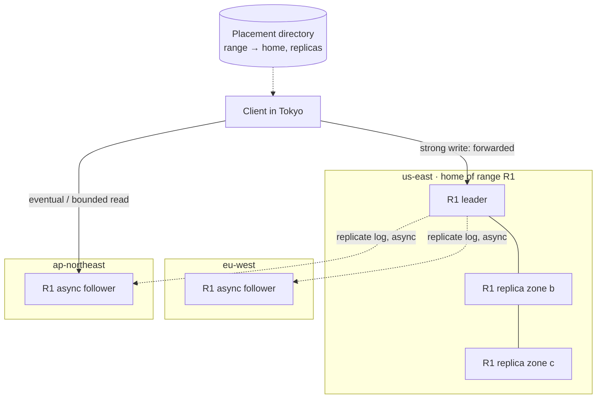

# SD-15 · Globally distributed key-value store

*A reference solution, stage by stage, for a 45–60-minute round. Cue sheet:
[`questions/C-storage-data-consistency.md`](../questions/C-storage-data-consistency.md) · theory:
[Replication & consistency](../theory/04-replication-and-consistency.md),
[Storage & partitioning](../theory/03-partitioning-and-storage.md).*

{: .spoiler }
> Run the round cold first: `Mock me: SD-15, Google, staff, full round.` Read this afterwards.

**The prompt:** *"Design a key-value store that serves reads and writes from five regions on three
continents."*

{: .key-title }
> The one-sentence insight to land by minute 10
>
> **You cannot have strongly consistent, low-latency writes in five regions** — a majority quorum
> across continents costs ~100–200 ms per write, and under a partition you must refuse writes or
> accept divergence. So **offer consistency as a per-operation choice**: each key range has a **home
> region with a consensus group** for linearizable writes, every region serves **local reads with a
> stated staleness bound**, and callers who need more pay for it explicitly.

---

## Stage 1 · Clarify requirements · 0:00–0:06

| I ask | Interviewer answers | Why it matters |
|---|---|---|
| Regions? | 5: us-east, us-west, eu-west, ap-south, ap-northeast | three continents → cross-continent RTTs on any global quorum |
| Data? | 1 KB avg, 100 TB, 10 B keys | partition count, storage bill |
| Traffic? | 1 M reads/s, 100 k writes/s, global | read-heavy (10:1) — local reads are the big win |
| Read latency? | p99 < 10 ms **locally** | reads must be served in-region |
| Write latency? | "what can you promise?" | **the** question — I'll answer with a number |
| Consistency? | "tell me what you can offer and what it costs" | tiers, not one answer |
| Access? | single-key get/put; transactions? (I ask — "not needed for v1") | per-key consensus is enough |
| Durability? | survive loss of a whole region | replicas in ≥ 3 regions per key |
| Locality of writes? | (ask) "most keys are written mostly from one region" | lets us home keys near their writers |

**Out of scope (say it):** multi-key transactions (discussed as an extension), secondary indexes,
query language, the client SDK's caching layer.

**Non-functional:** local reads p99 < 10 ms; region-loss durability (RPO = 0 for strong writes);
availability: strong-consistency writes unavailable only for keys homed in a region cut off from its
quorum; eventual reads always available.

{: .say }
> "Before designing, I'll put the impossibility on the table: under a partition I either refuse writes
> or accept divergence, and even without a partition, a quorum across continents costs a
> cross-continent round trip. So my plan is to make the consistency level a choice per operation and
> tell you exactly what each one costs."

## Stage 2 · Back-of-the-envelope · 0:06–0:11

| Quantity | Arithmetic | Result | Consequence |
|---|---|---|---|
| Write latency, global majority | 3 of 5 regions incl. another continent | **~100–200 ms** | unacceptable as the only option → home regions |
| Write latency, home-region quorum (3 zones in one region) | intra-region RTT | **~2–5 ms** | strong writes are fast **for clients near the home** |
| Storage | 100 TB × RF (3 in home region + 1 replica in each other region = 7) | **~700 TB** | ~$15 k–70 k/month depending on disk tier; **replication factor is a cost dial** |
| Partitions | 100 TB ÷ ~10 GB per range | ~10 k ranges | consensus groups are per range; manageable metadata |
| Reads per region | 1 M ÷ 5 | ~200 k/s per region | local followers serve them |

{: .key }
> Saying *"a strong write from Singapore to a key homed in us-east costs roughly 220 ms"* — and then
> deciding what to do about it — is the moment this round is won or lost.

## Stage 3 · API and data model · 0:11–0:17

```text
put(key, value, { consistency: "strong" | "eventual", ifVersion? })   -> { version, commitTs }
get(key, { consistency: "strong" | "bounded(5s)" | "session(token)" | "eventual" })
                                                                      -> { value, version, commitTs }
delete(key, ...)          cas(key, expectedVersion, value)            -- compare-and-set
```

- **`version`** per key (monotonic, from the range's consensus log) enables compare-and-set and
  conflict detection.
- **`session(token)`**: every write returns a `commitTs`; the client presents it on reads, and the
  serving replica waits until it has applied up to that timestamp → **read-your-writes anywhere**.

**Placement metadata (the directory):** `range [startKey, endKey) → home region, replica set, leader`
— a small, strongly consistent service (itself a consensus group), cached by every client and node.

## Stage 4 · High-level design · 0:17–0:27



**Per range:** a **Raft group of 3 replicas in 3 zones of its home region** (fast quorum, survives a
zone loss), plus **asynchronous followers in every other region** (local reads, region-loss
durability with a small lag).

**Walk-through — a strong write from Tokyo to a us-east-homed key:** client looks up the range in its
cached directory → sends to the nearest node, which forwards to the R1 leader in us-east (~150 ms
round trip) → leader appends to its log, replicates to 2 zones (~2 ms), commits → acks with
`commitTs` → followers in other regions apply within ~100–300 ms.

**Walk-through — an eventual read in Tokyo:** served by the local follower (< 10 ms); may be up to
the replication lag stale. **A bounded read** checks the follower's applied timestamp; if it's older
than the bound, forward to the leader (or wait briefly).

## Stage 5 · Technology choices

| Decision | Choice | Alternative and why not |
|---|---|---|
| Partitioning | **range partitioning** with automatic split/merge, directory-based placement | consistent hashing: simpler, but can't express per-range home regions or residency |
| Replication | **Raft per range** inside the home region + async followers elsewhere | global Raft: 100–200 ms writes for everyone; leaderless quorums: no single order, needs conflict resolution |
| Storage engine | LSM (RocksDB-class) per node | writes 100 k/s with compaction; B-tree fine too for this read-heavy mix |
| Time | **hybrid logical clocks** for `commitTs` | wall clocks can't order; TrueTime needs special hardware |
| Directory | small consensus-backed metadata service, cached | must be strongly consistent; tiny and rarely written |

## Stage 6 · Deep dives · 0:27–0:45

### 6.1 The partition: the EU–US link drops for 30 seconds

Take it second by second — the crux probe:

| | Keys homed in us-east | Keys homed in eu-west |
|---|---|---|
| **Writes from US** | ✅ normal (quorum is local) | ❌ strong writes fail/time out (leader unreachable) — **we chose C** |
| **Writes from EU** | ❌ strong writes fail | ✅ normal |
| **Eventual reads (both sides)** | ✅ served locally, staleness grows to 30 s | ✅ same |
| **Bounded(5 s) reads** | ✅ in US; ❌→ fall back or error in EU after 5 s | mirror image |
| **Session reads** | ✅ if the token's `commitTs` was already applied locally | same |

After the link heals, async followers catch up from the leaders' logs — no conflicts, because every
key had exactly one writer (its home leader).

{: .say }
> "Under the partition, each side keeps full service for keys it's home to, and keeps serving stale
> reads for everything else. Strong writes to keys homed across the cut fail — that's the C in CAP,
> chosen deliberately, and it only affects the cross-homed fraction of traffic."

### 6.2 The optional AP mode — multi-home writes

Some workloads (counters, presence, carts) prefer availability over order. Offer an **`eventual`
write** mode for designated tables: writes accepted in any region, replicated asynchronously, and
merged by **CRDT semantics** (counters, sets, LWW-register only where losing a concurrent write is
acceptable). **Never** silently apply last-write-wins to data that matters — clocks skew, and LWW
drops writes.

### 6.3 Read-your-writes from another region

Client writes in us-east (gets `commitTs = T`), then reads in eu-west: the session token carries `T`;
the EU follower **waits until it has applied T** (typically 100–300 ms) or forwards to the leader.
No stale read of one's own write, without making every read strong.

### 6.4 Region loss and rejoin

- **Home region lost:** strong writes to its ranges are unavailable until **failover** re-homes them
  — promote the most up-to-date async follower region. Because those followers are async, **the last
  few hundred ms of acknowledged writes can be lost (RPO > 0)**. If that's unacceptable for a table,
  configure it with a **cross-region quorum** (e.g. 2 replicas home + 1 in a nearby region, majority
  of 3 spanning two regions) — and pay the ~10–70 ms write latency for that table only.
- **Rejoin:** the returning region catches up from leaders' logs (or snapshot + log if far behind);
  it serves reads only after its applied timestamp is within the staleness bound.

### 6.5 Hot key — 100 k writes/s on one key

One Raft leader caps out well below that for a single key's serialised log. Options: push back on the
access pattern (it's usually a counter → **split into sub-keys** and sum on read, or a CRDT counter in
eventual mode); batch writes at the leader; or front it with a write-combining layer. State that a
single linearizable key has a **single-leader throughput ceiling** by design.

### 6.6 Adding a sixth region without downtime

New async followers for every range bootstrap from snapshots + logs (throttled to protect leaders),
then begin serving reads once caught up; directory updated per range. Ranges whose writers moved can
later be **re-homed** (leadership transfer + Raft membership change) one range at a time.

## Stage 7 · Mid-round requirement — EU data residency

*"EU users' data must stay in the EU, but the key space stays globally addressable."*

Range placement makes this a **placement policy**: ranges holding EU-resident data (key prefix or a
residency attribute) are **homed in eu-west with all replicas in EU zones/regions** — no async
followers outside the EU. Non-EU clients reading those keys are **forwarded** to the EU (paying the
latency), never served from a local copy. This is exactly what breaks a naive consistent-hash ring,
where placement is a function of the hash, not of policy.

## Stage 8 · Failure modes · 0:45–0:50

| Failure | Effect | Mitigation |
|---|---|---|
| Zone loss in home region | none — quorum of 2/3 remains | 3-zone placement per Raft group |
| Home region loss | strong writes to its ranges unavailable; possible RPO of async tail | failover runbook; cross-region quorum for zero-RPO tables |
| Leader GC pause / network blip | brief write stall; risk of two leaders | Raft terms + **fencing** on storage; leader leases with bounded clock skew |
| Directory unavailable | new lookups fail | clients cache placement; directory is itself replicated |
| Replication lag spike | stale reads beyond bound | bounded reads forward or fail; alert on lag per region |

## Stage 9 · SLOs, observability, cost · 0:50–0:54

- **SLIs:** local read latency p99 · strong write latency **by client-region × home-region pair** (the
  honest view) · **replication lag per region** (drives bounded-read SLO) · write availability per
  range.
- **Cost:** storage × replication factor (~700 TB at RF 7) and **cross-region replication egress**
  (100 k writes/s × 1 KB × 4 remote regions ≈ 400 MB/s ≈ 35 TB/day — roughly $1 k–3 k/day at
  typical inter-region transfer prices). RF and the
  number of read-replica regions per table are the cost dials.

## Stage 10 · The level layer

{: .level }
> **Staff:** the round is decided here — Raft mechanics (terms, commit index, why a majority
> guarantees committed writes survive), leases vs fencing, HLC timestamps for session tokens, and the
> **one-way doors**: the partitioning scheme and the consistency contract exposed in the API. **EM:**
> buy vs build (Spanner, CockroachDB, DynamoDB global tables cover most of this — build only if
> placement control or cost demands it); team seams *storage engine & replication* · *placement &
> directory* · *client SDK & API*; SLOs per consistency tier. **Principal / Director:** which teams
> get which guarantees by default, and the cost model of replication factor per table.

## Stage 11 · The close

> "It's a range-partitioned store where each range has a home region running a three-zone Raft group
> for fast, linearizable writes, and asynchronous followers everywhere else for local reads. Callers
> choose consistency per operation — strong, bounded staleness, session, or eventual — and the
> cross-continent cost only appears when they ask for it. Under a partition each side keeps serving
> its own keys and stale reads for the rest. Next I'd add cross-region quorums for zero-RPO tables and
> residency-aware placement."

## Stage 12 · Self-check

- [ ] Did I state CAP correctly and add PACELC?
- [ ] Did I quantify write latency for a cross-continent client?
- [ ] Did I distinguish replication from consensus?
- [ ] Did I walk the 30-second partition, second by second?
- [ ] Did I offer per-operation consistency and say what each costs?
- [ ] Did I name RPO on region loss honestly?
- [ ] Did I avoid "LWW because clocks are synchronised"?

---

## Cheat card

**Insight:** consistency is a per-operation product choice. **Numbers:** global quorum 100–200 ms;
in-region quorum 2–5 ms; 700 TB at RF 7; ~35 TB/day replication egress. **Design:** range partitions
→ home region Raft (3 zones) + async followers per region; directory for placement. **Reads:**
strong (leader) · bounded · session (commitTs) · eventual. **Partition:** home side keeps writing,
everyone keeps stale reads. **Residency:** placement policy per range. **Trap:** "strong, local and
fast everywhere"; LWW by wall clock.
