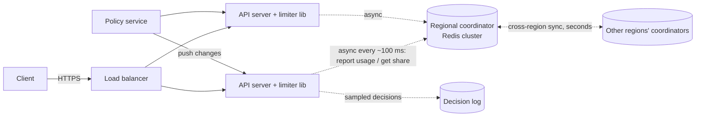

# SD-25 · Distributed rate limiter

*A reference solution, stage by stage, for a 45–60-minute round. Cue sheet:
[`questions/D-infrastructure-control-planes.md`](../questions/D-infrastructure-control-planes.md) ·
theory: [Reliability](../theory/08-reliability-and-operations.md),
[Correctness under failure](../theory/07-correctness-under-failure.md).*

{: .spoiler }
> Run the round cold first: `Mock me: SD-25, Google, staff, full round.` Read this afterwards, at
> debrief, against your report.

**The prompt:** *"Design a rate limiter for our API — every customer has a quota and we need to
enforce it across a fleet of servers."*

{: .key-title }
> The one-sentence insight to land by minute 10
>
> **The limiter sits on the critical path of every request, so its latency and availability matter
> more than its accuracy.** A globally exact limiter needs a shared-store round trip per request; a
> design that decides **locally from a token bucket and reconciles asynchronously** is fast, never
> takes the API down, and is wrong by a small, bounded amount. The round is about choosing that
> trade-off on purpose and knowing the size of the error.

---

## Stage 1 · Clarify requirements · 0:00–0:06

| I ask | Interviewer answers | Why it matters |
|---|---|---|
| Traffic? | 1 M req/s across 500 API servers in 3 regions | a shared store would take 1 M ops/s on the hot path |
| What is limited? | per customer, per endpoint, e.g. 1,000 req/min; some customers 100× others | key cardinality; heavy customers create hot keys |
| Accuracy? | "How accurate can you be, and what does exact cost?" | **the** trade-off of the round |
| Latency budget? | under 1 ms p99 added | rules out a cross-region call; even an in-region call is most of the budget |
| At the limit? | 429 with `Retry-After` — "what else should it carry?" | client contract (remaining quota, reset time) |
| Fail open or closed? | "Your call — defend it." | availability vs protection |
| Bursts? | customers burst legitimately; a hard per-second cap would break them | algorithm must allow bursts |
| Global or per region? | (ask) | exact global limits need cross-region coordination |

**In scope:** per-customer/per-endpoint limits, configurable policies, enforcement across the fleet,
client-facing headers, observability of decisions. **Out of scope (say it):** DDoS protection at the
network edge (a different layer), billing/metering accuracy (a separate exact pipeline), abuse
detection, the API gateway itself.

**Non-functional:** ≤ 1 ms p99 overhead; limiter outage must not become an API outage; accuracy
within a few percent of the configured limit; policy changes effective within seconds.

{: .say }
> "I'm going to treat this as a protection mechanism, not a billing meter. If billing needs exact
> counts, that's a separate asynchronous pipeline — mixing the two would force exactness onto the hot
> path for no reason."

## Stage 2 · Back-of-the-envelope · 0:06–0:11

| Quantity | Arithmetic | Result | Consequence |
|---|---|---|---|
| Naive per-node split | 1,000/min ÷ 500 servers | **2 per server per minute** | useless — a customer hitting 3 servers unevenly is throttled at 0.3% of quota. **Can't divide the limit statically.** |
| Shared-store load | 1 M req/s × 1 check | 1 M ops/s, ~0.5 ms RTT each | feasible across ~20–40 Redis-class shards, but it puts a network hop and a dependency on **every** request |
| State per key | customers × endpoints, e.g. 100 k × 20 = 2 M keys × ~64 B | ~128 MB | tiny — state size is not the problem; **hot paths are** |
| Hot customer | a customer at 100× quota sending 10% of traffic | 100 k req/s on one key | one shard can't take it — local aggregation needed anyway |

{: .say }
> "The number that shapes the design is the first one: two requests per server per minute. A static
> split doesn't work, and a shared counter on every request costs a network hop and a dependency.
> So I want local decisions with a share of the quota that moves to where the traffic actually is."

## Stage 3 · API and data model · 0:11–0:16

**Decision API** (in-process library in the API server, or a sidecar):

```text
allow(customerId, endpoint, cost=1) -> { allowed: bool, remaining: int, resetAt: ts, retryAfter: s }
```

**Response headers** on every response (the contract clients build against):

```text
RateLimit-Limit: 1000
RateLimit-Remaining: 37
RateLimit-Reset: 23            # seconds until a full refill
Retry-After: 2                 # only on 429
```

**Policy (control plane):**

```text
PUT /v1/policies/{customerId}/{endpoint}
  { rate: 1000, per: "minute", burst: 200, scope: "global" | "region", mode: "enforce" | "shadow" }
```

**State:**

| Store | Key | Value |
|---|---|---|
| Policy store (replicated config, cached in every server) | `(customer, endpoint)` | rate, burst, scope, mode, version |
| Local bucket (in memory, per server) | `(customer, endpoint)` | tokens, last refill time, local share |
| Coordinator / shared counters (Redis cluster, per region) | `(customer, endpoint, window)` | consumed count, per-node lease grants |
| Decision log (sampled, async) | `(customer, ts)` | decision, policy version, node — for "why was I limited?" |

## Stage 4 · High-level design · 0:16–0:26



**The walk-through — one request:**

1. The request reaches an API server; the limiter library looks up the policy (local cache, pushed by
   the policy service).
2. It takes a token from the **local bucket** for `(customer, endpoint)` — an in-memory atomic
   operation, ~microseconds. If a token is available: allow, set headers.
3. If the local bucket is empty, the request is rejected with 429 — **unless** the library's last
   sync suggested more share is available, in which case it requests a top-up (bounded wait, e.g.
   2 ms, else reject).
4. Every ~100 ms, each server **reports its consumption** to the regional coordinator and receives its
   **share** for the next interval — proportional to its recent demand for that key.
5. Coordinators of different regions exchange totals every few seconds for `scope: global` policies.

{: .why }
> **Why not just a Redis `INCR` per request?** It's the obvious design and it works at small scale.
> At 1 M req/s it adds ~0.5 ms and a hard dependency to every API call, concentrates heavy customers
> on single shards, and turns a Redis incident into an API outage. Local buckets with asynchronous
> share adjustment remove all three — at the price of bounded inaccuracy.

## Stage 5 · Technology choices

| Component | Choice | Reason |
|---|---|---|
| Decision point | **in-process library** (or sidecar) | zero network hops on the hot path |
| Algorithm | **token bucket** | allows bursts up to `burst`, enforces long-run `rate`, O(1) state |
| Coordinator | Redis cluster per region, Lua scripts | atomic read-modify-write of shares, ~100 k+ ops/s per shard; only ~5 k servers × keys/100 ms of traffic, not 1 M/s |
| Policy distribution | config service with push (watch) + local cache | policy changes in seconds; servers keep working if it's down (static stability) |
| Decision log | sampled events to a log → columnar store | explain decisions without a write per request |

## Stage 6 · Deep dives · 0:26–0:45

### 6.1 Algorithms — compared, not listed

| Algorithm | State | Bursts | Accuracy | Verdict |
|---|---|---|---|---|
| **Fixed window** counter | 1 counter/window | **2× burst at the boundary** (1,000 at 11:59:59 + 1,000 at 12:00:00) | poor at edges | simplest; boundary flaw |
| **Sliding window log** | a timestamp per request | exact | exact | memory O(requests) — unusable at 1,000/min × 2 M keys |
| **Sliding window counter** | current + previous window counts | smoothed | approximation (weighted) | good, cheap compromise |
| **Token bucket** | tokens + last refill | **up to `burst`** by design | exact for its definition | **chosen** — expresses "rate + allowed burst" directly |
| **Leaky bucket** | queue | none — smooths output | exact | for shaping outbound traffic, not API quotas |

Token bucket, atomically:

```lua
-- KEYS[1] = bucket key; ARGV: rate (tokens/s), burst, now (ms), cost
local b = redis.call('HMGET', KEYS[1], 'tokens', 'ts')
local tokens = tonumber(b[1]) or tonumber(ARGV[2])
local ts     = tonumber(b[2]) or tonumber(ARGV[3])
local now, rate, burst, cost = tonumber(ARGV[3]), tonumber(ARGV[1]), tonumber(ARGV[2]), tonumber(ARGV[4])
tokens = math.min(burst, tokens + (now - ts) / 1000 * rate)      -- refill
local allowed = tokens >= cost
if allowed then tokens = tokens - cost end
redis.call('HSET', KEYS[1], 'tokens', tokens, 'ts', now)
redis.call('PEXPIRE', KEYS[1], math.ceil(burst / rate * 1000) * 2)
return { allowed and 1 or 0, math.floor(tokens) }
```

{: .warn }
> **Read-then-write** (`GET`, compare, `SET`) from the API server races under concurrency and lets
> traffic through — a real production bug. The check-and-decrement must be **atomic**: a Lua script,
> an atomic counter, or a single-threaded local bucket.

### 6.2 Local decisions with a moving share — the error, quantified

Each server holds a **share** of each active key's budget, recomputed every interval `T` (~100 ms)
from reported demand:

```text
share_i = budget_remaining × (demand_i / Σ demand)      -- plus a small floor for new servers
```

- **Error bound:** within one interval a server can only overspend its own share. Total overshoot is
  bounded by roughly **one interval's worth of demand shift** — with `T` = 100 ms and a 1,000/min
  limit, a few tokens. For the heavy customer at 100 k req/s, a 1–2% overshoot.
- **Uneven load balancing** (one node gets 40% of a customer's traffic) is handled because shares
  **follow demand**, not node count — the exact failure of the naive split.
- **Cold keys** (most customers, most of the time): a server sees one request for a key it has no
  share for → ask the coordinator synchronously **once** (in-region, ~0.5 ms), then cache the share.
  Bounded extra latency only on first use.

{: .say }
> "I'm accepting being up to a couple of percent over the limit for the heaviest customers, in
> exchange for no network hop on the hot path and no dependency that can take the API down. If a
> customer has a contractual hard cap — say a paid tier — I can switch that policy to synchronous
> mode and pay the hop just for them."

### 6.3 Hot keys

The customer sending 100 k req/s is spread across all servers, and each server holds a local share —
so the hot key is **aggregated locally** and the coordinator sees 500 reports per 100 ms, not
100 k/s. That's the same mechanism; no special case needed. In a pure shared-store design, this key
would need sharding into sub-counters (`key#0…key#15`) summed on read.

### 6.4 Failure: the coordinator is down

**Fail open — locally.** Servers keep enforcing with their **last known shares** (decaying slowly
toward a conservative default) — the API keeps working and abusive customers are still roughly
contained. Alert on coordinator unavailability; it's a degradation, not an outage.

{: .warn }
> **Fail-closed by default** turns the limiter into a single point of failure for the whole API. If
> you choose it for some endpoint (e.g. an expensive export), say why that endpoint is different.

### 6.5 Multi-region

- **`scope: region`** (default): each region enforces `limit × regional weight` independently — exact
  per region, no cross-region traffic.
- **`scope: global`**: regional coordinators exchange consumption every few seconds and rebalance
  regional budgets. Overshoot is bounded by **one sync interval of cross-region demand shift** —
  state it. **An exact global limit would need a cross-region round trip (~100 ms) per decision**,
  which violates the 1 ms budget; that's the honest answer.

## Stage 7 · Mid-round requirement — the hourly burst allowance

*"A customer needs 10× burst for the first 30 seconds of each hour."*

Token bucket expresses it as a **scheduled policy**: `burst: 10×` during `:00:00–:00:30`, normal
otherwise — pushed by the policy service, effective in seconds. Then push back on the operational
cost: **per-customer special cases accumulate**; offer it as a product tier ("burst credits") rather
than a hand-edited exception, and require an owner and an expiry date.

## Stage 8 · Failure modes · 0:45–0:50

| Failure | Effect | Response |
|---|---|---|
| Coordinator down | shares freeze | enforce with last shares, decaying; alert |
| Policy service down | no policy changes | servers keep cached policies (static stability) |
| Bad policy pushed (limit = 0) | mass 429s | **shadow mode** for new policies; canary rollout of config; instant rollback |
| Clock skew between servers | refill miscomputed | buckets use local monotonic clocks; coordinator uses its own time |
| Server restart | local buckets reset | start conservative (small share), converge in one interval |

## Stage 9 · SLOs, observability, cost · 0:50–0:54

- **SLIs:** limiter decision latency (p99 < 1 ms) · **false-limit rate** — 429s issued to customers who
  were below their limit over the window, measured from the decision log · policy propagation time.
- **"Why was I limited?"** — the sampled decision log records policy version, node, bucket state; a
  support tool answers a customer complaint in minutes. **Design this in from day one.**
- **Cost:** negligible compute (in-process); a small Redis cluster per region; the decision log is the
  largest line — sample allowed decisions, keep all rejections.

## Stage 10 · The level layer

{: .level }
> **Staff:** go three levels deep on 6.2 — the share algorithm, its error bound, convergence after a
> node joins, and why sync-mode exists. Name the RFC-worthy decisions: the header contract and the
> fail-open default. **EM:** week-one plan (in-process token bucket per server with a conservative
> static share, shadow mode on, decision log) → week four (coordinator) → global scope later; who's
> on call; the false-limit SLI and the support runbook. **Director:** build vs buy (most API gateways
> include rate limiting — build only if the share model or global scope is a differentiator), and the
> policy-governance process for customer exceptions.

## Stage 11 · The close · 0:55–0:57

> "It's an in-process token-bucket limiter whose per-server budget share follows actual demand,
> synced asynchronously with a regional coordinator every hundred milliseconds. The hard part — exact
> limits with no hot-path hop — is resolved by accepting a bounded overshoot of a percent or two, with
> a synchronous mode for customers who need a hard cap. It fails open on its own dependencies, so it
> can never take the API down. Next I'd build the decision log and the false-limit SLI, because the
> first real-world problem is a customer asking why they were throttled."

## Stage 12 · Self-check

- [ ] Did I compute 1,000 ÷ 500 and let it kill the static split?
- [ ] Did I compare algorithms and name the fixed-window boundary burst?
- [ ] Did I make check-and-decrement atomic?
- [ ] Did I state fail-open and why?
- [ ] Did I quantify the inaccuracy instead of hiding it?
- [ ] Did I address hot keys and multi-region honestly?
- [ ] Did I design the "why was I limited?" observability?

---

## Cheat card

**Insight:** availability and latency of the limiter > its accuracy. **Number:** 1,000/min ÷ 500 = 2
per server. **Algorithm:** token bucket (rate + burst). **Architecture:** in-process buckets +
demand-proportional shares + async coordinator. **Error:** ≤ one sync interval of demand shift.
**Failure:** fail open on last shares. **Global:** exact = 100 ms per decision → no; sync every few
seconds. **SLI:** false-limit rate. **Trap:** read-then-write; fail-closed by default.
