# SD-25 · Rate limiter (distributed) — reference design

<!-- Generated by video/src/gen.py (kit dsl.write_reference_markdown) from the same slides and narration as the video. Edit video/src/*.py, then re-run gen.py; never edit this file. -->

> A rate limiter sits on every request, so its latency and availability matter more than its accuracy. Decide in memory from a token bucket, lease the global budget to where the traffic lands, and know exactly how wrong you can be.

**Contents**

- [1 · Prompt, questions and context](#1--prompt-questions-and-context)
- [2 · Estimates](#2--estimates)
- [3 · API and data model](#3--api-and-data-model)
- [4 · Design, driven by challenges](#4--design-driven-by-challenges)
- [5 · When you don't need all this](#5--when-you-dont-need-all-this)
- [6 · Recap](#6--recap)
- [Implementation Lab & Reproducible Workspace](#implementation-lab--reproducible-workspace)

## 1 · Prompt, questions and context

*A limit on every request, enforced by five hundred servers*

A rate limiter sounds like a counter and an if statement. It is one of the most asked questions at Google and Meta, because the counter has to live somewhere, and wherever it lives, it sits on the path of every single request.

> **Interviewer:** Design a rate limiter for our API. Every customer has a quota, and we need to enforce it across a fleet of servers.

#### One quota, five hundred servers, three answers

<sub>Why it is harder than it looks</sub>

*exact and slow · fast and wrong · fast and bounded*

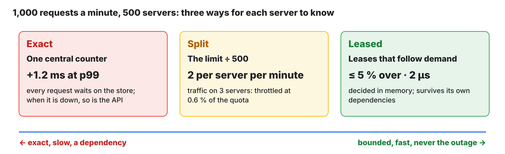

Here is the hook, as one picture. One customer may send a thousand requests a minute, and those requests land on five hundred servers. How does each server know whether to say yes? One central counter is exact, and every request waits on it. Dividing the limit by five hundred gives each server two a minute. The third answer leases the budget to wherever the traffic lands: at most five percent over, decided in microseconds. The whole round is choosing that trade on purpose, and being able to say exactly how wrong it can be.

#### What this question grades

<sub>Before the design</sub>

| Axis | Weak signal | Strong signal |
|---|---|---|
| **Requirements** | “Count requests”; the limiter as a billing meter | A protection limit; billing is a separate, exact pipeline |
| **Correctness** | A fixed window; read, then write | Algorithms compared; the boundary burst; one atomic step |
| **Trade-offs** | “Use Redis”, or “be exact” | Exact costs a round trip per request; the error is stated as a number |
| **Depth** | Stops at a counter in a cache | Leases sized by demand, the cold-start bound, regional budgets |
| **Operations** | Fail closed without noticing | A failure mode per limit; a false-limit rate; “why was I limited?” |

> [!IMPORTANT]
> **Coach · what is graded here.** The limiter's own availability and latency matter more than its accuracy.

> [!IMPORTANT]
> **Coach:** What this question grades. Requirements: is this a protection limit or a billing meter? They are different systems. Correctness: algorithms compared, not listed, and a check-and-take that is one atomic step. Trade-offs: exact costs a round trip on every request. Strong answers say what they give up, as a number. Depth: how the budget is split across servers, what happens to a brand-new key, and what happens across regions. Operations: what the limiter does when its dependency fails, and how you answer 'why was I limited?'

And the rule I keep all round: the limiter sits on every request, so its own availability and latency matter more than its accuracy.

#### Four numbers every estimate starts from

<sub>Requirements · the scale line</sub>

- ****1 M/s · 2.6 T**** — requests: average a second · a month
- ****500 · 3**** — API servers · regions
- ****2 M · 30 days**** — limit keys · decisions kept
- ****3 M/s**** — at the top of the hour; one customer at 100 k/s

Every number later in this video starts from one of these, and I'll say which.

The interviewer gives me the scale, and I write it down first. A million requests a second on average. That's two point six trillion a month. Spread over five hundred API servers in three regions. Two million limit keys: a hundred thousand customers, times about twenty endpoints each. And thirty days of decisions kept, so support can answer questions about last week. And the peak: three million a second at the top of every hour, when customers' batch jobs start. Inside it, one customer alone sends a hundred thousand a second. Every number I use later starts from one of these, and I'll say which.

What exactly is a limit keyed by?

> **Interviewer:** Per customer and per endpoint. For example, a thousand requests a minute on search. Some customers have a hundred times the limit of others.

So the key is customer and endpoint, two million of them, and the big ones will be hot keys.

How exact does it have to be?

> **Interviewer:** How accurate can you be, and what does exact cost?

That's the question of the round, handed back to me. I'll treat this as a protection limit, not a billing meter. If billing needs exact counts, that's a separate pipeline from the request logs. Here I'll name an error bound and defend it.

How much latency may the limiter add?

> **Interviewer:** Under one millisecond, at p99.

One millisecond at p99 is about the p99 of one network round trip inside a zone. So the default decision cannot make a network call.

What does a rejected client get, and what if the limiter itself fails?

> **Interviewer:** A 429, with a Retry-After header. What else it carries is up to you. Fail open or fail closed: your call. Defend it.

I'll come back to both. The response should let a client plan. And the failure mode is a decision per limit, not a library default.

Do customers burst, and is a limit per region or worldwide?

> **Interviewer:** They burst legitimately; a hard per-second cap would break them. Most limits are per region, and some contracts say global.

Bursts mean the algorithm needs a burst knob separate from the rate. And global contracts mean regions have to talk, which can't be on the request path.

#### Four things the limiter must do

<sub>Requirements · functional</sub>

- **FR1 · Decide.** For every request, allow or reject by customer and endpoint, before the backend sees it.
- **FR2 · Tell.** Every response says limit, remaining and reset; a 429 adds Retry-After and a decision ID.
- **FR3 · Configure.** Limits, tiers, bursts, schedules, scope and mode; changes staged, live in seconds.
- **FR4 · Explain.** For any 429: the policy version, the server, the lease, the global count.

Four functional requirements. One, decide: for every request, allow or reject by customer and endpoint, before the backend sees it. Two, tell: every response says the limit, what remains and when it resets. A 429 adds Retry-After and a decision ID. Three, configure: limits, tiers, bursts, schedules, scope and mode. Changes are staged, and live within seconds. Four, explain: for any 429, what produced it. Usually forgotten, and the first thing a big customer asks for.

#### The numbers, and what each is for

<sub>Requirements · non-functional</sub>

*all initial targets, not measurements*
- ****≤ 1 ms**** — added at p99, at 3 M requests/s
- ****99.99 %**** — API availability: the limiter never lowers it
- ****≤ 5 %**** — over the limit per minute; exact keys never
- ****≤ 10 s**** — a policy change everywhere

False limits, a customer under its limit rejected: under 0.1 % of its requests.

The numbers, and they are initial targets. At most one millisecond added at p99, at three million requests a second. The API's availability is four nines, and the limiter must never be the reason it drops. Accuracy: at most five percent over the limit in any minute for ordinary keys, and never over for the few keys that must be exact, like login attempts. A policy change reaches every server within ten seconds. And false limits, a customer under its limit being rejected, stay under a tenth of a percent of its requests.

#### What must never happen, and what must eventually happen

<sub>Requirements · properties</sub>

- **`[S1-bounded-overshoot]`.** Never more than 5 % over the limit in a minute; exact keys never over.
- **`[S2-never-the-outage]`.** A limiter failure never fails a request the limit would admit.
- **`[S3-no-false-limits]`.** A customer under its limit is almost never rejected: under 0.1 %.
- **`[L1-change-in-10s]`.** A policy change is enforced everywhere within 10 s.
- **`[L2-decide-in-1ms]`.** Every decision within 1 ms at p99.

As properties, so every fix can say which one it protects. Safety first.

> [!TIP]
> **If asked, I'd say:** `[S1-bounded-overshoot]`: never more than five percent over the limit in a minute, and the exact keys never over. `[S2-never-the-outage]`: a failure of the limiter never fails a request that the limit would have admitted. `[S3-no-false-limits]`: a customer under its limit is almost never rejected.

Liveness. `[L1-change-in-10s]`: a policy change is enforced everywhere within ten seconds. `[L2-decide-in-1ms]`: every decision within a millisecond. Notice the tension: the first property wants a shared count, the last one forbids waiting for it.

#### In, and out on purpose

<sub>Requirements · scope</sub>

- **In scope.** Per-customer, per-endpoint quotas; enforcement across the fleet and regions; the client contract; policies with staged rollout; decision observability.
- **Out, on purpose.** DDoS at the network edge. Billing and metering. Abuse detection. Load shedding by criticality. Authentication.

Billing reads the request logs, exactly, later. The limiter is allowed to be five percent wrong; an invoice is not.

In scope: quotas per customer and endpoint, enforced across the fleet and across regions, the contract with clients, policies with a staged rollout, and observability of every decision. Out, on purpose: DDoS protection at the network edge, a different layer. Billing and metering. Abuse detection. Load shedding by criticality. And authentication. One I'd say aloud: billing. Metering reads the request logs, exactly, later. The limiter may be five percent wrong; an invoice may not. Mixing them forces exactness onto the hot path.

#### The limiter in its context, before any boxes inside it

<sub>C4 level 1 · system context</sub>

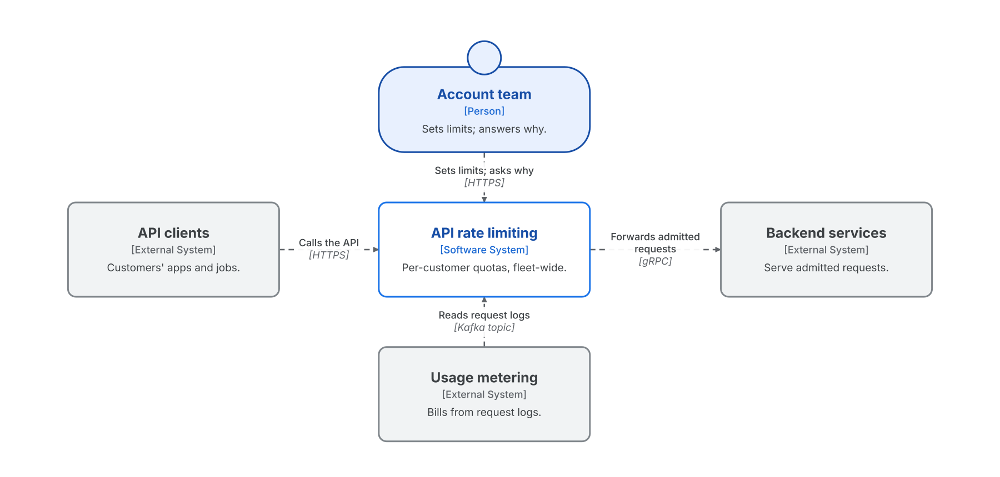

Before any boxes inside it, the system in its context. I draw this first, in every round. API clients: customers' apps and batch jobs, calling over HTTPS. All of the traffic. In the middle, the rate limiting system, one box for now. It runs inside the API tier. Behind it, the backend services. They only ever see admitted requests, over gRPC. The account team sets limits, and asks why a customer was limited. And usage metering reads the request logs as a Kafka topic, asynchronously. It never reads the limiter's counts. Nothing on the request path waits for it.

> [!TIP]
> **If asked, I'd say:** The core is three things. A decision made in memory, from a token bucket. Leases of the global budget that follow demand. And a failure mode chosen per limit.

> [!IMPORTANT]
> **Coach:** Notice the candidate separated the limiter from billing, fixed the scale and named the properties before any internals. That is the scoping signal.

## 2 · Estimates

*Each number from the scale line, and the constraint it forces*

Numbers next. Each starts from the scale line, and each ends in a constraint on the design: what it rules out, and what it forces. They are illustrative, not anyone's real figures.

#### Three million decisions a second, six thousand per server

<sub>Estimates · traffic and the fleet</sub>

| Number | From | Arithmetic | Forces |
|---|---|---|---|
| Requests | average | 1 M/s × 2.6 × 10⁶ s = **2.6 T** a month; × 3 = **3 M/s** at peak | a decision per request: in memory, in microseconds |
| Per server | peak, fleet | 3 M/s ÷ 500 = **6,000/s**; × 2 µs = 1.2 % of a core | in process is cheap; a sharded map, no global lock |
| Central store | peak | 3 M scripts/s ÷ ~100 k per shard ≈ **30 primaries** | feasible, but a dependency on every request |

Traffic, from the average. A million a second over two point six million seconds is two point six trillion a month, and three times the average at the top of the hour: three million a second. Every one of them needs a decision, so the decision has to be cheap: in memory, in microseconds. Per server, three million over five hundred is six thousand a second. At about two microseconds a decision, that's just over one percent of a core. Doing it in process is cheap, as long as the map is sharded and there's no global lock. And if instead every request ran a script in a central store: three million scripts a second, at roughly a hundred thousand per shard, is about thirty primaries. Feasible. But it puts a network hop and a dependency on every API call. Keep that number; challenge two prices it.

#### Two per server per minute, and one round trip

<sub>Estimates · the two numbers that decide the design</sub>

| Number | From | Arithmetic | Forces |
|---|---|---|---|
| Static split | limit, fleet | 1,000/min ÷ 500 = **2 per server per minute**; on 3 servers: 6/min = **0.6 %** of the quota | rules out dividing the limit; the share must follow demand |
| Round trip | latency NFR | in-zone ~0.3 ms median, **~1.2 ms p99**; cross-region **70–150 ms** | no call on the default path; no exact global limit |

Two numbers decide this design. The static split. A thousand a minute divided by five hundred servers is two per server per minute. Connections are sticky, so a customer's traffic may land on just three servers, and then it gets six a minute: zero point six percent of its quota. Dividing the limit statically is ruled out. Whatever each server holds has to follow where the traffic actually is. And the round trip. Inside a zone a network call is about a third of a millisecond at the median, and over a millisecond at p99 under load. Across regions it's seventy to a hundred and fifty. So the default path makes no network call at all, and an exact global limit across regions is out of the question on the request path.

#### Memory is small; the hot key and the sync are what to size

<sub>Estimates · state, the hot customer, the sync</sub>

| Number | From | Arithmetic | Forces |
|---|---|---|---|
| State | keys | 2 M × 64 B = **128 MB**; ~20 k active per server ≈ 1.3 MB | memory is not the problem |
| Hot customer | peak | 100 k/s on one key vs ~100 k ops/s per shard; leased: 500 × 10 = **5,000 updates/s** | aggregate locally, never a counter per request |
| Sync | fleet | 167 servers × 10/s ≈ 1,700 batches/s a region; ≤ 600 keys each ≤ **1 M key-updates/s** | batched, sharded by key, off the request path |
| Decisions | average | 1 % 429s + 1 % of allows = 20 k/s × 150 B = 3 MB/s ≈ **1.6 TB** / 30 days compressed | a columnar store, not a search index |

Where the bytes and the load go. State: two million keys at sixty-four bytes is a hundred and twenty-eight megabytes for everything. One server's active keys are a megabyte or so. Memory is not the problem. The hot customer: a hundred thousand a second on one key. A central counter for it would be one shard's whole thread. If each server aggregates locally and reports ten times a second, the coordinator sees five hundred times ten: five thousand updates a second for that key. So: aggregate locally. The sync itself: a hundred and sixty-seven servers per region, ten batches a second each, about seventeen hundred batches a second. At peak a batch carries at most six hundred keys, so up to a million key updates a second per region. That's real, so it's batched, sharded by key, and off the request path. And the decisions we keep: every 429, about one percent of requests, and a one-percent sample of the allows. Twenty thousand records a second, three megabytes a second, about one point six terabytes compressed for thirty days. A columnar store.

#### One millisecond, if every request asked a store

<sub>Estimates · the latency budget</sub>

*illustrative · p99*

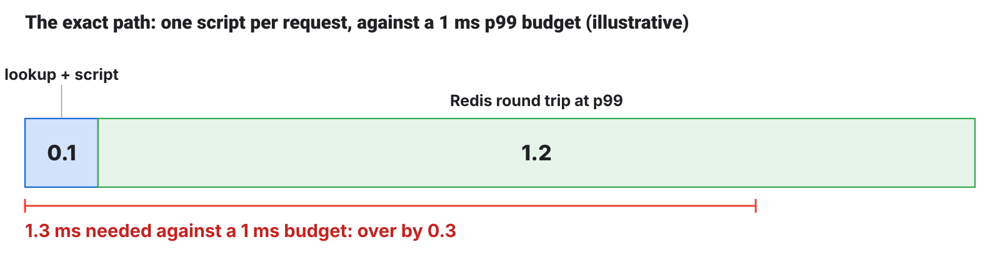

The latency budget, on the exact path. The policy lookup and the script together, about a tenth of a millisecond. A round trip to the store at p99, about one point two. One point three milliseconds against a budget of one. Over. The local path, a map lookup and a token take, is about three hundredths of a millisecond. That gap is the whole design. And it forces one more rule: an exact check is allowed only where a limit's owner accepts paying for it.

## 3 · API and data model

*What crosses the wire, and what is stored*

The API next, then the data. Every contract is tagged with the requirement it serves.

#### What the client sees when it is over

<sub>API · the decision (FR1) and the client contract (FR2)</sub>

*serves FR1 and FR2 · every response carries the headers*

```http
GET /v1/search?q=…            (customer 42)

429 Too Many Requests
RateLimit-Limit: 1000
RateLimit-Remaining: 0
RateLimit-Reset: 7
Retry-After: 7
{"error": "rate_limited",
 "decision_id": "d-7f3c…", "policy": "42:/search@v19"}
```

The decision itself is a function call inside the API server: allow, for a customer, an endpoint and a cost, usually one. It returns allowed, what remains, when it resets, and a decision ID. FR1. What the client sees is FR2. Every response carries the limit, what remains and the seconds to reset, not only the rejections, so a well-behaved client slows down before it hits the wall. A rejection is a 429 with Retry-After: seven seconds. Clients are expected to back off with jitter, or the top of the hour becomes a retry storm. And the body carries a decision ID and the policy version. That ID is how support answers 'why was I limited' in challenge six.

#### Three more contracts, each tagged

<sub>API · configuration, sync and explain</sub>

| Contract | Serves | Key fields | What it returns |
|---|---|---|---|
| `PUT /v1/policies/{customer}/{endpoint}` | FR3 | `If-Match` version; tier, burst, schedule, scope, mode, on_failure | `202`: the new version, in `shadow` |
| `Sync` RPC, server → quota service | FR1 at scale | per key: admitted, asked, policy version | per key: lease, valid until, global remaining |
| `GET /v1/decisions/{id}` | FR4 | the decision ID from the 429 | policy version, server, mode, lease, global count |

Three more contracts. Configuration, for FR3: a PUT per customer and endpoint, with If-Match on the current version so two edits can't overwrite each other. It sets a tier, burst, schedule, scope, mode, and what to do on failure. It answers 202 with a new version, and that version starts in shadow, not enforced. The sync, between an API server and the quota service: for each key, what it admitted and what it was asked. Back comes a lease for the next interval. This is what makes FR1 work at this scale; it's internal, and batched. And explain, for FR4: give it the decision ID from a 429, and it returns the policy version, server, mode, lease and the global count behind it.

#### Where each piece of state lives, and its key

<sub>Data · physical model</sub>

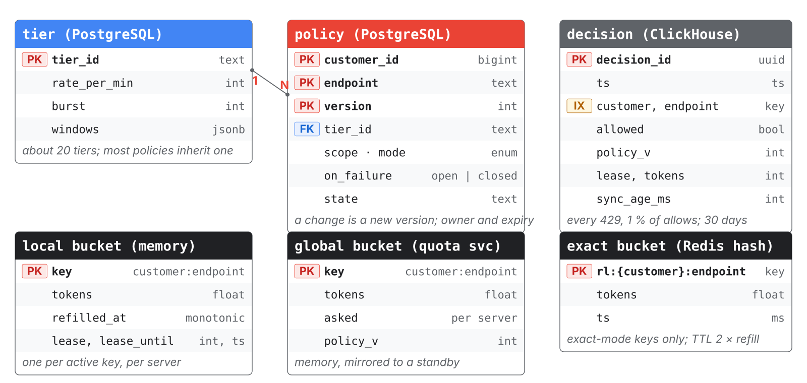

The physical model, one piece at a time. Tiers, in PostgreSQL. About twenty: a rate, a burst, and optional time windows. Most customers inherit one. Policy: keyed by customer, endpoint and version. It names a tier, a scope, region or global, a mode, local or exact, and a failure mode, open or closed. A change is a new version, with an owner and an expiry. A local bucket, in each API server's memory: tokens, last refill on the monotonic clock, and the current lease with its expiry. A global bucket, in the quota service's memory: tokens, and what each server asked for in the last interval. An exact bucket, a Redis hash, only for exact-mode keys, refilled using the shard's own clock. And decisions, in ClickHouse: every 429 and a sample of allows, keyed by customer, endpoint and time. Notice that nothing on the request path is durable. The durable things are the policy, and the record of what was decided.

#### A limit change is a production change

<sub>Data · the life of one policy version</sub>

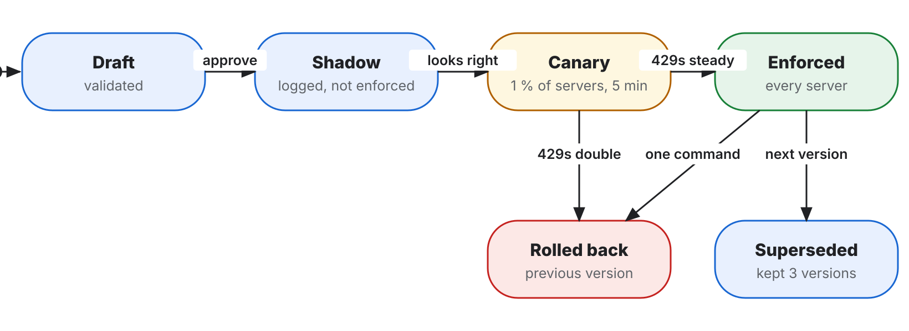

And the lifecycle of one policy version, because a limit change can take the API down as surely as a bad deploy. It starts as a draft, validated. In shadow, every server evaluates it beside the enforced version, and logs what it would have done, without doing it. In canary, one percent of servers enforce it for five minutes. Then it's enforced, everywhere. If the canaries' 429 rate doubles, or someone says so, it's rolled back to the previous version, from canary or from enforced. And an enforced version is eventually superseded by the next. Servers keep the last three, so a rollback is a pointer move. Challenge five lives on this diagram.

## 4 · Design, driven by challenges

*V1 is the C4 container view; every challenge changes it*

The design. I start directly with the container view, version one: the simplest thing that is correct. Then the interviewer breaks it, six times, and each fix is a change to this one picture, or a zoom into one of its boxes.

#### V1The simplest exact limiter: one shared bucket per key

<sub>C4 level 2 · containers</sub>

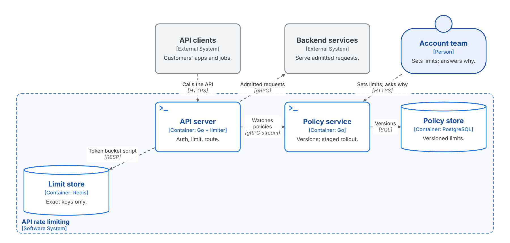

Version one, in the order a request travels. API clients call the API. The API server authenticates the request, and its limiter library makes the decision. By running a script against a shared limit store, Redis, which holds one bucket per customer and endpoint. Admitted requests go on to the backend services. The limits themselves come from a policy service, which every API server watches. Stored as versions in a policy store. And the account team edits them. One shared count per key: exact, and simple.

#### A request, and a limit change

<sub>Flow · FR1 and FR3 on V1</sub>

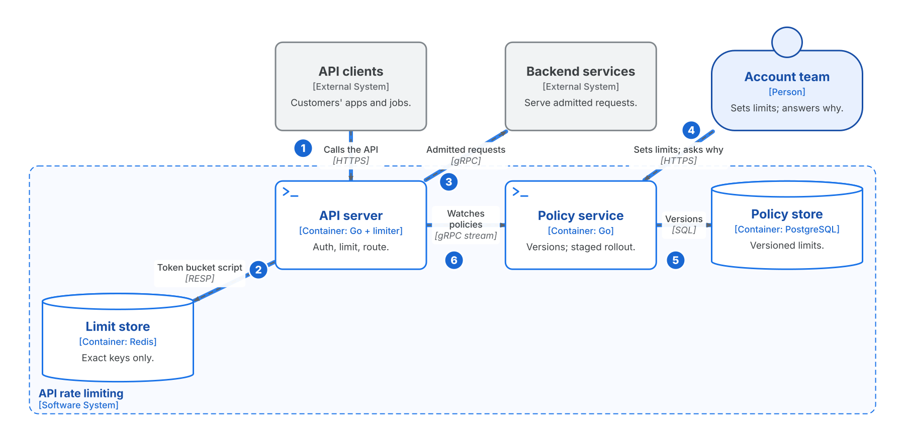

The happy path, numbered, once. One: a client calls the API. Two: the limiter runs the bucket script on the store for that customer and endpoint, and gets allowed and remaining. Three: admitted, the request goes to the backend, and the response carries the headers. Four: separately, the account team changes a limit. Five: the policy service writes it as a new version. Six: every API server is watching, and has it within seconds. FR1 and FR3, end to end.

#### A library in the API server: the decision never leaves the process

<sub>Technology · limiter library</sub>

- **How it is built.** A sharded map from `(customer, endpoint)` to a bucket: tokens, last refill on the monotonic clock, a lease and its expiry. Nothing blocks on I/O.

| Option | Why it is chosen, or why not |
|---|---|
| **A Go library linked into the API server** | Zero network hops: a lookup and a take, about two microseconds. |
| A sidecar proxy that asks a central rate-limit service | A network call per request: V1's round trip, behind another process. |
| A gateway plugin at the edge only | The edge sees the request before authentication and routing, so it cannot key by customer and endpoint. |

Background: building-blocks course, part 12 §12.1 (the token bucket) and part 11 §11.4 (the API gateway)

A sharded map from (customer, endpoint) to a bucket: tokens, last refill on the monotonic clock, a lease and its expiry. Nothing blocks on I/O. Why: Zero network hops. Rejected: A sidecar proxy that asks a central rate-limit service. A network call per request. A gateway plugin at the edge only. The edge sees the request before authentication and routing, so it cannot key by customer and endpoint.

#### Redis Cluster: a token bucket in one Lua script, on the key's shard

<sub>Technology · limit store</sub>

- **How it is built.** A hash `{tokens, ts}` per key, with a TTL. The script reads the shard's clock with `TIME`, refills, takes and writes in one step.

| Option | Why it is chosen, or why not |
|---|---|
| **Redis Cluster, a primary and a replica per shard** | A script runs to completion on the one thread that owns the key: read, refill, take and write are one atomic step, at about 100,000 scripted operations a second per shard. |
| Memcached `incr` | No scripts: refill and take become read-then-write from the client, and two servers race for the last token. |
| DynamoDB conditional writes | Exact, but about 5–10 ms and a paid write per request. |

Background: building-blocks course, part 8 §8.2 (conditional writes) and part 12 §12.1

A hash {tokens, ts} per key, with a TTL. The script reads the shard's clock with TIME, refills, takes and writes in one step. Why: A script runs to completion on the one thread that owns the key. Rejected: Memcached incr. No scripts. DynamoDB conditional writes. Exact, but about 5–10 ms and a paid write per request.

### 4.1 · Challenge 1: 1,000 at 11:59:59, 1,000 at 12:00:00

> [!IMPORTANT]
> **Coach:** Challenge one is the algorithm. It is the detail that shows whether a candidate has actually thought about windows.

> **Interviewer:** Your counter is per minute. A customer sends a thousand requests at 11:59:59 and a thousand more at 12:00:00. Is that within the limit?

#### Two thousand requests in one second, on a limit of a thousand a minute

<sub>Challenge 1 of 6 · the trace</sub>

| When | What happens |
|---|---|
| 11:59:00 | customer 42, limit 1,000 a minute on `/search`: quiet, counter 0 |
| 11:59:59.0 | 1,000 requests: window 11:59 counts 1,000; all admitted |
| 12:00:00.0 | a new window: the counter starts at 0; 1,000 more admitted |
| 12:00:01.0 | 2,000 requests in one second against a backend sized for about 17 a second |

- **Not a corner case.** Batch jobs start on the minute and on the hour. The boundary is exactly where real traffic lands.

The trace. Customer forty-two has a thousand a minute on search, and has been quiet. At eleven fifty-nine fifty-nine it sends a thousand requests. The counter for the eleven fifty-nine window reaches a thousand. All admitted. One second later a new window starts at zero, and a thousand more are admitted. Two thousand in one second, against a backend sized for about seventeen a second. Not a corner case: batch jobs start on the minute, exactly at the boundary.

#### A window resets; a bucket remembers

<sub>Challenge 1 of 6 · the break</sub>

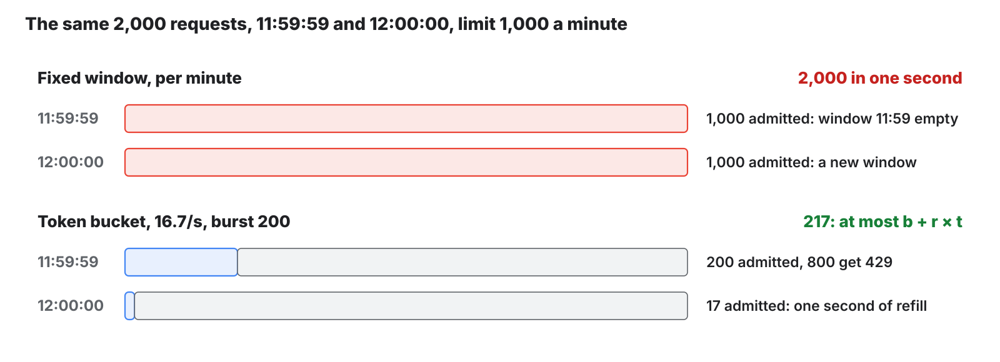

The same two thousand requests, through two algorithms. The fixed window admits a thousand on each side of the boundary: two thousand in one second. A token bucket with a rate of sixteen point seven a second and a burst of two hundred admits two hundred at eleven fifty-nine fifty-nine, and seventeen one second later. In any interval of t seconds it admits at most b plus r times t.

#### Five algorithms, compared, one picked

<sub>Challenge 1 of 6 · the options</sub>

| Algorithm | State per key | Bursts | Fails when |
|---|---|---|---|
| A · Fixed window counter | one counter | 2× at the boundary | traffic lands on the edge of a window |
| B · Sliding-window log | a timestamp per request | exact | 16 GB of timestamps; a trim on every check |
| C · Sliding-window counter | two counters | smoothed, approximate | traffic in the last window was uneven |
| **D · Token bucket** | two numbers | up to b, then the rate r | a burst of b is allowed, by design |
| E · Leaky bucket, as a queue | a queue | none: output smoothed | every burst waits in line: shaping, not quotas |

Rate and burst are two knobs, and customers asked for both.

Five algorithms, compared. A, the fixed window: one counter, and twice the limit at the boundary. We just saw it. B, the sliding-window log: exact, and a timestamp per request, sixteen gigabytes in all. C, the sliding-window counter: a cheap compromise that assumes the last window was even. D, which I pick: the token bucket. Two numbers per key, a burst of up to b, then the rate r. E, the leaky bucket as a queue: it makes every burst wait. That's shaping, not quotas.

> [!TIP]
> **If asked, I'd say:** Rate and burst are two knobs, and customers burst legitimately. The token bucket gives me both.

#### A token bucket, refilled lazily

<sub>Mechanism · 1 of 5</sub>

- **Protects.** `[S1-bounded-overshoot]` without blocking legitimate bursts
- **How it works.** Two numbers per key: tokens and the last refill time. On each request, add r × elapsed, capped at b; take the cost if it is there.
- **Rules out.** The boundary double: at most b + r × t in any t seconds.
- **Costs.** A burst of b is always allowed; one clock per key must do the refill.

The mechanism, just in time. It protects `[S1-bounded-overshoot]`, without blocking a legitimate burst. Two numbers per key: how many tokens, and when it was last refilled. Nothing runs in the background. On each request, add the rate times the time elapsed, capped at the burst, then take the cost if it's there. It rules out the boundary double. In any t seconds it admits at most b plus r times t. It costs a burst of b, always allowed, so b is a decision. And the refill needs one clock per key.

#### A token bucket, in one script, on the key's shard

<sub>Challenge 1 of 6 · the fix</sub>

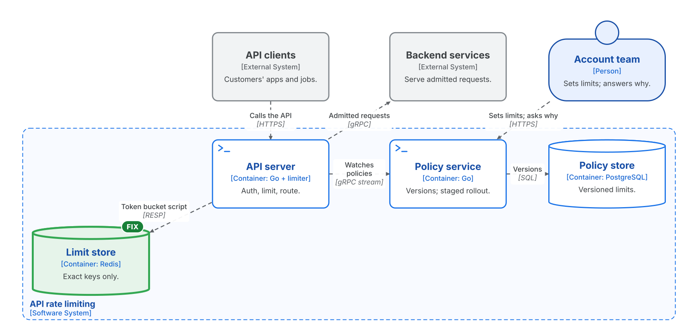

The fix, on the container view. The limit store, marked.

#### A token bucket, in one script, on the key's shard

<sub>Challenge 1 of 6 · the fix</sub>

- **Mechanism.** The bucket is a hash `{tokens, ts}`. One script refills with the shard's clock, compares, takes and writes, and returns allowed, remaining and retry-after.
- **Covers, and does not.** The boundary burst, and every race on one key. Not the round trip: every request still waits on the store.
- **Rejected:** **A sliding-window log**: exact, but one timestamp per request: 1,000 per key × 2 M keys × 8 B = 16 GB, and a trim on every check.

One level down: the bucket is a hash with tokens and a timestamp. One script refills it using the shard's own clock, compares, takes and writes, and returns allowed, what remains, and the retry-after. It covers the boundary burst, and any race on one key. It does not cover the round trip: every request still waits on the store. Rejected: the sliding-window log. Exact, but a timestamp per request: sixteen gigabytes, and a trim on every check.

#### Refill, compare, take: one step, one clock

<sub>Challenge 1 of 6 · the script, as pseudocode</sub>

```text
now = shard_time_ms()             # TIME, inside
tokens, ts = HMGET(key) or (b, now)
tokens = min(b, tokens + (now - ts) * r)
if tokens >= cost:
    tokens = tokens - cost; ok = true
else:
    ok = false
HSET(key, tokens, now)
PEXPIRE(key, 2 * b / r)
return ok, floor(tokens), (cost - tokens) / r
```

As pseudocode, the key lines marked. Line one: the time comes from the shard, inside the script, not from the caller. Line three: the lazy refill, capped at the burst. Line eight: the write happens in the same script as the read. Why it works: the script runs to completion on the thread that owns the key, so nothing happens between the read and the write. And idle keys expire.

> **Interviewer:** Two API servers check the same key at the same microsecond, with one token left.

#### One step on one thread, and one clock per key

<sub>Challenge 1 of 6 · one level deeper</sub>

- **One script, one thread.** The shard runs scripts one at a time: one server gets the token, the other a 429.
- **The store's clock.** 500 servers have 500 clocks. A server a second fast would mint a second of tokens per call.
- **Honest limit.** One key is one shard's thread: about 100,000 a second. The hot customer is right at it.
- **Rejected:** **GET, compare, then SET from the API server**: two servers both read one token and both admit; under load it leaks steadily — a real production bug.

The shard runs scripts one at a time, so exactly one server gets the last token, and the other gets a 429. And the refill uses the store's clock. Five hundred servers have five hundred clocks. If the caller supplied the time, a server running a second fast would mint a second of tokens on every call. The honest limit: one key is one shard's thread, about a hundred thousand operations a second. The hot customer is right at it. Rejected: get, compare, then set, from the API server. Both servers read one token and both admit. A real production bug.

> [!TIP]
> **If asked, I'd say:** A token bucket per customer and endpoint, refilled lazily. Rate and burst are separate knobs, and the boundary can't double the limit. Check and take are one atomic script on the key's shard, timed by its clock.

> [!IMPORTANT]
> **Coach:** That fix creates the next question: a round trip on every request, at three million a second.

### 4.2 · Challenge 2: Take the round trip off the hot path

> [!IMPORTANT]
> **Coach:** Challenge two is the crux of this question. Most answers either keep the shared counter or divide the limit. The grade is for what comes between.

> **Interviewer:** At the top of the hour that's three million scripts a second, and every API call waits on Redis. You have one millisecond. Take the round trip off the hot path. What do you lose?

#### The top of the hour, on V1

<sub>Challenge 2 of 6 · the trace</sub>

| When | What happens |
|---|---|
| 12:00:00 | batch jobs start: 3 M requests/s, 3 M scripts/s over 30 shards |
| 12:00:01 | customer 42 at 300 k/s: its shard at 100 % CPU, p99 4 ms |
| 12:00:02 | every key on that shard waits: API p99 up by 4 ms, for customers who did nothing |
| 12:00:40 | that shard fails over: 8 s without a primary; the API must guess |

- **What V1 became.** The API's slowest and least available dependency, sized by its busiest customer.

The trace. At noon the batch jobs start: three million requests a second, three million scripts over thirty shards. Customer forty-two goes to three hundred thousand a second. Its shard is at a hundred percent, and its p99 is four milliseconds. Every other key on that shard waits too. The API's p99 rises by four milliseconds for customers who did nothing. Forty seconds later that shard fails over. Eight seconds without a primary, and the API has to guess. The limiter became the API's slowest dependency, sized by its busiest customer.

#### Every request waits on the limit store

<sub>Challenge 2 of 6 · the break</sub>

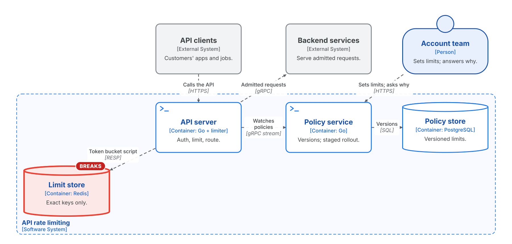

Version one, with the problem marked. The limit store is on every request. That gives exact counts, but it breaks `[L2-decide-in-1ms]` at p99, and with every failover it threatens `[S2-never-the-outage]`.

#### Where the count lives: five answers, one picked

<sub>Challenge 2 of 6 · the options</sub>

| Approach | Added latency | Over-admission | Fails when |
|---|---|---|---|
| A · central counter per request (V1) | a round trip | none | the store is slow, hot or failing over |
| B · static split: limit ÷ 500 | none | none | traffic is uneven: throttled at 0.6 % |
| C · route each customer to one owner | a hop, sometimes | none | the hot customer is one machine |
| D · gossip of local counts | none | ≈ rate × interval | 500 peers chatter; no one owns the number |
| **E · local buckets, leased by demand** | none | ≤ 5 % + cold starts | demand moves faster than 100 ms |

Exact where it is cheap, bounded where it is not.

Five places the count can live. A, a central counter per request: version one. B, a static split: no latency, and a customer on three servers is throttled at zero point six percent. C, route each customer to one owner server: exact, until the hot customer is one machine. D, gossip between servers: over-admission of the rate times the interval, and five hundred peers chattering. E, which I pick: local buckets, with tokens leased in proportion to demand. No added latency, at most five percent over.

> [!TIP]
> **If asked, I'd say:** Exact where it's cheap, bounded where it isn't, and the bound said out loud.

#### Leased tokens, sized by demand

<sub>Mechanism · 2 of 5</sub>

- **Protects.** `[L2-decide-in-1ms]` and `[S2-never-the-outage]`, within `[S1-bounded-overshoot]`
- **How it works.** Every 100 ms each server reports, per key, what it admitted and was asked. The quota service takes the admitted count out of the key's global bucket and leases the next interval's tokens in proportion to what each server was asked.
- **Rules out.** A network call per request; a share that ignores where the traffic lands.
- **Costs.** Up to 5 % over, plus a cold start; 100 ms to follow a shift; one more service.

The mechanism: leased tokens, sized by demand. It protects `[L2-decide-in-1ms]` and `[S2-never-the-outage]`, while staying inside `[S1-bounded-overshoot]`. Every hundred milliseconds, each server reports for each key what it admitted and what it was asked. The quota service takes the admitted count out of that key's global bucket, and leases the next interval's tokens to the servers in proportion to what each was asked. The server spends its lease locally. It rules out a network call per request, and a share that ignores where the traffic lands. It costs up to five percent over plus a cold start, a hundred milliseconds to follow a shift, and one more service.

#### V2A quota service, off the request path

<sub>Challenge 2 of 6 · the C4 delta</sub>

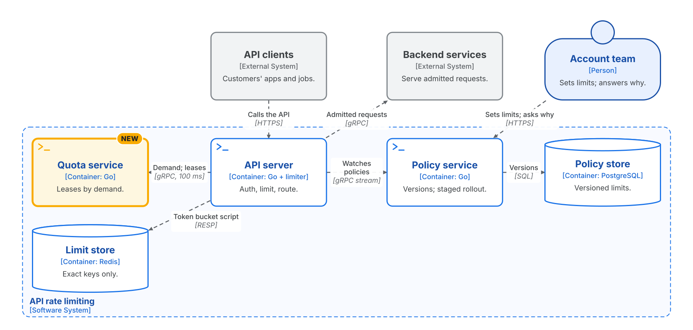

Version two. Everything from version one stays exactly where it was. New: a quota service, per region, sharded by key, state in memory. The API servers sync with it every hundred milliseconds, in batches, never per request. The limit store stays, but only for exact-mode keys: login attempts, hard-capped paid tiers. A few percent of traffic, whose owners accepted the round trip.

#### A request decided without leaving the server

<sub>Flow · FR1 on V2</sub>

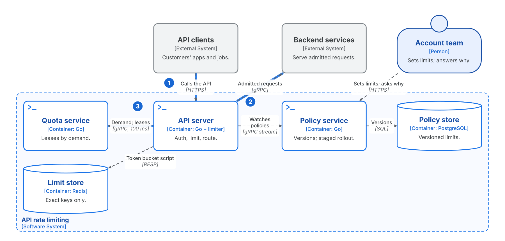

The request path, numbered. One: a client calls the API, and the limiter takes a token from the local bucket. In memory, about two microseconds. Two: admitted, the request goes to the backend. Three: on its own clock, every hundred milliseconds, the server sends what it admitted and was asked, and gets its next lease. Nothing on the request path waits for three.

#### A quota service that leases tokens to where the traffic is

<sub>Technology · quota service</sub>

- **How it is built.** Shards own keys by consistent hashing. Every 100 ms a server sends per key admitted, asked and the policy version; the shard returns its next lease.

| Option | Why it is chosen, or why not |
|---|---|
| **A Go service per region, 8 shards by key, state in memory** | It sees every server's demand for a key, so it can split by demand, and it is off the request path. |
| Redis as the coordinator | Splitting by demand needs every server's demand per key; in a script that is a 500-field hash per hot key on one thread. |
| Gossip between API servers | No centre, but over-admission is about the rate times the interval, and 500 peers chatter quadratically. |

Background: building-blocks course, part 12 §12.3 (distributed enforcement, leased capacity) and part 6 §6.5 (hot keys)

Shards own keys by consistent hashing. Every 100 ms a server sends per key admitted, asked and the policy version; the shard returns its next lease. Why: It sees every server's demand for a key, so it can split by demand, and it is off the request path. Rejected: Redis as the coordinator. Splitting by demand needs every server's demand per key. Gossip between API servers. No centre, but over-admission is about the rate times the interval, and 500 peers chatter quadratically.

#### Inside the API server: the limiter's seven components

<sub>C4 level 3 · the API server</sub>

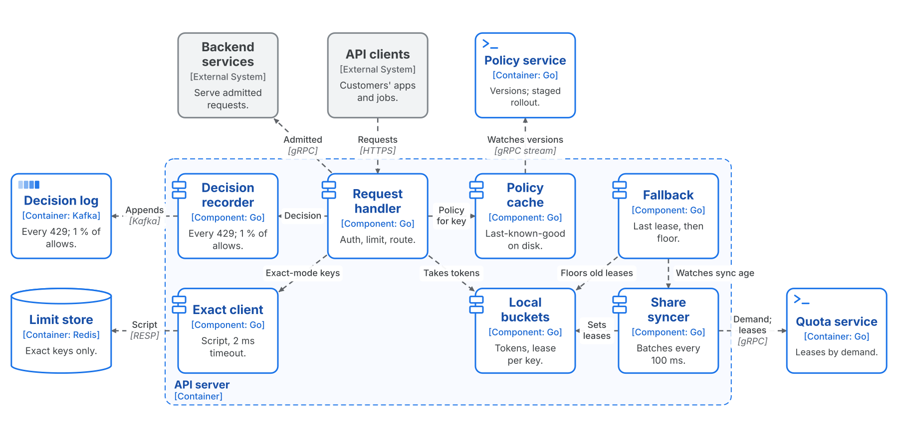

Before the fix, one level down: the API server's components. The limiter is a library inside it. A request handler authenticates, asks the limiter, and routes admitted requests to the backend. A policy cache holds the policies it watches, and keeps the last good copy on disk. Local buckets hold tokens and a lease per key, and an exact client runs the store's script for exact-mode keys, with a two-millisecond timeout. A share syncer batches the reports to the quota service, and a fallback watches how old the last sync is. And a decision recorder appends every 429, and a sample of allows, to a log. The next challenges each mark two or three of these boxes.

#### Spend locally, lease by demand

<sub>Challenge 2 of 6 · the fix</sub>

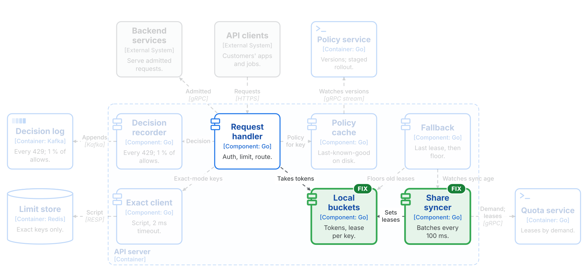

The fix, in the API server, where the request handler takes its tokens. The local buckets. And the share syncer.

#### Spend locally, lease by demand

<sub>Challenge 2 of 6 · the fix</sub>

- **Mechanism.** A bucket per key with rate = lease ÷ 100 ms. The sync carries (key, admitted, asked, policy version); lease = available × asked ÷ Σ asked, + 5 %.
- **Covers, and does not.** Uneven balancing, hot keys, the store's latency. Not a shift faster than 100 ms: a burst of false 429s, measured in challenge six.
- **Rejected:** **A static split: the limit ÷ 500 servers**: 2 per server per minute; a customer whose traffic lands on 3 servers is throttled at 0.6 % of its quota.

One level down: each key has a local bucket whose rate is its lease divided by the interval. The sync carries, per key, admitted, asked and the policy version. The quota service's lease to a server is the tokens available times that server's asked, over the sum of everyone's asked, plus five percent headroom. It covers uneven load balancing, hot keys, and the store's latency. It doesn't cover a shift in demand faster than a hundred milliseconds. That shows up as a burst of false 429s, which challenge six measures. Rejected: a static split, the limit divided by five hundred. Two per server per minute; a customer on three servers is throttled at zero point six percent.

#### The lease follows the traffic

<sub>Mechanism 2 · as a sequence</sub>

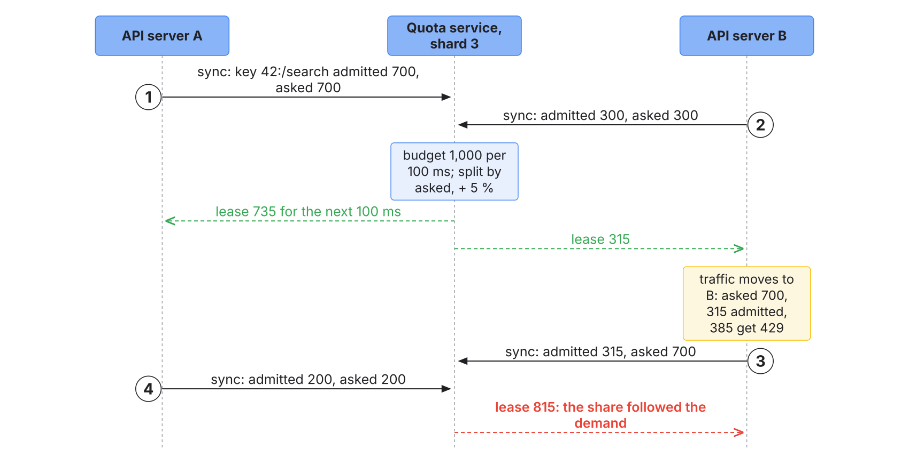

As a sequence: one key with a budget of a thousand per hundred milliseconds, and two servers. Server A admitted seven hundred and was asked seven hundred. Server B, three hundred. The quota service splits the next thousand by what was asked, plus five percent. A gets seven hundred and thirty-five. B gets three hundred and fifteen. Now the traffic moves to B. It's asked seven hundred, has three hundred and fifteen, and three hundred and eighty-five get a 429, although the customer is under its limit. That's the cost, and it lasts one interval. B reports it. A reports its drop. And B's next lease is eight hundred and fifteen. The share followed the demand. No server ever needed to know how the load balancer works.

> **Interviewer:** One customer is a tenth of all traffic, and a LB change puts forty percent of it on four servers. And a customer you've never seen sends its first request to every server at once.

#### Shares follow demand; a cold start is bounded

<sub>Challenge 2 of 6 · one level deeper</sub>

- **Uneven balancing.** Four servers asked for 40 %, so they get 40 % of the lease. Nothing assumes even balancing.
- **The hot customer.** 100 k/s on one key is 500 × 10 = 5,000 updates/s for the quota service, aggregated locally.
- **A cold key.** No lease yet: 2 provisional tokens per server. Worst case 500 × 2 = 1,000 extra, once.
- **Honest limit.** One interval of false 429s after a fast shift; exact keys pay the round trip instead.

Uneven balancing: the four servers asked for forty percent of the traffic, so they get forty percent of the lease. Nothing in this design assumes the load balancer is even. The hot customer: a hundred thousand a second on one key is five hundred servers reporting ten times a second, five thousand updates a second. It's aggregated where it lands, so the hot key costs nothing special. A cold key: a server with no lease starts with two provisional tokens. Worst case, all five hundred servers at once: a thousand extra requests, once. That's the cold-start bound. The honest limit: one interval of false 429s after a fast shift. And for the few keys that must never be over, exact mode pays the round trip instead.

> [!TIP]
> **If asked, I'd say:** Each server decides in memory, spending a lease of the key's global budget. Every hundred milliseconds the quota service re-splits it by what each server was asked, so the lease follows the traffic. At most five percent over plus a bounded cold start, and exact keys pay a round trip.

> [!IMPORTANT]
> **Coach:** That fix creates the next question. Every server now depends on the quota service. What if it's gone?

### 4.3 · Challenge 3: The quota service is down

> [!IMPORTANT]
> **Coach:** Challenge three is failure. The interviewer said fail open or closed is your call. This is where you defend it.

> **Interviewer:** At 14:02 the quota shard that owns a tenth of your keys stops answering. What does the API do, for those customers, for the next minute?

#### One shard gone, and two wrong defaults

<sub>Challenge 3 of 6 · the trace</sub>

| When | What happens |
|---|---|
| 14:02:00.0 | quota shard 3 in us-east loses its primary; the standby needs 20 s |
| 14:02:00.05 | syncs to shard 3 time out after 50 ms |
| 14:02:10 | fail closed: leases expire; one customer in eight gets only 429s |
| 14:02:10 | fail open, blindly: customer 42 sends 300 k/s straight at search |

- **Two wrong defaults.** One is an outage the limiter caused; the other is no protection when it is most needed.

The trace. At two minutes past two, quota shard three in us-east loses its primary. The standby needs twenty seconds. Fifty milliseconds later, syncs to that shard time out. Fail closed, and one customer in eight gets nothing but 429s. The limiter caused an outage. Fail open blindly, and customer forty-two sends three hundred thousand a second at search. Neither default is an answer.

#### Inside the API server: who notices the silence?

<sub>Challenge 3 of 6 · the break</sub>

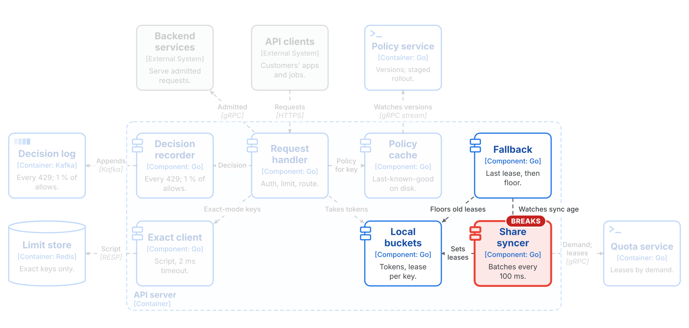

The same component view. The local buckets, the share syncer and the fallback are in play. The syncer is marked. The naive answer.

#### Inside the API server: who notices the silence?

<sub>Challenge 3 of 6 · the break</sub>

- **Naive answer.** “Fail open: the limiter must never take the API down.”
- **Break.** Half right. With no lease and no bound, the one customer the limit exists for goes straight through.

Fail open: the limiter must never take the API down. It's half right. With no lease and no bound, the one customer the limit exists for goes straight through to the backend.

#### Static stability, to a bounded floor

<sub>Mechanism · 3 of 5</sub>

- **Protects.** `[S2-never-the-outage]`, keeping `[S1-bounded-overshoot]` bounded
- **How it works.** Keep spending the last lease for its lifetime, 10 s. Then fall back to a local floor: 3 × the regional limit ÷ the region's servers. Decided per limit: product limits fail open to the floor, security limits fail closed.
- **Rules out.** The limiter as the outage; and no limit at all.
- **Costs.** During the outage, a customer can reach up to 3× its limit; concentrated traffic gets less.

The mechanism: static stability, to a bounded floor. It protects `[S2-never-the-outage]`, and keeps `[S1-bounded-overshoot]` bounded even then. A server keeps spending its last lease for the lease's lifetime, ten seconds. After that it falls back to a local floor: three times the regional limit, divided by the servers in the region. And it's decided per limit: product limits fail open to that floor, security limits fail closed. It rules out the limiter being the outage, and it rules out having no limit at all. It costs accuracy while the quota service is gone: a customer spread evenly can reach three times its limit, and one concentrated on a few servers gets less.

#### A lease, then a floor, then the standby

<sub>Mechanism 3 · as a sequence</sub>

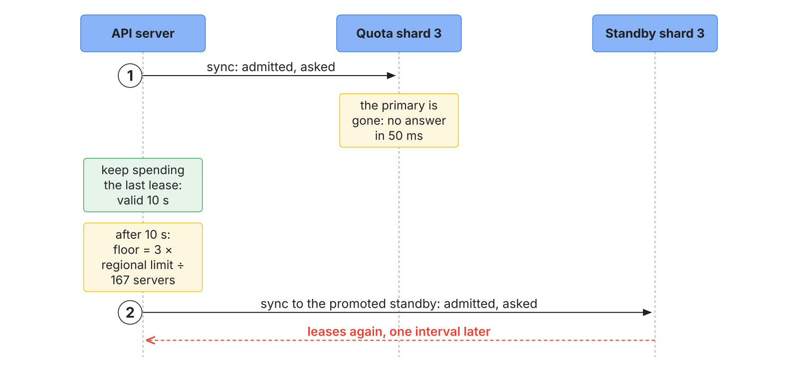

As a sequence. The server syncs. No answer in fifty milliseconds. It keeps spending its last lease, valid for ten seconds. After ten seconds, the floor: three times the regional limit over a hundred and sixty-seven servers. Twenty seconds in, the standby is promoted, and the next sync goes to it. Leases again, one interval later. Nobody got a 503, and nobody got unlimited traffic.

#### A fallback that is decided, not defaulted

<sub>Challenge 3 of 6 · the fix</sub>

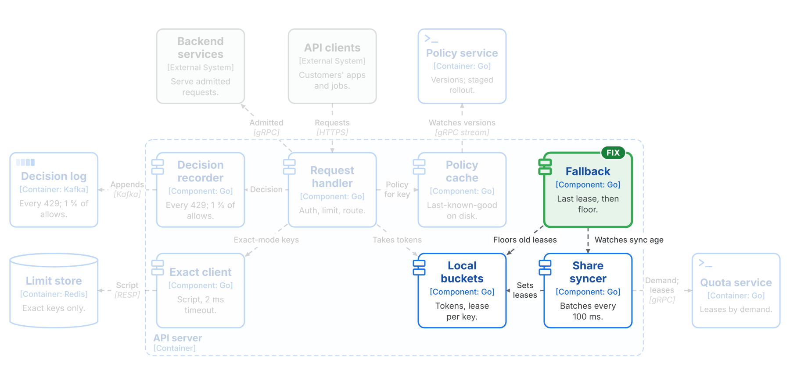

The fix, in the API server. The fallback, marked.

#### A fallback that is decided, not defaulted

<sub>Challenge 3 of 6 · the fix</sub>

- **Mechanism.** The fallback watches the sync age: under 10 s the lease stands; then a floor of 3 × limit ÷ servers. `on_failure` in the policy picks open-to-floor or closed.
- **Covers, and does not.** A dead shard, a slow one, a partition from it. Not a wrong policy: that is challenge five.
- **Rejected:** **Fail closed everywhere**: the limiter becomes the single point of failure of the whole API.

One level down: the fallback watches the age of the last sync. Under ten seconds, the lease stands; then the floor. The policy's on-failure field picks open-to-the-floor or closed, chosen by the limit's owner, and tested in a game day. It covers a dead shard, a slow one, and a partition from it. It doesn't cover a wrong policy. That's challenge five. Rejected: fail closed everywhere. It makes the limiter the single point of failure of the whole API.

#### Exact, leased, floored, or closed: in that order

<sub>Challenge 3 of 6 · the decision, as pseudocode</sub>

```text
p = policy(key)                # last-known-good
if p.mode == EXACT:
    return exact_or(p.on_failure)  # 2 ms timeout
b = buckets[key]
if b.lease_until > now:
    return b.take(cost)
if p.on_failure == CLOSED:
    return deny(key, "no lease")
b.rate = 3 * p.region_rate / servers
return b.take(cost)            # bounded, local
```

The whole decision, as pseudocode, key lines marked. Line five: a valid lease is spent locally, which is almost every request. Line seven: a limit whose owner chose closed rejects when there's no lease. Line nine: everything else drops to the floor, still a token bucket, still local. Why it works: there's no path through this function that waits on the network, except exact mode, which has its own timeout and its own failure mode.

> **Interviewer:** And an hour later the policy service is down too, while fifty API servers restart.

#### Never block startup on a dependency

<sub>Challenge 3 of 6 · one level deeper</sub>

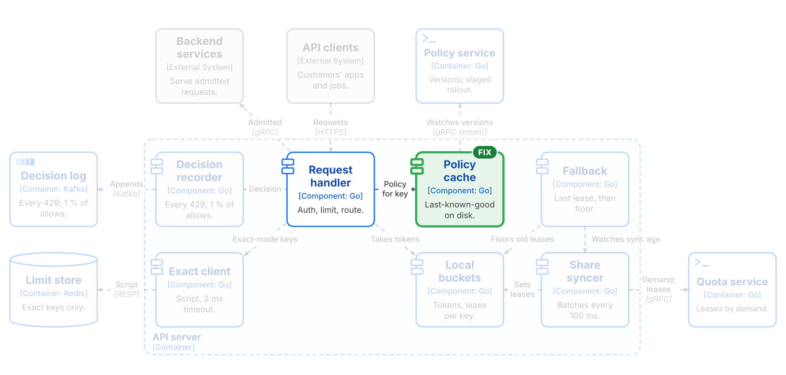

The policy cache is the box in play. The policy cache, marked.

#### Never block startup on a dependency

<sub>Challenge 3 of 6 · one level deeper</sub>

- **Last-known-good on disk.** Every snapshot is written locally with its version; a restart loads it, then watches.
- **Start conservative.** No leases after a restart: provisional tokens and the floor until the first sync, 100 ms.
- **Honest limit.** Policy changes made during the outage wait for it; the floor bounds the rest.

Every policy snapshot is written to local disk with its version. A restarting server loads it, and starts serving before it reconnects. Even with no file at all, the release carries tier defaults, so a server never refuses to start. A restarted server has no leases: provisional tokens and the floor, until its first sync a hundred milliseconds later. The honest limit: a change made while the policy service is down waits for it. Everything else keeps working.

> [!TIP]
> **If asked, I'd say:** The limiter keeps working on what it has. The last lease for ten seconds, then a local floor, and a last-known-good policy on disk. Open-to-the-floor or closed is decided per limit by its owner, and tested, so the limiter is never the outage.

> [!IMPORTANT]
> **Coach:** That fix keeps one region standing. The next question: one customer, one quota, three regions.

### 4.4 · Challenge 4: One quota, three regions

> [!IMPORTANT]
> **Coach:** Challenge four is geography. The honest answer has a number in it.

> **Interviewer:** A customer's contract says sixty thousand requests a minute, worldwide. Their traffic moves from Europe to the US during the day. How exact can you be?

#### A global contract against two naive answers

<sub>Challenge 4 of 6 · the trace</sub>

| When | What happens |
|---|---|
| 08:00 UTC | customer 7: 1,000/s worldwide; 80 % in eu-west, 15 % us-east, 5 % ap-south |
| 08:00 | split statically, a third each: eu gets 333/s, asks 800: 467/s rejected while under the contract |
| 08:00 | one global counter in us-east: every eu decision crosses the Atlantic: +80 ms |
| 16:00 | the traffic moves: 70 % in us-east |

- **The number that decides it.** An exact global limit needs a 70–150 ms round trip per decision: a hundred times the budget.

The trace. Customer seven: a thousand a second worldwide. At eight in the morning, eighty percent in Europe, fifteen in the US, five in Asia. Split statically, a third each, Europe gets three hundred and thirty-three and asks for eight hundred. Four hundred and sixty-seven a second rejected, while the customer is under its contract. One global counter in us-east instead: every European decision crosses the Atlantic. Eighty milliseconds. And at four in the afternoon the traffic moves: seventy percent in the US. Exact across regions needs a round trip of up to a hundred and fifty milliseconds per decision.

#### The quota service only knows its own region

<sub>Challenge 4 of 6 · the break</sub>

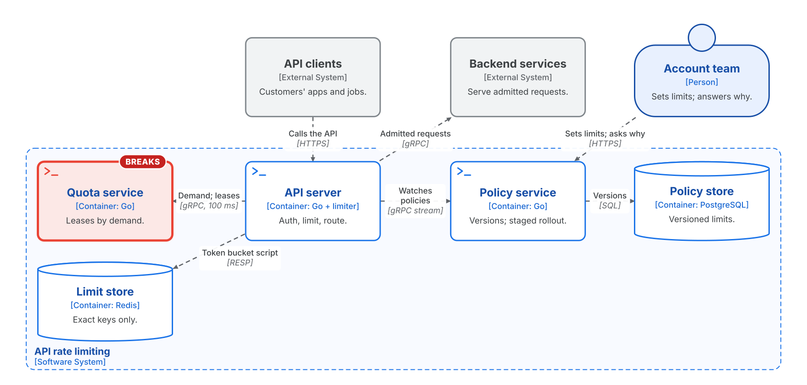

Version two, with the problem marked. The quota service is regional. It splits the budget between the servers of one region, and knows nothing of the other two, so a global contract either over-admits three times or breaks `[S3-no-false-limits]`.

#### Regional budgets, re-split every 2 s

<sub>Mechanism · 4 of 5</sub>

- **Protects.** `[S1-bounded-overshoot]` globally, and `[S3-no-false-limits]`
- **How it works.** Each region's quota service holds a budget: the global limit × its share of global demand. Every 2 s the regions exchange admitted and asked per global key and re-split. Servers still lease from their own region.
- **Rules out.** A cross-region call per decision; a static split by region.
- **Costs.** 2 s to follow a move; peering between regions; a partition freezes the split.

The mechanism: regional budgets, re-split every two seconds. The same idea one level up. It protects `[S1-bounded-overshoot]` across regions, and `[S3-no-false-limits]`. Each region's quota service holds the global limit times its share of global demand. Every two seconds the regions exchange admitted and asked, and re-split. Servers keep leasing locally; nothing on the request path crosses an ocean. It rules out a cross-region call per decision, and a static split by region. It costs two seconds to follow a move, a peering link between regions, and when that link partitions, the split freezes.

#### V3The regions' quota services talk to each other

<sub>Challenge 4 of 6 · the C4 delta</sub>

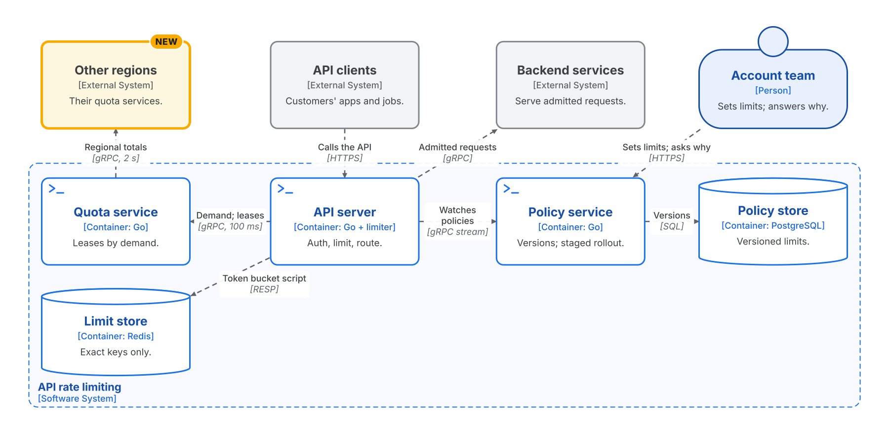

This one changes the container view, so it's version three. Version two, carried, with one box new. The other regions: their quota services. Ours exchanges regional totals with them every two seconds over gRPC, for keys whose scope is global. Most keys are regional, and never leave the region.

#### Three regions re-split one budget

<sub>Mechanism 4 · as a sequence</sub>

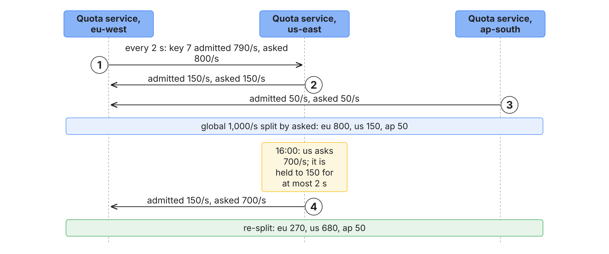

As a sequence, between the three regions' quota services. Every two seconds, Europe reports customer seven: admitted seven hundred and ninety a second, asked eight hundred. The US: a hundred and fifty. Asia: fifty. So the global thousand splits by what was asked: eight hundred, a hundred and fifty, fifty. At four in the afternoon the US asks for seven hundred. For at most two seconds it's held to a hundred and fifty. It reports. And the re-split follows: Europe two hundred and seventy, the US six hundred and eighty, Asia fifty. Two seconds to follow a move that took hours to happen.

> **Interviewer:** The Atlantic link partitions for ten minutes.

#### A partition makes it stricter, not looser

<sub>Challenge 4 of 6 · one level deeper</sub>

- **Each region keeps its last budget.** The budgets still sum to the global limit, so nobody over-admits.
- **A silent peer's budget is not taken.** Budgets are leased for 30 s and renewed; a region never spends one it cannot see renewed.
- **Honest limit.** A region whose demand grows during the partition is held to its last budget: false 429s, measured.
- **Rejected:** **One global counter in one region**: a 70–150 ms round trip per decision from the other two regions: a hundred times the budget.

Each region keeps its last budget. They still add up to the global limit, so a partition makes the limit stricter, never looser. And no region takes a silent peer's share. Budgets are leased for thirty seconds and renewed; a peer that can't be heard keeps its budget until it expires on both sides, and then both fall to their contracted regional weight. The honest limit: a region whose demand grows during the partition is held to its last budget. Those are false 429s, and challenge six counts them. Rejected: one global counter in one region: a hundred times the budget for the other two. I'd write global within two seconds and five percent into the contract.

> [!TIP]
> **If asked, I'd say:** Exact across regions costs a cross-region round trip per decision, so I don't promise it. Each region holds a budget proportional to its share of global demand, re-split every two seconds. A partition freezes the split: stricter, never looser.

> [!IMPORTANT]
> **Coach:** That fix makes the limits right in space. The next question changes them in time.

### 4.5 · Challenge 5: 10× burst for 30 seconds, every hour

> [!IMPORTANT]
> **Coach:** Challenge five is the curveball. It tests whether the algorithm can express real policy, and whether the candidate pushes back on special cases.

> **Interviewer:** A large customer's batch job runs at the top of every hour. They need ten times their rate for the first thirty seconds. Can your design express that?

#### A batch job against a flat bucket

<sub>Challenge 5 of 6 · the trace</sub>

| When | What happens |
|---|---|
| tier | customer 9: 100/s, burst 200 |
| 13:00:00 | the job fires: 1,000/s for 30 s, 30,000 requests |
| 13:00:30 | 200 + 100 × 30 = 3,200 admitted; 26,800 get 429 |
| 13:05 | their ticket: “your limiter breaks our nightly reconciliation, every hour” |

- **And it is not one customer.** About 200 customers have hourly jobs: they are the 3 M/s peak in the scale line.

The trace. Customer nine has a hundred a second with a burst of two hundred. At one o'clock their job fires: a thousand a second for thirty seconds. Thirty thousand requests. The bucket admits its burst plus thirty seconds of refill: three thousand two hundred. Twenty-six thousand eight hundred get a 429. And a ticket: your limiter breaks our job, every hour. It isn't one customer. About two hundred have hourly jobs. They're the three-million-a-second peak in the scale line.

#### A policy is a rate and a burst, with no time in it

<sub>Challenge 5 of 6 · the break</sub>

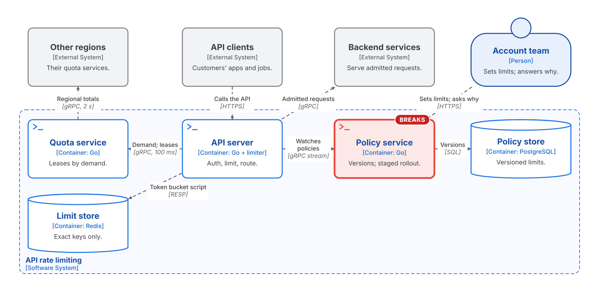

Version three, with the problem marked. The policy service stores a rate and a burst. There's no way to say 'ten times, for thirty seconds, every hour', so the naive answer is a hand edit at one minute to one, and someone undoing it at one past.

#### Scheduled, versioned, staged policy

<sub>Mechanism · 5 of 5</sub>

- **Protects.** `[L1-change-in-10s]` and `[S1-bounded-overshoot]`
- **How it works.** A tier carries time windows: a cron, a duration and a multiplier. Every bucket computes its rate from the active window. A change is a new version that goes shadow → canary → enforced.
- **Rules out.** Hand edits at 12:59; a code path per customer; a bad change everywhere at once.
- **Costs.** A window check on every refill; minutes to roll out; the hour's peak must be paid for.

The mechanism: scheduled, versioned, staged policy. It protects `[L1-change-in-10s]`, and `[S1-bounded-overshoot]` at the top of every hour. A tier carries time windows: a cron, a duration and a multiplier. Every bucket, local and global, computes its rate from the window active now. And a change is a new version that goes through shadow, canary and enforced. It rules out hand edits at one minute to the hour, a code path per customer, and a bad change reaching every server at once. It costs a window check on every refill, minutes to roll out, and the top of the hour's peak has to be paid for by someone.

#### Bursts as a tier, not an exception

<sub>Challenge 5 of 6 · the fix</sub>

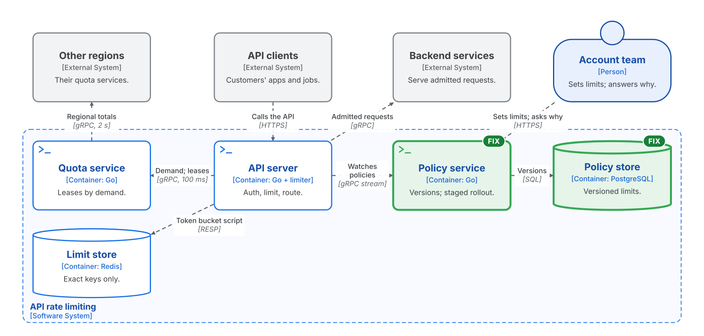

The fix, on the container view. The policy service. And its store.

#### Bursts as a tier, not an exception

<sub>Challenge 5 of 6 · the fix</sub>

- **Mechanism.** A tier “batch-hourly”: rate × 10 from :00:00 to :00:30, with an owner and an expiry. The quota service and every bucket evaluate the same version, so leases follow.
- **Covers, and does not.** Any scheduled burst, sold and capacity-planned. Not the backend's own limit: 200 jobs at :00 is the 3 M/s peak.
- **Rejected:** **Hand-edited per-customer exceptions**: no owner, no expiry, no staged rollout; two hundred of them and every top of the hour is a capacity incident.

One level down: a tier called batch-hourly, ten times the rate for the first thirty seconds of the hour, with an owner and an expiry. Every bucket and the quota service evaluate the same version, so leases grow at one o'clock by themselves. It covers any scheduled burst, sold and capacity-planned. It doesn't make the backend absorb two hundred jobs at once: that's the three-million peak, and the tier is sold against it. Rejected: hand-edited per-customer exceptions. No owner, no expiry, no staged rollout. Two hundred of them, and every top of the hour is a capacity incident.

#### The rate depends on the time; nothing else changes

<sub>Challenge 5 of 6 · the schedule, as pseudocode</sub>

```text
def rate(p, t):
    for w in p.tier.windows:     # cron, 30 s, x10
        if w.active(t):
            return p.rate * w.mult
    return p.rate

r = rate(p, now)
tokens = min(cap(p, now),
             tokens + (now - ts) * r)
```

As pseudocode, key lines marked. Line three: a window is active by the time now, from a cron and a duration. Line seven: the rate for this refill. Line eight: the same lazy refill as challenge one, with a rate and a cap that depend on the time. Why it works: the bucket was always a function of the policy and the time; a schedule makes the policy one too.

> **Interviewer:** Two hundred more customers want the same. And one Friday an edit with a typo sets every limit in a tier to zero.

#### A limit change is a deploy: validate, shadow, canary, roll back

<sub>Challenge 5 of 6 · one level deeper</sub>

- **Validate.** A cut of more than 50 %, or a change to over 1,000 customers, needs a second approver.
- **Shadow.** Evaluated beside the enforced version and logged: “would have rejected 41 % of requests”.
- **Canary.** 1 % of servers for 5 min; rolled back by itself if their 429 rate doubles.
- **Roll back.** Servers keep the last 3 versions: back to the previous one everywhere in under 10 s.

The typo is the more important half. A limit change is a deploy, and it goes through the lifecycle from chapter three. Validate: a cut of more than half, or a change touching more than a thousand customers, needs a second approver. Shadow: every server evaluates the new version beside the enforced one and logs the difference. 'This would have rejected forty-one percent of requests' is caught before anyone is rejected. Canary: one percent of servers for five minutes, rolled back by itself if their 429 rate doubles. And roll back: servers keep the last three versions, so going back is a pointer move, everywhere in under ten seconds. That's `[L1-change-in-10s]`, used in the other direction.

#### Policies as versioned configuration, watched by every server

<sub>Technology · policy service</sub>

- **How it is built.** Each change is a new row `(customer, endpoint, version)` with an owner and an expiry, streamed to servers, which keep it on disk as last-known-good.

| Option | Why it is chosen, or why not |
|---|---|
| **A Go service over PostgreSQL, pushed over a gRPC stream** | A limit change is a production change: versions, an audit trail and a staged rollout come from a relational store, and a stream gets it to 500 servers in seconds. |
| etcd as the policy store | Watch is right, but millions of rows and the audit queries are not what it is for. |
| A config file polled from object storage | Minutes to propagate, and no shadow or canary step. |

Background: building-blocks course, part 4 §4.6 (configuration distribution) and part 13 §13.7 (static stability)

Each change is a new row (customer, endpoint, version) with an owner and an expiry, streamed to servers, which keep it on disk as last-known-good. Why: A limit change is a production change. Rejected: etcd as the policy store. Watch is right, but millions of rows and the audit queries are not what it is for. A config file polled from object storage. Minutes to propagate, and no shadow or canary step.

> [!TIP]
> **If asked, I'd say:** Yes. A tier carries time windows, evaluated identically by every bucket and the quota service. I'd sell it as a tier with an owner and an expiry, against planned capacity, not as an exception. And every limit change is a deploy: validated, shadowed, canaried, and rolled back in seconds.

> [!IMPORTANT]
> **Coach:** That fix creates the last question. Every part can now be right. How would you know when a customer was limited wrongly?

### 4.6 · Challenge 6: “You limited us while we were under”

> [!IMPORTANT]
> **Coach:** Challenge six is observability. In this question it is about a wrong decision, not a down server.

> **Interviewer:** A top customer says you rejected them last Tuesday from two to twenty past, while they were under their limit. What do you look at, and how would you have known first?

#### Twenty minutes of wrong 429s, all dashboards green

<sub>Challenge 6 of 6 · the trace</sub>

| When | What happens |
|---|---|
| Tue 13:58 | a load-balancer change moves 60 % of customer 42's traffic onto 12 servers in one zone |
| 14:00–14:20 | those servers' leases lag every interval: 3 % of requests get 429 at 85 % of the limit |
| 14:00–14:20 | decision latency, quota service, error rate: green; total 429 rate +0.1 % |
| Fri | the customer's escalation, with request IDs and a contract number |

- **What nobody measured.** Rejections of a customer who was under its limit.

The trace. Tuesday at two minutes to two, a LB change moves sixty percent of customer forty-two's traffic onto twelve servers in one zone. For twenty minutes, those servers' leases lag the demand every interval. Three percent of the customer's requests get a 429, while it's at eighty-five percent of its limit. Decision latency, the quota service and the error rate are green, and the total 429 rate rose by a tenth of a percent. On Friday, an escalation with request IDs and a contract number. What nobody measured: rejections of a customer who was under its limit.

#### V4Every decision that matters, recorded and queryable

<sub>Challenge 6 of 6 · the C4 delta</sub>

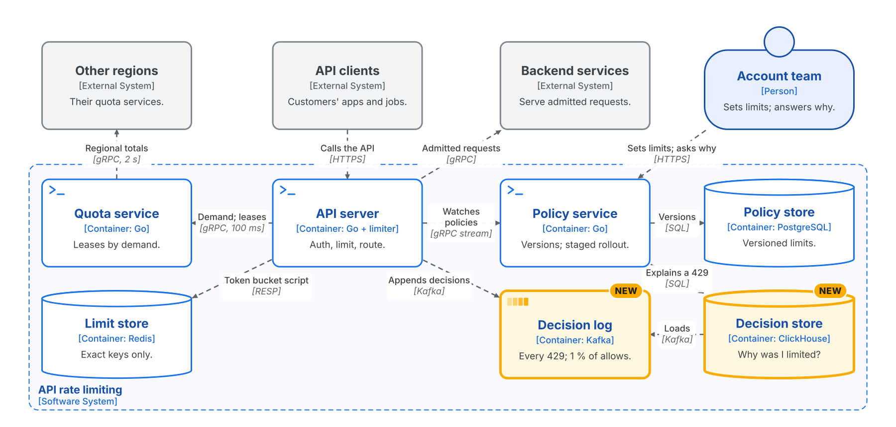

This changes the container view: version four. Version three, carried, with two boxes new. A decision log, in Kafka: every 429, and one allow in a hundred, appended without waiting. And a decision store, ClickHouse, loaded from it. The policy service answers 'why was I limited' by querying it.

#### Record the decision, with everything that made it

<sub>Challenge 6 of 6 · the fix</sub>

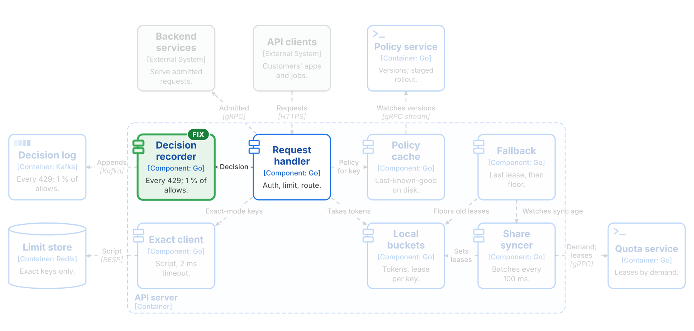

The fix, inside the API server. The decision recorder.

#### Record the decision, with everything that made it

<sub>Challenge 6 of 6 · the fix</sub>

- **Mechanism.** Per 429: decision ID, key, server, policy version, mode, lease, local tokens, sync age, global admitted at the last sync. Fire-and-forget; drops are counted.
- **Covers, and does not.** Any 429 explained from its ID, in minutes. Not the allows in full: a 1 % sample is enough for rates.
- **Rejected:** **Sampling the 429s like the allows**: the rejection the customer is asking about is the one you dropped.

One level down: for every 429 it records the decision ID sent to the client, the key, server, policy version, mode, lease, local tokens, sync age, and the global count at that sync. Appended without waiting; if Kafka is slow, records are dropped and counted. It covers any 429, explained from its ID in minutes. It doesn't record every allow. A one percent sample is enough for rates. Rejected: sampling the 429s like the allows. The rejection the customer is asking about is the one you dropped.

#### Three signals about decisions, not machines

<sub>Challenge 6 of 6 · the fix, one level down</sub>

- **False-limit rate.** 429s on keys whose global admitted rate that minute was under 95 % of the limit. SLO: under 0.1 % per customer per day.
- **Latency and sync age.** Decision p99 under 1 ms; sync age p99 under 300 ms; share of servers on the floor.
- **Over-admission.** Global admitted against the limit, per key-minute: alert above 5 %.
- **Answering the customer.** The decision ID on their 429 → the record → policy version, lease, global count: the false limits, minute by minute.

One level down, three signals, about decisions rather than machines. The false-limit rate. A scheduled query joins the decisions with the quota service's global totals per key and minute, and counts 429s where the customer was under ninety-five percent of its limit. The SLO is under a tenth of a percent per customer per day. That's `[S3-no-false-limits]`, made measurable, and it would have fired on Tuesday at two oh five. Latency and sync age: decision p99 under a millisecond, sync age p99 under three hundred milliseconds, and the share of servers running on the floor. And over-admission, the other direction: global admitted against the limit, alerting above five percent. To answer the customer: the decision ID on their 429 leads to the record. We can show their false limits minute by minute, and the balancer change behind them.

#### Symptoms in pairs: what each one means

<sub>Challenge 6 of 6 · reading the signals</sub>

| Symptom | Paired with | Means |
|---|---|---|
| False limits up | sync age normal | demand moved faster than 100 ms: a balancer change |
| False limits up | sync age up | the quota service is slow |
| 429s up | global admitted at the limit | a real overage: correct |
| Over-admission above 5 % | many new keys | cold starts, or headroom too large |
| Servers on the floor | sync errors to one shard | a quota shard is down: challenge three |

Read symptoms in pairs; a number alone is not a diagnosis. False limits up, sync age normal: demand moved faster than the interval. A balancer change. Our case. False limits up, sync age up: the quota service is slow. 429s up while the global count is at the limit: a real overage. The limiter is doing its job. Over-admission above five percent with many new keys: cold starts, or too much headroom. Servers on the floor, with sync errors to one shard: that shard is down, challenge three.

#### Every 429 kept, one allow in a hundred, queryable in seconds

<sub>Technology · decision store</sub>

- **How it is built.** The library appends without waiting; ClickHouse loads `decision` by day, ordered by `(customer, endpoint, ts)`: one customer's hour is a range scan.

| Option | Why it is chosen, or why not |
|---|---|
| **Kafka into ClickHouse, 30 days** | Twenty thousand decisions a second is an append workload with slice-and-dice reads: a log for durability, a columnar store for the questions support asks. |
| Elasticsearch | Indexing every field of 20,000 records a second costs several times the storage, for queries that are ranges by key. |
| Logging every decision | A million records a second to answer questions that every 429 and a 1 % sample answer. |

Background: building-blocks course, part 14 §14.7 (logging pipelines) and §14.9 (columnar storage)

The library appends without waiting; ClickHouse loads decision by day, ordered by (customer, endpoint, ts): one customer's hour is a range scan. Why: Twenty thousand decisions a second is an append workload with slice-and-dice reads. Rejected: Elasticsearch. Indexing every field of 20,000 records a second costs several times the storage, for queries that are ranges by key. Logging every decision. A million records a second to answer questions that every 429 and a 1 % sample answer.

> **Interviewer:** And if the decision log itself drops records?

#### Check the checker

<sub>Challenge 6 of 6 · one level deeper</sub>

- **Counters reconcile the log.** Each server counts its 429s per minute as a metric; the log's count must match within 0.1 %, or it pages.
- **A canary customer.** A synthetic key sends 90 % of its limit from every region; any 429 to it pages.

Counters reconcile the log. Each server counts its 429s per minute as a plain metric, never sampled. The log's count for that minute must match within a tenth of a percent, or it pages about itself. And a canary customer: a synthetic key that sends ninety percent of its limit from every region, all day. It is never over, so any 429 to it is a false limit by construction, and it pages.

> [!TIP]
> **If asked, I'd say:** I'd answer from the decision ID on their 429. Its record shows their false limits, minute by minute. And I'd have known first: a false-limit rate per customer with an SLO, over-admission in the other direction, and a canary customer that should never see a 429.

## 5 · When you don't need all this

*The simpler design, and the number where it stops being enough*

Before the recap: a much smaller design is correct at a smaller scale, and I should say where the line is.

#### One Redis, one script, a config file

<sub>Alternate path</sub>

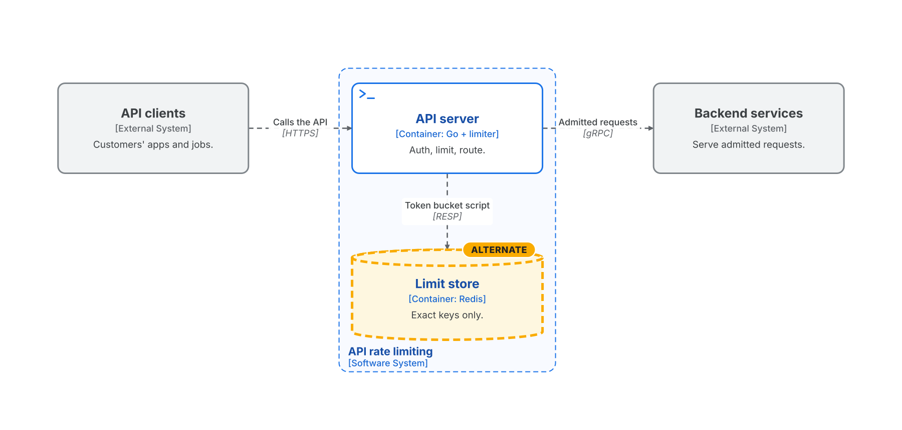

The alternate path: no quota service, no policy service, no decision store. One Redis, marked alternate. Each request runs challenge one's script on one primary, with a replica.

#### One Redis, one script, a config file

<sub>Alternate path</sub>

- **How it works.** Each request runs challenge one's token-bucket script on one Redis primary with a replica; limits come from a config file deployed with the API.
- **What it gives up.** A round trip on every request; Redis on the critical path, so it must fail open; a hot key on one thread; no global scope.

Limits come from a config file deployed with the API. It's exact, and it's version one with the right algorithm. What it gives up, precisely: a round trip on every request. Redis on the critical path, so it must fail open, explicitly. A hot customer on one thread. And no global scope across regions.

Where is the line? One shard runs about a hundred thousand scripts a second. We peak at three million, with a budget of one millisecond. That's sixty times past what one shard does comfortably, and the budget is under the round trip.

> [!TIP]
> **If asked, I'd say:** Below about fifty thousand requests a second at peak, in one region, with a couple of milliseconds to spare, I'd ship one Redis and one script, and say out loud the number where I'd switch.

## 6 · Recap

*The final design, the trade-offs, and what comes next*

The recap. One picture with the mechanisms on it, the stack against its rivals, and the mistakes that cost most.

#### V4Where each mechanism ended up

<sub>Recap · the final container view</sub>

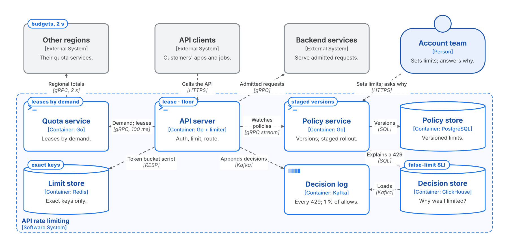

Version four, the final design: the same picture as version one, with four boxes more. The mechanisms go on it one at a time. The API server decides in memory: a leased token bucket, and a floor when the lease is old. The limit store holds only the exact keys, one atomic script each. The quota service leases each key's budget by demand, every hundred milliseconds. The regions re-split global budgets every two seconds. The policy service ships every limit change as a staged version. And the decision store turns every 429 into an answer, and into a false-limit rate.

#### The stack, against its rivals

<sub>Recap · the trade-offs</sub>

| Container | Choice | Rejected | The deciding reason |
|---|---|---|---|
| Limiter library | Go, in process | sidecar + central service | no hop on the decision |
| Limit store | Redis Cluster, Lua | Memcached, DynamoDB | atomic on one thread; exact keys only |
| Quota service | Go, sharded, in memory | Redis coordinator, gossip | splits by demand; off the request path |
| Policy service | Go + PostgreSQL, streamed | etcd, polled files | versions, audit, staged rollout |
| Decision store | Kafka → ClickHouse | Elasticsearch, log everything | every 429 kept; range scans by key |

> [!IMPORTANT]
> **Coach · what is graded here.** Naming a product is not the signal. Naming the property that rules out its rival is.

The stack on one slide, as I would leave it on the whiteboard. Limiter library: Go, in process. Not sidecar + central service. No hop on the decision. Limit store: Redis Cluster, Lua. Not Memcached, DynamoDB. Atomic on one thread; exact keys only. Quota service: Go, sharded, in memory. Not Redis coordinator, gossip. Splits by demand; off the request path. Policy service: Go + PostgreSQL, streamed. Not etcd, polled files. Versions, audit, staged rollout. Decision store: Kafka to ClickHouse. Not Elasticsearch, log everything. Every 429 kept; range scans by key.

> [!IMPORTANT]
> **Coach:** Naming a product is not the signal. Naming the property that rules out its rival is. Interviewers go one level down on whichever box you name, so name only what you can defend.

#### What costs most in this round

<sub>Recap · the mistakes</sub>

| Mistake | Instead |
|---|---|
| A Redis increment per request, per fixed window | a token bucket, decided in memory, leased |
| Read the counter, then write it | one atomic script, timed by the store's clock |
| The limit divided by the number of servers | leases that follow demand |
| Fail closed by default | a failure mode per limit, to a bounded floor |
| “Exactly global” across regions | regional budgets re-split every 2 s, the bound stated |
| No answer to “why was I limited?” | a decision ID on every 429; a false-limit SLO |

> [!IMPORTANT]
> **Coach:** The mistakes that cost most in this round. A Redis increment per request, per fixed window. Instead, a token bucket, decided in memory, from a lease. Reading the counter, then writing it. Instead, one atomic script, timed by the store's clock. Dividing the limit by the number of servers. Instead, leases that follow demand. Failing closed by default. Instead, a failure mode per limit, to a bounded floor. Promising exactly global across regions. Instead, regional budgets re-split every two seconds, and the bound stated. And no answer to 'why was I limited'. Instead, a decision ID on every 429, and a false-limit SLO.

#### Questions you should be ready for next

<sub>Recap · follow-ups</sub>

| Follow-up question | Where this video answers it |
|---|---|
| Billing wants the limiter's counts | no: metering reads the request logs, exactly |
| An export costs 50 times a search | a cost per endpoint; take(cost), same bucket |
| A slow backend needs concurrency limits | an in-flight count per key (part 12.4) |
| All within quota, and the backend melts | shedding by criticality (part 12.5) |
| Build or buy? | a gateway's limiter is V1; build leases for 1 ms |
| What would you ship in week one? | local buckets, static share, shadow mode, 429s logged |

The follow-up questions an interviewer asks next, and where I'd start. Billing wants the limiter's counts: no. Metering reads the request logs, exactly. The limiter is allowed to be five percent off. An export costs fifty times a search: a cost per endpoint in the policy, taken from the same bucket. A slow backend needs concurrency limits: an in-flight count per key, released on completion. A different limiter. Everyone is within quota and the backend still melts: that's load shedding by criticality, not quotas. Build or buy: a gateway's global rate-limit service is version one. I'd build the lease layer only for a one-millisecond budget or global scope. And week one, at the manager layer: in-process buckets with a conservative static share, in shadow mode, with every 429 logged. Leases in week four, global scope when a contract asks for it.

> [!TIP]
> **If asked, I'd say:** A rate limiter sits on every request, so its availability and latency matter more than its accuracy. Decide in memory, lease the budget to where the traffic lands, and know exactly how wrong you can be.

Thanks for watching. The written design, generated from this same script, is linked below.

## Implementation Lab & Reproducible Workspace

Everything in this design is reproducible from files in this folder:

| File | What it is |
|---|---|
| [`workspace.dsl`](workspace.dsl) | the one Structurizr workspace behind every C4 picture (context, containers, components) |
| [`views.json`](views.json) | every version (V1 … Vn), flow, challenge break/fix zoom and the recap, derived from that workspace |
| [`stack.json`](stack.json) | each container's technology, how it is built, the rivals rejected and why |
| [`video/src/`](video/src/) | the slides and narration this document and the video are both generated from |

Rebuild: `python3 .claude/skills/reference-solution/scripts/ref_solution.py all SD-25` (stages: diagrams · deck · markdown · video · publish · clean).
