\newpage

# How to read this document

The **long answer key for question `SD-29`** in [design-room](https://github.com/nirmata78/design-room), companion to its
compact-cut reference video (about an hour, six challenges). The same design answers *over-the-air updates*, *IoT device
management*, *a fleet of point-of-sale terminals or cameras*, and the control-plane half of fleet telemetry (SD-97).

Part I explains the system in pictures; Part II is the round, stage by stage, with the challenges in Stage 6; Part III is the
internals: A/B updates, reconciliation, staged-rollout statistics and backoff.

::: {.key title="Top-3 number"}
A number worth computing out loud.
:::

::: why
A term or decision, in plain words.
:::

> Words to say in the room.

**Practise:** read Parts I–II, run `Read CLAUDE.md. Mock me: SD-29, Google, staff, full round.` cold, then reread where you fell
short. **Numbers** are the cue sheet's plus labelled arithmetic; none is a measurement or any company's figure.

**The prompt:** *"Design the control plane for a million devices in the field: know their state, push configuration and software to
them, and do it without bricking the fleet."*

::: {.key title="The one-sentence insight to land by minute 12"}
**Never send a device a command; publish a desired state it converges to whenever it can. Release in waves that halt themselves,
and give every device a last known good it returns to on its own.**
:::

::: why
**Why this sentence.** Each clause answers one way the obvious design fails: commands are lost to offline devices; a release to
everyone is a fleet-wide outage on a schedule; and a device in a crash loop cannot be reached by any server, so its recovery must
live on the device.
:::

\newpage

# Part I: The system in pictures

## Vocabulary

| Term | Plain meaning | Where it lives |
|---|---|---|
| **Desired document** | The whole state a device should have, with a version | the shadow store |
| **Reported document** | What the device says it runs, applied and rejected | the shadow store |
| **Drift** | desired version > reported version | the reconciler's query |
| **Cohort** | A named group of devices (customer, region, hardware) | the shadow store |
| **Wave** | One step of a release, soaked and compared with a control | the rollout controller |
| **A/B slots** | Two firmware partitions: one running, one to update | the device's flash |
| **Watchdog** | A hardware timer that resets a device that does not check in | the device |
| **Last known good** | The config and slot the device returns to on failure | the device |
| **Full jitter** | Retry after a random delay up to a growing cap | the agent |

## What one config change experiences

1. An operator writes desired version 18 for a cohort, with `If-Match: 17`.
2. The reconciler finds 40,000 devices whose reported version is behind and nudges them, spread over ten minutes.
3. Each online device reads the latest desired document, stages it as pending, and reboots if needed.
4. Within 120 seconds the agent must confirm: process up, network up, certificate accepted, desired state fetched and reported back.
5. If it confirms, v18 becomes the last known good; if three boots fail, the bootloader restores v17 and the device reports that it
   rejected v18.
6. Offline devices do the same, whenever they return, with the latest version only.

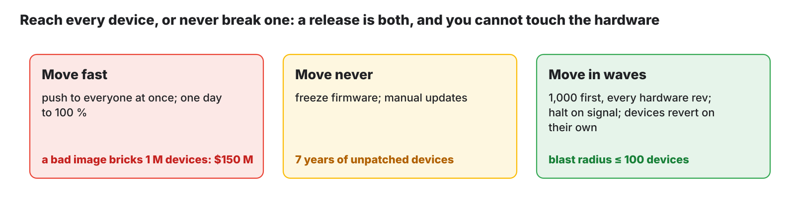{width=95%}

## The whole design on one page

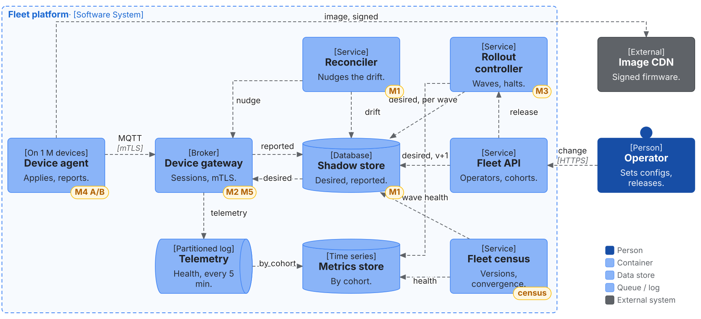{width=100%}

# Part II: The round, stage by stage

# Stage 1: Clarify

| Question | Answer | What it changes |
|---|---|---|
| How often offline? | Daily; some for weeks | devices catch up on their own |
| What does a brick cost? | ~$150 and a customer day | a blast-radius budget of 100 devices |
| How different? | 5 hw revs, 3 carriers, every region | waves by strata, not percentages |
| Trusted? | No | identity per device; topics scoped to it |
| Scope? | Config, firmware, state, health | the data plane is SD-97 |

FR1 Know · FR2 Configure · FR3 Release · FR4 Stop. NFRs: ≤ 100 devices harmed per release; 95 % of online devices on a config within
24 h; a release in ~2 weeks; 99.9 % for the control plane, and devices keep running their last good state without it.

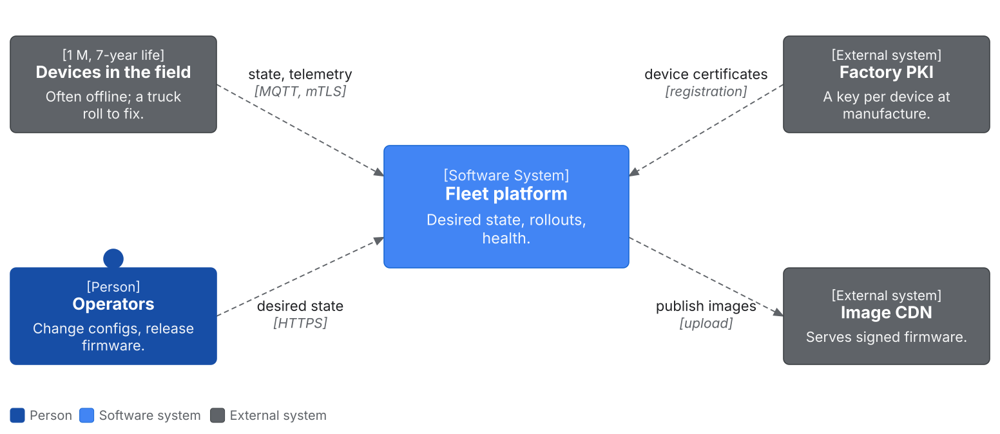{width=90%}

# Stage 2: Back-of-the-envelope

::: {.key title="Top-3 number 1: the cost of one bad release"}
1 % bricked = 10,000 × $150 = **$1.5 M**. *Say:* "That's why a release reaches a thousand devices of every kind before it reaches
a hundred thousand."
:::

::: {.key title="Top-3 number 2: the storm"}
200,000 reconnects in a minute ≈ 3,300 a second; if they retry together in 5 s, **40,000 TLS handshakes a second**. *Say:* "A
recovering fleet can be the next outage, so retries are jittered and admission is rate-limited."
:::

::: {.key title="Top-3 number 3: the steady state is small"}
3,300 health reports a second, 4 GB of shadow, 20 broker nodes. *Say:* "The load is easy; the difficulty is that I can't reach the
devices."
:::

Images: 50 MB × 1 M = 50 TB a release (deltas ≈ 8 TB): a CDN. Certificates: ≈ 1,400 renewals a day. Version tail: up to 84 versions
over seven years.

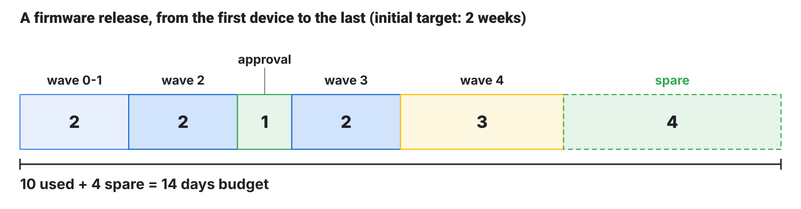{width=95%}

# Stage 3: API and data

```json
GET devices/d-7781/desired   (MQTT, retained)
{"version": 18,
 "config": {"display": "eco", "report_s": 300},
 "firmware": {"version": "4.3",
   "url": "https://cdn.../fw-4.3-hw2.bin",
   "sha256": "9f1c...", "signature": "MEQC..."},
 "min_firmware_for_config": "4.1"}
```

The reported document carries the applied version, firmware and slot, what was rejected and why, what the device is blocked on, and
a `(seq, epoch)` pair. Operators write desired state with `If-Match`; releases are created with a wave plan and halted without a call.

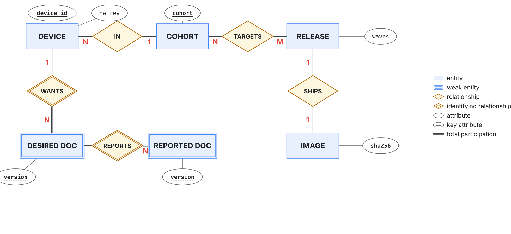{width=95%}

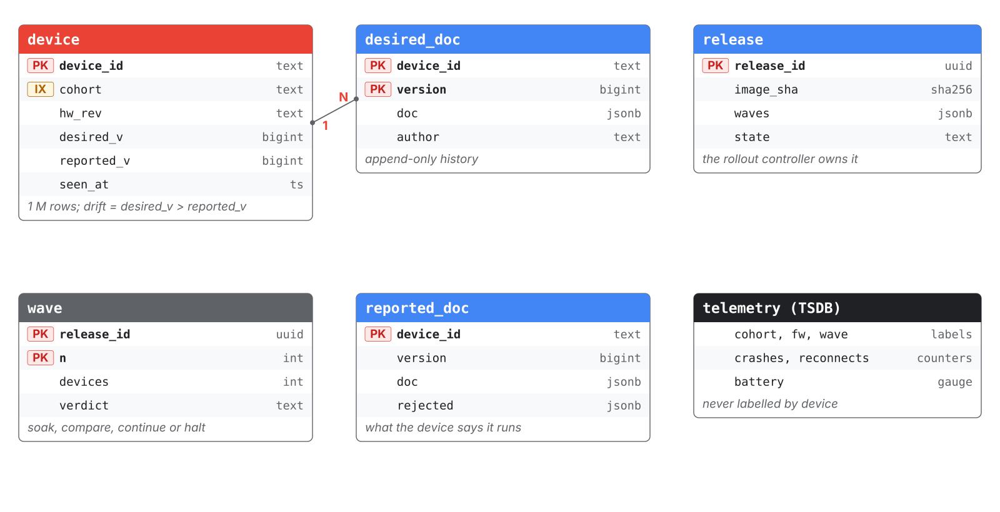{width=95%}

# Stage 4: High-level design

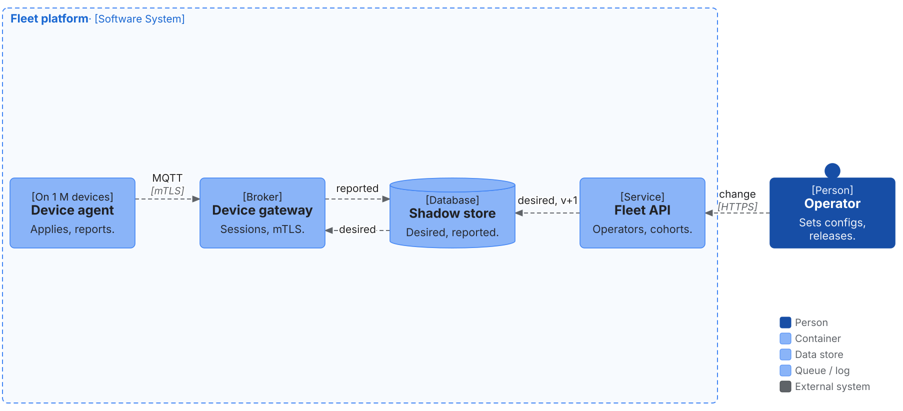{width=100%}

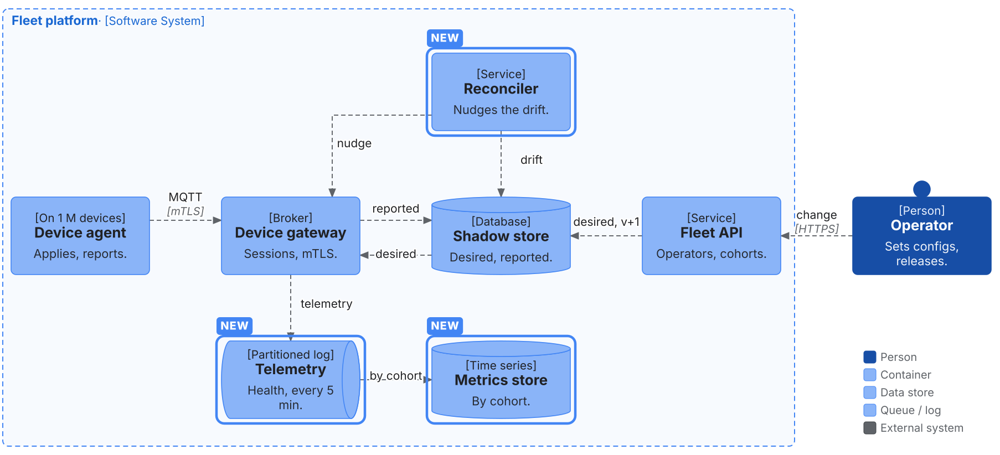{width=100%}

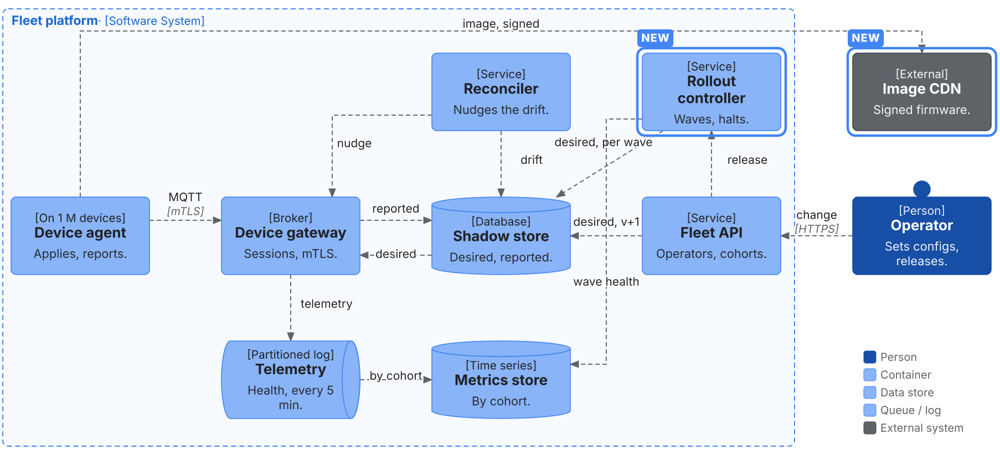{width=100%}

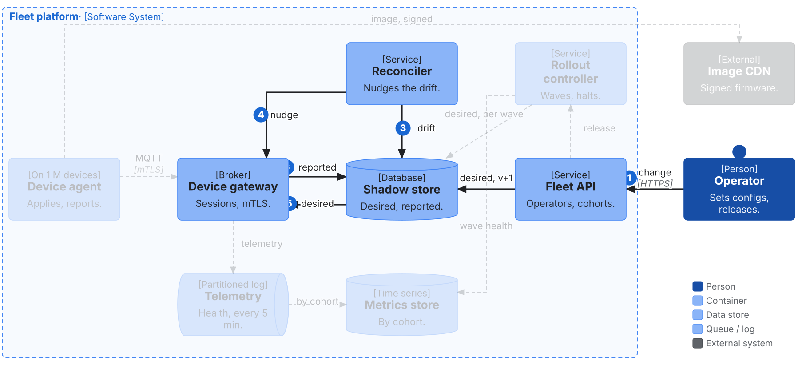{width=100%}

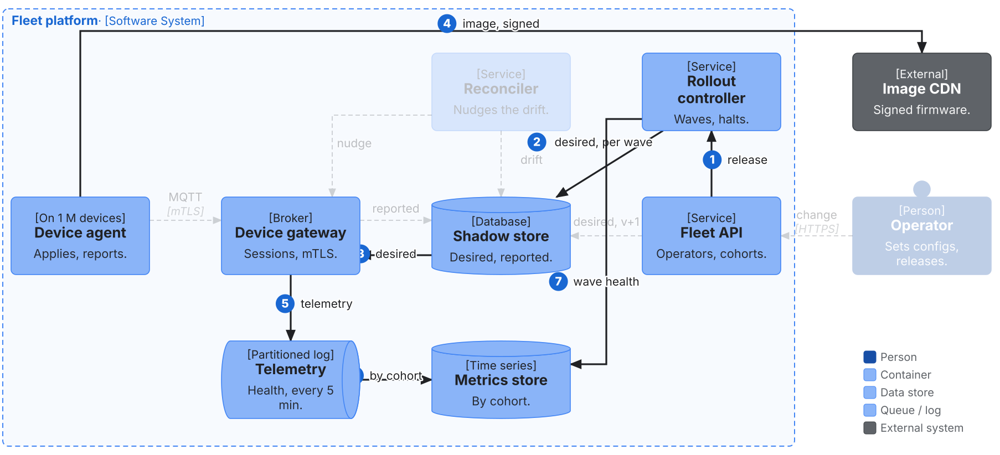{width=100%}

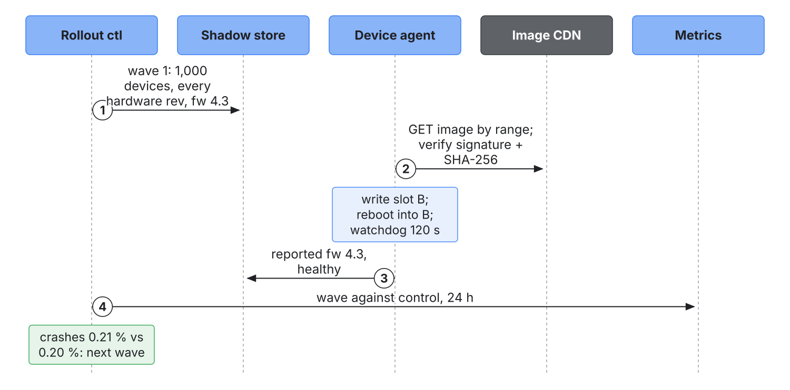{width=85%}

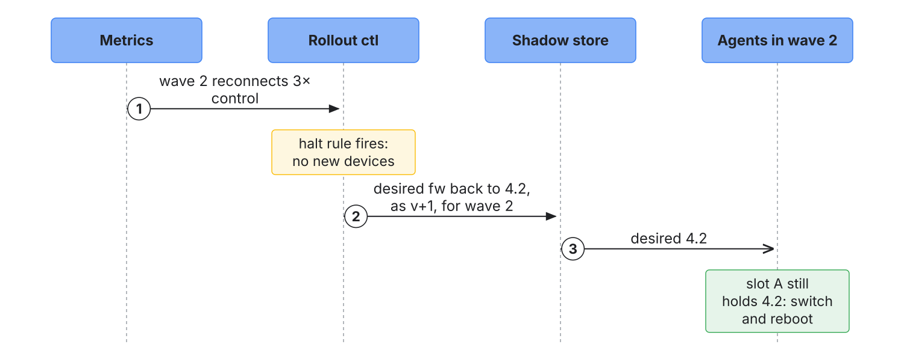{width=80%}

| Outcome | Cost | Who decides |
|---|---|---|
| A false halt | a day; a person reads it | the controller halts, a person resumes |
| A real halt in wave 1 | ≤ 50 devices, reverting by themselves | the controller |
| No halt, bad release at 10 % | up to 100,000 devices, $15 M | nobody: that is the failure |

# Stage 5: Components and technologies

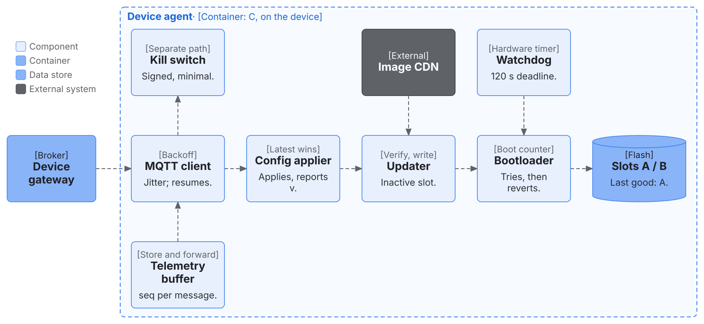{width=100%}

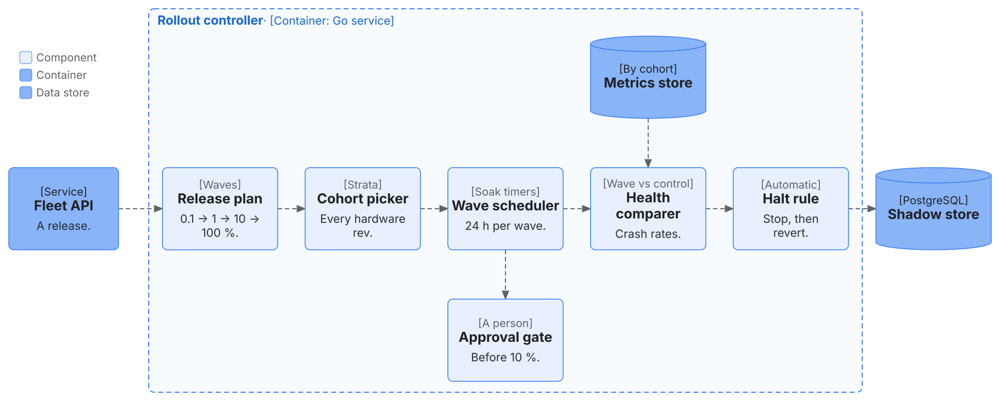{width=100%}

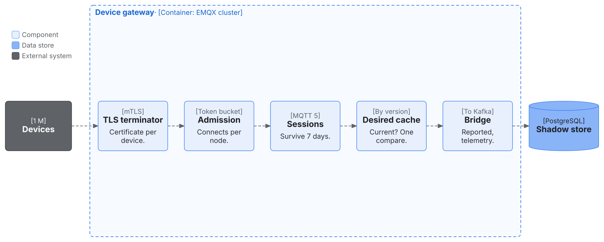{width=100%}

<!-- stack:sections -->

## Device gateway: an MQTT broker cluster with mutual TLS

*How it is built.* About 100,000 connections per node, 20 nodes. Each device presents its factory certificate; topics are scoped to its own ID. MQTT 5 session expiry keeps a device's subscriptions for 7 days across disconnects. The broker forwards reported state and telemetry to Kafka through a bridge, and admits new connections through a per-node token bucket during storms. The desired-state document is served from a cache keyed by version, so a reconnecting device that is already current costs one comparison.

*Why EMQX cluster, MQTT 5, mTLS:* A small, battery-friendly protocol with persistent sessions and a device identity checked at the handshake.

*Rejected:*

- **HTTP polling**: Every device polls whether or not anything changed.
- **Kafka on devices**: A server-side log, not a device protocol.

*Course:* building-blocks course, part 11 §11.6–11.7 (persistent connections) and part 16 §16.1 (authentication).

## Shadow store: desired and reported documents in PostgreSQL

*How it is built.* One row per device: desired and reported JSON with versions. Writers use `WHERE desired_v = $read`. About 4 GB in total. The reconciler reads the rows where `desired_v > reported_v` through an index on that difference. History of desired documents is kept in an append-only table for audit and for rollbacks: rolling back is writing an older document as a new version.

*Why PostgreSQL, one row per device:* 1 M rows of a few kilobytes is small; conditional updates on a version make every desired-state change a compare-and-set.

*Rejected:*

- **Redis**: A lost write is a device told something nobody can see.
- **A replayed change log**: Six weeks offline means four obsolete configs.

*Course:* building-blocks course, part 15 §15.2 (desired state and reconciliation) and part 8 §8.2 (conditional writes).

## Firmware images: signed, on object storage behind a CDN

*How it is built.* The desired document names the URL, size, SHA-256 and an offline signature. The agent fetches by range, resumes, and verifies before writing. Signing keys live in an HSM and sign release manifests in an offline ceremony; devices hold the public key from manufacture. Delta images reduce a typical release from 50 MB to about 8 MB.

*Why Object storage + CDN; images signed offline:* 50 TB per release must not cross the gateway; a device-side signature check defeats a compromised CDN.

*Rejected:*

- **Images through the brokers**: 50 TB crowds out every control message.
- **Trusting TLS to the CDN**: TLS proves the server, not the image.

*Course:* building-blocks course, part 7 §7.12 (integrity) and part 16 §16.4 (progressive rollout).

## Telemetry: Kafka into a time-series store, by cohort

*How it is built.* Summaries every 5 minutes with a per-device sequence; repeats dropped; metrics labelled by cohort, firmware and wave. 3,300 messages a second, about 3.3 MB/s: small. Dedup state is the last sequence per device, 1 M entries. A device offline for weeks uploads its buffer oldest first at a capped rate.

*Why Kafka → VictoriaMetrics, cohort labels:* Rollout decisions compare cohorts and waves; a device-ID label would make a million series out of one metric.

*Rejected:*

- **Device ID as a label**: 1 M series per metric.
- **Scraping devices**: Behind NAT and often offline.

*Course:* building-blocks course, part 14 §14.3 (cardinality) and part 10 §10.5 (delivery semantics).

<!-- /stack:sections -->

## The stack on one page

<!-- stack:summary -->

| Container | Choice | Rejected | The deciding reason |
|---|---|---|---|
| Device gateway | EMQX (MQTT 5), mTLS | HTTP polling, Kafka | light sessions; identity at the handshake |
| Shadow store | PostgreSQL | Redis, a change log replayed | latest desired; versioned compare-and-set |
| Firmware delivery | CDN + signed images | via brokers, TLS only | the device verifies what it runs |
| Telemetry | Kafka → VictoriaMetrics | device labels, scraping | cohort labels; per-device seq dedup |

Each fix in Stage 6 rejects one tool by name:

| Deep dive | Rejected | Because |
|---|---|---|
| 6.1 | A server-side rollback command | a device that crashes on boot never connects to receive it. |
| 6.2 | Rolling out to a percentage | 1 % is mostly the most common hardware; the rare revision that bricks may not be in it. |
| 6.3 | Replaying every queued change in order | a device offline for six weeks applies four obsolete configs to reach the fifth. |
| 6.4 | Immediate reconnect with a fixed retry | 200,000 devices retry in step and the brokers never recover. |
| 6.5 | Exactly-once delivery from the broker | MQTT QoS 2 covers one session; a device replaying its buffer after a reboot is a new session. |
| 6.6 | Dashboards of connected devices | a device that connects but runs the wrong firmware looks exactly healthy. |

<!-- /stack:summary -->

## When you don't need all this

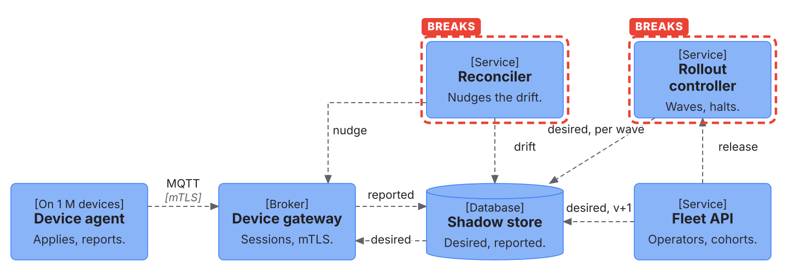{width=100%}

Below about 10,000 devices: a managed device service holds the shadows, devices poll hourly, and a release is three manual steps.
Keep the A/B slots and the watchdog no matter what: they are the only protection a device in a crash loop has.

# Stage 6: Deep dives

## 6.1 A config that crashes the device (the crux)

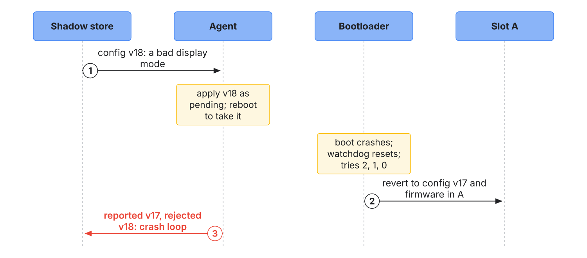{width=80%}

New configs, like images, are **pending until confirmed**. The agent confirms only after four checks within 120 s: the process is
up, the network has an address, the gateway accepted the certificate, and desired state was fetched and reported back. Three failed
boots and the bootloader restores the last known good. A tiny recovery client in the bootloader polls one signed URL daily for
"revert to slot A", in case an agent boots but can no longer be updated.

::: warn
**"Push a rollback."** A device in a crash loop never connects to receive it. Recovery that depends on the server does not exist for
the devices that need it.
:::

## 6.2 The rare revision

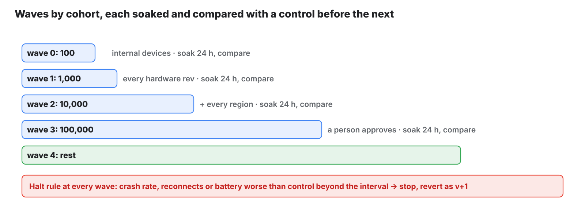{width=95%}

Wave 1 contains at least 50 online devices of every (hardware revision × region × carrier) cell; each cell is compared with its own
control for 24 h; the halt is automatic when an interval for crashes, reconnects, watchdog reverts or battery excludes zero. A
person approves going past 10 %; nobody approves stopping.

| Failure rate a day | Expected in 1,000 | Visible in a day? |
|---|---|---|
| 0.2 % (baseline) | 2 | — |
| 1 % (5×) | 10 | yes |
| 0.3 % (1.5×) | 3 | no: wave 2 or a week |
| bricking | silence and reverts | yes |

## 6.3 Six weeks offline

```
loop every connect and every 6 h:
    d = get_desired()                  # one document
    if d.version == applied.version: continue
    if fw < d.min_firmware:
        report(blocked_on = d.min_firmware); continue
    stage(d); reboot_if_needed()
    if healthy_round_trip(): confirm(d)
    else: revert(applied)              # last known good
```

| | Edge-triggered | Level-triggered |
|---|---|---|
| A week offline | misses or replays | reads the latest |
| A lost message | a lost change | caught next time |
| A duplicate | applied twice | a no-op |

Versions order everything; the device's clock orders nothing.

## 6.4 The reconnect storm

```
attempt = 0
while not connected:
    cap = min(15 min, 2 s * 2 ** attempt)
    sleep(random(0, cap))              # full jitter
    r = connect()
    if r.retry_after:
        sleep(r.retry_after + random(0, 30 s))
    attempt += 1
on connected: attempt = 0
```

Each broker node admits through a token bucket (2,000 connects a second) and answers with retry-after; a reconnecting device that
is already current costs one cached version comparison. With full jitter and a 15-minute cap, 200,000 devices arrive at about 220 a
second by the tail.

## 6.5 Telemetry, twice

```
on report(dev, epoch, seq, body):
    last = seen.get(dev)                # (epoch, seq)
    if last and (epoch, seq) <= last: return
    seen[dev] = (epoch, seq)
    m = labels(cohort(dev), body.fw, wave(dev))
    counters[m].add(body.crashes, body.reconnects)
    lake.append(dev, epoch, seq, body)  # per device
```

MQTT's highest QoS covers one session; a buffer resent after a reboot is a new session. Metrics are labelled by cohort, firmware and
wave, never by device: per-device records go to the lake.

## 6.6 Connected is not converged (observability)

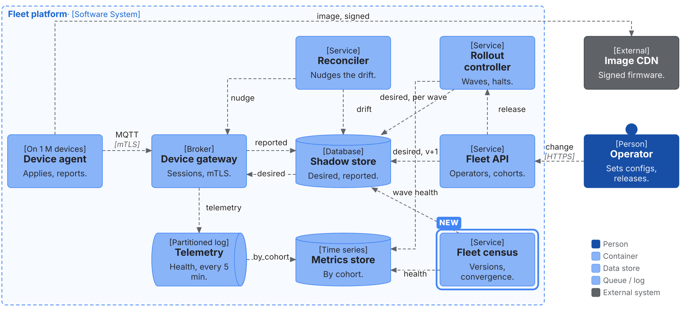{width=100%}

| SLI | Target |
|---|---|
| Online devices on the desired config within 24 h | ≥ 95 % |
| Devices harmed per release | ≤ 100 |
| Watchdog reverts per release | alerted per cell |
| Devices unseen for 30 days | watched |
| Control-plane availability | 99.9 % |

| Symptom | Paired with | Means |
|---|---|---|
| Convergence stalls | "blocked on" rising | a missing prerequisite |
| Convergence stalls | "rejected" rising | the change fails on some hardware |
| Reconnects up | one wave only | the release |
| Reconnects up | every wave, one carrier | the network |
| Watchdog reverts | one hardware rev | a driver bug |

# Stage 11: The close

> **What:** a shadow of desired and reported state, waves by cohort that halt themselves, devices that recover themselves.
> **Trade-off:** two weeks per release and twice the flash, for a blast radius of a hundred devices. **Risk:** a fleet that is
> connected but not converging; hence the census. **Next:** measure convergence per cohort and shrink wave 1's soak where the
> statistics allow.

# Stage 12: Self-check

| Area | Weak | Strong | Exceptional |
|---|---|---|---|
| State | commands | desired/reported | level-triggered, prerequisites, idempotent apply |
| Release | everyone at once | percentages | strata, per-cell controls, automatic halt |
| Recovery | server rollback | A/B slots | confirmation = a full round trip; signed recovery path |
| Load | autoscale | backoff | full jitter, admission, version-compare cache |
| Telemetry | device labels | aggregation | (epoch, seq) dedup; lake for per-device |
| Operations | connected count | health | census, convergence, blocked/rejected, unseen |

\newpage

# Part III: The internals

## Appendix A: A/B updates

The device has two firmware slots. An update is written to the inactive slot and verified; the bootloader is told to try it with a
counter. Each boot decrements the counter; a confirmed boot resets it and makes the slot the default. A watchdog timer resets a hung
device, which consumes a try. When the counter reaches zero, the bootloader boots the other slot. Configs use the same pending,
confirm and revert discipline.

## Appendix B: Reconciliation

A reconciliation loop compares desired and observed state and acts to reduce the difference, repeatedly. Because it compares rather
than replays, it is robust to lost messages, duplicates and long absences, which is why Kubernetes controllers and device shadows
work this way.

## Appendix C: Staged-rollout statistics

For each cell, compare the wave's event rate with the control's over the soak; a Poisson or bootstrap interval on the rate ratio
says whether the difference is real. Leading indicators (reconnects, watchdog reverts) move before crashes. Rare failures need
larger waves, not longer stares.

## Appendix D: Full jitter

Exponential backoff alone keeps clients synchronised; "full jitter" draws the delay uniformly between zero and the exponential cap,
spreading arrivals evenly and minimising total work for a recovering server.

\newpage

# One-page cheat card

- **Scale:** 1 M devices, 7 years; a release a month; 200,000 reconnects in a minute.
- **Numbers:** $1.5 M per 1 % bricked; 40,000 handshakes/s unjittered; 3,300 reports/s; 4 GB shadow; 50 TB per release.
- **Thesis:** desired state, not commands; waves that halt themselves; devices that recover themselves.
- **Mechanisms:** M1 desired/reported, reconciled · M2 identity + signed images · M3 waves by cohort, auto-halt · M4 A/B + watchdog ·
  M5 jitter + admission.
- **Stack:** EMQX (MQTT 5, mTLS) · PostgreSQL shadow · signed images on a CDN · Kafka → VictoriaMetrics by cohort.
- **Challenges:** crash on boot · the rare revision · six weeks offline · the storm · telemetry twice · connected is not converged.
- **Alternate:** a managed service and manual waves below ~10,000 devices; never without A/B and a watchdog.
