\newpage

# How to read this document

This is the **long answer key for question `SD-39`** in [design-room](https://github.com/nirmata78/design-room), the written
companion to its compact-cut reference video (about an hour, six challenges). It shows how a strong Staff candidate (L6/L7) runs
the round, and the **why** behind every line. The same structure answers *delivery dispatch*, *nearby couriers* and the
*live location* half of fleet tracking (SD-97, which builds on this question).

**Three layers.** Part I explains the system in pictures; Part II is the round, stage by stage, with the six challenges in
Stage 6; Part III is the internals: H3, soft state, conditional claims and leases, assignment.

::: {.key title="Top-3 number"}
One of the back-of-the-envelope numbers worth computing out loud.
:::

::: why
A term or a decision explained in plain words.
:::

> Words you can say in the room.

::: warn
A trap.
:::

**Practise:** read Parts I and II, then run `Read CLAUDE.md. Mock me: SD-39, Google, staff, full round.` cold, then reread
where you fell short. **Numbers** are the cue sheet's scale plus labelled arithmetic; none is a measurement or any company's figure,
and this is not any company's actual design.

**The prompt:** *"Design the system that matches riders to nearby drivers. Drivers move constantly; a rider expects a match in
seconds."*

::: {.key title="The one-sentence insight to land by minute 12"}
**Keep where drivers are as fast, overwrite-only, lossy memory, and keep who gets which driver as one exact conditional write,
owned by one matcher per city.**
:::

::: why
**Why this sentence.** It splits the question into its two halves before anything is drawn. The geo half has a huge write rate
and tolerates loss; the contention half has a small write rate and tolerates nothing. Candidates who build one store for both
either drown it in location writes or make claims as weak as locations.
:::

\newpage

# Part I: The system in pictures

## Vocabulary

| Term | Plain meaning | Where it lives |
|---|---|---|
| **H3 cell** | A hexagon with a 64-bit ID; resolution 8 ≈ 0.74 km² | the location index |
| **k-ring** | A cell and all cells within k steps | the query |
| **Soft state** | Data that is refreshed so often that losing it costs one refresh | the location index |
| **Sequence number** | A per-driver counter on every update; older ones are dropped | updates |
| **Claim** | The conditional write that makes a driver "offered" to one request | the trip store |
| **Epoch** | A counter from the city's leadership lease; fences an old leader | etcd, the trip store |
| **Offer** | A proposal to one driver, with an expiry | the matcher, the driver's stream |
| **Lease** | A claim that lapses unless renewed by heartbeats | the trip store |
| **Batch tick** | Every 2 s, all pending requests in a city are matched together | the matcher |

## What one request experiences

1. A rider taps "request"; the ride API stores it under an idempotency key and answers "matching".
2. Within two seconds, the city's matcher ticks. It reads the pickup's H3 cell and rings of neighbours from the in-memory index,
   twenty candidates by distance.
3. One ETA matrix call ranks every pending request's candidates; a minimum-cost assignment pairs requests with drivers.
4. Each pair is claimed by one conditional update in PostgreSQL: available, at the version read, with the current epoch.
5. The offer goes down the driver's open gRPC stream and expires in 15 seconds.
6. The driver accepts, naming the offer; the trip starts and holds a 30-second lease renewed by heartbeats.
7. The driver's positions are forwarded to the rider's map until pickup.

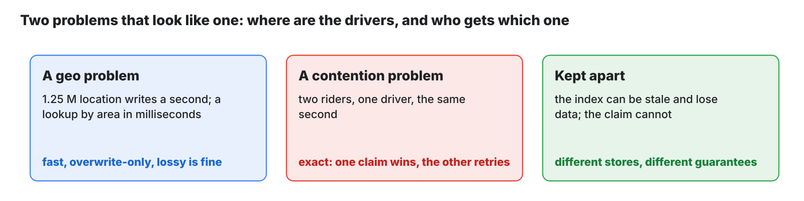{width=95%}

## The whole design on one page

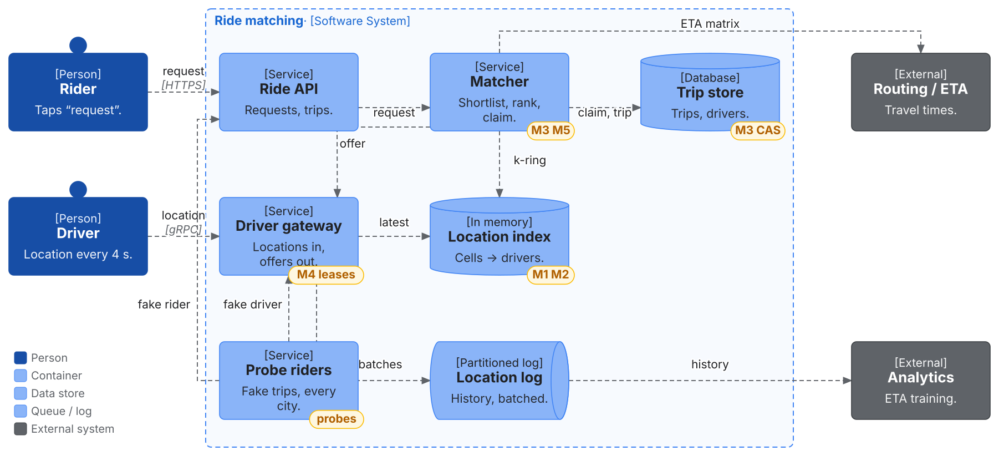{width=100%}

::: load
**Gateway:** 5 M streams, 1.25 M location updates a second. **Index:** the same 1.25 M overwrites a second, ~1 GB in total.
**Matcher:** ~2,100 requests a second at peak globally; one city on New Year's Eve about the same. **Trip store:** ~2,100
conditional claims a second. **Routing:** ~42,000 ETA pairs a second, batched per tick.
:::

\newpage

# Part II: The round, stage by stage

# Stage 1: Clarify

| Question | Answer | What it changes |
|---|---|---|
| What must never happen? | A driver assigned to two riders | a claim, not a geo query |
| How fast? | An offer within 5 s | room for a batch |
| Distance or time? | Distance for V1; ETA better | shortlist, then rank |
| Across cities? | No | a city is the shard and the failure domain |
| Scope? | Matching and tracking; not pricing, payment, routing | routing is a dependency |

FR1 Report · FR2 Match · FR3 Accept · FR4 Track. NFRs (initial targets): zero double assignments; 5 s p95; no location older than
8 s; 99.95 % per city. Pooled rides are out, and worth naming: they turn a claim from one-or-zero into a seat count.

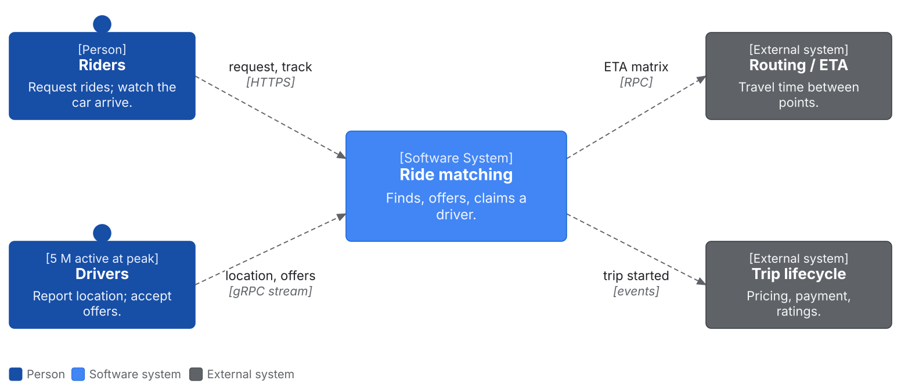{width=90%}

# Stage 2: Back-of-the-envelope

::: {.key title="Top-3 number 1: the write rate"}
5 M drivers ÷ 4 s = **1.25 M writes a second**. Durable, that is ~1.1 × 10^11^ rows (≈ 11 TB) a day of data stale in four
seconds. *Say:* "That number says locations don't go in a database."
:::

::: {.key title="Top-3 number 2: the memory"}
5 M × 200 B ≈ **1 GB**. *Say:* "All of it fits on one machine; I shard by city for isolation and blast radius, not capacity."
:::

::: {.key title="Top-3 number 3: matching is small"}
≈ 350 trips a second × 2 requests × 3 at peak ≈ **2,100 requests a second**. *Say:* "Matching isn't a throughput problem; it's a
contention problem."
:::

Density: 3,000 drivers within 2 km downtown ≈ 180 per resolution-8 cell, the busiest over 300 (split to resolution 9). ETA pairs:
2,100 × 20 = 42,000 a second, so shortlist and batch.

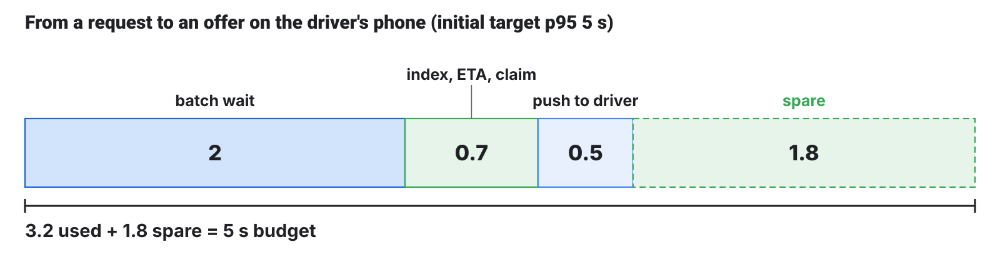{width=95%}

# Stage 3: API and data

```json
POST /v1/rides
Idempotency-Key: 7c1e...
{"pickup": {"lat": 40.7484, "lng": -73.9857},
 "dropoff": {"lat": 40.7306, "lng": -73.9866},
 "product": "standard"}

202 Accepted
{"ride_id": "r77", "state": "matching"}
```

The driver stream carries `Locations` (position, heading, `seq`) upward and `Offer` / `Accept(offer_id, driver_version)` both
ways. An accept for an expired offer or an older version is refused; a retried accept returns the same trip.

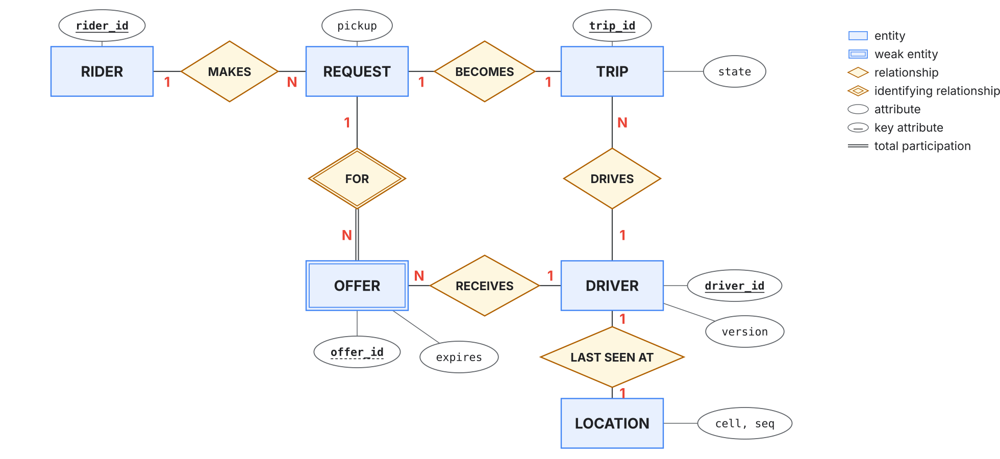{width=95%}

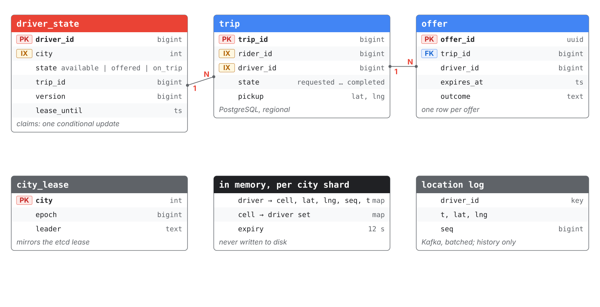{width=95%}

# Stage 4: High-level design

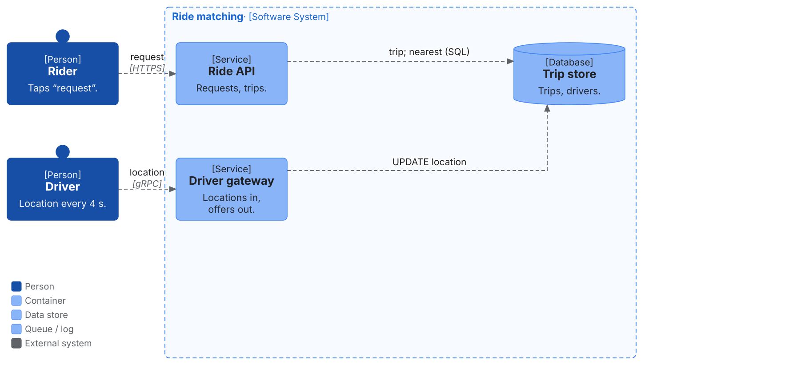{width=100%}

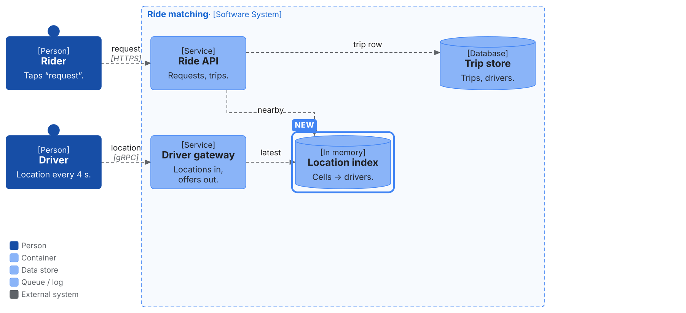{width=100%}

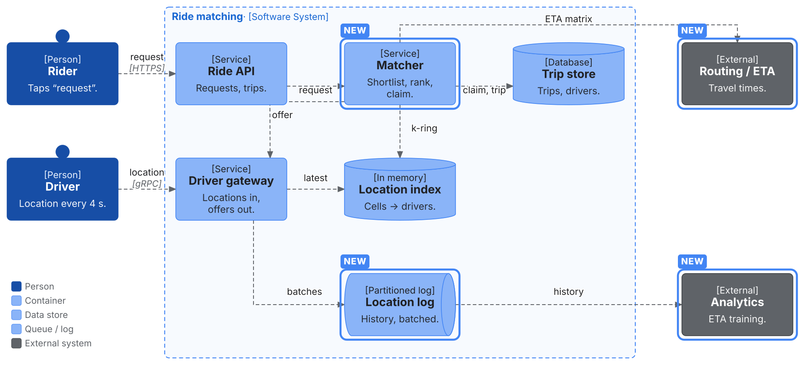{width=100%}

| State | Leaves by | Timer |
|---|---|---|
| matching | a claim, or "no drivers" | 5 s target |
| offered | accept, decline, expiry | 15 s |
| accepted | arrival, or a lapsed lease | 30 s lease, renewed |
| arriving | pickup, cancel, a lapsed lease | 30 s lease, renewed |
| on trip | drop-off, handed to the trip lifecycle | — |

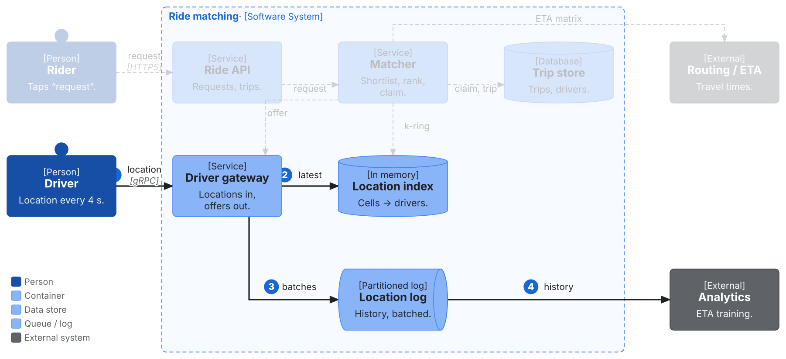{width=100%}

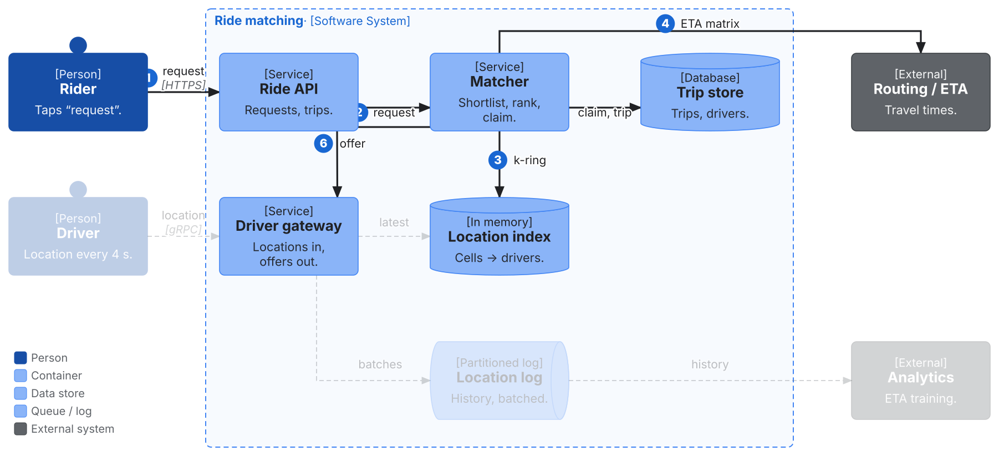{width=100%}

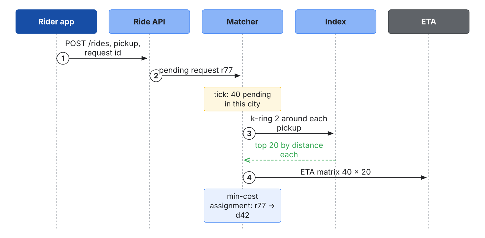{width=85%}

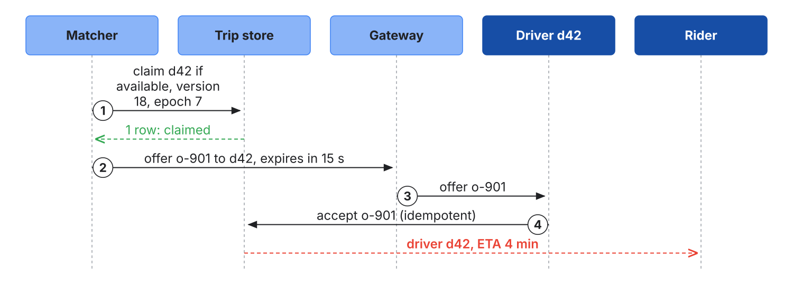{width=85%}

# Stage 5: Components and technologies

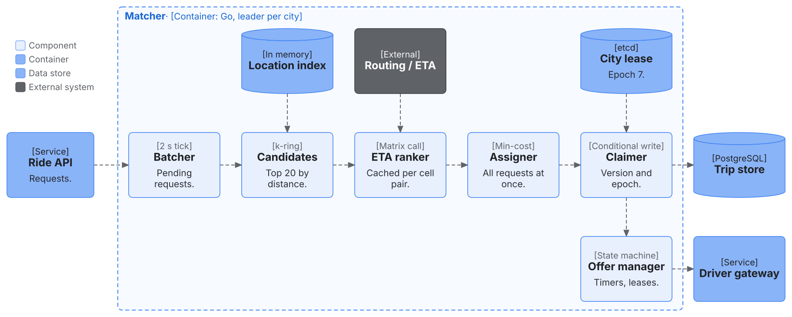{width=100%}

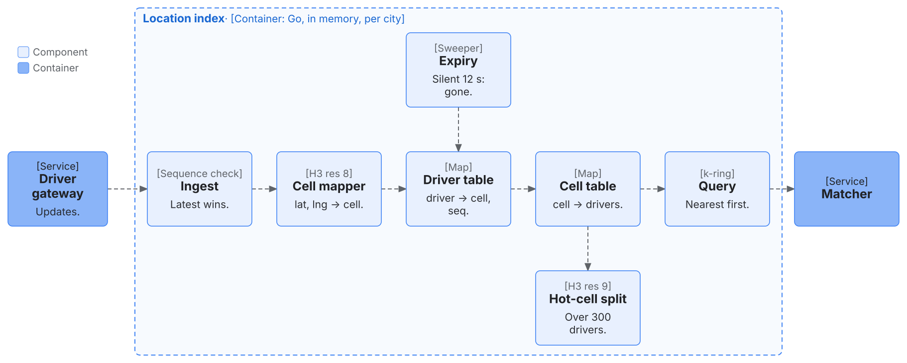{width=100%}

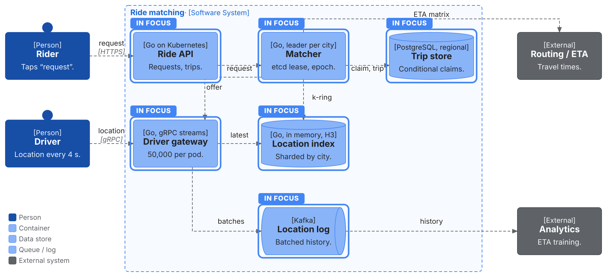{width=100%}

<!-- stack:sections -->

## Location index: an in-memory H3 index, sharded by city

*How it is built.* Per city: driver → (cell, position, seq) and cell → drivers. Older sequence numbers are dropped; silent drivers expire after 12 s. H3 resolution 8 cells are about 0.74 km² (edge ≈ 0.46 km); a 2 km search is the k = 2 ring, 19 cells. A cell with more than ~300 drivers is indexed again at resolution 9 so a downtown query reads a few hundred drivers, not thousands. Shards are assigned to cities (big cities split by cell ranges) through a static map in the config service; there are no replicas: a lost shard refills from the next reports within 4 s.

*Why Go service, H3 resolution 8, in memory:* A location lives four seconds; all 5 M drivers fit in about 1 GB, so shards are for isolation.

*Rejected:*

- **Redis GEO**: Members never expire, and every update is a hop to a shared cluster.
- **PostGIS**: A durable write per update: 1.25 M a second of stale data.

*Course:* building-blocks course, part 6 §6.5 (hot keys and hot partitions) and part 17 §17.3 (memory and coordination).

*Drill.* "A shard dies with 50,000 drivers on it. What breaks, and for how long?" Matching in that city sees no drivers until they report again: at most one 4 s interval plus reconnect. Nothing durable is lost; the gateway routes updates to the replacement shard, which fills from them.

## Trip store: PostgreSQL, regional, with conditional claims

*How it is built.* `UPDATE driver_state … WHERE state='available' AND version=$v AND epoch current`. One row back: claimed. Trips, offers and driver status live here; locations do not. A synchronous standby in another zone means a fail-over cannot forget a claim. The city epoch column fences a deposed matcher leader.

*Why PostgreSQL per region, synchronous standby:* Claims are thousands a second and must be linearizable: a conditional row update is a compare-and-set.

*Rejected:*

- **Redis for claims**: Asynchronous replication can lose a claim in a fail-over.
- **Cassandra LWT**: A Paxos round per claim, and a second store to run.

*Course:* building-blocks course, part 8 §8.2 (optimistic concurrency and conditional writes) and part 2 §2.11 (leases and fencing).

## Driver gateway: long-lived gRPC streams

*How it is built.* About 50,000 streams per pod, 100 pods. A driver → pod table lets the matcher push to the right one. Locations are forwarded to the city's index shard and appended to the location log in batches. A pod drain moves streams gradually with a reconnect hint. Mobile reconnects resume with the last sequence number.

*Why Go on Kubernetes, gRPC bidirectional streams:* An open stream delivers an offer in under a second and carries locations too.

*Rejected:*

- **HTTP polling**: Offers wait for the next poll.
- **An MQTT broker**: An honest equal; we already run gRPC.

*Course:* building-blocks course, part 11 §11.6–11.7 (persistent connections).

## Matcher: one leader per city, behind an etcd lease

*How it is built.* Every 2 s: shortlist 20 per request, one ETA matrix, a min-cost assignment, claims carrying the epoch. Leases last 5 s; a standby takes over within one lease. The batch window trades up to 2 s of waiting for globally shorter pickups; in quiet cities the tick shortens to 0.5 s.

*Why Go service, leader per city via etcd lease:* One writer per city means no racing matchers; the lease epoch fences a deposed leader.

*Rejected:*

- **Racing stateless matchers**: Constant claim conflicts and retries.
- **ZooKeeper**: An honest equal; a second coordination system.

*Course:* building-blocks course, part 4 §4.3 (leader election) and part 2 §2.11 (fencing tokens).

<!-- /stack:sections -->

## The stack on one page

<!-- stack:summary -->

| Container | Choice | Rejected | The deciding reason |
|---|---|---|---|
| Location index | in-memory H3, per city | Redis GEO, PostGIS | overwrite-only; expiry; 1 GB fits |
| Trip store | PostgreSQL, regional | Redis, Cassandra LWT | a claim is one conditional update |
| Driver gateway | gRPC streams | polling, MQTT | offers pushed on an open stream |
| Matcher | leader per city, etcd | racing matchers, ZooKeeper | one writer; epoch fences |

Each fix in Stage 6 rejects one tool by name:

| Deep dive | Rejected | Because |
|---|---|---|
| 6.1 | Redis `SETNX` as the claim | after a fail-over the asynchronous replica may not have it, and the driver is handed out twice. |
| 6.2 | A long fixed offer timeout | it either leaves riders waiting or takes trips from slow but willing drivers; only a heartbeat lease tells the two apart. |
| 6.3 | Geohash prefixes alone | neighbours across a prefix boundary share no prefix, and cells distort with latitude. |
| 6.4 | Replicating the index synchronously | it doubles 1.25 M writes a second to protect data that is stale in four seconds. |
| 6.5 | Straight-line distance | a river, a one-way street or a highway exit turns 200 m into 12 minutes. |
| 6.6 | Request success rate | it stays green when riders are told “no drivers” while drivers sit idle nearby. |

<!-- /stack:summary -->

## When you don't need all this

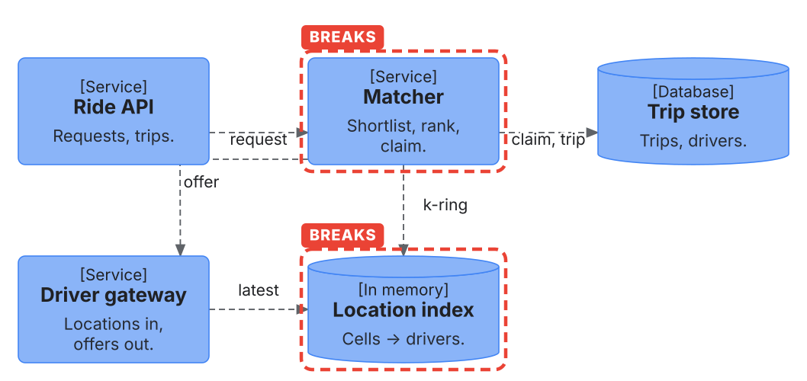{width=100%}

For one or two cities: drivers update a PostGIS row every 15 s; a request runs a radius query on a GiST index and claims with
`SELECT … FOR UPDATE SKIP LOCKED`. It gives up durable writes for soft data, batching, and per-city isolation. 20,000 drivers ÷ 15 s
≈ 1,300 updates a second: one database. **Below about 20,000 drivers, ship it.**

# Stage 6: Deep dives

## 6.1 Two riders, one driver (the crux)

Two requests read "available" for driver d42 within 20 ms; both send offers; d42 accepts both. **Fix:** one matcher leader per city
under an etcd lease; every claim is one conditional update:

```sql
UPDATE driver_state
   SET state = 'offered', trip_id = $2,
       version = version + 1
 WHERE driver_id = $1
   AND state = 'available'
   AND version = $3
   AND $4 >= (SELECT epoch FROM city_lease
              WHERE city = driver_state.city)
RETURNING version;
```

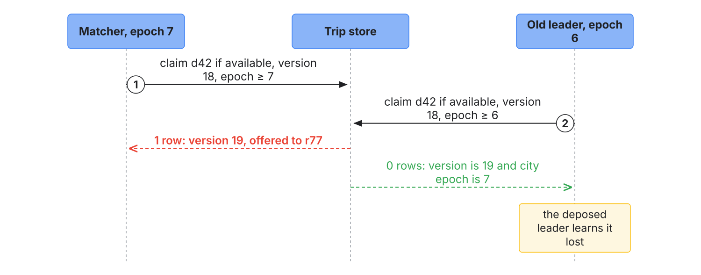{width=80%}

::: warn
**Redis `SETNX` as the claim.** Replication is asynchronous: after a fail-over the new primary may not have the key, and the driver
is handed out twice. A claim belongs in a store whose fail-over cannot forget a committed write.
:::

**Fail-over:** a synchronous standby in another zone; claims fail for the 10–30 s of a fail-over and requests wait a tick or two.
Matching pauses; wrong matches never happen.

## 6.2 The driver who vanishes

An accepted driver's app crashes in a tunnel. **Fix:** offers expire after 15 s; an accepted trip holds a 30 s lease renewed by
heartbeats on the stream; on lapse the driver becomes unavailable and the trip returns to matching at the front of the queue;
accepts carry the offer ID. A phone returning after 40 s presents its trip and version and is told the trip moved on.

| Lease | A vanished driver costs | False releases |
|---|---|---|
| 10 s | 10 s | often (tunnels, lifts) |
| 30 s | 30 s | rarely |
| 120 s | 2 min | almost never |

## 6.3 Boundaries and hot cells

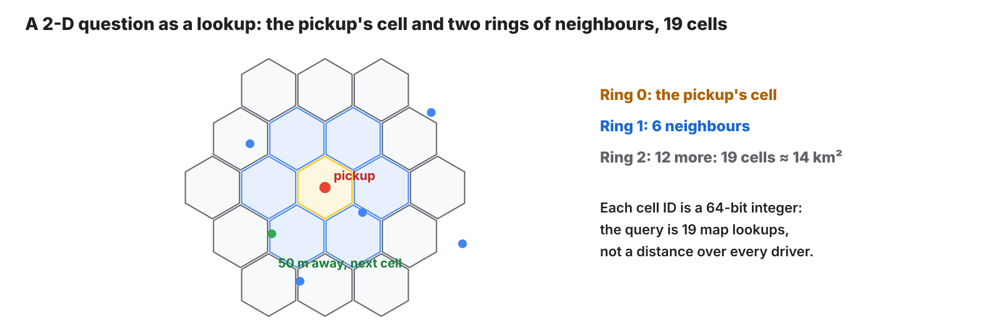{width=95%}

```
cell = h3(pickup, res = 9 if hot(pickup) else 8)
cands = []
for k in 1, 2, 3:
    for c in ring(cell, k) - seen:
        cands += drivers_in(c)        # map lookups
    if len(cands) >= 20: break
return sort_by_haversine(cands, pickup)[:20]
```

| System | Neighbours | Watch out for |
|---|---|---|
| Geohash | 8, by adjacency rules | prefix edges; distortion with latitude |
| Quadtree | by walking the tree | rebalancing under motion; sharding |
| S2 | by ID arithmetic | ~2× area variation |
| **H3** | 6, equidistant | imperfect nesting (irrelevant here) |

A stadium exit (20,000 riders, 400 drivers) is not an index problem: a pickup-zone queue, and supply is pricing's lever.

## 6.4 A shard dies

No replicas: a standby shard starts empty and fills from the next 4 s of reports. Ingest keeps an update only if its sequence is
newer, so a buffered old position never overwrites a new one. A refilling city holds requests one extra tick; the biggest cities
keep a warm, asynchronously fed standby.

```
on update(d, lat, lng, seq, t):
    cur = drivers.get(d)
    if cur and seq <= cur.seq: return     # old, drop
    cell = h3(lat, lng, 8)
    if cur and cur.cell != cell:
        cells[cur.cell].remove(d)
    cells[cell].add(d)
    drivers[d] = (cell, lat, lng, seq, t)
```

## 6.5 Nearest is not closest

A driver 200 m away across a river is 12 minutes by road, and greedy nearest-first gives the next rider a worse match. **Fix:**
twenty candidates by distance, one ETA matrix per tick (cached per cell pair for 30 s, 300 ms timeout, distance × detour factor as
fallback), and a minimum-cost assignment over the batch.

| Plan | r77 | r78 | Total |
|---|---|---|---|
| Greedy by distance | 12 min | 9 min | 21 min |
| Greedy by ETA | 6 min | 3 min | 9 min |
| **Batch, min-cost on ETA** | 6 min | 3 min | **9 min, stable as the batch grows** |

## 6.6 "No drivers" next to idle drivers (observability)

A gateway deploy stops forwarding a tenth of a city's drivers; they expire from the index while online; riders hear "no drivers"
with a 100 % success rate. **Fix (V4):** probe riders (a fake driver and rider per city per minute, end to end); "no drivers"
answers with idle drivers nearby; online drivers missing from the index per gateway pod; time to offer per city.

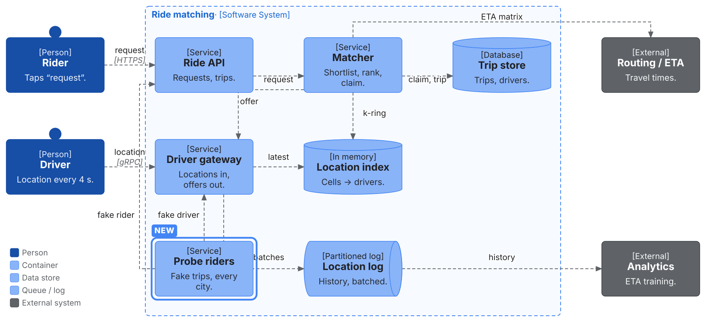{width=100%}

| SLI | Target |
|---|---|
| Probe trips completed | 100 % per city |
| Time to offer | p95 ≤ 5 s |
| "No drivers" with idle drivers nearby | ≤ 0.1 % |
| Online drivers missing from the index | ≤ 0.5 % |
| Double assignments (nightly audit) | 0 |

# Stage 11: The close

> **What:** an in-memory H3 index per city, one matcher per city with conditional fenced claims, offers and trips as leases.
> **Trade-off:** up to 2 s of batching and seconds of blindness after a shard loss, for exact assignment and no durable location
> writes. **Risk:** a healthy system answering "no drivers"; hence probes. **Next:** measure the heartbeat-gap distribution and
> tune leases per city.

# Stage 12: Self-check

| Area | Weak | Strong | Exceptional |
|---|---|---|---|
| Write path | database per update | in-memory, overwrite | sequence numbers, expiry, refill without replicas |
| Geo | one cell | rings | expanding rings, hot cells, H3 vs S2 vs geohash |
| Contention | nearest wins | a claim | conditional, versioned, fenced by epoch |
| Lifecycle | none | offer timeout | leases renewed by heartbeats; idempotent accept |
| Efficiency | greedy distance | ETA | shortlist, matrix, batch assignment |
| Operations | success rate | latency | probe trips; idle next to "no drivers" |

\newpage

# Part III: The internals

## Appendix A: H3

H3 tiles the sphere with hexagons (and twelve pentagons) at 16 resolutions; each cell is a 64-bit integer. `latLngToCell`,
`gridDisk(cell, k)` (the k-ring) and `cellToParent` are the operations used here. Resolution 8 has an average area of about
0.74 km²; resolution 9 about 0.11 km².

## Appendix B: Soft state

Soft state is kept alive by refresh, not by durability: a value that stops being refreshed expires. It is the right model when the
refresh interval is shorter than the time anyone cares about a lost value, as with a 4 s location.

## Appendix C: Conditional writes, leases and fencing

A conditional update is a compare-and-set in SQL: it changes a row only if the predicate still holds, and the affected-row count
says whether it did. A lease grants ownership for a time and must be renewed; a fencing epoch makes writes from an expired owner
fail at the store, so correctness never depends on clocks agreeing.

## Appendix D: Assignment

The batch is a bipartite graph of requests and candidate drivers with ETA costs; the Hungarian algorithm (or a min-cost flow) finds
the cheapest perfect matching. With forty requests and twenty candidates each, it solves in milliseconds.

\newpage

# One-page cheat card

- **Scale:** 900 M trips a month; 5 M drivers every 4 s; NYE ×10 in one city; 3,000 drivers in 2 km downtown.
- **Numbers:** 1.25 M writes/s; ~1 GB in memory; ~2,100 claims/s; 19 cells per 2 km query; 42,000 ETA pairs/s.
- **Thesis:** fast, lossy memory for where; one exact, fenced write for who; every claim a lease.
- **Mechanisms:** M1 H3 k-rings · M2 soft state with sequence numbers · M3 conditional fenced claim · M4 leases · M5 batches.
- **Stack:** Go index in memory · PostgreSQL claims · gRPC streams · leader per city via etcd · Kafka for history.
- **Challenges:** two riders one driver · the vanishing driver · boundaries and hot cells · a lost shard · nearest is not closest ·
  "no drivers" next to idle drivers.
- **Alternate:** PostGIS + SKIP LOCKED below ~20,000 drivers.
