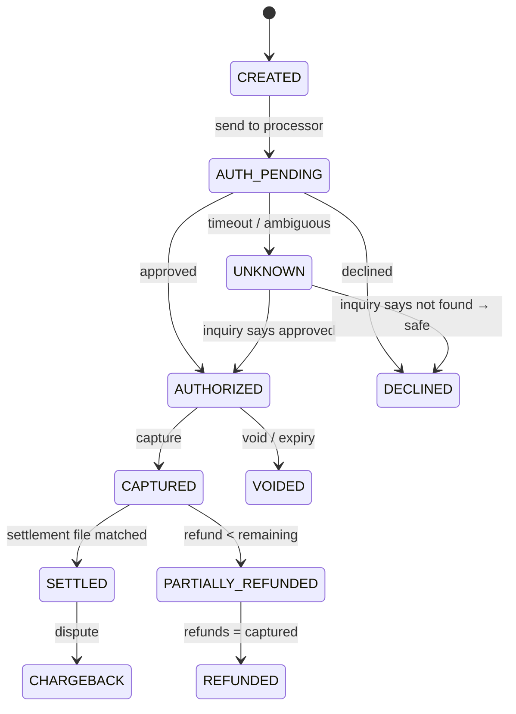
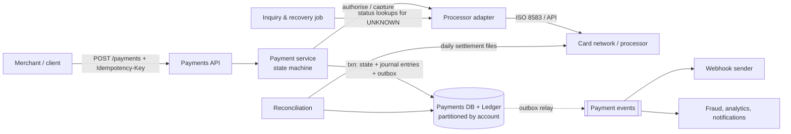

# SD-44 · Payment processing & double-entry ledger

*A reference solution, stage by stage, for a 45–60-minute round. Cue sheet:
[`questions/F-transactions-payments.md`](../questions/F-transactions-payments.md) · theory:
[Correctness under failure](../theory/07-correctness-under-failure.md),
[Messaging & streams](../theory/06-messaging-and-streams.md).*

{: .spoiler }
> Run the round cold first: `Mock me: SD-44, Amazon, em, full round.` Read this afterwards.

**The prompt:** *"Design the system that takes a payment and records it — the ledger the company's
money is accounted for in."*

{: .key-title }
> The one-sentence insight to land by minute 10
>
> **Exactly-once does not exist across a network boundary.** So the design is **at-least-once
> delivery + idempotent operations + an explicit pending state for unknown outcomes + reconciliation
> that finds the discrepancies anyway** — on top of an **immutable, append-only double-entry
> journal** where balances are derived, never stored as the truth.

---

## Stage 1 · Clarify requirements · 0:00–0:06

| I ask | Interviewer answers | Why it matters |
|---|---|---|
| Volume? | 10 k payments/s peak, 50 currencies | ledger write rate, partitioning |
| Latency? | authorisation decision within 2 s | the processor call dominates; budget the rest |
| External parties? | card networks, banks — time out, return ambiguous results, go down for hours | **unknown outcomes are the core problem** |
| Ledger rule? | **must always balance — no exceptions** | double entry, atomic posting |
| Audit? | every balance explainable from immutable records for 7 years | append-only journal, no `UPDATE` |
| Refunds / chargebacks? | yes, partial, days to months later | adjusting entries; state machine |
| Retries? | clients retry — "what do you require of them?" | idempotency keys |
| *What must never happen, in order?* | (ask) | 1 lose money/double-charge · 2 unbalanced ledger · 3 slow payment |

**Out of scope (say it):** fraud scoring (assume a service, SD-43), card-data vaulting (assume a
PCI-scoped tokenisation service), FX pricing (SD-80), merchant onboarding/KYC (SD-78), payouts (SD-81).

**Non-functional:** zero double charges; ledger balanced at every commit; idempotent API; payment
decision p99 < 2 s; every state change auditable; reconciliation daily with breaks owned.

## Stage 2 · Back-of-the-envelope · 0:06–0:11

| Quantity | Arithmetic | Result | Consequence |
|---|---|---|---|
| Journal writes | 10 k payments/s × ~4 entries (auth hold + capture legs) | **~40 k entries/s** peak | partition the journal by account |
| 7-year storage | ~3 k/s average (peak ÷ 3) × 10⁵ s × 365 × 7 years × 4 entries × ~200 B | **~500–600 TB** | hot recent partitions + cold archive; immutable makes archiving easy |
| **Hot account** | a large merchant receiving 5 k payments/s | 5 k writes/s to **one balance** | a balance-row `UPDATE` serialises on a lock → **append entries, derive balance** |
| Processor latency | 300–1,500 ms typical, timeouts at ~10 s | most of the 2 s budget | everything we own must be < ~200 ms |

{: .say }
> "The number that shapes the data model is the hot merchant: five thousand updates a second to one
> balance row would serialise on a row lock. So entries are appended and the balance is derived —
> which is also exactly what auditors want."

## Stage 3 · API and data model · 0:11–0:17

```text
POST /v1/payments           Idempotency-Key: <uuid>
  { merchantId, amount: { value: 1050, currency: "EUR" },   -- integer minor units, never floats
    paymentMethodToken, capture: "auto" | "manual" }
  -> 201 { paymentId, status: "authorized" | "captured" | "declined" | "pending" }
POST /v1/payments/{id}/capture   { amount }      Idempotency-Key
POST /v1/payments/{id}/refunds   { amount }      Idempotency-Key
GET  /v1/payments/{id}
Webhooks to merchants: signed, with event IDs, retried with backoff (merchants dedupe by event ID)
```

**Payment state machine:**



**The ledger (double entry):**

| Table | Key | Content | Mutability |
|---|---|---|---|
| `accounts` | `account_id` | owner, type (merchant payable, customer funds, fees revenue, processor receivable…), currency | rarely changes |
| `journal_transactions` | `txn_id` | `idempotency_key`, `payment_id`, type, created_at, description | **immutable** |
| `journal_entries` | `(account_id, entry_id)` | `txn_id`, `direction` (debit/credit), `amount_minor`, `currency` | **immutable** |
| `balances` (cache/projection) | `account_id` | balance, as-of entry | derived; rebuildable |
| `idempotency` | `(client_id, key)` | request hash, status, stored response | TTL e.g. 30 days |
| `outbox` | `id` | event to publish | deleted after relay |

**Invariant:** for every `txn_id`, Σ debits = Σ credits per currency — enforced in the posting code
*and* checked by a database constraint or a deferred check, inside one transaction.

**Example — €10.50 captured, €0.30 fee:**

| Account | Debit | Credit |
|---|---:|---:|
| Processor receivable | 1,050 | |
| Merchant payable | | 1,020 |
| Fee revenue | | 30 |

## Stage 4 · High-level design · 0:17–0:27



**Walk-through — one successful payment:**

1. API receives `POST /payments` with an idempotency key; inserts an `idempotency` row as
   *processing* (unique on key) — a concurrent duplicate gets "in progress".
2. Payment service creates the payment `CREATED → AUTH_PENDING` and **commits before calling out**
   (so a crash leaves evidence the call may have been made).
3. Processor adapter calls the network with **our own idempotency/reference ID**.
4. Approved → in one DB transaction: state `AUTHORIZED`, journal entries for the authorisation
   hold (if modelled), outbox event, idempotency row → *done* with the stored response.
5. Capture (auto or later) → `CAPTURED`, posting the balanced entries above, outbox event.
6. Relay publishes events → webhooks to the merchant, downstream consumers.
7. Next day: settlement file arrives → reconciliation matches it → `SETTLED`, posting the settlement
   entries (receivable → bank cash, fees).

## Stage 5 · Technology choices

| Component | Choice | Reason |
|---|---|---|
| Ledger + payment state | **relational database**, partitioned by account (or a distributed SQL store) | multi-row atomic postings, constraints, serializable where needed |
| Events | **transactional outbox** → log | no dual writes between DB and broker |
| Processor integration | adapter per processor, with retries only where the processor supports idempotent references | ambiguity differs per partner |
| Reconciliation | batch pipeline over immutable raw files + ledger expectations | external truth arrives in files |
| Money | integer minor units + ISO currency on every amount | floats lose cents |

## Stage 6 · Deep dives · 0:27–0:45

### 6.1 The bank timed out — the next ten minutes and the next ten days

The crux. The authorisation call timed out; the customer may or may not have been charged.

1. **Do not** mark it failed (the merchant retries → double charge) and **do not** mark it succeeded.
   Move to **`UNKNOWN`** and return `pending` to the client.
2. **Inquiry job** (seconds to minutes): ask the processor for the status **by our reference ID**. If
   approved → `AUTHORIZED` and continue. If "not found" after the processor's safe window → `DECLINED`
   (safe to retry with a new attempt).
3. If the processor supports it, send a **reversal/void** for an unknown auth we no longer want —
   reversals are idempotent by reference.
4. **Days later:** the settlement file is the final word — reconciliation catches anything the inquiry
   missed (a capture we didn't record → **break** → adjusting entry + merchant notification).

{: .say }
> "A timeout is an unknown, not a failure. The payment goes to a pending state, an inquiry job asks the
> processor by our reference, and the settlement file is the final arbiter. At no point does a retry
> create a second charge, because every call carries the same reference."

### 6.2 Idempotency — three concurrent retries, and the same key with a different amount

- Unique `(client_id, key)` insert **inside the same transaction** that creates the payment: one wins;
  the others see *processing* → `409 retry later`, or, once done, get the **stored response**.
- **Same key, different payload** (amount changed): request hash mismatch → `422`. Silently returning
  the original would hide a client bug; executing would double-charge.
- **Downstream idempotency:** our processor calls carry a deterministic reference
  (`payment_id + attempt`), so our own retries are deduplicated by the processor.

### 6.3 Crash between ledger write and event publish

Can't happen inconsistently: state change, journal entries and the outbox row commit **in one
transaction**; the relay publishes later, at least once; consumers dedupe by event ID. A crash before
commit leaves nothing; after commit, the event will be published.

### 6.4 The hot merchant account

Appending entries scales (no lock on a balance row). For the balance itself:

- **Derived on read** from a projection updated asynchronously (seconds behind) — fine for dashboards.
- **Where a check needs the balance** (payouts can't exceed available funds): split the account into
  **N sub-accounts** that each receive a share of writes, and sum them; or serialise payout checks
  through a single per-merchant worker. Payouts are rare compared to incoming payments.

### 6.5 Refunds, partial refunds, chargebacks

Each is a **new journal transaction** referencing the original payment — never an edit. A refund is
allowed only if `Σ refunds + amount ≤ captured` — checked under a per-payment lock or conditional
update on the payment row (`refunded_minor + $amt <= captured_minor`). A chargeback 90 days later posts
entries dated **now** (with the original reference), so closed periods are never rewritten.

### 6.6 Reconciliation as a permanent component

Daily: ingest the processor's settlement file (immutable raw copy) → the ledger generates
**expectations** (what we expect to be settled, net of fees) → match → breaks (missing, amount
mismatch, unexpected) become an **owned, aged workflow** for finance ops. The **unreconciled balance by
age** is a monitored metric. (Full design: SD-79.)

## Stage 7 · Mid-round requirement — a bug double-posted 40,000 entries

1. **Stop the bleeding:** kill-switch the faulty code path; **halt payouts** for affected merchants
   (money not yet sent can still be protected).
2. **Identify** the duplicates precisely from the immutable journal (same payment, same type, twice).
3. **Correct with reversing entries** — one correction transaction per duplicate, tagged with an
   incident ID — never `DELETE`/`UPDATE`. The audit trail shows the error *and* the correction.
4. For merchants **already paid out** the excess: a receivable from the merchant, recovered from future
   settlements — a business decision with communication, not a database operation.
5. **Postmortem** on the class: why did idempotency not catch it, and add a reconciliation check that
   would have flagged it within the hour.

## Stage 8 · Failure modes · 0:45–0:50

| Failure | Effect | Response |
|---|---|---|
| Processor outage | authorisations fail | route to a secondary processor where contracts allow; degrade gracefully; never "approve offline" without a risk policy |
| Processor slow | latency budget blown | timeouts → `UNKNOWN` + inquiry, not retries in a loop |
| DB primary failover | seconds of write unavailability | clients retry with the same idempotency key — safe |
| Outbox relay lag | webhooks late | alert on outbox age; merchants can poll `GET /payments/{id}` |
| Reconciliation breaks growing | financial risk | ageing SLO, owners, escalation |

## Stage 9 · SLOs, observability, cost · 0:50–0:54

- **SLIs:** payment API success (excluding legitimate declines) · decision latency p99 < 2 s ·
  **`UNKNOWN` rate and age** (spikes mean a processor problem) · ledger balance check (Σ = 0, must
  always hold — page immediately if not) · unreconciled amount by age.
- **The alert that fires before finance notices:** auth approval rate per processor drops vs. baseline;
  `UNKNOWN` count rising; any imbalance.
- **Cost:** processor fees dwarf infrastructure — the engineering lever on cost is **routing** and
  **reducing false declines**, not servers.

## Stage 10 · The level layer

{: .level }
> **EM:** the one-way doors — **the ledger schema and the idempotency contract** — get the most review;
> MVP is single processor, auto-capture, daily reconciliation; team seams *payments API & state
> machine* · *ledger (owned centrally, a contract for everyone else)* · *processor integrations* ·
> *reconciliation & finance tooling*; on-call runbook for "payments failing at 3 a.m.". **Staff:**
> posting invariants enforced in the database, the inquiry protocol per processor, sub-account
> sharding for hot accounts, replay/rebuild of projections. **Director:** multi-processor strategy
> (cost and resilience), regulatory and audit ownership, finance-ops headcount vs auto-match rate.

## Stage 11 · The close

> "Payments are an explicit state machine whose every transition commits together with balanced,
> immutable double-entry journal entries and an outbox event. Exactly-once across the bank boundary is
> impossible, so every call is idempotent by key, timeouts go to a pending state resolved by an inquiry
> job, and daily reconciliation against settlement files catches what's left. Balances are derived, so
> the hot merchant account scales and every number is explainable for seven years. Next I'd harden the
> inquiry protocol per processor and make reconciliation breaks an owned, aged workflow."

## Stage 12 · Self-check

- [ ] Did I say "exactly-once doesn't exist across the boundary" and design around it?
- [ ] Double entry with derived balances, integer minor units?
- [ ] Idempotency key in the same transaction; same key + different payload rejected?
- [ ] The timeout walk: `UNKNOWN` → inquiry → reversal → reconciliation?
- [ ] Outbox for events; no dual writes?
- [ ] Refunds and chargebacks as new entries, never edits?
- [ ] Reconciliation as a permanent, owned component?

---

## Cheat card

**Insight:** at-least-once + idempotency + pending state + reconciliation, on an immutable double-entry
journal. **Numbers:** ~40 k entries/s; ~500–600 TB over 7 years; hot merchant 5 k writes/s → append, don't
update. **API:** idempotency key, integer minor units. **Unknown outcome:** `UNKNOWN` → inquiry by
our reference → reversal → settlement file. **Events:** outbox. **Corrections:** reversing entries.
**Trap:** distributed transaction with the bank; balance column as truth; floats; "timeout = failed".
