# SD-59 · Multi-team decomposition and API contracts — reference design

*Principal / senior engineering-manager level, compact cut. Subject system: the loan-servicing platform of [SD-95](../SD-95-loan-servicing/SD-95_Loan_Servicing_Reference_Design.md). All numbers are illustrative until measured. The video that follows this design: [`video/README.md`](video/README.md).*

> [!IMPORTANT]
> **The thesis.** Cut along **domain seams**, put a versioned **contract** on every seam, give every shared thing **one owner**, integrate **end to end by week four**, and keep the **contracts, the dependency graph and the milestones** for yourself.

## How to read this document

The question is asked after a design round: *forty engineers, five teams, six months: how do you split the work so the teams can move independently, and what do you own as the manager?* The crux is **cutting along seams that minimise coordination and making the contracts at those seams explicit and independently evolvable**. A split that is clean on a diagram and creates a dependency web is the failure mode.

Properties are named by slug, never by a bare code: `[S1-no-silent-break]`, `[S2-one-owner-each]` (safety); `[L1-no-team-waits]`, `[L2-integrated-by-week-4]`, `[L3-wrong-split-seen-early]` (liveness).

# Stage 1: Clarify requirements

**The scale line.** 40 engineers in 5 teams of 8 · 3 time zones · 6 months to the first release (240 engineer-months) · 2 external teams consume the output.

| Question | Answer | What it changes |
|---|---|---|
| Optimising for? | Independent delivery | the measure is how rarely a change needs two teams |
| Existing skills? | Two teams know the domain, three are new | match risk to experience |
| Can the structure change? | Yes, once, at the start | org and architecture are one decision |
| Time zones? | Three; pairs overlap ~2 h, never all three | cross-zone seams are the most stable contracts |
| Who depends on us? | Two external teams (events in, breaks out) | their contracts freeze first |

| # | Requirement | Number |
|---|---|---|
| FR1 | Choose seams: one team per cluster that changes together | a feature touches ≤ 2 teams, on average |
| FR2 | Every seam is an explicit, versioned contract | agreed by week 2 |
| FR3 | Every team stays unblocked | no team idle more than 2 days |
| FR4 | Integrate early and continuously | end to end green by week 4 |
| FR5 | Detect a wrong split and re-cut once | signal by month 2 |

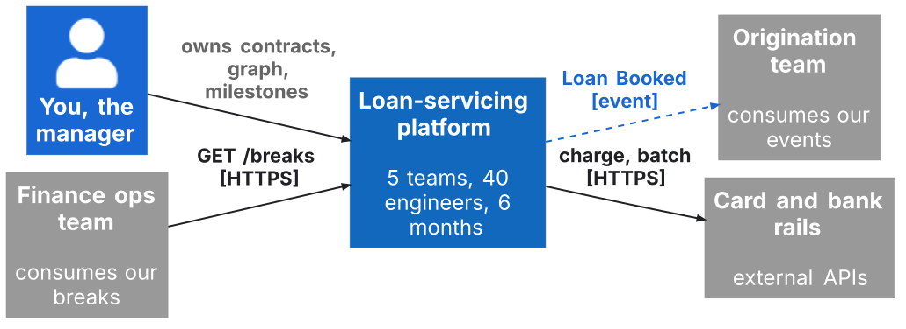

**Out of scope, on purpose:** the system's internal design (SD-95), hiring and promotions, tooling procurement, individual performance.

# Stage 2: Estimates

| Step | Arithmetic (from the scale line) | Result |
|---|---|---|
| Budget | 40 engineers × 6 months | **240** engineer-months |
| Overhead (on-call, meetings, leave, onboarding) | about 25 % of 240 | −60 |
| Spendable | 240 − 60 | **about 180**, i.e. **36** per team |
| Team pairs | 5 × 4 ÷ 2 | **10**; design for 4 to 5 that must agree |
| One cross-team change | about 1 week of waiting (illustrative) | a feature touching 4 teams: **3 to 4 weeks** of latency |
| Integration found at month 5 against week 4 | months of drift against days | about **10×** cheaper to find early (illustrative) |

A team has about 4.5 working engineers for 8 months. A month of waiting is a seventh of its budget. The number to minimise is **arrows, not boxes**.

# Stage 3: Theory first

<!-- theory:begin -->
<!-- generated from video/src/ch3.py by dsl.sync_theory_md: edit the slides, not this region -->

*Theory · 1 of 5 · what it is*
> A division of the work into *teams that can ship alone*, joined by *explicit contracts*, with *one owner* for everything shared, and a way to *see early* that the cut is wrong.

### Four things it is confused with
*Theory · 1 of 5 · what it is not*
- **Not an org chart.** Who reports to whom is one input. A decomposition is also what each team owns and what it promises the others.
- **Not an architecture diagram.** Boxes show components. A decomposition also says which team changes them, and who must agree.
- **Not a task list.** Assigning components to people leaves the arrows unmanaged, which is where the slips are.
- **Not microservices.** Five teams do not need twelve services. A boundary is a cost, and it is expensive to move.

### State safety and liveness separately
*Theory · 2 of 5 · the two properties*
- **Safety · must never happen.** **[S1-no-silent-break]** A change on one side breaks a consumer, and nobody finds out before release. **[S2-one-owner-each]** A component, contract or table has no owner, or two.
- **Liveness · must eventually happen.** **[L1-no-team-waits]** Every team has unblocked work every week. **[L2-integrated-by-week-4]** An end-to-end path runs by week four and stays green. **[L3-wrong-split-seen-early]** A wrong cut is visible by month two.

### Autonomy against coherence
*Theory · 3 of 5 · the central tension*

| Pull toward | What you gain | What it costs |
|---|---|---|
| **More autonomy** | teams ship alone; fewer meetings | duplicated logic; contracts to keep stable; drift |
| **More coherence** | one model, one style, easy to reason about | every change needs a meeting; teams wait |
| **The cut decides** | where autonomy is free, where coherence is paid for | a wrong cut pays both |

### Seams by domain, not by layer · C4
*Theory · 4 of 5 · mechanism 1 of 6*
- **Protects.** **[L1-no-team-waits]**.
- **How it works.** Group what changes together into one team: a domain with its logic, data and integrations. Conway’s law: the system will copy the org, so choose both at once.
- **Rules out.** Every feature needing every team; a dependency web hidden by a tidy diagram.
- **Costs.** Some duplication across domains, and a domain model that must be argued first.

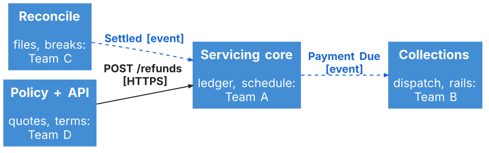

### Contracts first, versioned · ERD
*Theory · 4 of 5 · mechanism 2 of 6*
- **Protects.** **[S1-no-silent-break]**.
- **How it works.** Every seam is a contract with an owner, a schema, a compatibility policy (additive only) and a sunset date. Agreed before code starts.
- **Rules out.** Two teams assuming different shapes; a rename that breaks a consumer.
- **Costs.** Up-front agreement work in weeks one and two, and the discipline of additive change.

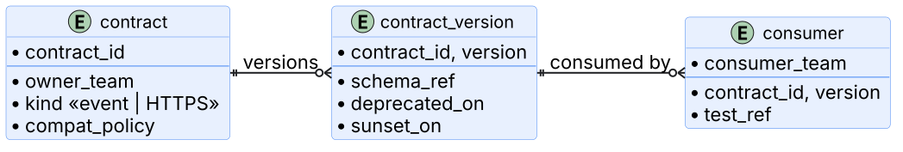

### Consumer-driven tests and mocks · SEQUENCE
*Theory · 4 of 5 · mechanism 3 of 6*
- **Protects.** **[S1-no-silent-break]** and **[L1-no-team-waits]**.
- **How it works.** Consumers register the calls they rely on. The provider’s CI runs every consumer test. A mock server from the contract lets a consumer build before the provider exists.
- **Rules out.** A breaking change reaching release; a team idle for a missing API.
- **Costs.** A contract hub to run, and tests the consumers must write.

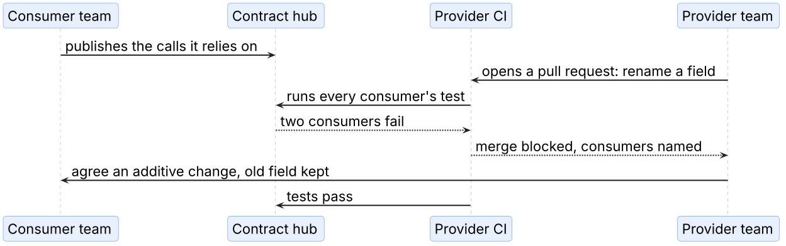

### One owner for every shared thing · C4
*Theory · 4 of 5 · mechanism 4 of 6*
- **Protects.** **[S2-one-owner-each]**.
- **How it works.** The shared schema, library or ledger belongs to exactly one team. Others use it only through its contract. Changes go through the owner.
- **Rules out.** A table edited by three teams; a shared thing that is nobody’s problem.
- **Costs.** The owner becomes a queue unless its contract is rich enough.

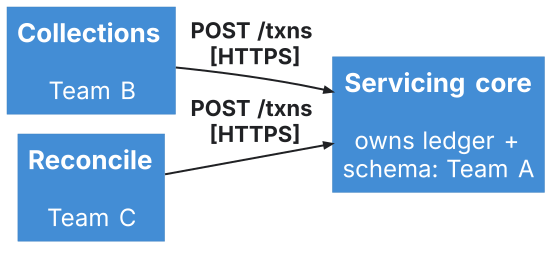

### An end-to-end skeleton first · C4
*Theory · 4 of 5 · mechanism 5 of 6*
- **Protects.** **[L2-integrated-by-week-4]**.
- **How it works.** A walking skeleton: one thin request through every team’s component, with stubs and mocks, running in week four, then thickened.
- **Rules out.** A six-month plan that learns it does not fit in month five.
- **Costs.** Early throw-away stubs, and teams who must agree before they feel ready.

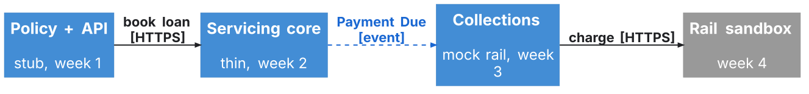

### Leading indicators and one re-cut · STATE MACHINE
*Theory · 4 of 5 · mechanism 6 of 6*
- **Protects.** **[L3-wrong-split-seen-early]**.
- **How it works.** Watch cross-team pull requests, lead time and meeting load weekly. Two weeks of friction triggers one review, and at most one re-cut.
- **Rules out.** A wrong split discovered by a missed date.
- **Costs.** A weekly dashboard, and the humility to move a seam.

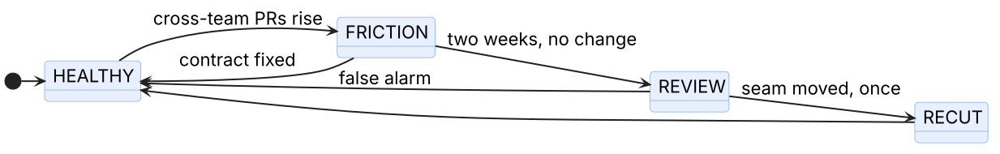

### A · Split by technical layer · C4
*Theory · 5 of 5 · option A*
**Rejected · every feature needs every team**
- ✅ Pro: Specialists stay together
- ✅ Pro: Easy to staff
- ➖ Con: Every feature crosses all teams
- 🔴 Pitfall: Three to four weeks of latency per feature
- 🔴 Pitfall: No team can ship alone

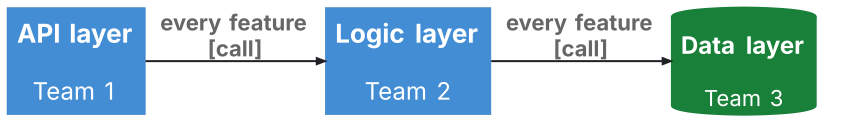

### B · Split by domain, vertical · C4
*Theory · 5 of 5 · option B*
**The pick · with a platform team where it earns its keep**
- ✅ Pro: A team can ship a feature alone
- ✅ Pro: Matches how the domain changes
- ➖ Con: Some duplication
- ➖ Con: A domain model to agree first
- 🔴 Pitfall: A wrong domain cut is expensive to move
- 🔴 Pitfall: A shared ledger needs one owner

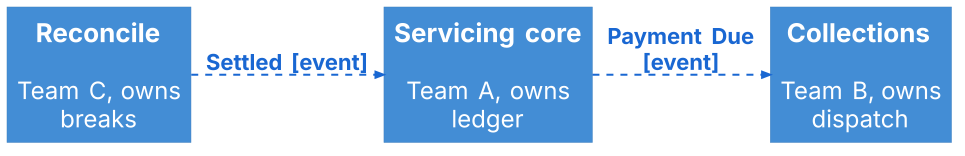

### C · Feature teams, shared everything · C4
*Theory · 5 of 5 · option C*
**Rejected · no owners**
- ✅ Pro: Maximum flexibility
- ✅ Pro: No hand-offs by design
- ➖ Con: No ownership
- ➖ Con: Merge conflicts become the coordination
- 🔴 Pitfall: Two teams change one table the same week
- 🔴 Pitfall: Nobody is paged for the shared code

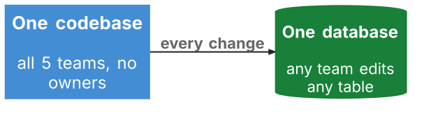

### D · Twelve services, one per entity · C4
*Theory · 5 of 5 · option D*
**Rejected · over-decomposed**
- ✅ Pro: Small, replaceable parts
- ➖ Con: Twelve contracts to version
- ➖ Con: Network failure between everything
- 🔴 Pitfall: Five teams own two or three each: more arrows, not fewer
- 🔴 Pitfall: Boundaries drawn before the domain is understood

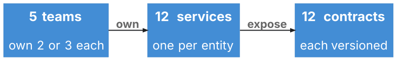

### E · Platform team plus stream teams · C4
*Theory · 5 of 5 · option E*
**Rejected for now · the honest next step at 100 engineers**
- ✅ Pro: Paved road for everyone
- ✅ Pro: Stream teams own a domain end to end
- ➖ Con: A platform team to staff and fund
- ➖ Con: Overhead before it pays
- 🔴 Pitfall: Platform becomes a ticket queue
- 🔴 Pitfall: Too early at forty engineers

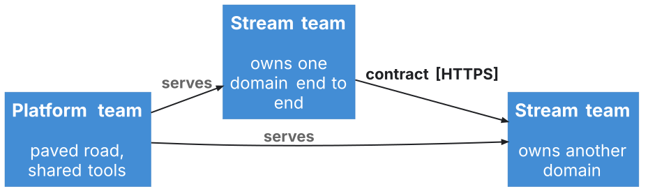

### The matrix, as a summary
*Theory · 5 of 5 · the options, side by side*

| Approach | Ship alone | Arrows | Fails when |
|---|---|---|---|
| A · by layer | no | every feature | any feature is requested |
| B · by domain, vertical | yes | 3 to 5 | the domain cut is wrong, and found late |
| C · feature teams, shared everything | no owners | implicit | two teams edit one table |
| D · twelve services | yes | 12 or more | five teams carry twelve contracts |
| E · platform plus streams | yes | few | the programme is under 100 engineers |

### B, and what it gives up
*Theory · 5 of 5 · the pick*
- **What B buys.** A feature usually touches one team. Contracts sit only where change is rare. Every team has a domain it can own and be paged for.
- **What B gives up.** Some duplication. A domain model to agree up front. A shared ledger that needs one owner and a rich contract. A wrong cut that costs a re-cut.

### Every mechanism names its property
*Theory · what each mechanism serves*

| Mechanism | Serves | Where it returns |
|---|---|---|
| M1 Seams by domain | **[L1-no-team-waits]** | chapter 5, challenge 1 |
| M2 Contracts first, versioned | **[S1-no-silent-break]** | chapter 4, challenge 4 |
| M3 Consumer tests and mocks | **[S1-no-silent-break]** **[L1-no-team-waits]** | challenges 1 and 2 |
| M4 One owner for shared things | **[S2-one-owner-each]** | challenge 3 |
| M5 End-to-end skeleton | **[L2-integrated-by-week-4]** | chapter 5, challenge 5 |
| M6 Leading indicators, one re-cut | **[L3-wrong-split-seen-early]** | challenge 6 |

<!-- theory:end -->

# Stage 4: Contracts and entities

An event contract and its additive v2 (nothing renamed, nothing removed):

```json
{"contract": "loan-booked", "version": 1, "loanId": "ln-5531", "principalCents": 120000}
{"contract": "loan-booked", "version": 2, "loanId": "ln-5531", "principalCents": 120000, "currency": "usd"}
```

A synchronous call, with its policy (additive only; deprecate with two weeks' notice):

```http
POST /v1/refunds
Idempotency-Key: mr-77

{"loanId": "ln-5531", "amountCents": 30000}

HTTP/1.1 201 Created
{"refundId": "rf-901", "status": "applied"}
```

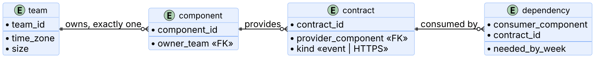

# Stage 5: High-level design

Every picture is a view of one C4 container diagram; new boxes are outlined.

**V1 — one team per layer.** Easy to staff, and where most first plans start.

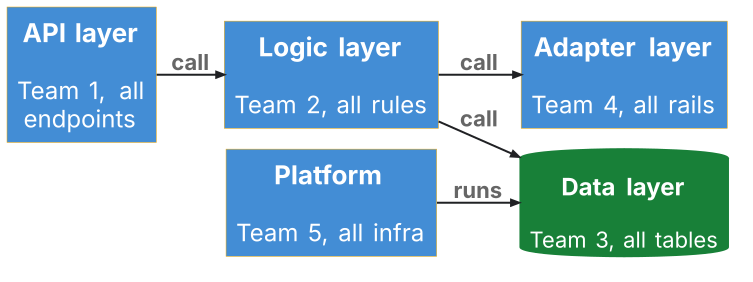

**The objection to V1.** A partial refund needs a rule (logic team), a column (data team) and a rail field (adapter team): it ships after all four, in week three.

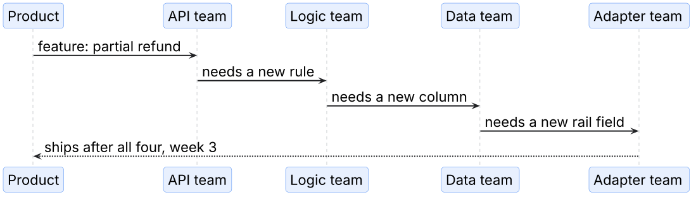

**V2 — one team per domain**, with its own data and rails; only events and one call between them.

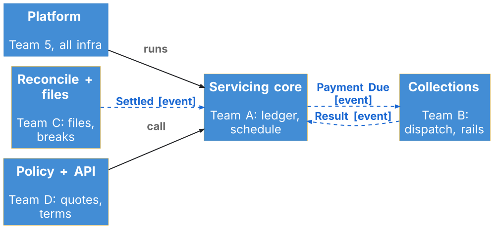

**The objection to V2.** Two teams need incompatible changes to the same ledger table with no owner rule, and the first end-to-end run is in month five.

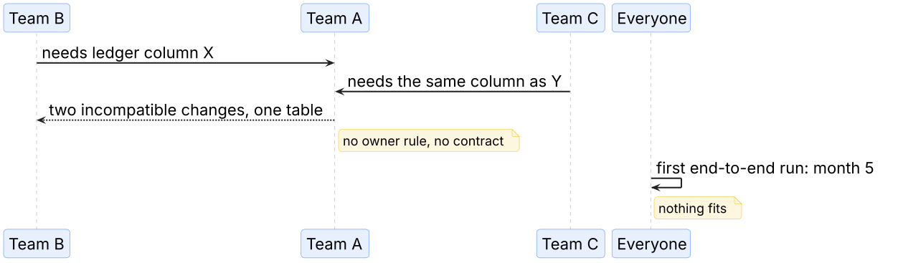

**V3 — close the loops:** a contract hub (schemas, consumer tests, mocks) and a skeleton environment; no team changes.

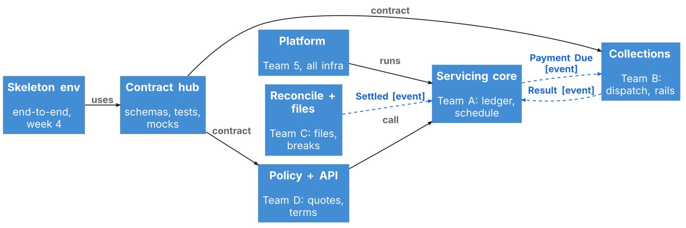

| FR | How it runs | Diagram |
|---|---|---|
| FR1 seams | cluster what changes together; one owner each | 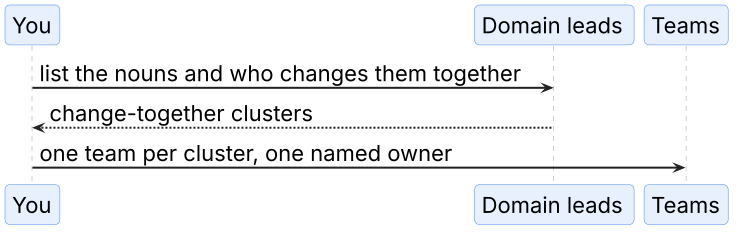 |
| FR2 contracts | draft, review, register calls; v1 in week 2 | 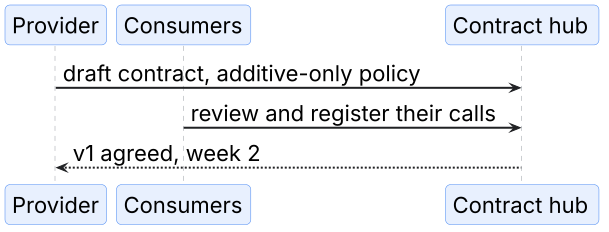 |
| FR3 unblock | build on a generated mock; real service replaces it in month 4 | 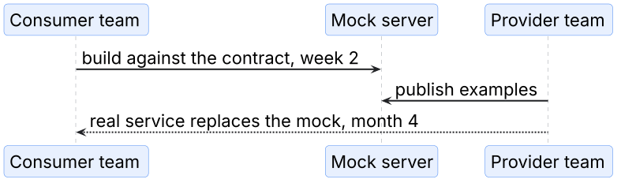 |
| FR4 integrate | thin ledger path + mock-rail path; green by week 4 | 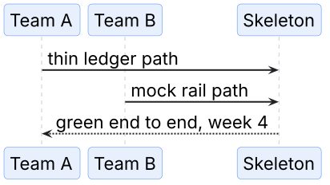 |
| FR5 detect | PRs and lead time up → two-week review → move one seam, once | 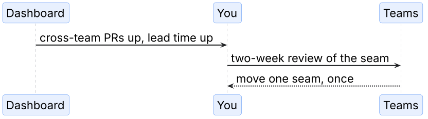 |

## Tools, one level down

| Concern | Pick | How it works | Rejected, and why |
|---|---|---|---|
| Contract format | OpenAPI and protobuf in one reviewed hub repository | a CI check compares every change to the last release and fails on a removed field, changed type or new required field | wiki pages (nothing checks them); shared source code (couples release dates) |
| Consumer tests | consumer-driven contract tests in the provider's CI | consumers register the calls they make; the provider replays them; a failure names the consumer; the same file serves the mock | end-to-end tests only (slow, flaky, late); manual review (does not scale to ten pairs) |
| Decisions and health | a one-page decision record and a weekly dashboard | proposal, options, a 2-day objection window, a named decider; three numbers: cross-team PRs, lead time, meeting hours | escalation by meeting (2 h each, no record); status reports (green until the date is missed) |

## When you don't need all this (the alternate path)

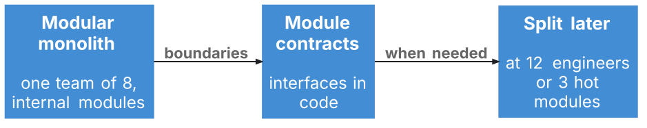

Below about twelve engineers, ship one team and a modular monolith: the module contracts are the same contracts, only cheaper to change. **What it gives up:** nothing ships in parallel. **Split when** headcount passes twelve or three modules are hot at once.

# Stage 6: Deep dives

<!-- challenges:begin -->
## 6.1 Which team is on the critical path?

**Interviewer:** Which team is on the critical path, and what do the other four do while they work?

**The naive answer.** Start everyone in parallel and let the teams sort it out. It sounds like autonomy, and it is the default when nobody names the path.

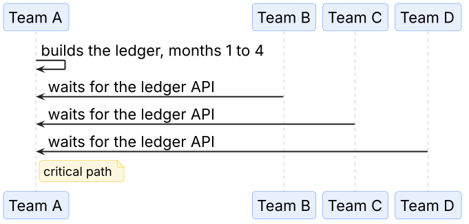

**The fix, one level down.** Publish the ledger contract v1 and a generated mock in week two. The consumers depend on the contract, not the code, so they build from week two, and the provider can still change what is behind it.

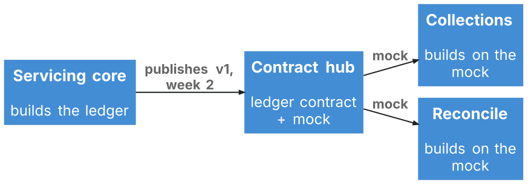

> [!WARNING]
> **Rejected: Adding engineers to the ledger team.** More communication paths on a narrow interface; the bottleneck is the contract, not typing speed.

**If the fix fails (What if the mock drifts from the real service?)** The mock is generated from the same contract file the provider's tests use, and the consumers' tests run against the real service nightly from month three. *Cost:* A nightly job and a provider fix time of two days; a drift is a failing test, not a surprise.

> [!TIP]
> **If asked, I'd say:** The critical path is the ledger. I would publish its contract and a mock in week two, so the other four build in parallel, and I would own that date personally.

## 6.2 A dependency arrives two months late

**Interviewer:** Team C needs Team B's API in month two, and B won't have it until month four. What do you do?

**The naive answer.** Move team c's work to month four and let them wait. It is honest about the dependency, and it spends two months of a team's budget.

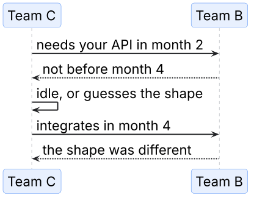

**The fix, one level down.** Team C builds against contract v1; its calls are registered and run in B's CI. A divergence fails B's own build and names C, in the week it happens, instead of both teams finding it in month four.

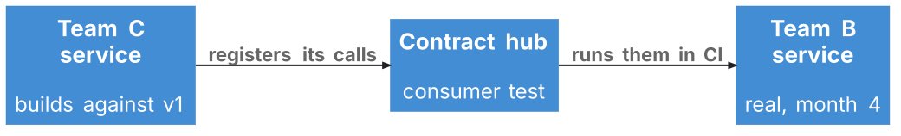

> [!WARNING]
> **Rejected: Re-sequencing: team C starts in month four.** It spends two of its thirty-six engineer-months on waiting and still integrates late.

**If the fix fails (What if the real shape has to change after C started?)** An additive version two with both live; C migrates by the sunset date, announced two weeks ahead. *Cost:* Two versions to support for a few weeks, and a sunset date the manager enforces.

> [!TIP]
> **If asked, I'd say:** I would not let team C wait. They build against the contract in week two, and their calls run in B's pipeline from the day B's service exists, so a mismatch shows up as a failing build.

## 6.3 Two teams, one table, incompatible changes

**Interviewer:** Who owns the shared data model, and what happens when two teams need incompatible changes to it?

**The naive answer.** Let them negotiate directly and merge whichever lands first. It assumes goodwill is a mechanism.

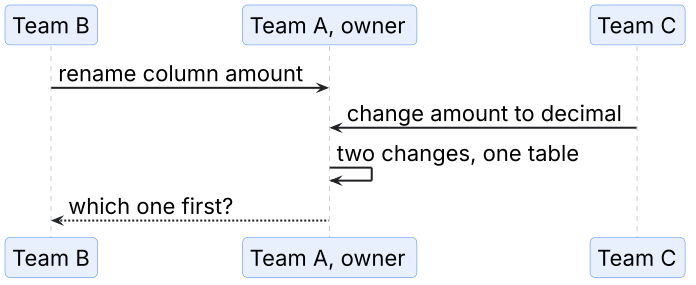

**The fix, one level down.** One owner; versioned views; expand, migrate, contract. Two incompatible needs become two compatible versions, in order, and the order is one team's decision.

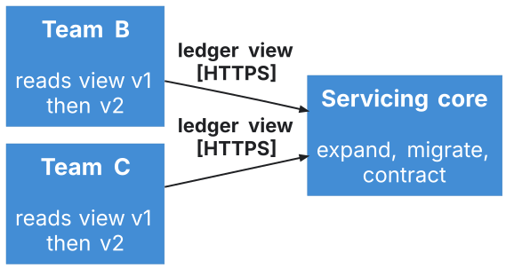

> [!WARNING]
> **Rejected: A shared schema every team may alter.** No owner, no order, and a long migration blocks everyone at once.

**If the fix fails (What if the owner becomes a bottleneck?)** The owner publishes a richer view so most needs need no change, reviews requests in two days, and hands a slice to a second team through its own contract if the queue passes five. *Cost:* Review time to staff, and a view layer to maintain.

> [!TIP]
> **If asked, I'd say:** Shared data gets exactly one owner. Everyone else reads versioned views. The owner changes a table by expanding, migrating, then contracting, so two incompatible needs become two compatible versions in order.

## 6.4 Two teams disagree on a contract

**Interviewer:** Two teams disagree on a contract and both escalate to you. Walk me through the conversation.

**The naive answer.** Get both in a room and decide on the spot. It feels decisive, and it makes the manager the bottleneck.

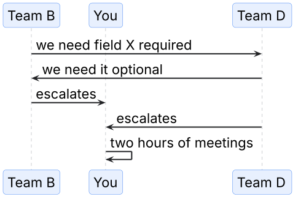

**The fix, one level down.** A one-page decision record, a two-day objection window, the provider decides ties. Most disputes dissolve when the options are written. The rest have a clock and a named decider, and the decision is on record.

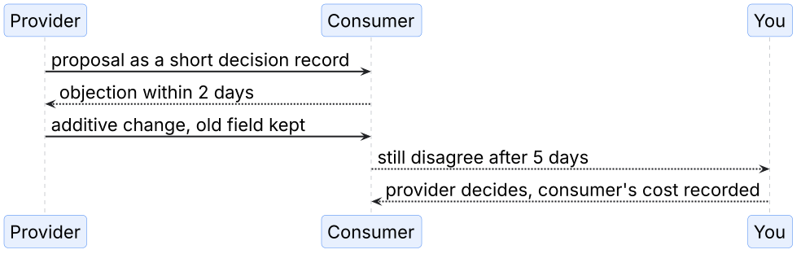

> [!WARNING]
> **Rejected: Resolving it in a meeting with both teams.** Two hours per dispute, no written record, and it is relitigated next sprint.

**If the fix fails (What if the losing team is still unhappy?)** The record names a revisit trigger, a number such as rejected calls in a month, rather than an argument. *Cost:* I look at the number at the month-three review; it takes discipline to let the data overrule the person who decided.

> [!TIP]
> **If asked, I'd say:** When two teams escalate, I run a protocol: a written proposal, two days to object, the provider decides, the consumer's cost is on record, and a number that reopens it. I am not the bottleneck.

## 6.5 You lose a team at month three

**Interviewer:** You lose one team entirely to a reorg at month three. What happens?

**The naive answer.** Spread its work across the other four teams. It looks fair, and it spreads everyone thinner.

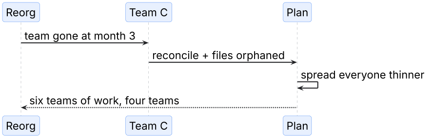

**The fix, one level down.** Pause reconciliation to release 2; freeze its contract; pair two engineers across A and B. One owner per component means a lost team orphans one component, and a frozen contract means nothing built on it moves.

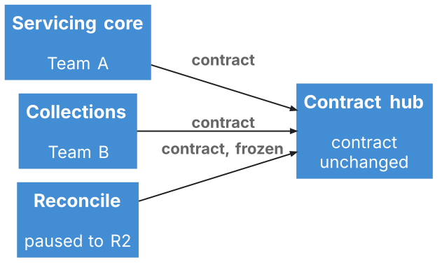

> [!WARNING]
> **Rejected: Spreading the orphaned work across the other four.** It adds four arrows and dilutes every team that was on track.

**If the fix fails (What if the date cannot move?)** Release one ships with manual break review in a sheet, an explicit risk product accepts in writing. *Cost:* Operations carry the manual work until release two, and the cost is stated, not hidden.

> [!TIP]
> **If asked, I'd say:** If I lose a team, I pause its component, freeze its contract and cut scope. I do not spread the work across four teams. The decomposition was built so a lost team orphans exactly one thing.

## 6.6 How would you know the split is wrong?

**Interviewer:** How do you know in month two that the decomposition is wrong, and how would you get this wrong?

**The naive answer.** Watch the status reports. Everyone looks at them, and they are green until the date is missed.

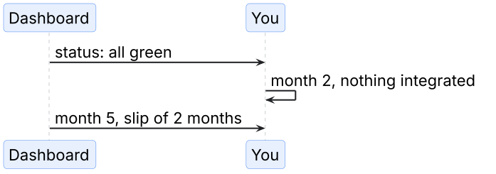

**The fix, one level down.** Cross-team PRs, lead time and meeting hours, with thresholds set in advance. They measure the cost of the cut itself and move within weeks, long before a date is missed.

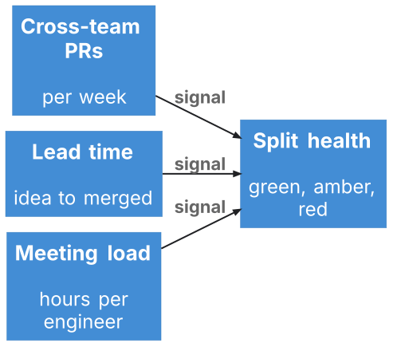

> [!WARNING]
> **Rejected: Status reports and colour codes.** They report what teams say; they are green until the date is missed.

**If the fix fails (How would you get this wrong yourself?)** I designed the cut, so I will want it to be right. The thresholds are set now, a peer manager reads the dashboard with me, and one re-cut is allowed, once. *Cost:* A peer's time every month, and the humility to move a seam I drew.

> [!TIP]
> **If asked, I'd say:** In month two I would look at three numbers: cross-team pull requests, lead time and meeting hours, against thresholds set in advance. And I would name my own failure mode: I will want my cut to be right, so a peer reads the numbers with me.

<!-- challenges:end -->

# Stage 7: Recap

| Path | In one sentence |
|---|---|
| Seams | domain clusters of what changes together; one team and one named owner each |
| Contracts | versioned before code, additive only, with a sunset date and a consumer test |
| Unblock | a mock from the contract in week 2; the critical path named and owned |
| Integrate | a thin end-to-end skeleton green by week 4, thickened weekly |
| Detect | three leading indicators, thresholds set in advance, one re-cut allowed |

**What the manager owns and does not delegate:** the contracts, the dependency graph, the integration milestones (week 4, month 3, month 5), and the escalation path (a protocol, not every verdict).

**Common mistakes:** splitting by layer; twelve services for five teams; shared tables with no owner; re-shuffling teams every quarter; assigning everything and owning nothing; integration as a phase at the end; status reports instead of leading indicators; escalation by meeting.

## Follow-up questions to be ready for

| Follow-up | Where this design answers it |
|---|---|
| Three teams are new to the domain and none can own the ledger? | Challenge 3, second fix |
| When does a platform team start to pay for itself? | Option E; the pick |
| How do you keep the contract hub from becoming a bottleneck? | Challenge 1, second fix; mechanism 3 |
| The product pivots: how does the split change? | Mechanism 6; challenge 6 |
| The date moves up a month: what do you cut? | Challenge 5, second fix |
| Eight teams, or two? | The alternate path; option E |

*Canon check.* Conway's law (stated, mechanism 1) · domain over layer (option A rejected) · contracts before code, additive-only, sunset (mechanism 2) · consumer-driven tests and mocks (mechanism 3) · one owner for shared components (mechanism 4, challenge 3) · skeleton first (mechanism 5) · sequencing against skills (clarifying question 2; the ledger to an experienced team) · time-zone seams (clarifying question 4) · what the manager owns (recap) · leading indicators and one's own failure mode (challenge 6) · not over-decomposing (option D) · the reorg curveball (challenge 5).
