\newpage

# How to read this document

This is the **long answer key for question `SD-77`** in
[design-room](https://github.com/nirmata78/design-room), an open-source system design interview
simulator, and the written companion to its reference-solution video. It shows how a strong Staff
candidate (L6/L7) runs the round: what to say, what to draw, and **when**. It adds the **why** behind
every line, so you can defend each choice when the interviewer asks *"why?"*, *"what is that?"* or
*"what happens when it breaks?"*.

Card authorisation looks like the easiest question in a fintech loop: a request arrives, you check the
balance, you say yes. It is asked at senior, Staff and manager levels because the simple answer is wrong
in three separate places at once. The decision has a **deadline set by someone else**, and missing it
does not produce an error: it produces a decision made by the card network on your behalf. The money
**does not move at the till**: an approval is a promise, recorded as a hold, and the real amount arrives
days later in a file, often different, sometimes never. And the fraud decision is **changed by analysts
several times a day**, while the labels that say whether a decision was right arrive two months later.
This document is written for those three places.

**The document has three layers, and you will read them differently:**

1. **Part I, the system in pictures.** Read it first. It explains who is in the chain of a card
   payment, what one restaurant bill does to an account, where the deadline comes from, and where the
   load lands. There is no interview script in it, only understanding.
2. **Part II, the round, stage by stage.** This is what you do in the room. Each stage has the words to
   say, what to draw, and boxes that explain every term. The eight **challenges** of the video are
   Stage 6, and each goes further here than the video can.
3. **Part III, the internals.** How holds and their expiry work, how idempotency on a network reference
   survives a failover, how a conditional write serialises one account, how inline counters are built,
   how a sandboxed rule language is evaluated, and how clearing is matched, at the depth a round reaches
   when you name a mechanism and the interviewer asks how it works.

**The coloured boxes:**

::: {.key title="Top-3 number"}
One of the back-of-the-envelope numbers worth computing out loud in the round. In a real interview you
have time for two or three calculations, not ten.
:::

::: why
Explains a term or a decision in plain words. This is for you, not for the interviewer.
:::

> Words you can say in the room, nearly verbatim.

::: warn
A trap: something weak candidates do, or a claim that breaks under a follow-up question.
:::

::: load
What this part of the system sees at peak, with numbers.
:::

**Practise in three passes.** (1) Read Part I and Part II once, end to end. (2) Close the document and
run the [simulator](https://github.com/nirmata78/design-room) cold:
`Read CLAUDE.md. Mock me: SD-77, fintech, staff, full round.`
(3) Debrief against the Stage 12 self-check, then reread only the sections where you fell short.
**Do not memorise numbers.** Memorise *the order of the argument* and how to rebuild each number in
twenty seconds.

**About the numbers.** The scale figures in Stage 1 are the simulator's cue sheet. Everything derived
from them is back-of-the-envelope arithmetic, and every planning assumption (daily volume, hold
lifetimes, the average purchase, record sizes, the fraud rate) is labelled as one: *given*, *derived*,
*illustrative* or *initial target*. None of them is a measurement, they are not any issuer's, processor's
or network's real figures, and this is not any company's actual design. Card networks and their message
standard (ISO 8583) are named only as public standards. **This is not legal, compliance or scheme-rule
advice**: network rules on hold lifetimes, stand-in and clearing differ by network, region and product,
and an issuer's own agreements decide them.

**The prompt as the interviewer reads it:**
*"You're building a card issuer — a company that issues debit cards to its customers. Design the system
that receives authorisation requests from the card network and approves or declines them."*

::: {.key title="The one-sentence insight to land by minute 12"}
**Card authorisation is a promise made inside someone else's deadline.** Answer in milliseconds with a
*hold, not a debit*; make every network message *take effect once, in any order*; spend the deadline on
the signals that matter and have a *written answer for when one is late*; and let the ledger *absorb the
decisions we did not make*.
:::

::: why
**Why this sentence, and why by minute 12.** It names the four places the question is graded: the money
model (holds), correctness under a messy network (idempotency and order), the deadline (budget and fail
policy) and stand-in (decisions made for us). Everything after it defends one of those four. A candidate
who says it early is driving the round; one who discovers stand-in at minute 45 is being driven.
:::

\newpage

# Part I: The system in pictures

## Vocabulary you need first

| Term | Plain meaning | Where it lives |
|---|---|---|
| **Issuer** | The company whose card it is: holds the customer's account, decides yes or no | us |
| **Acquirer** | The merchant's bank; sends the purchase into the network | outside |
| **Card network** | Routes messages between acquirers and issuers; sets the rules and the deadline | outside |
| **Processor** | The issuer's technical front end: link to the network, card vault, stand-in | outside, bought |
| **Authorisation** | "May this card spend this amount here, now?" Approve or decline | the decision service |
| **Incremental authorisation** | "Raise the earlier amount by this much" (a tip, a longer hotel stay) | same message family |
| **Reversal** | "Cancel all or part of an earlier authorisation" | releases a hold |
| **Advice** | "We decided for you while you were late or down; here is what we decided" | stand-in's notification |
| **Stand-in** | The network or processor approving or declining on our behalf, within limits we set | outside, configured by us |
| **Hold** | Money reserved against an account by an approval; not yet moved | the authorisation store |
| **Available balance** | Posted balance minus active holds: what a new purchase may spend | computed per decision |
| **Clearing** | The network's file with the real, final amounts, days later | the clearing matcher |
| **Settlement** | Banks paying each other the net amounts; the issuer pays the network | treasury, outside the design |
| **Network reference** | The identifier the network gives a transaction; links its messages | the message table |
| **Token** | A stand-in for the card number; the real number stays in the processor's vault | the card table |
| **Rule set** | A versioned bundle of fraud rules, written by analysts as data | the rule service |
| **Chargeback** | The cardholder disputes a purchase; the money is pulled back, weeks later | outside the design; a label |

::: why
**Why this table first.** Most weak answers fail on vocabulary, not on boxes. A candidate who says
"we debit the balance" has not heard the word *hold*; one who says "the network gives us 100 ms" has
confused the network's deadline with their own target. Getting the nouns right is half of the money
model.
:::

## The path of a swipe

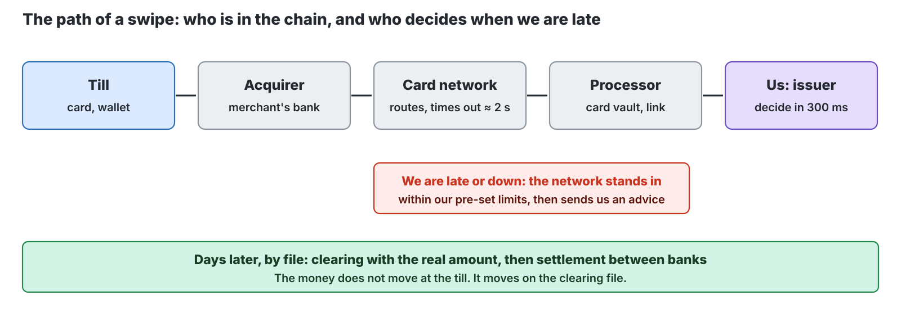{width=100%}

A cardholder taps at a till. The **merchant's terminal** sends the purchase to the **acquirer**, which
sends it into the **card network**. The network routes it by the card's number range to the
**issuer's processor**, which holds the card vault and the link, and the processor passes it to **us**.
We answer approve or decline, and the answer travels the same chain back. The whole round trip is a
couple of seconds at most; the network's own timeout is about two seconds, and the processor's is
shorter. Our part must be a small fraction of it.

If we do not answer in time, nothing fails visibly at the till. The network **stands in**: it approves
or declines using limits we configured in advance (for example, approve up to some amount per
transaction and per day, decline above), and later sends us an **advice** saying what it decided. The
cardholder never knows. We do, the next minute, and we must record it.

No money moved. Days later, the network sends a **clearing file** with the final amounts, and the banks
**settle** between themselves. The design is therefore two systems joined at the hold: a hard
real-time decision path, and a batch clearing path that turns promises into posted money.

## What one restaurant bill does to an account

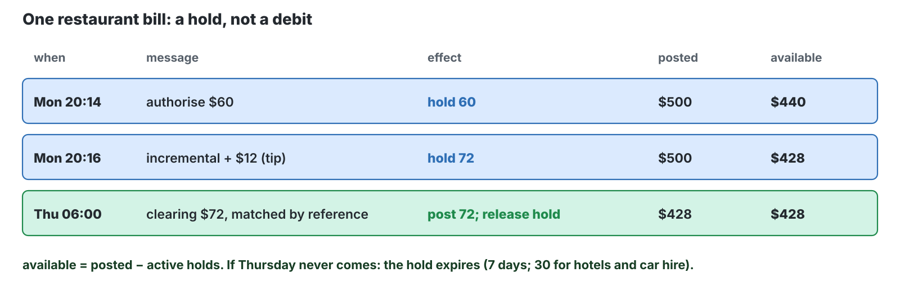{width=100%}

| When | Message | Effect | Posted | Available |
|---|---|---|---|---|
| Mon 20:14 | Authorise \$60 | Hold \$60 | \$500 | \$440 |
| Mon 20:16 | Incremental authorisation +\$12 (tip) | Hold becomes \$72 | \$500 | \$428 |
| Thu 06:00 | Clearing \$72, matched by network reference | Post \$72; release the hold | \$428 | \$428 |

Read the last column. Available balance is what the next decision reads, and it moved at the till,
not on Thursday. Posted balance moved on Thursday, when the money really moved. Between the two, the
customer's banking app shows a **pending** \$72. If Thursday never comes (the restaurant never submits),
the hold **expires** after a lifetime set by merchant category, about seven days for most and thirty
for hotels and car hire, and the \$72 comes back to available.

::: warn
**The weak answer debits \$60 at the till.** Then Thursday's \$72 is either a second debit (the
customer pays \$132) or a mismatch nobody owns (the restaurant is short \$12). Every follow-up the
interviewer has, tips, hotel pre-authorisations, partial shipments, refunds, currency conversion, is a
case where the authorised amount and the cleared amount differ. Debiting at authorisation fails all of
them.
:::

## The same story as states

A hold is a small state machine, and every message moves it:

| From | Message | To | Notes |
|---|---|---|---|
| — | authorisation approved | **open** | amount A, expiry by merchant category |
| — | advice (stand-in approved) | **open** | even if it overdraws the account |
| open | incremental authorisation | open | amount A + delta |
| open | partial reversal | open | amount reduced |
| open | full reversal | **released** | available restored |
| open | clearing record matched | **cleared** | posted in the ledger; hold released |
| open | expiry passed *and* the day's clearing file has arrived | **expired** | available restored |
| released or expired | late clearing record | — | posts anyway; may overdraw: a modelled state |

The last row is where weak designs break: the network has already paid the merchant, so a clearing
record is a fact, not a request. We post it even if the hold is long gone.

## The central contrast: two clocks

| | The decision clock | The money clock |
|---|---|---|
| Speed | milliseconds, inside a ~2 s network deadline | days, by daily file |
| Who sets it | the network | the network's clearing cycle |
| What it writes | a hold, a decision record | a posting in the core ledger |
| What happens if late | the network decides for us (stand-in) | posting slips; holds wait; the customer sees pending longer |
| Truth | our decision, with its inputs | the clearing file |
| Failure mode | missing the deadline | a mismatch nobody owns |

Most of the design is keeping these two clocks apart: nothing on the money clock may sit on the
decision clock's path, and nothing the decision clock decided may be lost by the money clock.

## Where the deadline goes

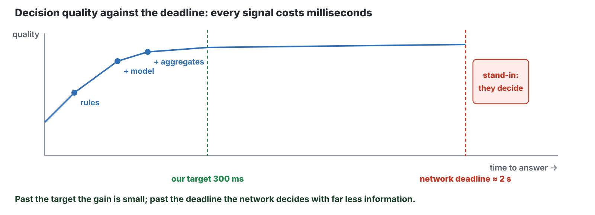{width=100%}

Each signal costs time. Card status and the balance are a few milliseconds. In-process rules are ten.
A fraud model is tens of milliseconds and occasionally far more. Rich aggregates computed on request
would be hundreds. Past our own target, the extra quality is small; past the network's deadline, the
network decides with far less information than we have. The design spends the deadline deliberately and
writes down, in advance, what happens when a step is late.

## Where the load lands

::: load
**Authorisation path at the busiest peak (illustrative):** 4,000 requests a second; 1,200 in flight at
the 300 ms target, about 400 at a typical 100 ms; about 12,000 state reads a second (account and holds,
card, counters), each budgeted at a few milliseconds. **Per account:** a few authorisations a minute.
**Auth store:** about 36 million open holds, about 7 GB. **Event log:** about 20 million decisions a day,
40 GB of decision records. **Clearing:** one file of about 10 million records, 5 GB, once a day.
**Advices after an outage:** a burst of hundreds of thousands within minutes.
:::

The shape matters more than the size. The fleet is small; the tail latency of the slowest dependency is
the whole problem on the decision path; the per-account rate is tiny, so serialising per account is
free; and the batch side is large but has hours, not milliseconds.

## The whole design on one page

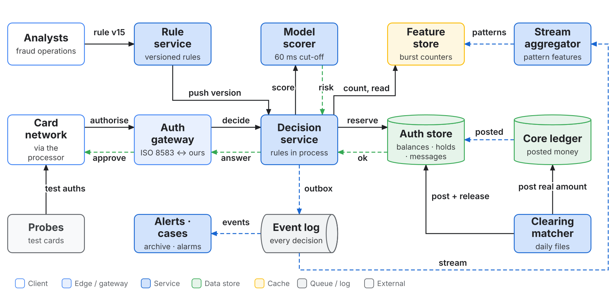{width=100%}

Across the middle, the authorisation path: the **card network** (through the processor) calls our
**auth gateway**, which maps the network's message format to ours; the **decision service** reads and
increments **burst counters** in the **feature store**, asks the **model scorer** for a risk score
under a 60 ms cut-off while **rules** run in its own process, and reserves the hold in the
**authorisation store** in one atomic write. The answer goes back the same way. Above, the **rule
service** pushes versioned rule sets that **analysts** write, and a **stream aggregator** feeds pattern
features. Below, every decision goes through an outbox to the **event log**, which feeds **alerts,
cases and the decision archive**. On the right, the **clearing matcher** turns the network's daily file
into postings in the **core ledger** and releases holds in the authorisation store, and posted-balance
changes flow back from the ledger to the authorisation store.

\newpage

# Part II: The round, stage by stage

| Stage | Minutes (of 60) | What you produce |
|---|---|---|
| 1 Clarify | 0–5 | Six questions; four functional requirements; numbers; IN and OUT |
| 2 Estimates | 5–10 | Concurrency, the hold book in memory, the cost of a slow model, the latency budget |
| 3 API and data | 10–16 | The four message families and the clearing file; the auth store's tables; the keys |
| 4 High-level design | 16–28 | V1, V2, V3; four numbered flows |
| 5 Technology | inside 4 | One sentence per choice, against the alternative |
| 6 Deep dives | 28–50 | Two to four of the eight challenges, chosen by the interviewer |
| 7 Mid-round requirement | inside 6 | A late, duplicated clearing file; a second region; credit cards |
| 8–10 Failure, SLOs, cost, EM layer | 50–56 | Two minutes each, prioritised |
| 11 Close | 56–58 | Four sentences |

# Stage 1: Clarify requirements

Ask six questions before drawing. Each answer below is the simulator's, and each changes the design.

| Question | Answer | What it changes |
|---|---|---|
| Cards and traffic? | 8 million debit cards; 1,500 authorisations a second at the evening peak; 4,000 on the busiest shopping day | Size for 4,000; the fleet is small; the tail is the problem |
| The deadline? | The network times out after about 2 seconds and stands in; our own target is up to us | We pick p99 under 300 ms at our gateway, and design for when we miss it |
| Which messages? | Authorisation, incremental authorisation, reversal, advice, refund; clearing by daily file | A message state machine, not a single request type |
| Fraud? | Losses about 8 basis points of volume; chargebacks and customer reports 30 to 90 days later; analysts change rules several times a day without a release | A fraud score under a budget; rules as data; labels are late |
| Money? | The balance lives in our core ledger; clearing can differ from the authorisation; some never clear | Holds, not debits; clearing is the financial truth |
| Card data? | The processor holds full card numbers in its vault; we receive a token | Card-data scope stays at the processor; we never see a full number |

::: why
**Why ask about the deadline before anything else.** It is the one number set by someone else, and it
has a consequence nobody else's number has: missing it does not fail, it hands the decision to the
network. Asking it first also lets you correct the most common prep error out loud: the network's
timeout is seconds, and *your* target is a choice you make inside it.
:::

::: why
**Why ask about fraud labels.** "30 to 90 days" is the sentence that later makes shadow mode unable to
measure false positives (Challenge 6). A candidate who asks it in minute three and uses it in minute
forty is showing exactly the habit the round grades: a number that changes a decision.
:::

**Functional requirements.**

- **FR1 · Authorise.** Answer an authorisation or incremental authorisation, approve or decline, inside
  the deadline. An approval places a hold.
- **FR2 · Reverse and advise.** Reversals release holds. Stand-in advices are recorded and held, even
  past the balance.
- **FR3 · Clear.** Match each clearing record to its hold, post the real amount, release or adjust the
  hold; expire holds that never clear.
- **FR4 · Change rules.** Analysts publish fraud rules as versioned data, through backtest, shadow, a
  slice and enforcement, without a deploy.

**Non-functional requirements** (initial targets, not measurements):

| Requirement | Number | Why this number |
|---|---|---|
| Latency | p99 under 300 ms at our gateway, request in to answer out | leaves most of the ~2 s for the network and processor hops |
| Availability of the authorisation path | 99.99 % | each minute down is stand-in for every card |
| Effects | a network message never takes effect twice | retries and duplicates are normal |
| Our approvals | never take an account's available balance below zero | the advice path may; ours may not |
| Reproducibility | every decision reproducible for 7 years | disputes, regulators, model debugging |
| Clearing | posted by 09:00 on the day the file arrives | the customer's statement and the bank's books |
| Rule change | live within 5 minutes | an attack at 02:00 is minutes, not a release cycle |
| Degraded decisions | inside an hourly exposure cap signed by risk and finance | falling back is a money decision |

**Out of scope, said aloud:** issuing and manufacturing cards; the network and the processor themselves;
the disputes and chargeback workflow (we only consume its labels); statements; how models are trained;
credit and overdraft products; the 3-D Secure challenge flow, whose result arrives as an input field.

> The core is three things: a decision path that always answers inside the deadline, a hold ledger where
> each network message takes effect once, and a clearing path that turns promises into posted money and
> absorbs what we did not decide.

# Stage 2: Back-of-the-envelope

## How to do estimates in an interview

Three numbers deserve to be said out loud; the rest go in a table you mention. For each, say the
arithmetic, the label, and the decision it changes.

::: {.key title="Top-3 number: what is in flight, and where state must live"}
4,000 requests a second × 0.3 s at the target = **1,200 in flight** at worst; about 400 at a typical
100 ms. Each reads three things: the account and its holds, the card, the counters. 4,000 × 3 = **12,000
state reads a second**, each budgeted at a few milliseconds. **Meaning:** concurrency is small, but every
read is on the critical path. **Design change:** the state a decision needs lives next to the decision,
in a store built for single-digit-millisecond reads, never the core ledger.
**Say:** "Twelve thousand reads a second, each in a few milliseconds: that's a dedicated authorisation
store, not the ledger."
:::

::: {.key title="Top-3 number: the hold book fits in memory"}
Assume 12 million approvals a day, each open about three days until clearing: **36 million open holds**.
At about 200 bytes each that is **7 GB**. **Meaning:** the whole hold book, with balances, fits in the
memory of a small partitioned cluster. **Design change:** an in-memory-backed store, partitioned by
account, with a durable log; reads never touch disk on the hot path.
**Say:** "Thirty-six million holds is seven gigabytes. The whole book fits in memory, partitioned by account."
:::

::: {.key title="Top-3 number: what a slow model costs"}
If 2 % of decisions at the 4,000-a-second peak miss the model's slot: 4,000 × 60 × 2 % = **4,800
decisions a minute** decided without it. At an average \$60 and the base fraud rate of 8 basis points:
4,800 × \$60 × 0.08 % about **\$230 a minute** of expected loss. **Meaning:** small, at the base rate; but
fraud concentrates exactly where the model is blind, so the real number is several times higher.
**Design change:** falling back to rules is a priced decision with an hourly cap and an owner, not an
engineering default.
**Say:** "About two hundred and thirty dollars a minute at the base rate, more in practice. That's a
finance conversation, so it's a table with a cap."
:::

## The full table

| Number | Arithmetic | Label | Decision it drives |
|---|---|---|---|
| Peak rate | 1,500/s evening; 4,000/s busiest day | given | Size for 4,000 with headroom |
| Daily messages | assume 20 M a day about 230/s average; 4,000 ÷ 230 about 17 at the busiest peak, 1,500 ÷ 230 about 6.5 on a normal evening; 20 M ÷ 8 M about 2.5 a card a day | illustrative | Daily volume sizes logs and the clearing file, not servers |
| Concurrency | 4,000 × 0.3 s = 1,200; × 0.1 s = 400 | derived | Small fleet; the tail is the problem |
| State reads | 4,000 × 3 = 12,000/s | derived | A dedicated authorisation store next to the decision |
| Open holds | 12 M a day × 3 days = 36 M × 200 B about 7 GB | illustrative | In memory, partitioned by account |
| Per account | a busy card: a few a minute | derived | Serialising per account is free (C2) |
| Fleet card account | 2,000 cards × 1 per 10 min = 3.3/s on one key | illustrative | Still fine; sub-limits only at hundreds a second |
| Slow model | 4,800/min × \$60 × 0.08 % about \$230/min | illustrative | Fail policy with a cap |
| Outage | 20 min × 60 × 300/s = 360,000 stand-in decisions | illustrative | Advices arrive in a burst; post them all, once |
| Clearing file | 10 M records × 500 B about 5 GB a day | illustrative | Minutes of batch; matching is the hard part |
| Duplicates in a bad file | 3 % × 10 M = 300,000 | illustrative | Record-level idempotency (C7) |
| Decision log | 20 M × 2 KB about 40 GB a day; × 365 about 15 TB a year | illustrative | Object storage by day; seven-year retention |
| Latency budget | 5 + 5 + 3 + 10 + 60 + 10 + 5 = 98 ms; spare 202 ms of 300 | initial target | The model is the only slow step, and it has a cut-off |

::: why
**Why the peak-to-average ratio matters here.** A payments system is sized for its worst evening, not
its average second, and card traffic is spiky: lunchtime, evening, the busiest shopping day of the year.
The ratio also tells you the fleet will idle most of the day, which is why the cost lines that matter
(Stage 9) are fees and fraud, not servers.
:::

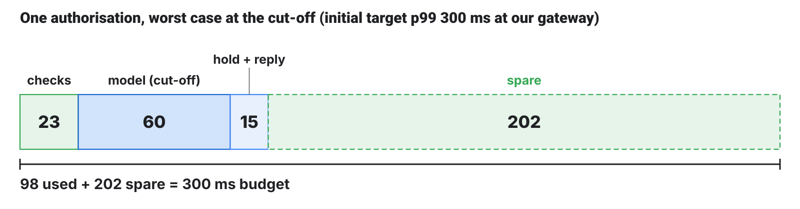{width=100%}

**The budget, step by step.** Parse the network message and check its reference: 5 ms. Read the account,
holds and card: 5 ms. Read and increment the burst counters: 3 ms. Rules, in process: 10 ms, in
parallel with the model. The model: up to 60 ms, then the decision proceeds without it. Reserve the hold:
10 ms. Respond: 5 ms. **98 ms at the cut-off; about 200 ms spare.** The spare is not waste: it is the room
for a garbage-collection pause, a partition failover and a slow network hop, all at once, before the
network's own clock is in danger.

# Stage 3: API and data

## The messages

The network speaks ISO 8583, a message standard with numbered fields; the processor delivers it to us
over a dedicated link. Our gateway maps it to our own messages, so nothing behind the gateway knows the
wire format.

| Message | Serves | Reads / writes | Notes |
|---|---|---|---|
| `Authorise {networkRef, token, amount, currency, mcc, merchant, entryMode, threeDS, ts}` → `{approve \| decline, reasonCode, authCode}` | FR1 | reads Card, Account, Counters; writes Hold, Message, Decision | The answer must leave inside the budget |
| `IncrementalAuth {networkRef, originalRef, deltaAmount}` | FR1 | writes Hold | The same hold, larger |
| `Reversal {networkRef, originalRef, amount}` → ack | FR2 | writes Hold, Message | May arrive before its original |
| `Advice {networkRef, decidedBy, decision, amount}` → ack | FR2 | writes Hold, Message | Always acknowledged, always recorded |
| `ClearingFile {fileId, records[]}` | FR3 | reads Hold; writes Posting, Hold, ClearingRecord | Each record has its own ID; files repeat |
| `POST /rulesets {rules[], parent}` · `POST /rulesets/{v}/promote {mode, slice}` | FR4 | writes RuleSet | Internal; reviewed by a second analyst |

::: why
**Why `mcc` and `entryMode` are on the request.** The merchant category code says what kind of
merchant it is (restaurant, fuel, hotel, electronics); it sets the hold's lifetime and is the strongest
single fraud feature. The entry mode says whether the card was present (chip, contactless) or not
(online, phone). Card-not-present fraud is most of fraud, so almost every rule branches on it.
:::

::: why
**Why an advice is acknowledged even when we disagree.** It is not a question. It is the network telling
us what it already did, under limits we set. Refusing it does not undo the purchase; it only makes our
books disagree with the network's, which clearing will expose on Thursday.
:::

**The reason codes matter.** A decline carries a reason (insufficient funds, suspected fraud, card
blocked, do not honour). The terminal and the cardholder's app show something different for each, and
"suspected fraud" triggers a text asking the customer whether it was them, which is the fastest
false-positive signal there is (Challenge 6).

## The data model

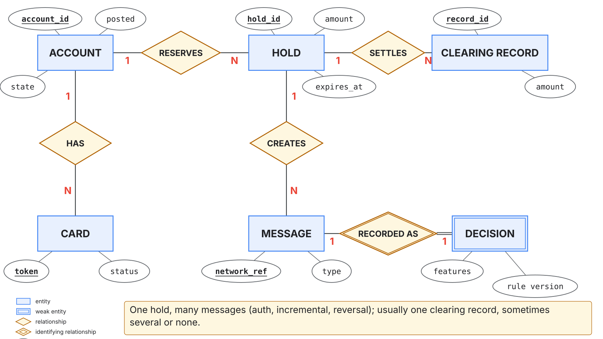{width=95%}

An **account** has many **cards** (a joint account, a replacement card, a fleet of business cards). An
account has many **holds**. A hold is created by a **message** and changed by later messages with the
same reference family: the authorisation, its incrementals, its reversals. Each message is recorded as
a **decision**, a weak entity that only exists as the record of its message, carrying the features, the
rule-set version and the model version. A hold is **settled** by clearing records: usually one, several
for a split shipment, none for a hold that expires.

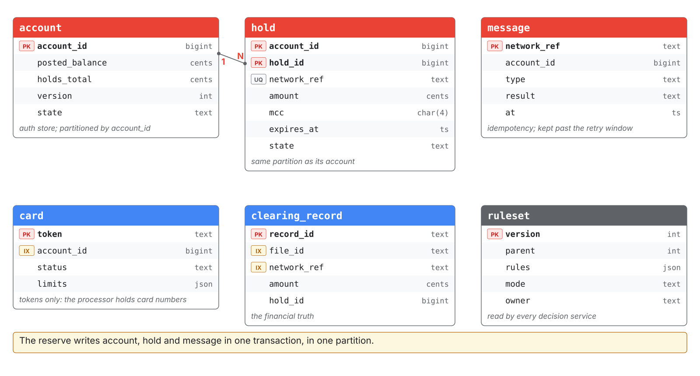{width=100%}

| Table | Key | Columns | Note |
|---|---|---|---|
| `account` | `account_id`, the partition key | posted_balance, holds_total, version, state | `state` includes over-limit |
| `hold` | `(account_id, hold_id)`; `network_ref` unique | amount, mcc, expires_at, state | same partition as its account |
| `message` | `network_ref` | account_id, type, result, at | idempotency; kept past the retry window |
| `card` | `token` | account_id, status, limits | tokens only |
| `clearing_record` | `record_id` | file_id, network_ref, amount, hold_id | the financial truth |
| `ruleset` | `version` | parent, rules, mode, slice, owner | read by every decision service |
| counters | `card:minute` in an in-memory store | count | expire after 11 minutes |

**The hot keys and their writers.** The account row is written by the decision service (holds), the
clearing matcher (releases) and the ledger's posted-balance events. All three write through the same
conditional-write path with the version column, so none of them can overwrite another's change. The
counter keys are written only by the decision service. The rule-set table is written by the rule
service and read, through a push, by every decision service.

**Stores and "can we lose it?"**

| Store | Lose it? | Because |
|---|---|---|
| Auth store (balances, holds, messages) | **No** | holds are money; messages are idempotency |
| Feature store (counters) | Yes, ten minutes of it | rebuilt from the event log; a row of the fail table covers the gap |
| Event log | No, until consumed and archived | it carries the outbox to the ledger, alerts and archive |
| Decision archive | No | seven-year reproducibility |
| Rule sets | No | every decision names one |
| Core ledger | No | it is the bank's books |

# Stage 4: High-level design

Draw one baseline and evolve it. Boxes never move; each version adds boxes and reroutes arrows.

## Version 1: the simplest thing that works

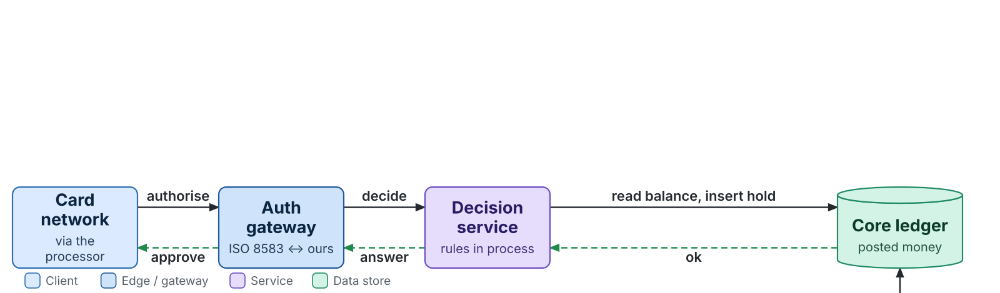{width=100%}

A gateway and one decision service. To authorise, it reads the balance from the core ledger and inserts
a hold row there, in one transaction. Rules are `if` statements in its code. A nightly clearing job reads
the network's file, posts the amounts and releases the holds.

> V1 works, and for a small issuer at a hundred authorisations a second it might be enough. The objection:
> the core ledger's tail latency and its nightly batch window now sit on the authorisation path; every rule
> change is a deploy; there is no fraud score; and nothing answers a retried or out-of-order message.

## Version 2: split the decision from the ledger

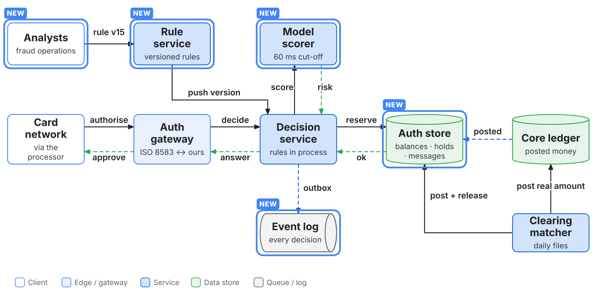{width=100%}

The decision service becomes stateless, and the state it needs moves to an **authorisation store**:
balances, holds and the message table, partitioned by account, with one atomic reserve. **Rules** move
into the decision service's process, pushed as versioned data from a **rule service** that analysts
use. A **model scorer** answers under a 60 ms cut-off. Every decision is written to an **outbox** in the
same transaction as the hold and published to an **event log**. A **clearing matcher** loads the
network's daily file, posts to the core ledger and releases holds in the authorisation store; the
ledger's posted-balance changes (salary in, a direct debit out) flow back to the authorisation store as
events.

> The objection V2 answers: the authorisation path must not depend on the ledger's tail, and a rule must
> change without a deploy. The objection it leaves: where do features come from, what happens when
> something is late, what about stand-in advices, and how do two copies of the balance stay in agreement?

## Version 3: protect the deadline and close the loops

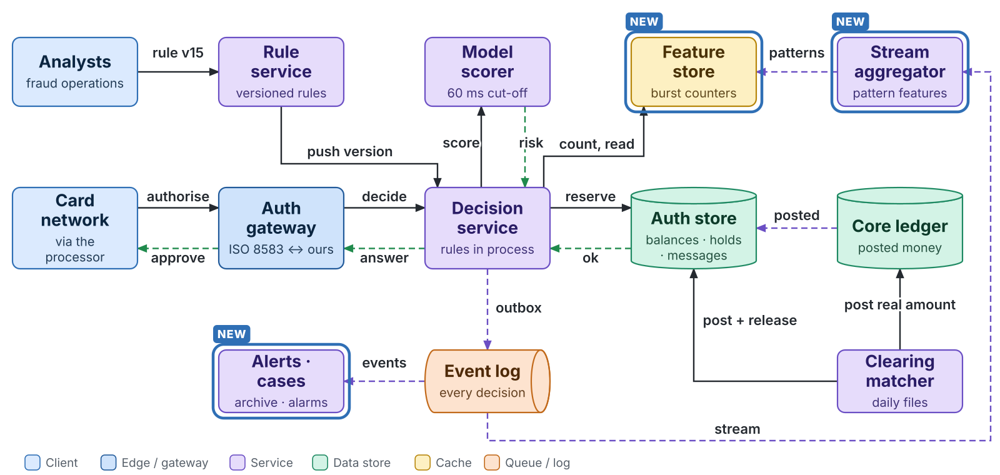{width=100%}

A **feature store** holds burst counters that the decision service reads and increments inline, and
pattern features that a **stream aggregator** computes from the event log. The decision service carries
the **fail-policy table** and exposure counters. Advices take the same path as authorisations and are
always recorded. The rule service gains **backtest** (on the decision archive) and **shadow** modes.
**Alerts, cases and the archive** consume the event log. And a daily job **reconciles** the
authorisation store against the ledger.

| Version | Adds | Answers | Leaves |
|---|---|---|---|
| V1 | Gateway, one service, holds in the ledger, rules in code, a nightly clearing job | — | the ledger on the hot path; deploys for rules; no score; no idempotency |
| V2 | Auth store, atomic reserve, rules as data, model under a cut-off, outbox and event log, clearing matcher | the ledger off the hot path; rules without deploy | features; lateness; advices; two balances |
| V3 | Feature store and aggregator, fail table, advices, lifecycle tooling, consumers, reconciliation | every step budgeted with a written fallback; nothing we did not decide is lost | the details: Challenges 1 to 8 |

## The numbered flows, one per functional requirement

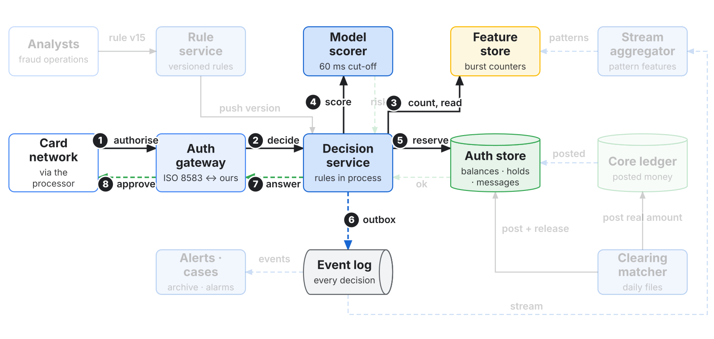{width=100%}

**FR1 · Authorise.** (1) The network sends the request through the processor. (2) The gateway maps it
and passes it to a decision service. (3) The decision service increments this card's current-minute
counter and reads the previous nine minutes in one round trip. (4) It sends the request to the model
scorer with a 60 ms cut-off, while the rules run in its own process. (5) If the decision is approve, it
reserves the hold in the account's partition: check available, insert the hold, record the message, in
one conditional write. (6) The decision, with its inputs, features and versions, goes to the outbox in
the same write and to the event log. (7, 8) The answer goes back through the gateway to the network.

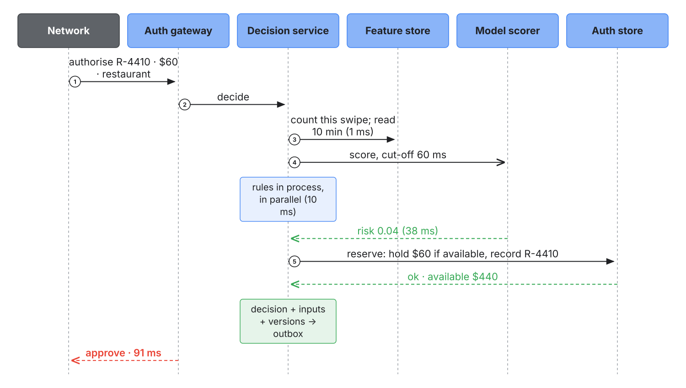{width=100%}

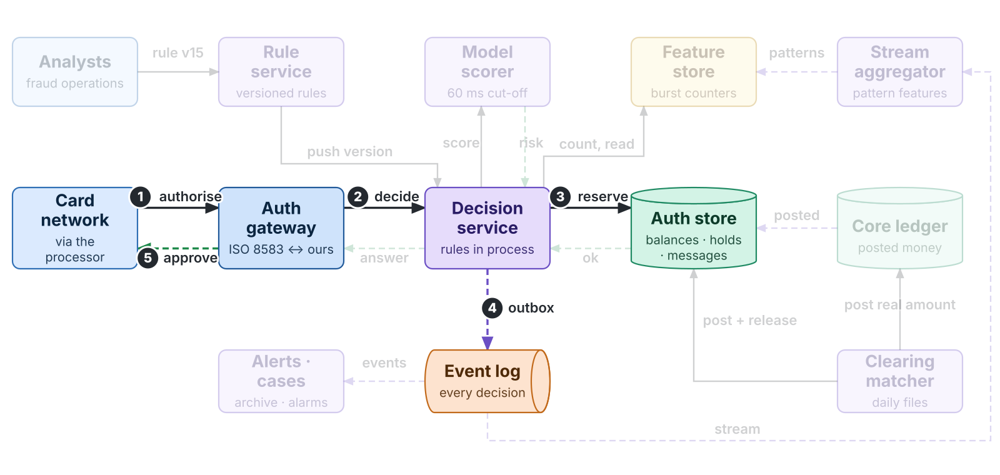{width=100%}

**FR2 · Reverse and advise.** (1) A reversal or an advice arrives from the network. (2) The gateway passes
it on. (3) The decision service applies it by network reference in the authorisation store: a reversal
releases all or part of a hold (or is stored as a tombstone if its original has not arrived); an advice
is recorded as a hold even if it takes the account past zero. (4) The event goes to the log. (5) The
acknowledgement goes back.

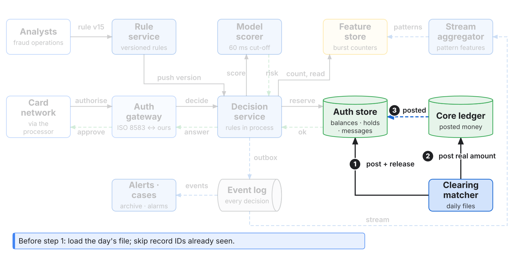{width=100%}

**FR3 · Clear.** Before step 1 the matcher loads the day's file and skips record IDs it has already seen.
(1) In the authorisation store, in one write, it moves the amount from the hold to the posted balance:
posted goes down by \$72 and the \$72 hold is released, so available does not move at all. (2) It posts the
same amount to the core ledger, keyed by the clearing record's ID. (3) The ledger's other posted-balance
changes (a salary in, a direct debit out) flow back to the authorisation store; the clearing postings it
already applied are recognised by record ID and skipped. Records with no reference fall back to a fuzzy
match; unmatched records still post and go to a review queue; holds past their lifetime are released once
the day's file has arrived.

::: warn
**The ordering trap.** If the matcher released the hold first and waited for the ledger's posted event to
lower the balance, available would jump up by \$72 for a moment, and a purchase in that moment could
spend money that is already gone. Moving the amount from hold to posted in one write in the
authorisation store keeps available unchanged at every instant.
:::

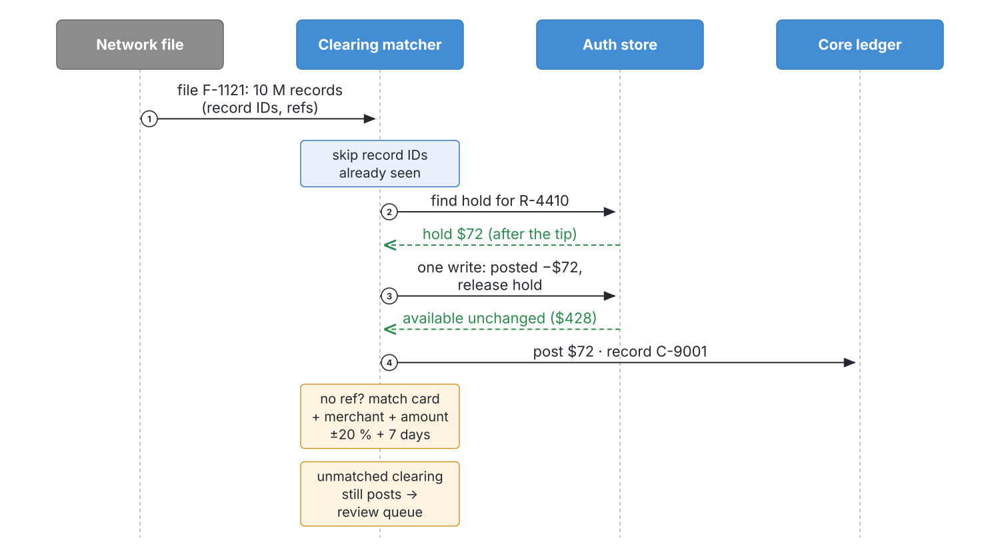{width=100%}

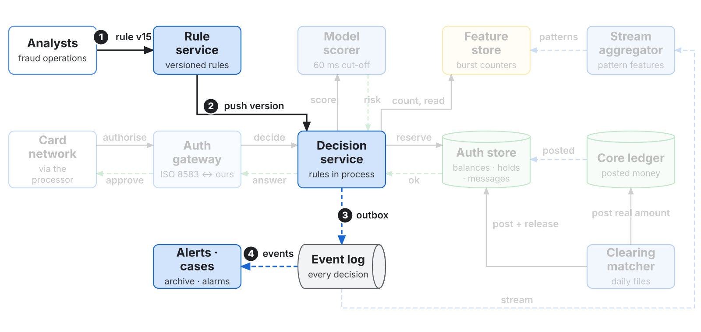{width=100%}

**FR4 · Change rules.** (1) An analyst writes rule version 15 in the rule service, which backtests it on
the decision archive. (2) The rule service pushes a new rule-set version to every decision service, in
shadow. (3) Every decision records the rule-set version and what shadow rules would have done, to the
outbox. (4) The event log feeds the alarms on decline rate by merchant type. Then a slice, then
enforcement; rollback is re-pointing to the previous version.

## The C4 views

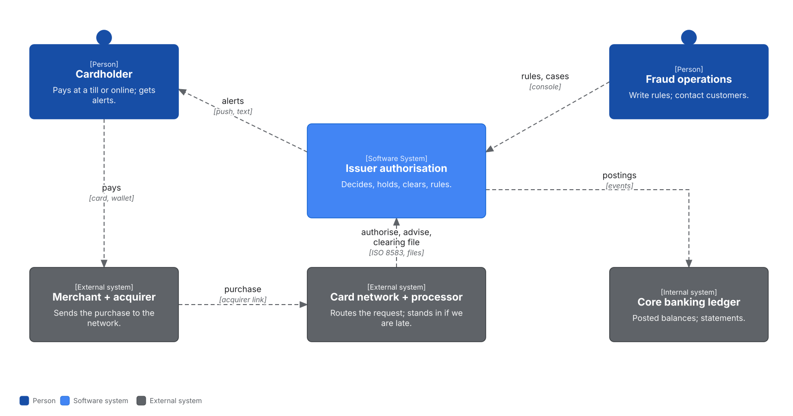{width=95%}

**Context.** The cardholder pays a merchant, whose acquirer sends the purchase through the card network
and the processor to us. We send the cardholder alerts. Fraud operations write rules and work cases. We
send postings to the core banking ledger. Nothing else is on the authorisation path.

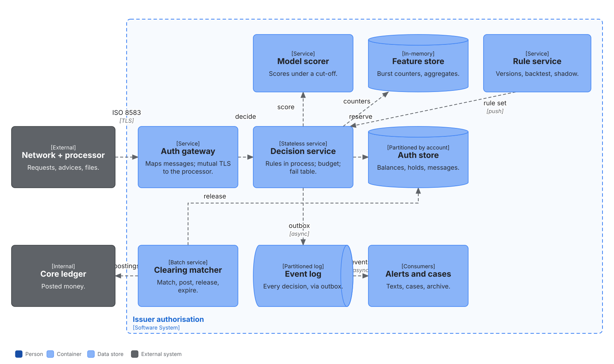{width=100%}

**Containers.** The gateway, the decision service, the authorisation store and the feature store, the
model scorer and the rule service, the event log with its consumers, and the clearing matcher. The
authorisation path is three boxes in a row; everything else is above it (what it reads) or below it (what
happens after the answer). That layout is the thesis, drawn.

# Stage 5: Why these choices

## A dedicated authorisation store, partitioned by account

**Why here.** The decision reads the account, its holds and its messages, and must reserve atomically,
in a few milliseconds, 12,000 times a second, without inheriting the core ledger's batch windows. **What
to explain.** Partition by `account_id`, so every write a decision makes lands in one partition and one
transaction; keep the working set in memory with a replicated, durable log; a version column on the
account for conditional writes. **Alternatives.** Holds in the core ledger (correct, but its tail and
maintenance sit on the authorisation path); a cache in front of the ledger (a cache cannot reserve: two
readers of the same cached balance both approve). **Verdict:** a dedicated store, reconciled daily with
the ledger, which keeps the truth for posted money.

## Rules in process, pushed as versioned data

**Why here.** Rules are cheap to evaluate and must change without a deploy. Calling a remote rules
service would add a network hop and a failure mode to every decision. **What to explain.** A sandboxed
expression language with a time and memory limit per evaluation; the rule set compiled once per version
and swapped atomically; the version on every decision. **Alternatives.** Rules as code (a deploy per
change); a remote rules engine (a hop and a dependency). **Verdict:** in process, as data.

## A model scorer with a hard cut-off

**Why here.** The model is the only step that can be slow, and its slowness must never become ours.
**What to explain.** The decision service sends the request asynchronously and waits at most 60 ms; a
late score is logged and ignored; the fail-policy table decides without it. **Alternatives.** Embed the
model in the decision service (no hop, but model releases become decision-service releases, and a heavy
model competes for the same CPU); wait for it (stand-in). **Verdict:** a separate scorer behind a cut-off,
or embedded when the model is small, with the same cut-off around it.

## An in-memory feature store for counters

**Why here.** Burst counters must be exact at decision time and cost about a millisecond. **What to
explain.** One key per card per minute; increment the current bucket and read the previous nine in one
pipelined round trip; keys expire on their own. **Alternatives.** Counters from a stream processor (seconds
late: Challenge 5); a SQL count over recent transactions (milliseconds turn into tens). **Verdict:** inline
counters, plus pattern features from the stream.

## An outbox and a partitioned event log

**Why here.** Every decision must reach the archive, alerts, case management and the aggregator, and none
of them may slow the answer. **What to explain.** The decision is written to an outbox row in the same
transaction as the hold; a relay publishes it to the log; consumers are idempotent by network reference.
**Alternatives.** Publish directly from the decision service (a crash between the hold and the publish
loses the event, or publishes an event for a hold that rolled back). **Verdict:** outbox, then log.

## A batch clearing matcher

**Why here.** Clearing arrives as a file once a day; it is large but has hours. **What to explain.**
Record-level idempotency; matching by reference first, then fuzzy; one write in the authorisation store
that moves the amount from hold to posted, so available never jumps; then the ledger posting, keyed by
record ID, so a crash between the two is repaired by simply running the record again. **Alternatives.** Streaming clearing per record
(fine where the network offers it; the matching logic is the same). **Verdict:** batch, with the same
idempotent per-record step a stream would use.

## Technologies, one level down

Every container with the technology it runs on, how it is built, the alternatives rejected and why, and the question an interviewer asks about it. Generated from `stack.json`.

<!-- stack:sections -->

## Auth store: PostgreSQL partitioned by account

*How it is built.* Accounts are partitioned by account ID, so the balance, the holds and the network message a decision touches live together. A decision is one conditional update: a version column on the account makes the second of two simultaneous swipes fail and re-read. The network's reference is a unique key, written with the hold. The hot set fits in memory, and each primary has a synchronous standby in another zone. The core ledger keeps posted money; this store is reconciled with it daily.

*Why PostgreSQL 16, partitioned by account, hot set in memory, synchronous standby:* The decision must reserve atomically, in milliseconds, twelve thousand times a second. Everything it writes belongs to one account, so one partition and one transaction hold it.

*Rejected:*

- **Holds in the core ledger**: Correct, but its batch windows and tail latency would sit on the authorisation path.
- **A cache in front of the ledger**: A cache cannot reserve: two readers of the same cached balance both approve.
- **An event log as the source of truth**: The synchronous check needs the current balance, not a replay.

*Course:* theory/03 (partitioning and storage) and theory/07 (correctness under failure).

*Drill.* "Two swipes on one card hit two decision servers in the same millisecond. How many approvals?" At most what the balance covers. Both write to the account's partition, and the conditional update on the version lets only one succeed; the other re-reads and decides again. The trap is read, decide, then write.

## Rules in process: versioned data

*How it is built.* The rule service holds versions of the rule set. Each decision server fetches a new version, compiles it once and swaps it in atomically. Every evaluation has a time and memory limit, and the version number is written on the decision. A new rule goes through a backtest on yesterday's traffic, then a shadow period where it decides but does not act, then a slice of live traffic. A bad rule is rolled back by switching the version, not by a deploy.

*Why A sandboxed expression language in the decision service, a rule set per version:* Rules are cheap to evaluate and must change without a deploy. A remote rules service would add a hop and a failure mode to every decision.

*Rejected:*

- **Rules as code**: A deploy per change, at two in the morning.
- **A remote rules engine**: A network hop and a dependency inside a hundred-millisecond budget.

*Course:* theory/08 (reliability and operations).

*Drill.* "A new rule blocks ten percent of good transactions in the first minute. What happens?" The slice stage caps it to a small share of traffic, a gate sees the decline rate move and the rollout halts. The version is switched back. Backtest and shadow come first so it rarely gets here.

## Model scorer: a separate service with a cut-off

*How it is built.* The decision service sends the request asynchronously and waits at most sixty milliseconds. A late score is logged and ignored. A fail-policy table decides without it, by merchant category and amount. Model releases are independent of decision releases. A small model can be embedded, with the same cut-off around it. The table is signed and versioned like rules.

*Why A separate gRPC service, a 60 millisecond cut-off, a fail table:* The model is the only step that can be slow. Its slowness must not become ours.

*Rejected:*

- **Embedding a large model in the decision service**: Model releases become decision releases, and a heavy model competes for the same CPU.
- **Waiting for the model**: The slowest score sets every customer's wait.

*Course:* theory/08 (reliability and operations).

*Drill.* "The model is slow tonight. What does a cardholder at a till experience?" Nothing worse: at sixty milliseconds the decision proceeds with the fail table and the rules. Approvals continue, with slightly looser or tighter policy by category.

## Feature store: exact counters in memory

*How it is built.* One key per card per minute. A decision increments the current bucket and reads the previous nine in one pipelined round trip, and keys expire on their own. Slower pattern features come from the stream processor and are written back in batches. A lost shard loses counts for a few minutes; the rules treat missing as unknown, not as zero.

*Why Redis Cluster, one key per card per minute, one pipelined round trip:* Velocity rules need the count of the last few minutes, exact, inside the request path.

*Rejected:*

- **Counters from a stream processor**: Seconds late: the burst is over before the count lands.
- **A SQL count over recent transactions**: A millisecond becomes tens.

*Course:* theory/05 (caching).

*Drill.* "A card is used four times in ten seconds, at four merchants. Which counter sees it, and when?" The inline per-minute counter, in the same decision: the fourth swipe reads the count of the previous three. A stream aggregate would be seconds late.

## Event log: outbox and Kafka

*How it is built.* The decision is written to an outbox row in the same transaction as the hold. A relay publishes it to Kafka, keyed by account, at least once. The archive, the alert service and case management are separate consumer groups, each deduplicating by decision ID. The decision carries the rule version and the score, so it can be explained later.

*Why Outbox row in the same transaction, Kafka partitioned by account:* Consumers must not slow the answer, and none may miss a decision.

*Rejected:*

- **Publishing after the commit**: A crash between the two loses the decision for the audit trail.
- **Synchronous calls to each consumer**: Every consumer's slowness joins the answer.

*Course:* theory/06 (messaging and streams).

## Auth gateway: the network's messages

*How it is built.* The gateway terminates mutual TLS from the processor, maps each message to our request and keys it by the network's reference. A repeat of an authorisation is answered from the stored decision. An advice, which is the network telling us a fact, is recorded once even when it would overdraw the account. A reversal arriving before its authorisation is parked briefly and matched.

*Why Go service, mutual TLS to the processor, message mapping, deduplication:* The card network's messages are not our domain model. One place maps them and takes care of repeats and order.

*Rejected:*

- **The processor's format through our services**: Every service would need to know the network's quirks.
- **Treating each message as new**: A repeated message double-holds the balance.

*Course:* theory/07 (correctness under failure).

## Clearing matcher: a batch job

*How it is built.* The matcher reads the clearing file and matches each line to its hold by the network's reference. A match posts the final amount to the core ledger and releases the difference, which handles the tip. An unmatched hold expires after its lifetime. An unmatched clearing line becomes a break with an owner. Count and amount totals are checked per file before matching.

*Why Spark batch over clearing files, matching by network reference:* Money moves at clearing, not at authorisation. The files arrive daily and the join is a batch job.

*Rejected:*

- **Debiting at authorisation**: The final amount is not known: a tip or a fuel pre-authorisation differs.
- **Matching on amount and time**: Two equal amounts at a cafe in a minute are ambiguous.

*Course:* theory/08 (reliability and operations).

<!-- /stack:sections -->

## The stack on one page

<!-- stack:summary -->

| Container | Choice | Rejected | The deciding reason |
|---|---|---|---|
| Auth store | PostgreSQL, by account | Core ledger; cache | One conditional write per decision |
| Rules | In process, versioned data | Rules as code; remote engine | Change without a deploy |
| Model scorer | Separate service, 60 ms | Embedded; wait | Slow model, fast answer |
| Feature store | Redis, per-minute keys | Stream counters; SQL count | Exact, in one round trip |
| Event log | Outbox into Kafka | Publish after; sync calls | None can slow the answer |
| Auth gateway | Go, mutual TLS, mapping | Raw format; treat as new | Repeats and order handled once |
| Clearing matcher | Spark batch | Debit at auth | Hold now, money at clearing |

Each fix in Stage 6 rejects one tool by name:

| Deep dive | Rejected | Because |
|---|---|---|
| 6.1 | Debiting the balance at authorisation | the final amount differs by the tip; a hold is placed and clearing moves the money. |
| 6.2 | Reading the balance, then writing it | two readers both approve; a conditional write in one partition decides. |
| 6.3 | Treating every network message as new | a repeat double-holds the balance; key by the network's reference. |
| 6.4 | Waiting for the model | its slowness becomes ours; a budget slice and a fail table cap it. |
| 6.5 | Burst counters from a stream processor | they land seconds late, after the burst is over. |
| 6.6 | Rules as code, deployed | a deploy per change at two in the morning; versioned data swaps in atomically. |
| 6.7 | Dropping advices received while we were down | the network already approved; every advice is recorded once, even if it overdraws. |
| 6.8 | Dashboards of CPU and memory | the machines are fine while declines double; watch decisions by reason. |

<!-- /stack:summary -->

# Stage 6: Deep dives

The interviewer picks two to four of these. Each follows the same shape as the video: the question, the
answer most people give, a case with numbers that breaks it, where it breaks, the fix, why it works, the
push on the fix, and the answer to give in the room. Each goes one level further here.

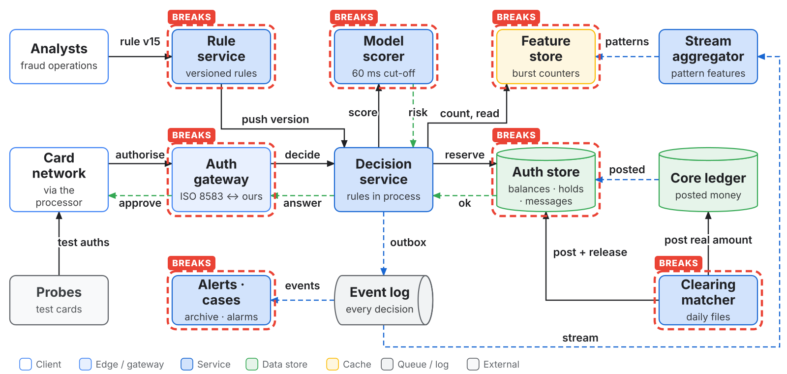{width=100%}

| # | Challenge | Kind | Mechanism |
|---|---|---|---|
| 1 | The tip | correctness (crux) | holds with expiry; clearing as truth |
| 2 | Two swipes, one balance | correctness under concurrency | per-account atomic reserve |
| 3 | The same message twice, and in the wrong order | correctness | idempotency on the network reference |
| 4 | The model is slow tonight | overload (crux) | budget and fail-policy table with a cap |
| 5 | A burst, seconds apart | decision quality | two-speed features |
| 6 | A new attack at 2 a.m. | operations | rules as versioned data, staged |
| 7 | We were down for twenty minutes | failure recovery (crux) | the ledger absorbs stand-in; idempotent files |
| 8 | Declines doubled in ten minutes | observability | decision SLIs, symptom pairs, a runbook |

## 6.1 The tip (correctness)

> **Interviewer:** "A sixty-dollar restaurant authorisation clears three days later at seventy-two, with
> the tip. Walk me through the money."

**The naive answer.** "Approve and debit sixty. Clearing is a formality."

**The case.**

| Time | Event | Debit model |
|---|---|---|
| Mon 20:14 | authorise \$60 | debit \$60; balance \$500 → \$440 |
| Mon 20:16 | the waiter adds a \$12 tip | nothing, or a second debit of \$12 |
| Thu 06:00 | clearing \$72 | a second debit of \$72 (\$368), or ignored (restaurant \$12 short) |

The same shape appears everywhere amounts differ: a hotel pre-authorises \$300 and checks out at \$180; a
fuel pump authorises \$1 and clears at \$64; an online order ships in two parts and clears twice; a
purchase in another currency clears at a different rate.

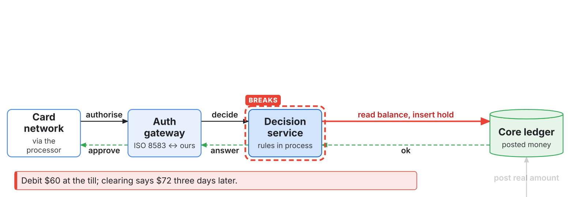{width=100%}

**The fix: a hold, not a debit.** An approval inserts a hold of \$60 in the authorisation store. The
incremental authorisation raises the same hold to \$72. Available is posted minus active holds:
500 − 72 = \$428. On Thursday the clearing record matches the hold by network reference; in one write
the authorisation store lowers posted by \$72 and releases the hold, so available stays \$428 and posted
becomes \$428; the ledger posts \$72. Each hold gets a lifetime by merchant category: about seven days
for most, about thirty for hotels and car hire, where the final amount can come weeks later.

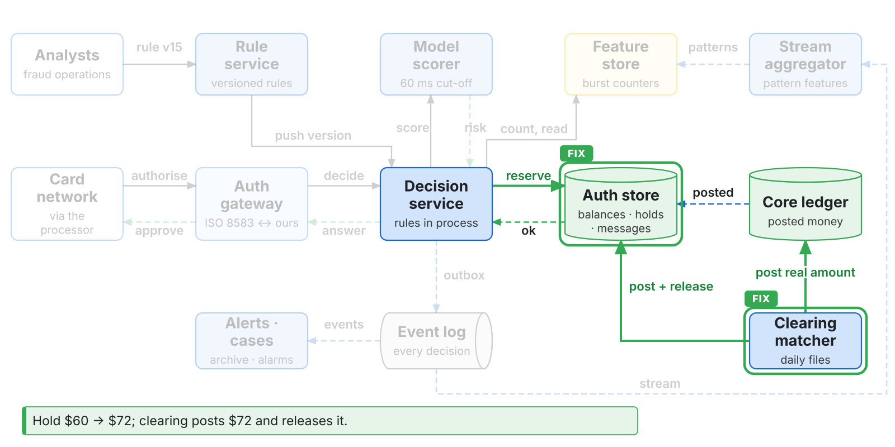{width=100%}

**Why it works.** Safety S1 is checked against available, which includes every promise already made.
Liveness L2 holds because every hold ends: by clearing, by reversal or by expiry.

> **Interviewer:** "The clearing record has no matching authorisation. Or it arrives after the hold
> expired."

**The second fix.** Match by reference first. If there is no reference, or it matches nothing, fall
back to a fuzzy match: same card, same merchant, amount within a tolerance (±20 % covers tips and most
currency swings), within a date window (seven days). If nothing matches, **the clearing record still
posts**: the network has already paid the merchant from our settlement account, so the file is the
financial truth, and the record goes to a review queue. A clearing that arrives after its hold expired
posts too, and may take the account below zero: that is the modelled over-limit state of Challenge 7.

::: warn
**"One authorisation equals one clearing record"** is the trap. Split shipments clear several times
against one authorisation; some authorisations never clear; some clearing has no authorisation at all
(offline transactions on a plane, below-floor-limit purchases). A matcher that assumes one-to-one either
double-releases or leaves holds open forever.
:::

::: why
**Why expiry waits for the day's file.** A hold that expires at 05:00 when the day's clearing file arrives
at 06:00 would release \$72 of available for an hour; the clearing then posts against nothing and takes
the account below what the customer saw. Gating expiry on the arrival of the day's file closes that hour.
:::

**If asked, I'd say:** *"Approval is a hold, not a debit. Available is posted minus active holds, and
clearing moves the real amount from hold to posted, matched by the network's reference. Holds that never
clear expire, and late clearing still posts."*

## 6.2 Two swipes, one balance (correctness under concurrency)

> **Interviewer:** "Two authorisations for one account arrive two milliseconds apart. The balance covers
> one of them. What happens?"

**The naive answer.** "Read the available balance, check it, insert the hold."

**The case.**

| Time | Request A: fuel \$80 | Request B: online \$60 |
|---|---|---|
| 12:00:00.000 | reads available \$100 | |
| 12:00:00.002 | | reads available \$100 |
| 12:00:00.004 | 80 <= 100: inserts hold \$80 | |
| 12:00:00.006 | | 60 <= 100: inserts hold \$60 |
| result | **available −\$40, both approved by us** | |

Joint accounts, a cardholder with a phone wallet and a physical card, and an online subscription that
renews while the customer pays at a till all produce this race. It is rare per account and common across
eight million.

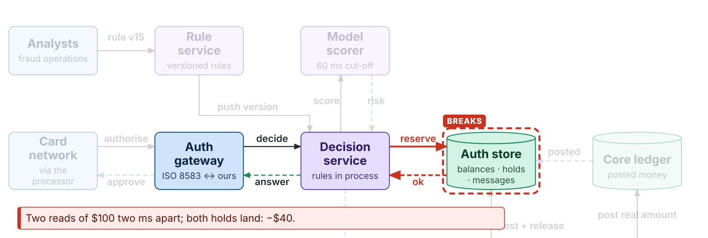{width=100%}

**The fix: one conditional write per account.** The reserve is a single operation in the partition that
owns the account: *if* holds total plus the amount is within posted, *and* the account's version is the
one I read, *then* insert the hold, record the message, add to holds total and bump the version.
Otherwise nothing is written, and the decision service re-reads and decides again.

```python
def reserve(store, acct_id, ref, amount, expires_at):
    while True:
        a = store.get("account", acct_id)                  # posted, holds_total, version
        if a.holds_total + amount > a.posted:
            return "decline: insufficient funds"
        ok = store.transact(acct_id, [                     # one partition, one transaction
            cond("account", acct_id, version=a.version),
            put("hold", (acct_id, new_id()), ref=ref, amount=amount, expires_at=expires_at),
            put("message", ref, type="auth", result="approve"),
            upd("account", acct_id, holds_total=a.holds_total + amount, version=a.version + 1)])
        if ok:
            return "approve"                               # else: someone else won; read again
```

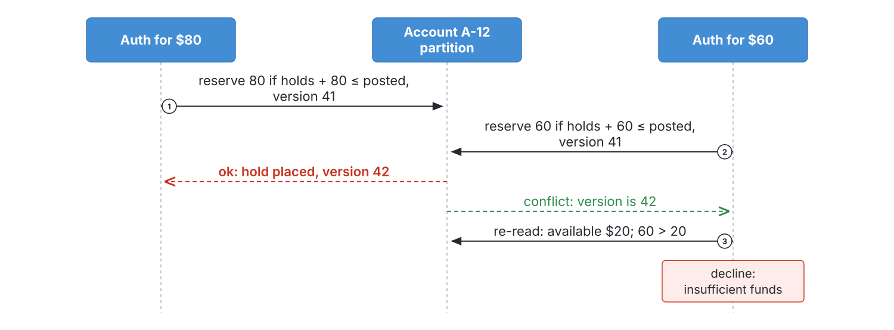{width=100%}

**Why it works.** S1 is decided by the one partition that owns the account, so there is exactly one
place where "is there enough?" can be answered. The conflict is cheap because per-account traffic is a
few requests a minute: a retry costs one more round trip, rarely.

> **Interviewer:** "A business account has 2,000 fleet cards on one balance, and on the busiest day they
> all buy fuel at 7 a.m."

**The second fix.** First the arithmetic: 2,000 cards × one authorisation in ten minutes is 3.3 a
second on one key. One partition handles that easily, with a conflict now and then. If it grows to
hundreds a second (a very large fleet, a marketplace with virtual cards), carve **sub-limits per card**
from the account: the account reserves budget to each card in blocks, refilled asynchronously, and most
authorisations touch only the card's slice. This is the escrow pattern, the same idea as counter ranges
in other designs.

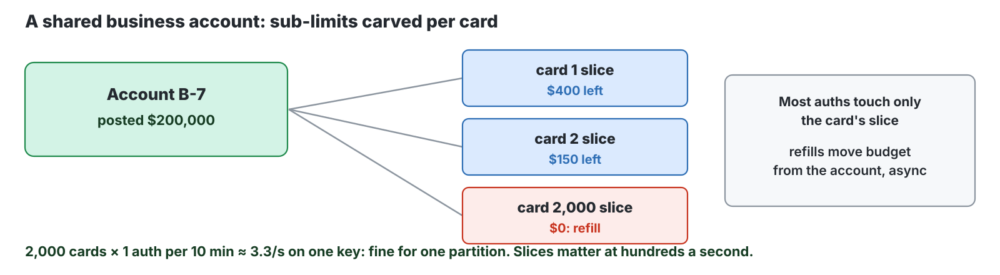{width=100%}

**The honest limit.** A card's slice can run dry while the account still has money. Refill early (at
half-used), size slices by each card's recent spend, and when a slice is empty, fall back to the
account-level reserve rather than declining.

::: why
**Why not a distributed lock.** A lock taken before the read and released after the write gives the
same safety, at the cost of a lock service on the hot path, a lease to expire when a decision service
dies holding it, and a second round trip. The conditional write is the lock and the write in one
operation, in the store that already owns the data.
:::

**If asked, I'd say:** *"Check-and-reserve is one conditional write in the partition that owns the
account, so two swipes can't both spend the same money. Per-account traffic is tiny, so that costs
nothing; a shared business account gets sub-limits per card."*

## 6.3 The same message twice, and in the wrong order (idempotency)

> **Interviewer:** "The network retries an authorisation we already approved. And a reversal arrives
> before the authorisation it reverses. What happens?"

**The naive answer.** "Process messages as they arrive; a retry is a new request."

**The case.**

| Time | Event | Naive result |
|---|---|---|
| 18:30:00.000 | authorise R-7731 \$45; approved; hold placed | |
| 18:30:00.090 | our answer is lost on the link | |
| 18:30:01.900 | the network retries R-7731 | a second hold: available down \$90 |
| 19:02:10.120 | reversal of R-8840 arrives (the merchant cancelled at once) | "nothing to reverse": dropped |
| 19:02:10.180 | authorise R-8840 \$45 arrives | approved: a hold for a cancelled purchase, for seven days |

Networks retry, processors resend after a failover, and the paths an authorisation and its reversal take
are not guaranteed to deliver in order. These are normal conditions, not edge cases.

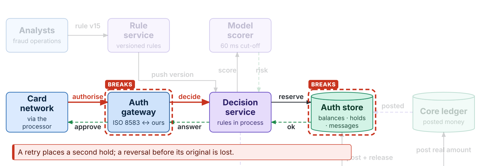{width=100%}

**The fix: idempotency on the network reference, written with the hold.** The message table is keyed by
the network's reference. Before acting, the decision service looks the reference up: if it is there, it
returns the stored answer. A reversal whose original has not arrived is stored as a **tombstone**; when
the original arrives, it is answered as the network expects (the network already knows it was reversed)
and no hold is placed. The message record is written **in the same transaction as the hold** (the
reserve of Challenge 2), so no crash can leave a hold without its message record or the reverse.

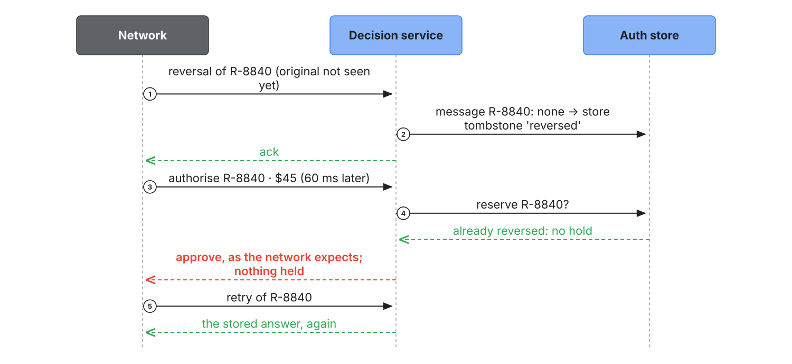{width=100%}

**Why it works.** S2: the effect is keyed by what the network calls the message, not by when it arrives.
Retries return the same answer; order stops mattering.

::: why
**Why the same transaction, and why it must be the same partition.** If the message record lived in a
separate idempotency store, a crash after the hold and before the record would let the retry place a
second hold; a crash after the record and before the hold would return "approved" for a purchase with no
hold. Putting the message in the account's partition lets one local transaction cover both. The
reference arrives with the account already resolved from the token, so the partition is known before the
write.
:::

> **Interviewer:** "The partition fails over mid-write. Or the message table is purged and a retry
> arrives a day later."

**The second fix.** The transaction commits on a quorum of replicas in the zone before the answer
leaves, so a failover finds both writes or neither. Message records are kept for longer than the
network's retry and reversal windows, which are days, not minutes; they are small (about 100 bytes) and
compress well: 20 million a day × 100 B × 30 days about 60 GB. Past that window, clearing (Challenge 1) is
the backstop: a hold that should not exist expires, and a clearing that should exist posts.

**If asked, I'd say:** *"Every message is keyed by the network's reference, and the record of it is
written in the same atomic step as the hold. A retry gets the stored answer, and a reversal that arrives
first waits as a tombstone for its original."*

## 6.4 The model is slow tonight (overload; the crux)

> **Interviewer:** "Your fraud model is at 1.8 seconds p99 tonight. What does the authorisation path do?"

**The naive answers.** "Wait for it: fraud matters more than latency." Or: "Fail open."

**The case.** At 20:00 a model release doubles its feature fetches and its p99 goes to 1.8 seconds. If
we wait: by 20:01 about 30 % of our answers pass two seconds, and the network stands in for about 450 a
second (30 % of 1,500) with limits we set months ago and no fraud score at all. If we fail open: every
decision is unscored, 1,500 × 60 = 90,000 a minute, and a fraud ring that probes with small purchases
notices within minutes.

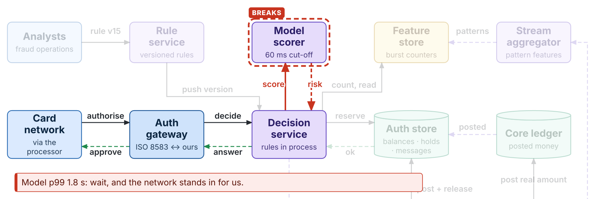{width=100%}

**The fix: a budget per step and a fail-policy table.** Rules always run, in process, in about 10 ms.
The model gets a 60 ms cut-off; at 60 ms the decision proceeds without it. What "without it" means is a
table, agreed in advance:

| Situation | Low amount, low-risk merchant | High amount or risky merchant type |
|---|---|---|
| Model late | rules-only decision | rules only, stricter limits |
| Counters missing | rules with conservative card-not-present limits | decline card-not-present; step up |
| Rules engine fails | approve within stand-in-like limits | decline, or step up the customer |
| Authorisation store unavailable | (the network stands in) | (the network stands in) |
| We miss the deadline | network stand-in | network stand-in |

Every cell has an **exposure cap per hour**: the most we accept losing while degraded. The decision
service counts degraded approvals and their amounts against the cap, live.

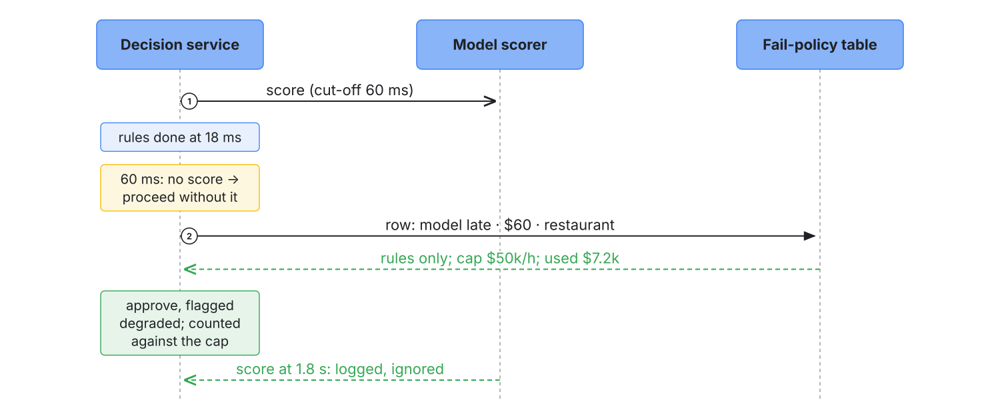{width=100%}

**Why it works.** L1: the answer leaves inside 300 ms whatever the model does, because nothing waits past
its slice. The quality loss is bounded by the cap, priced by the estimate in Stage 2, and owned.

> **Interviewer:** "It lasts all evening and the cap runs out. And who decided those numbers?"

**The second fix.** When a cell's cap is used up, that cell tightens: first a step-up (ask the
cardholder to confirm in the app), then lower limits, then decline. The model is rolled back by
re-pointing its version, which is the first runbook step. The ownership: **risk** sets the limits in each
cell from loss data and reviews them monthly; **finance** signs the cap; **engineering** makes each cell
a setting, counts every degraded decision and pages at 50 % of the cap. The point at the manager bar is
that this conversation happens before the incident, not during it.

::: warn
**"Fail open under \$100"** is the usual prep line. It is a start, not an answer: fraud is not uniform
across merchants or entry modes, a fraud ring adapts to a known threshold within hours, and nobody has
said how much fail-open costs or who signed it. The table with caps and owners is the answer.
:::

**If asked, I'd say:** *"The model gets a fixed slice of the budget and the decision never waits past
it. When it's late, a table owned by risk and finance decides by amount and merchant risk, under an
hourly exposure cap. We answer in time and we know what that costs."*

## 6.5 A burst, seconds apart (features)

> **Interviewer:** "Your rule is more than three swipes in ten minutes on one card. Where does that number
> come from, in time?"

**The naive answer.** "From the stream processor, into a key-value store."

**The case.**

| Time | Event | Counter from the stream (5–8 s behind) |
|---|---|---|
| 03:12:01 | card-not-present \$240 on token T-55 | reads 0: approve |
| 03:12:04 | \$240 | reads 1: approve |
| 03:12:06 | \$240 | reads 1: approve |
| 03:12:09 | \$240 | reads 2: approve |
| 03:12:15 | | the counter finally reads 4: \$960 already gone |

A burst of fraud on one stolen card is seconds apart, because it is a script. A stream processor's
counters are seconds behind, because that is what streams are.

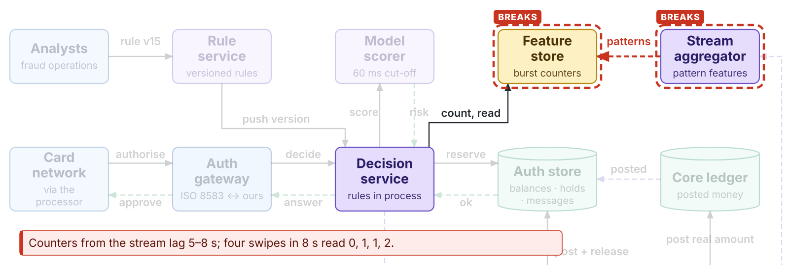{width=100%}

**The fix: two-speed features.** Burst counters are **updated inline**: per card, one-minute buckets;
increment the current bucket and read the previous nine in one pipelined round trip, about a
millisecond. Pattern features that can be seconds late come from the stream: distinct merchants for this
card today, a merchant's decline rate in the last hour, a device seen on other cards in thirty days.

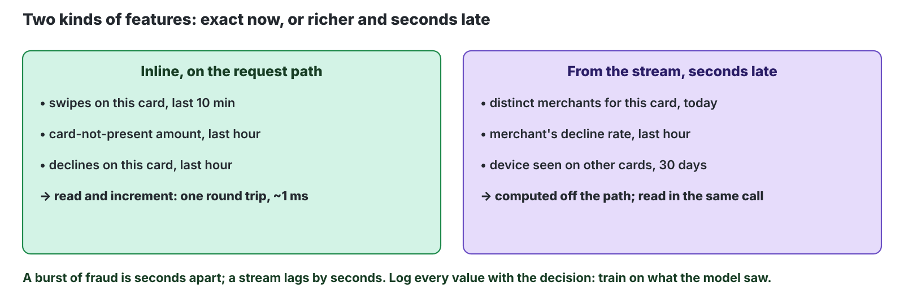{width=100%}

```python
def swipes_last_10_min(store, card_token: str, now_s: int) -> int:
    """Count this swipe and return the swipes in the last 10 minutes, including it."""
    minute = now_s // 60
    key = f"v:{card_token}:{minute}"
    pipe = store.pipeline(transaction=True)
    pipe.incr(key)                              # this swipe
    pipe.expire(key, 11 * 60)                   # buckets clean themselves up
    for m in range(minute - 9, minute):
        pipe.get(f"v:{card_token}:{m}")         # the nine minutes before
    res = pipe.execute()
    return res[0] + sum(int(x or 0) for x in res[2:])
```

**Why it works.** The features whose value is in being *now* are exact at decision time. And every
feature value is **logged with the decision**, so the model is trained on exactly what it saw (safety S3),
not on values recomputed later from a different pipeline, which is how training and serving drift apart.

::: why
**Why a declined swipe still counts.** The counter is incremented before the decision, so declined
attempts count too. A fraud script that keeps trying after a decline is the strongest burst signal
there is.
:::

> **Interviewer:** "The counter store is slow or down."

**The second fix.** It is a row in the fail table: counters missing, so rules apply conservative
card-not-present limits. The counter store is partitioned by card with a replica; losing a partition
loses at most ten minutes of buckets, which are rebuilt from the event log for the cards that transact
next.

**If asked, I'd say:** *"Burst features are counted inline, read and incremented in one round trip,
because a stream lags behind a burst. Pattern features come from the stream. And every value is logged
with the decision, so training sees what the model saw."*

## 6.6 A new attack at 2 a.m. (operations: change safely)

> **Interviewer:** "A new attack appears at two in the morning. How fast can an analyst block it, and what
> stops them from blocking everyone?"

**The naive answers.** "Add an `if` and hotfix the decision service." Or: "Shadow-test it to measure the
false positives."

**The case.** At 02:05 fraud operations see a pattern: a \$1 test charge, then \$400 at electronics
merchants, on cards from one breach. A hotfix takes fifty minutes through review, build and deploy. The
alternative, an analyst pushing `amount > 300 && mcc == electronics → decline` live at 02:20, declines
9 % of all electronics purchases, almost all of them good customers.

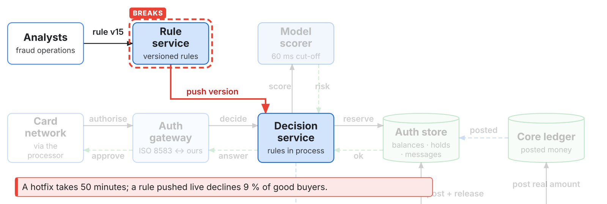{width=100%}

**The fix: rules as versioned data, staged.** A rule is an expression in a small sandboxed language (no
loops, no I/O, a time limit), with an owner and an expiry. It goes through four stages:

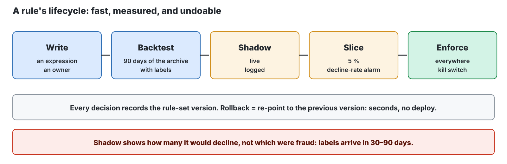{width=100%}

1. **Backtest** on ninety days of the decision archive with known labels: how much of the ring's fraud
   it catches, how many good purchases it declines.
2. **Shadow** on live traffic: it runs and logs what it would have done, without enforcing; it shows the
   would-decline rate and the overlap with existing rules.
3. **Slice**: enforce on 5 % of traffic, with an alarm on the decline rate by merchant type.
4. **Enforce** everywhere, with a kill switch and the expiry.

```yaml
id: test-then-electronics
version: 15
condition: >
  txn.entry_mode == "card_not_present"
  && txn.mcc in ["5732", "5734"]
  && txn.amount > 300
  && features.small_charges_24h >= 1
action: decline
mode: shadow            # shadow | slice | enforce
slice: 0.05
expires: 2026-12-05
owner: fraud-ops/night
```

Every decision records the rule-set version it ran. Rollback is re-pointing every decision service to
the previous version: seconds, no deploy.

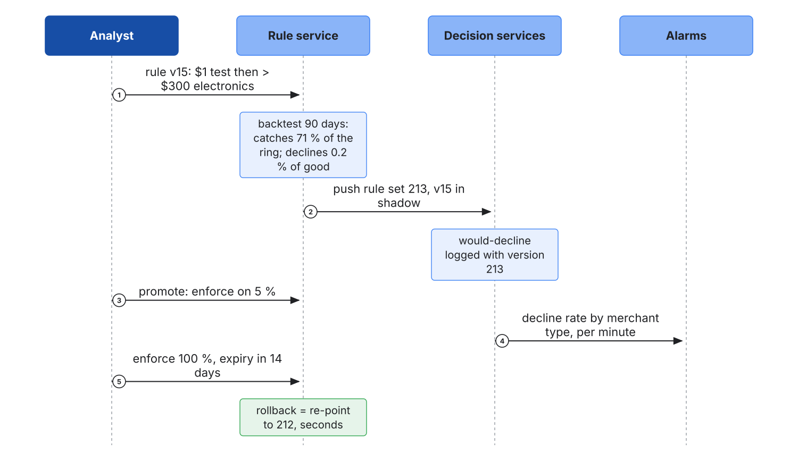{width=100%}

**Why it works.** L3: minutes from idea to enforcement, not a release cycle. S3: the version is on every
decision, so any decision can be explained and any version undone. The staged rollout bounds the blast
radius of a mistake to a slice and an alarm.

> **Interviewer:** "Shadow says the rule would decline 4,000 transactions a day. How many were fraud?"

**The second fix, and the honest limit.** Shadow cannot say. It shows *how many* it would decline today,
not *which* were fraud: the labels, chargebacks and customer reports, arrive in 30 to 90 days. So the
evidence comes from elsewhere: the **backtest** on labelled history; **fast proxies**, such as the share
of customers who reply "it was me" to a decline text, or who pass a step-up; the **slice** with its
decline-rate alarm; and the **expiry**, so an emergency rule is reviewed with real labels rather than
living forever.

::: warn
**"Shadow mode measures false positives"** is in many prep sheets, and it is wrong for fraud. A false
positive is a decline of a good customer; you only learn a declined purchase was good when the customer
complains or confirms, and you never learn it for most of them. Say what you would measure instead.
:::

**If asked, I'd say:** *"Rules are versioned data, not code: backtest, shadow, a small slice with a
decline-rate alarm, then enforce, with a kill switch and the version on every decision. Shadow can't
measure false positives, because labels arrive months later."*

## 6.7 We were down for twenty minutes (failure recovery; the crux)

> **Interviewer:** "You were down for twenty minutes at two in the morning. The network approved 360,000
> transactions in stand-in. Walk me through the next morning."

**The naive answers.** "The network declined them while we were down." Or: "Replay them through our system
and decline the ones we wouldn't have approved."

**The case.** From 02:00 to 02:20 the network stands in with our pre-set limits, say up to \$150 a
transaction and \$400 a day a card: 20 × 60 × 300 = 360,000 approvals. At 02:21 we are back and the
advices arrive. Account A-19 had \$35 available; stand-in approved \$60 and \$80 on it, so available is now
−\$105. A check that refuses any write taking available below zero rejects those advices. The holds are
missing; Thursday's clearing posts anyway; the books disagree with the network's.

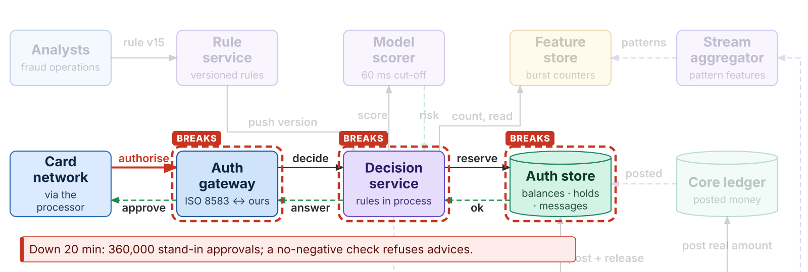{width=100%}

**The fix: the ledger absorbs decisions we did not make.** Advices are always acknowledged and recorded,
idempotently by network reference, as holds, even when they take the account past zero. Over-limit is a
**modelled account state**: new authorisations decline until the balance is back above zero, the
customer is told, and collections take over if it persists. Then, the next morning, the 360,000 are
replayed through our rules offline, not to reverse them, but to see which we would have declined and to
tune the stand-in limits with risk.

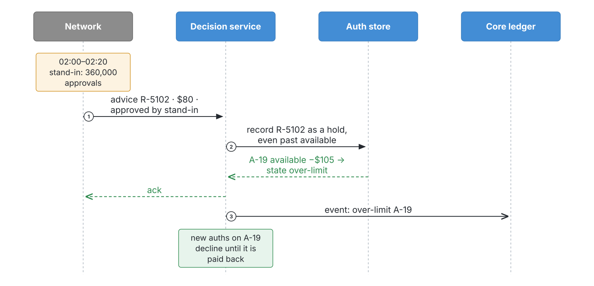{width=100%}

**Why it works.** S1 is about *our* approvals. The network's decisions are facts to record (S2), never
requests to refuse. A design whose invariant is "never below zero" is false by construction the first
time stand-in runs.

> **Interviewer:** "And the next day's clearing file arrives six hours late, with 3 % of its records
> duplicated."

**The second fix.** Ingest files idempotently: a checksum per file, so a resent file is recognised, and
a unique record ID per clearing record, so the 300,000 duplicates (3 % of 10 million) are no-ops. Hold
expiry waits for the day's file, so a late file does not find its holds already released. The 09:00
posting target slips, with a status note to finance and support, not silently. And every day, after
clearing, the authorisation store is **reconciled** with the ledger: for every account, posted balance
in the authorisation store must equal the ledger's; any difference is a break with an owner.

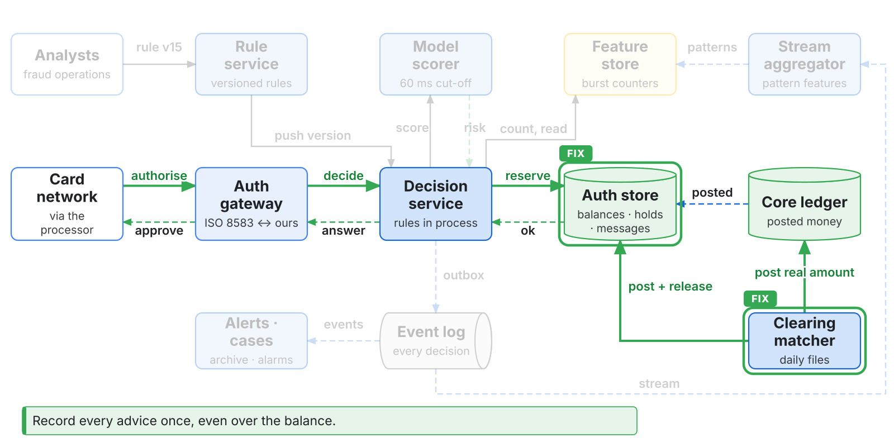{width=100%}

::: why
**Why stand-in limits are a risk decision too.** Higher limits mean fewer declined good customers during
an outage and more fraud let through; lower limits the reverse. The replay the morning after is the only
data that says whether last night's limits were right, which is why it happens every time.
:::

**If asked, I'd say:** *"Stand-in decisions are facts, not requests: we record every advice once, even
when it overdraws the account, and model over-limit as a state. Clearing files are ingested
idempotently, and hold expiry waits for the day's file."*

## 6.8 Declines doubled in ten minutes (observability)

> **Interviewer:** "The decline rate doubled in ten minutes. Your dashboards are green. How do you know
> what is wrong, and what is on the runbook?"

**The naive answer.** "CPU, error rate and latency."

**The case.**

| Time | Event |
|---|---|
| 19:40 | rule set v212 enforced: a typo widens a merchant-category list to include groceries |
| 19:41 | grocery approval rate 96 % → 71 %; no errors; p99 92 ms |
| 19:55 | the first complaints on social media |
| 20:10 | the first page, from support call volume |

Nothing failed. Every box was healthy. The product, deciding yes or no well, was broken for half an
hour.

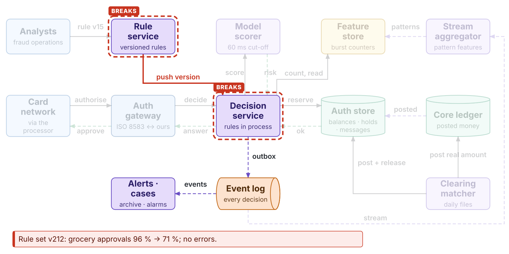{width=100%}

**The fix: SLIs on decisions, not machines.**

| SLI | Why it pages |
|---|---|
| Approval rate by merchant type and region, per minute, against the same hour last week | a sudden drop is almost always a rule or a release |
| Stand-in count | each one is a decision we did not make |
| Degraded decisions against the cap | prove the cap risk agreed to holds |
| "It was me" replies after declines | the fastest false-positive signal |
| p99 at the gateway, and model cut-offs | the deadline |
| Unmatched holds and clearings, per day | money and customers' available stuck |
| Synthetic test cards, every minute, every region | the end-to-end path works |

**Symptom pairs: two metrics, one cause.**

| When you see | Together with | It means |
|---|---|---|
| Declines up | a rule-set version change in the same minute | **a rule** (this case) |
| Declines up in one merchant | flat everywhere else | **that merchant's terminal or acquirer** |
| Stand-in count up | p99 at the gateway flat | **the link to the processor**, not us |
| Model cut-offs up | p99 flat | **the model**: the cut-off is doing its job |
| "It was me" up | declines up | **false positives**: roll back |
| Declines up | "it was me" flat, step-up pass low | **a real attack**: keep the rule, warn support |

**The runbook for "declines doubled in ten minutes".**

| Step | Why |
|---|---|
| 1 Check rule-set and release changes in the last hour | the most common cause, and the fastest to undo |
| 2 Re-point to the previous rule-set version | rollback in seconds, no deploy |
| 3 Compare by merchant type and region | a real attack, or one merchant's broken terminal? |
| 4 Then the model and its features | a stale feature looks like risk |
| 5 Tell support and the status page | complaints arrive before alerts otherwise |

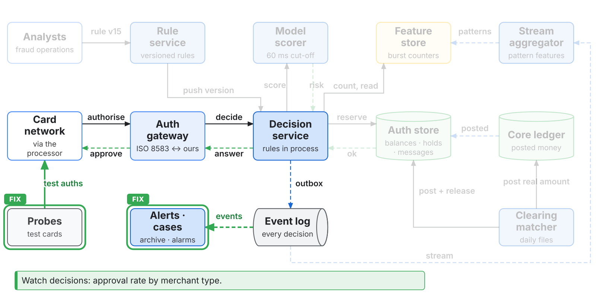{width=100%}

**Why it works.** The SLI measures what the cardholder experiences. A pair turns two metrics into one
cause. And the runbook starts with the most common cause, which is also the cheapest to undo.

> **Interviewer:** "It's real fraud this time: an attack, and the rule is right."

**The second fix.** The "it was me" rate and the step-up pass rate separate good customers from fraud
within minutes: if few declined customers say it was them and few pass a step-up, the rule is right.
Keep it, tell support what customers will hear, and let the expiry bring it back for review.

**If asked, I'd say:** *"I watch decisions, not boxes: approval rate by merchant type against last week,
stand-in count, degraded decisions against the cap. The runbook starts with what changed, because a rule
or a release is the usual cause and the fastest to undo."*

## 6.9 How the whole system degrades, in priority order

| What fails | What still works | What the customer sees |
|---|---|---|
| Model scorer | rules, counters, holds | slightly more fraud, inside the cap; maybe a step-up |
| Feature store | rules with conservative limits; holds | more step-ups for card-not-present |
| Rule service | the last pushed rule set keeps running | nothing; analysts cannot change rules |
| Event log | decisions continue; outbox rows accumulate | alerts delayed; nothing lost |
| Clearing matcher | authorisations continue; holds stay open | pending lasts longer |
| Core ledger | authorisations continue against the auth store | statements delayed |
| One auth-store partition | the other partitions | for that partition's accounts: stand-in |
| Gateway or decision service fleet | — | stand-in for everyone, within our limits |

The order is deliberate: everything above the last two lines degrades *inside* our answer; only the
authorisation store and the decision fleet hand the decision to the network.

# Stage 7: Requirements that arrive mid-round

Interviewers often add a requirement around minute 35. Name the delta out loud: what changes, what does
not, what it costs, and which existing seam absorbs it.

**"The clearing file is six hours late, with 3 % duplicates."** Covered in Challenge 7. *Changes:* file
and record idempotency; expiry gated on the file's arrival. *Does not change:* the authorisation path.
*Costs:* a later posting time on bad days. *Seam:* the clearing matcher's per-record step.

**"Add credit cards."** *Changes:* available becomes credit limit minus posted balance minus holds; the
account state gains statement cycles, minimum payments and interest, all in the core ledger. *Does not
change:* holds, messages, the reserve, the fail table, rules, clearing. *Costs:* a second available
formula and a product team. *Seam:* the account row's available calculation in the reserve.

**"Run in a second region."** *Changes:* each account is homed in one region (its partition's primary);
the gateway in either region routes by the account's home; a regional failover moves the primaries.
*Does not change:* one account, one writer: the reserve stays a single-partition write. *Costs:* a
cross-region hop for an account homed far away, and a failover measured in tens of seconds, during which
those accounts get stand-in. *Seam:* the partition map.

::: warn
**Active-active balances across regions** are the trap here. Two regions accepting reserves for the same
account need either a cross-region consensus write on every authorisation (latency) or a reconciliation
of overdrafts afterwards (the two-swipes race, at region scale). Homing each account in one region is the
boring, correct answer.
:::

**"Product wants instant refunds to the card."** *Changes:* a refund message posts a credit; available
goes up only when it posts, not when the merchant initiates it. *Does not change:* everything else.
*Seam:* the message state machine gains a credit type.

**"Add the network's own risk score."** *Changes:* one more field on the request, one more model feature.
*Does not change:* anything structural. Mention it as what changed in recent years: networks' real-time
scores now routinely arrive with the request.

# Stage 8: Failures and reliability

| Failure | Blast radius | Detection | Response |
|---|---|---|---|
| Model slow or down | fraud quality, inside the cap | model cut-off rate | fail table; roll back the model version |
| Feature store partition lost | burst features for some cards | counter errors | conservative limits; rebuild buckets |
| Bad rule set | approvals for whole merchant types | approval rate by merchant type | re-point to the previous version |
| Auth-store partition failover | its accounts, for seconds | reserve errors, stand-in count | quorum commit; stand-in covers the gap |
| Whole decision fleet down | every card: stand-in | synthetic test cards, stand-in count | restore; post advices; replay the night |
| Link to the processor down | every card: stand-in | stand-in count with flat p99 | the processor's problem, our runbook |
| Late or duplicated clearing file | posting time | file-arrival alarm | idempotent ingestion; expiry waits |
| Auth store and ledger disagree | some accounts' available | daily reconciliation breaks | break queue with an owner |
| Card data leak | regulatory | — | out of our scope: tokens only |

## One incident, walked through

**21:10, a model release.** The new model's feature fetches double; p99 for scoring goes to 1.8 s.

- *21:11* Model cut-off rate goes from 0.3 % to 31 %. Gateway p99 stays at 95 ms: the cut-off is doing
  its job. Degraded approvals start counting against the "model late" cells' caps.
- *21:12* The pair "cut-offs up, p99 flat" pages the risk platform on-call: the model, not us.
- *21:15* Runbook step 1, what changed: the model release at 21:09. Step 2, re-point the scorer to the
  previous model version.
- *21:17* Cut-offs back to 0.3 %. Degraded decisions in the incident: about 1,500 × 0.31 × 360 s =
  167,000, worth about \$10 million in volume, against which the cap and the rules held.
- *Next morning:* compare the degraded decisions' fraud with the model's normal rate as labels arrive;
  add a canary for model releases; review whether the cap was right.

# Stage 9: SLOs, observability, cost

**SLOs** (initial targets): authorisation p99 under 300 ms at the gateway; availability 99.99 % measured
by synthetic test cards in every region; stand-in under 0.01 % of authorisations in a month; clearing
posted by 09:00 on 99 % of days; rule change live within 5 minutes; reconciliation breaks resolved within
two business days.

**How they are measured from outside.** Synthetic test cards in every region send an authorisation and a
reversal every minute through the processor, so the measurement includes the link. Stand-in is counted
from advices, which are the network's own record of our absence. Approval rates are compared with the
same hour last week, because card traffic is strongly weekly.

**The dashboard**, top to bottom: approval rate by merchant type; stand-in count; gateway p99 and model
cut-offs; degraded decisions against each cap; "it was me" replies; unmatched holds and clearings;
reconciliation breaks.

**Cost, illustrative.**

| Line | Size | Lever |
|---|---|---|
| Processor and network fees | per transaction; the largest | negotiated, not engineered |
| Fraud losses | 8 bps of volume | the model, the rules, the fail policy |
| Declined good customers | lost revenue, never measured directly | fast proxies; step-up instead of decline |
| Decision archive | about 15 TB a year, seven years | compression, cold storage after 90 days |
| Model serving | a few machines | embed a small model; cache features |
| Authorisation fleet | small | none needed |

> A basis point of fraud is worth more than all the servers. The design's cost lever is the quality of
> the decision, not the size of the fleet.

# Stage 10: The EM layer (auxiliary at Staff)

**Phasing.**

| Phase | Scope | People and time |
|---|---|---|
| V0, buy | outsourced authorisation at the processor with uploaded rules and stand-in limits | 3 engineers, 8 weeks |
| V1 | own decision service on the core ledger | 4 engineers, 3 months |
| V2 | auth store, rules as data, model under a cut-off, clearing matcher | a team of 6–8, 2 quarters |
| V3 | features, fail table, advices, lifecycle tooling, reconciliation | two teams, 2 more quarters |

**Team seams.** *Authorisation platform:* gateway, decision service, authorisation store, latency and
availability. *Risk platform:* rules engine, features, shadow and backtest tooling. *Data science:*
models and their monitoring. *Fraud operations:* the content of rules, customer contact. *Ledger and
clearing:* holds' end of life, posting, reconciliation. The contracts between them: the decision event
schema, the rule-set format, and the fail-policy table.

**Half the team.** Keep V0 longer: the processor's rules and stand-in, with our own clearing matcher and
reconciliation. Cut the in-house model before cutting idempotency or reconciliation: a weaker fraud
score costs basis points; a double hold or a broken book costs trust.

**On-call.** The authorisation platform is 24/7 with a five-minute response; the runbook for "declines
doubled" is owned jointly with fraud operations; the fail-policy caps page before they run out.

# Stage 11: The close

> **What:** a stateless decision service with its state next to it answers inside 300 ms, places a hold
> rather than a debit, and makes every network message count once in any order.
> **Trade-off:** we keep a second copy of balances, reconciled daily with the ledger, to keep the ledger
> off the authorisation path.
> **Risk:** the fail policy is only as good as the caps risk and finance sign; the stand-in limits are
> only as good as last outage's replay.
> **Next:** sub-limits for large business accounts, a canary for model releases, and network tokens to
> shrink card-data scope further.

# Stage 12: Self-check after a simulator run

| Area | Weak | Strong | Exceptional |
|---|---|---|---|
| Money | debits at authorisation | holds; available = posted − holds; clearing posts and releases | expiry gated on the file; clearing as truth; late clearing posts |
| Correctness | no idempotency | network reference; per-account reserve | message written in the hold's transaction; tombstones for early reversals |
| Deadline | "call the fraud service" | budget per step; a cut-off | fail table with caps and owners, priced |
| Stand-in | not mentioned | advices recorded | over-limit as a modelled state; replay to tune limits |
| Fraud change | rules as code | rules as data with shadow | backtest, slice, expiry; knows shadow cannot measure false positives |
| Features | from a stream | inline bursts | features logged with the decision |
| Operations | CPU and errors | approval rate by merchant type | symptom pairs and a runbook starting with changes |

**Common traps:** debiting at authorisation; one authorisation equals one clearing record; read-then-write
on the balance; ignoring retries and out-of-order reversals; "the network gives 100 ms"; waiting for the
model; "fail open under \$100" as the whole answer; velocity only from a stream; shadow mode to measure
false positives; refusing advices because they overdraw; no owner for the fail policy.

\newpage

# Part III: The internals

## Appendix A: Holds and their lifetimes, in plain words

A hold is a row that says "this much of this account is promised". It has an amount, a merchant
category, an expiry and a state. Available balance is computed, never stored on its own: posted balance
minus the sum of open holds, which the account row keeps as `holds_total` so the reserve does not have to
add up every hold.

**Incremental authorisations** raise an open hold; **partial reversals** lower it; **full reversals**
release it. **Expiry** is a sweep that runs after each day's clearing file has been processed: any hold
past its lifetime is released. Lifetimes come from the merchant category, because the network's rules
and the merchant's habits differ: restaurants and fuel clear in a day or two, hotels and car hire can
take weeks. A conservative issuer sets lifetimes a little longer than the network's maximum for that
category, because releasing too early is worse (the customer spends money that is about to leave) than
releasing too late (the customer sees less available for a few days).

**Multiple clearing records for one hold.** A split shipment clears twice. The first record posts its
amount and lowers the hold by the same amount, rather than releasing it; the last record, or expiry,
releases what remains.

## Appendix B: Idempotency on a network reference

A **network reference** is the identifier the network attaches to a transaction; related messages
(incremental, reversal, advice) carry the original's reference too. The message table stores one row per
message: its reference, type, the account and the result we gave.

The rule is simple: **look up before acting, and record in the same transaction as the effect.** A
retry finds the row and returns the stored result. A reversal that finds no original writes a tombstone
row; the original, when it arrives, finds the tombstone and is answered without a hold.

**Retention.** The row must live longer than the longest window in which the network can resend or
reverse: days. After that, clearing is the backstop.

**What not to key on.** Not the arrival time, not a hash of the amount and merchant (two genuine
purchases of the same coffee five minutes apart look identical), and not our own generated ID (the
network does not know it).

## Appendix C: Conditional writes and per-account serialisation

A **conditional write** says "apply these changes only if this condition still holds", typically a
version number. It is optimistic: nobody waits; whoever commits first wins; the loser re-reads and
decides again. It works when conflicts are rare, which per-account traffic guarantees.

**Why one partition.** A transaction inside one partition is local and fast. Partitioning by account
puts the account row, its holds and its messages in the same place, so the reserve never needs a
distributed transaction. The card token is resolved to its account before the write, from the card table,
which changes rarely and is cached.

**Hot accounts.** When one account's rate grows to hundreds a second, conflicts become frequent and
retries pile up. The fix is to split the account's budget into slices (Challenge 2): each slice is its own
key, and a background refill moves budget between them. This trades a little precision (a slice can run
dry while the account has money) for throughput.

## Appendix D: Budgets, cut-offs and fail policies

A **latency budget** gives each step a slice of the target. A **cut-off** enforces the slice for the one
step that can be slow: the call is made asynchronously, and the decision proceeds when the slice is used,
whether or not the answer has arrived. A late answer is logged (it is useful for training and for
diagnosing the slowness) and otherwise ignored.

A **fail policy** is the written answer to "what do we decide when a step is late or down?" It is a
table rather than code, because the people who own the answer (risk, finance) are not the people who
write code, and because it changes with loss data. Each cell has an **exposure cap**: a running sum of
degraded approvals' amounts per hour, which, when reached, moves the cell to a stricter row.

**Hedged requests** (sending the model call twice and taking the first answer) are a tempting way to cut
the tail. They are fine for a stateless scorer with spare capacity, and they double its load exactly when
it is struggling; a cut-off with a fail policy is the safer default.

## Appendix E: Inline counters and the stream

**Inline counters** are bucketed by time: one key per card per minute. Incrementing the current bucket
and reading the nine before it gives a sliding ten-minute count accurate to a minute, in one round trip.
Keys expire after eleven minutes, so memory stays bounded: about eight million cards, of which a small
share are active in any ten minutes, a few keys each.

**Stream aggregates** cover what does not fit the inline shape: distinct counts (merchants, devices),
long windows (thirty days), cross-card features (a device seen on many cards). A stream processor reads
the event log, maintains these in its own state, and writes them to the feature store, where the decision
reads them in the same call as the counters. They are seconds late by design.

**Logging what the model saw.** Every feature value used in a decision is written to the decision record.
Training reads those values, not values recomputed later, so a bug or a lag in the feature pipeline shows
up in training exactly as it did in serving.

## Appendix F: Rule languages and the rule lifecycle

A **sandboxed expression language** (the Common Expression Language is one widely used example) lets
analysts write conditions over the request and the features without being able to loop, call the
network or read files. Each evaluation has a time limit. Rules are compiled once per rule-set version and
swapped atomically in every decision service when a new version is pushed.

**Why staged.** A rule's two errors are asymmetric in time: missed fraud is visible within days (customer
reports), declined good customers almost never (most just use another card). The lifecycle (backtest,
shadow, slice, enforce) and the **expiry** exist because the second error is invisible.

## Appendix G: Clearing and matching

The network's clearing file lists every transaction the acquirers submitted, with the final amount, the
network reference where there is one, and a record ID. The matcher:

1. Loads the file; skips it if its checksum has been seen; skips any record ID already applied.
2. Matches each record to a hold: by reference; if none, by card, merchant, amount within a tolerance and
   a date window.
3. For a match: one write in the authorisation store moves the amount from hold to posted; then the
   ledger posting, keyed by record ID.
4. For no match: posts anyway, flags for review.
5. After the file: the expiry sweep for holds past their lifetime.
6. After posting: the daily reconciliation of the authorisation store against the ledger.

## Appendix H: Testing it

- **Property tests on the hold state machine:** any order of authorisation, incremental, reversal,
  advice and clearing for one reference ends in the same state, and holds total equals the sum of open
  holds.
- **A concurrency test** firing hundreds of reserves at one account: never below zero from our approvals.
- **A replay test**: a day of recorded messages, replayed twice with duplicates and reordering, produces
  the same balances.
- **Fault injection**: the model at 2 s, the feature store down, an auth-store failover mid-reserve,
  the clearing file resent; each must produce the table's behaviour and no double effect.
- **Synthetic test cards** in production, every minute, every region.

\newpage

# One-page cheat card

**Prompt:** a debit-card issuer; approve or decline the network's authorisation requests.

**Insight:** a promise inside someone else's deadline: a hold, not a debit; every message once, any
order; a budget with a written fallback; the ledger absorbs what we did not decide.

**Numbers:** 4,000/s peak → 1,200 in flight at 300 ms; 12,000 state reads/s; 36 M holds about 7 GB in memory;
slow model about \$230/min at the base rate; budget 98 ms of 300; outage 360,000 advices.

**Design:** network → gateway → decision service (rules in process, model under 60 ms cut-off, inline
counters) → authorisation store (one conditional write per account: hold + message) → outbox → event log
→ alerts, archive, aggregator. Clearing matcher: file → hold to posted in one write → ledger.

**Challenges:** 1 tip: holds, expiry, clearing as truth · 2 two swipes: per-account conditional write;
sub-limits for fleets · 3 duplicates and order: network reference, tombstones · 4 slow model: cut-off,
fail table, caps, owners · 5 burst: inline counters, features logged · 6 2 a.m. attack: rules as data,
staged; shadow cannot measure false positives · 7 stand-in: record advices even when they overdraw;
idempotent files; expiry waits · 8 declines doubled: decision SLIs, symptom pairs, runbook starts with
changes.

**Close:** "Answer in time with a hold, not a debit. Make every message count once, whatever the order.
Spend the budget on what matters and write down what happens when something is late. And record what the
network decided for us, even when it hurts."
