# How to read this document

This is the **long answer key for question `SD-95`** in
[design-room](https://github.com/nirmata78/design-room), an open-source system design interview
simulator, and the written companion to its reference-solution video. It shows how a strong Staff
candidate (L6/L7) runs the round: what to say, what to draw, and **when**. It adds the **why** behind
every line, so you can defend each choice when the interviewer asks *"why?"*, *"what is that?"* or
*"what happens when it breaks?"*.

**The document has three layers, and you will read them differently:**

1. **Part I, the system in pictures.** Read it first. It explains what happens to an instalment loan
   from the day it is booked to the day it is closed: how a schedule is made, how each payment is
   collected, why the truth about a collection keeps arriving for weeks, and where the load lands. There
   is no interview script in it.
2. **Part II, the round, stage by stage.** This is what you do in the room. Each stage has the words to
   say, what to draw, and boxes that explain every term. The eight **challenges** of the video are Stage
   6, and each goes further here than the video can.
3. **Part III, the internals.** How double entry, idempotency keys, a database used as a work queue,
   token buckets, bank-debit returns and reconciliation actually work, at the depth a round reaches when
   you name a mechanism and the interviewer asks how it works.

**The coloured boxes:**

> [!IMPORTANT]
> **Top-3 number**
>
> One of the back-of-the-envelope numbers worth computing out loud in the round. In a real interview you
> have time for two or three calculations, not ten.


> [!NOTE]
> **Why? What is it?**
>
> Explains a term or a decision in plain words. This is for you, not for the interviewer.


> Words you can say in the room, nearly verbatim.

> [!WARNING]
> **Trap**
>
> A trap: something weak candidates do, or a claim that breaks under a follow-up question.


> [!CAUTION]
> **Under load**
>
> What this part of the system sees at peak, with numbers.


**Practise in three passes.** (1) Read Part I and Part II once, end to end. (2) Close the document and
run the [simulator](https://github.com/nirmata78/design-room) cold:
`Read CLAUDE.md. Mock me: SD-95, fintech, staff, full round.`
(3) Debrief against the Stage 12 self-check, then reread only the sections where you fell short.
**Do not memorise numbers.** Memorise *the order of the argument* and how to rebuild each number in
twenty seconds.

**About the numbers.** The scale figures in Stage 1 are the simulator's cue sheet: five million active
loans, bank debit for 80 % of collections and card for 20 %, 600,000 collections due on the 1st, a card
processor contract of 100 requests a second, a bank cut-off, seven years of audit, and a two-day
month-end close. Everything derived from them is back-of-the-envelope arithmetic, and every planning
assumption (the average instalment, the return rate, the timeout rate, record sizes) is labelled:
*given*, *illustrative*, *initial target* or *derived*. None of them is a measurement, none is any
company's figure, and this is not any company's design. The rails are described in their US form
(automated bank debits and card networks) because the cue sheet names them; amounts are in dollars and
stored as integer cents. The rule-based statements about bank-debit returns (the return windows and the
limit on re-presenting a returned debit) were checked against public rule summaries in November 2026;
check them again before relying on them. **This is not legal, accounting or compliance advice.**

**The prompt as the interviewer reads it:**
*"Loans are created elsewhere. Design the system that services them for their whole life: it schedules
repayments, collects them by bank debit or card, handles refunds, late fees and early payoff, and
reconciles with the bank."*

> [!IMPORTANT]
> **The one-sentence insight to land by minute 10**
>
> **Settled is not final for a bank debit.** Throughput is never the problem here; correctness over
> months is. So the design is an immutable double-entry ledger, a payment state machine that admits
> *unknown* and *returned*, a scheduler bounded by the *rail* rather than the database, and a daily
> *three-way reconciliation*.


> [!NOTE]
> **Why? What is it?**
>
> **Why is this the insight?** The prompt sounds like a batch job: on each due date, charge everyone who
> owes money. Candidates hear "600,000 collections on the 1st" and reach for a message broker to absorb a
> "thundering herd". But 600,000 over four hours is 42 a second, which one relational database handles
> without noticing. What actually goes wrong in loan servicing is slower and quieter: a card charge that
> times out and gets charged again, a bank debit that settles on the 2nd and is returned on the 3rd, or
> returned as unauthorised forty days later, a merchant refund that changes the schedule of a live loan, a
> customer paying off early while a debit is still in flight, and a month-end where the ledger says $400 more
> than the bank. Every one of those is a correctness problem over time. The candidate who names that, and
> designs a state or a mechanism for each point where the truth arrives, has found the question.


# Part I: The system in pictures

## Vocabulary you need first

**About the loan**

| Term | Meaning |
|---|---|
| Instalment loan | A loan repaid in a fixed number of scheduled payments. Here: 3 to 12 monthly instalments, often for a purchase at a merchant ("buy now, pay later") |
| Terms, terms version | The contract: number of instalments, rounding, interest if any, fees, the allocation order, how refunds are treated. Versioned, because old loans keep old rules |
| Schedule, schedule version | The list of instalments with due dates and amounts, derived from the terms. A refund or payoff produces a *new version*; the old one stays for the audit |
| Due item | One instalment due on one date: the row the collections scheduler works from |
| Payoff | Paying the whole remaining balance early. A *payoff quote* says how much, until when |
| Re-amortise / shorten | Two ways to apply a partial refund: smaller remaining instalments, or the same instalments and an earlier end |
| Allocation waterfall | The order in which a payment is applied: typically fees due, interest due, principal due, then future principal |

**About the rails**

| Term | Meaning |
|---|---|
| Rail | A way money moves. Here: bank debit (automated clearing, in files) and card (through a processor, one request at a time) |
| Bank debit | We instruct the customer's bank to pay us, under a *mandate* (the customer's authorisation). Sent in batch files with a daily *cut-off* |
| Settlement | The point at which the bank says the money moved. For a bank debit, one to two business days after submission |
| Return | A bank debit that comes back after settlement. *Insufficient funds* (code R01) within two banking days; *unauthorised* (R10 and similar) up to sixty calendar days |
| Re-presentment | Sending a returned debit again. For insufficient funds, the network's rules allow it at most twice within 180 days; never for unauthorised |
| Processor | The company that runs card charges for us. Card numbers are stored there as *tokens* |
| Contract limit | The processor's allowed request rate: 100 a second here |

**About the books**

| Term | Meaning |
|---|---|
| Double entry | Every movement of money is a transaction of two or more lines whose amounts sum to zero |
| Line | One amount on one account in one transaction. Never edited |
| Account | Where lines accumulate: per loan (principal, interest, fees) and system-wide (cash clearing, cash at bank, merchant payable, customer payable) |
| Balance projection | A stored balance, updated in the same transaction as the lines, at a version; always provable from the lines |
| Reversal | A new transaction that undoes an earlier one. The only way to correct a mistake |
| Reconciliation | Matching our books against the processor's report and the bank's statement, line by line |
| Break | A difference found by reconciliation: typed, owned, aged |

## What a loan experiences

Follow one loan, `ln-5531`, through its life. It is a $1,200 purchase repaid in eight monthly instalments of
$150, collected by bank debit.

1. **Day 0, booked.** Origination emits *loan booked*. Servicing creates schedule version 1 (eight
   instalments of $150, due dates on business days), and posts the booking: the loan's principal receivable
   is debited $1,200; the merchant payable is credited $1,164; merchant discount income is credited $36.
2. **The merchant is funded** (by a payouts system outside our scope), which settles the merchant payable.
3. **Each due date.** The scheduler claims the due item, opens a *payment intent* with a key, and writes an
   outbox row, all in one commit. The dispatcher adds the debit to the day's bank file, which is submitted by
   10:30 and acknowledged by 11:00. The ledger moves $150 into *cash clearing*: the collection is PENDING.
4. **A day or two later, settled.** The bank's settlement report confirms it. Clearing moves to cash at bank.
   The instalment is PAID.
5. **Month 2, returned.** One debit settles and comes back the next day for insufficient funds. The
   collection moves from SETTLED to RETURNED; a reversing transaction is posted *dated the day the return
   arrives*; the instalment goes back to DUE with the reason; policy schedules a re-presentment after the
   customer's payday.
6. **Month 3, refunded.** The merchant refunds $300 of the purchase. The ledger records that the merchant
   owes us $300 and the loan's principal is $300 lower. Schedule version 2 replaces the remaining instalments,
   re-amortised or shortened as the terms say.
7. **Month 5, paid off.** The customer asks for a payoff quote. The quote lists the debit still in flight. The
   loan goes to PAID_PENDING and closes when nothing can come back.
8. **Every night,** reconciliation matches each line of the ledger against the processor's report and the
   bank's statement, and gives every difference to an owner.

## The same story as a collection's states


Read it left to right. SCHEDULED, SUBMITTED, PENDING, SETTLED is the happy path. Two red states are the
point of the question. **UNKNOWN** is where a card charge goes when the processor does not answer: we do
not know whether money moved, so we neither call it failed nor call it paid; we ask. **RETURNED** is where
a settled bank debit goes when the bank sends it back. It has exits: a re-presentment, allowed by policy for
insufficient funds; or a stop, for an unauthorised return, which needs the customer's new authorisation.

## Why the truth keeps arriving

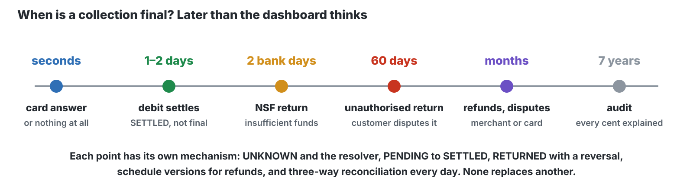

A payment gateway (SD-44) deals with truth that arrives over a payment's life. Servicing deals with the same
problem multiplied by a schedule: every instalment of every loan goes through this timeline, and the
schedule itself changes when refunds and payoffs arrive. That is why the design has a mechanism at each
point: the resolver for seconds, settlement posting for days, return handling for weeks, schedule versions
for months, and reconciliation every day.

## One loan as entries


> [!NOTE]
> **Why? What is it?**
>
> **Why a clearing account?** A pending bank debit has not moved money yet, but the loan's balance should
> show that a payment is on its way, or the customer would be chased for it. So the collection is posted
> twice: first into *cash clearing* (an account that says "money expected"), then from clearing into cash when
> the bank settles. A balance on the clearing account at any moment is exactly the money in flight; a
> clearing balance that never empties is a bug or a lost file, and reconciliation sees it.


## Where the load lands

> [!CAUTION]
> **Under load**
>
> **The 1st of the month (illustrative, from the cue sheet):** 600,000 collections. 480,000 bank debits go in
> one file (about 45 MB). 120,000 card charges go one by one under a contract of 100 a second: at 90 a second,
> about 22 minutes. Spread over four hours, the whole day is about **42 operations a second** on the database.
> Two days later: about 14,400 insufficient-funds returns (an illustrative 3 %). On the 1st itself, about 240
> card timeouts (an illustrative 0.2 %), each one a possible double charge.


The load map has one surprise for most candidates: the database is the least loaded component. The binding
constraints are outside the system: a processor contract measured in requests a second, and a bank clock
that closes the door at 14:00. The design follows the constraints, not the volume.


# Part II: The round, stage by stage

| Stage | Clock (75 min, typing-adjusted) | What you produce |
|---|---|---|
| 1 Clarify | 0–12 | Seven questions, five functional requirements, numbers on the non-functional ones, stated cuts |
| 2 Estimates | 12–21 | Three calculations that change the design |
| 3 API and data | 21–30 | The event, the calls, the states, the tables, the posting transaction |
| 4 High-level design | 30–45 | V1 → V2 → V3, the collect path walked end to end |
| 5 Why these choices | (inside 4) | The database as the queue; one writer to the ledger; files stored raw |
| 6 Deep dives | 45–67 | Two or three of the eight challenges, as the interviewer picks them |
| 7–11 Wrap | 67–75 | Failures, SLOs, cost, the EM layer, the four-sentence close |


# Stage 1: Clarify requirements

Open with questions, not boxes. Each question below has the cue sheet's answer and what it changes. Ask
them in one burst, write the answers down, and say the consequence of each one aloud: that is what turns
a list of questions into a scoping argument.

| # | Question | Answer (cue sheet) | What it changes |
|---|---|---|---|
| 1 | How big is the portfolio? | 5M active loans, 3–12 monthly instalments | ~5M collections a month; loans live up to a year, long enough for every slow failure |
| 2 | Which rails? | Bank debit 80 %, card 20 %; card numbers are tokens at the processor | Two rails with opposite behaviour; tokens mean no quick failover between processors |
| 3 | When are payments due? | They cluster: 600,000 on the 1st | One day must be planned; size it before reacting to it |
| 4 | What limits do the rails impose? | Card contract 100/s; bank debit files have a daily cut-off (take 14:00) | The binding limits are outside the system |
| 5 | Refunds? | Merchants refund fully or partly, any time | Schedules change under live loans; the terms must say how |
| 6 | Audit and close? | Every cent explained 7 years; month-end close in 2 days | Immutable lines; differences found daily, not at month-end |
| 7 | What must never happen, in order? | Your call | Propose: charge twice; an unexplained cent; a penalty for our failure; then lateness |

> [!NOTE]
> **Why? What is it?**
>
> **Why ask "what must never happen, in order?"** Because the answer settles every later trade-off in one
> sentence. When the interviewer later asks "the processor is slow, do you retry or wait?", you can point to
> the order: a double charge is worse than a late collection, so you wait and ask. Candidates who never set
> the order end up arguing each trade-off from scratch.


**Functional requirements**, numbered, because each gets a flow in Stage 4:

- **FR1 Schedule.** A booked loan becomes a schedule of instalments from its terms version.
- **FR2 Collect.** On each due date, collect by bank debit or card; retries and late fees follow policy.
- **FR3 Adjust.** Merchant refunds, extra payments and early payoff; re-amortise or shorten per the terms;
  every payment allocated by a versioned waterfall.
- **FR4 Absorb returns.** A debit returned days or weeks later reverses a collection and puts the instalment
  back to due.
- **FR5 Reconcile.** Ledger against processor against bank, every day; month-end close in two days.

**Non-functional requirements**, all *initial targets*:

| Promise | Target |
|---|---|
| Customers charged twice for one instalment | 0 |
| Unexplained differences at month-end close | 0 |
| Debit file submitted (cut-off 14:00) | by 10:30, acknowledged by 11:00 |
| UNKNOWN card outcomes resolved | 99 % within 1 hour |
| Retention | every line kept and explainable for 7 years |
| Close | 2 days after month-end |

**In scope:** schedules and terms versions; both rails with retries and returns; refunds, late fees and
payoff; the ledger; reconciliation; customer notices as events.
**Out of scope, said aloud:** origination and underwriting (SD-82); outside collections agencies and hardship
programmes beyond a pause flag; statement design; tax reporting; payouts to merchants (SD-81); funding or
selling the loans.

> "The core is four things: a ledger that is never edited, a payment state machine with unknown and returned,
> a scheduler bounded by the rail, and reconciliation against the outside. Everything else serves those four."

> [!WARNING]
> **Trap**
>
> **Trap: treating the prompt's silence as "no requirement".** The prompt does not mention returns. A candidate
> who does not ask how a bank debit fails will design a system in which settled means paid, and will lose the
> second half of the round to Challenge 3.


# Stage 2: Back-of-the-envelope

## How to do estimates in this round

Three calculations are worth doing aloud; the rest go in the table. Each ends with a decision.

> [!IMPORTANT]
> **Top-3 number 1: the busy day is 42 a second**
>
> **Arithmetic:** 600,000 collections ÷ (4 h × 3,600 s) = about **42 per second**. *Derived from a given.*
> **What it means:** one relational primary handles thousands of small transactions a second.
> **Decision:** the database is the work queue; a message broker is not needed for load.
> **Say:** "Six hundred thousand sounds like a herd, but it's forty-two a second. The database is fine. The
> limits are elsewhere."


> [!IMPORTANT]
> **Top-3 number 2: the card window is 22 minutes**
>
> **Arithmetic:** 600,000 × 20 % = 120,000 card charges; ÷ 100/s = 1,200 s = **20 minutes** at the contract
> limit; at 90 % of the contract, = about **22 minutes**. *Derived; 90 % is an initial target.*
> **Decision:** a token bucket per rail set below the contract, and a day plan with a card window.
> **Say:** "The processor's contract sets the pace, so I plan the window, I don't burst into it."


> [!IMPORTANT]
> **Top-3 number 3: ninety million dollars on one morning**
>
> **Arithmetic:** 600,000 × $150 average instalment = about **$90M**; a 0.1 % error = about **$90k**. *Illustrative
> average.*
> **Decision:** correctness beats speed; a day's delay is cheap, an error is not.
> **Say:** "Being late costs a little. Being wrong by a tenth of a percent costs ninety thousand dollars."


## The full table, row by row

| Number | Arithmetic | Label | Decision it drives |
|---|---|---|---|
| Busy-day rate | 600,000 ÷ 14,400 s = about 42/s | derived | DB as the queue |
| Card charges | 600,000 × 20 % = 120,000 | derived | — |
| Card window | 120,000 ÷ 90/s = about 1,333 s = about 22 min | derived | token bucket, day plan |
| Bank debits | 600,000 × 80 % = 480,000 | derived | one file |
| File size | 480,000 × 94 B = about 45 MB | illustrative record size | build early, validate, wait for the acknowledgement |
| Money on the 1st | 600,000 × $150 = about $90M | illustrative | correctness over speed |
| Returns | 480,000 × 3 % = about 14,400 on days 2–3 | illustrative rate | a return pipeline with an owner |
| Card timeouts | 120,000 × 0.2 % = about 240 | illustrative rate | a resolver service |
| Ledger lines a month | 5M × 4 = 2 × 10^7 | illustrative lines per loan | — |
| Seven years | 2 × 10^7 × 84 × 200 B = about 336 GB = about 340 GB | derived | one relational DB, partitioned by month, no sharding |
| Daily accrual lines (rejected) | 5M × 30 × 2 = 3 × 10^8 a month | derived | accrue by calculation; post at events and month-end |

> [!NOTE]
> **Why? What is it?**
>
> **Why "four lines per loan per month"?** Two for the collection itself (cash clearing against the loan's
> principal). The move from clearing to cash at settlement happens on system accounts, posted once per
> settlement batch rather than once per loan, so it adds little. Two more for the interest accrued at
> month-end, on loans that carry interest. Refunds, fees and returns add lines, but rarely. The point of the
> estimate is the order of magnitude: hundreds of
> gigabytes over seven years, not petabytes, which is why a single relational database with real constraints
> is the right home for the ledger.


> [!WARNING]
> **Trap**
>
> **Trap: posting interest every day.** It feels accurate, and it multiplies the ledger by fifteen. Accrual is a
> calculation from the balance, the rate and the days elapsed; it is *posted* when something happens (a
> payment, a payoff, a refund) and at month-end. The posted amount is exactly what the calculation gives, so
> nothing is lost.


# Stage 2b: Theory first

What makes this problem hard, in words that outlive any product name. Safety and liveness are named by slug (`[S1-no-twice-collect]`), each mechanism is paired with the diagram type that fits it, and each option of the matrix has its own pros, cons, picture and pitfalls. The failure list is not a catalogue here: the failures are the challenges of Stage 6, and the open ones are the follow-ups at the end.

<!-- theory:begin -->
<!-- generated from video/src/ch3.py by dsl.sync_theory_md: edit the slides, not this region -->

*Theory · 1 of 5 · what it is*
> Turn each loan's *terms* into a schedule, collect each amount *once* through rails that answer in days and *reverse weeks later*, record every movement as *balanced, immutable* lines, and *prove daily* the books agree with the bank.

### Four things it is confused with
*Theory · 1 of 5 · what it is not*
- **Not a payment gateway.** A gateway turns one intent into one payment in seconds (SD-44). Servicing drives many payments over months, against a schedule that changes.
- **Not a cron job.** A cron job fires work. It does not know what was attempted, what is pending, or what came back.
- **A ledger is not a balance table.** A balance is a sum of lines. A number updated in place cannot explain itself to an auditor.
- **Settled is not final.** A bank debit can be returned after it settles. Final is a later, rule-defined point.

### State safety and liveness separately
*Theory · 2 of 5 · the two properties*
- **Safety · must never happen.** **[S1-no-twice-collect]** One instalment collected twice. **[S2-ledger-balanced-immutable]** A ledger transaction that does not sum to zero in integer cents, or a line that is edited. **[S3-no-unfair-penalty]** A customer penalised beyond policy, or for our failure.
- **Liveness · must eventually happen.** **[L1-attempt-by-cutoff]** Every due instalment is attempted on its due date, before the cut-off. **[L2-every-unknown-ends]** Every payment leaves UNKNOWN and PENDING for SETTLED or RETURNED, within a bound. **[L3-every-break-owned]** Every difference between ledger, processor and bank becomes an owned break within a day.

### When is money final, and who decides?
*Theory · 3 of 5 · the central tension*

| When | What we know | Mechanism that lives there |
|---|---|---|
| **seconds** | a card answer, or nothing | UNKNOWN and the resolver; a key on every send |
| **1–2 days** | the debit settled | PENDING to SETTLED, posted from the settlement file |
| **2 bank days** | insufficient funds | RETURNED, a reversal, a re-presentment by policy |
| **60 days** | unauthorised | RETURNED, never retried; exposure reported by age |
| **months** | refunds, card disputes | a new schedule version; a reversal dated now |
| **every day** | the bank's view | three-way reconciliation |

### An immutable double-entry ledger, with a projection · ERD
*Theory · 4 of 5 · mechanism 1 of 7*
- **Protects.** **[S2-ledger-balanced-immutable]** and the audit.
- **How it works.** Every movement is a transaction of two or more lines that sum to zero in integer cents. Lines are inserted, never updated. A balance row is updated in the same commit, at a version.
- **Rules out.** Unexplainable balances, lost cents, two postings interleaving on one loan.
- **Costs.** Storage that only grows. Every correction is a reversing transaction.

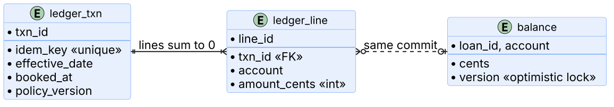

### A payment state machine with UNKNOWN and RETURNED · STATE MACHINE
*Theory · 4 of 5 · mechanism 2 of 7*
- **Protects.** **[S1-no-twice-collect]** and **[L2-every-unknown-ends]**.
- **How it works.** Due, intent open, submitted, pending, settled. A timeout goes to UNKNOWN, a real state with exits. A return moves SETTLED to RETURNED and posts a reversal.
- **Rules out.** A timeout treated as failure, then charged again. A return with nowhere to go.
- **Costs.** More states and transitions to test. Statements show pending for days.

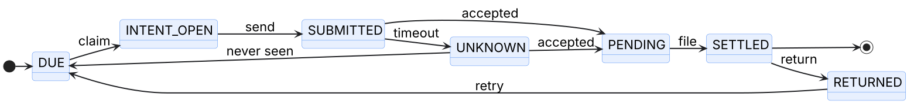

### Idempotency at three layers · SEQUENCE
*Theory · 4 of 5 · mechanism 3 of 7*
- **Protects.** **[S1-no-twice-collect]**.
- **How it works.** The ledger transaction has a unique key: loan, instalment, attempt. The same key goes to the processor. And only one open intent may exist per instalment.
- **Rules out.** A duplicate posting, a duplicate charge, two workers creating two intents.
- **Costs.** Key discipline: only a new decision gets a new attempt number.

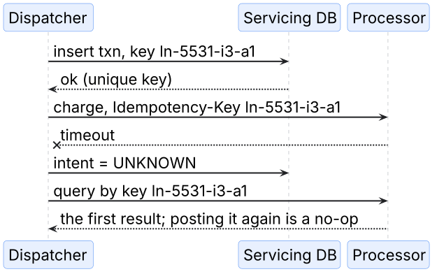

### The database as the queue · C4
*Theory · 4 of 5 · mechanism 4 of 7*
- **Protects.** **[L1-attempt-by-cutoff]**.
- **How it works.** Due items are rows. Workers claim batches with FOR UPDATE SKIP LOCKED, and write the intent and an outbox row in the same commit. A sweeper returns stale claims.
- **Rules out.** Lost or doubly claimed due items; a commit with no send, or a send with no record.
- **Costs.** Polling, and a sweeper to run.

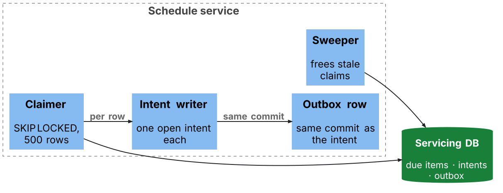

### A rail budget · C4
*Theory · 4 of 5 · mechanism 5 of 7*
- **Protects.** **[L1-attempt-by-cutoff]** and **[S3-no-unfair-penalty]**.
- **How it works.** A token bucket per rail, set below the contract. A day plan back-scheduled from the cut-off. A pause switch per rail. Live limits from the adapter.
- **Rules out.** Self-inflicted throttling that turns into declines; a missed cut-off.
- **Costs.** Planning the day; spreading due dates at origination.

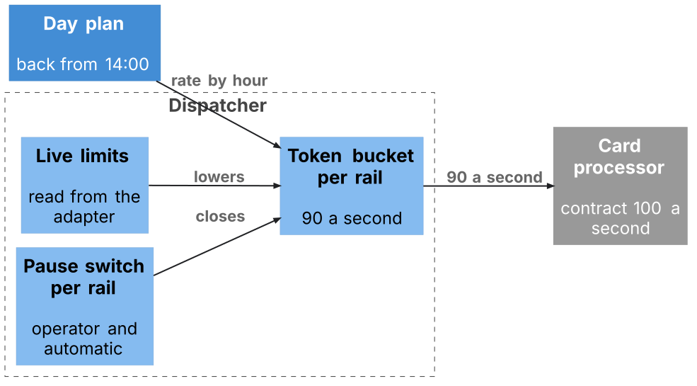

### Policy as versioned data · ERD
*Theory · 4 of 5 · mechanism 6 of 7*
- **Protects.** **[S3-no-unfair-penalty]** and the audit.
- **How it works.** Allocation waterfall, retry schedule, late fees and refund treatment are rules with versions and owners. Every posting records the version it used.
- **Rules out.** Behaviour nobody can explain; a rule change applied to old loans by accident.
- **Costs.** A rules component. Owners in risk and legal who must approve changes.

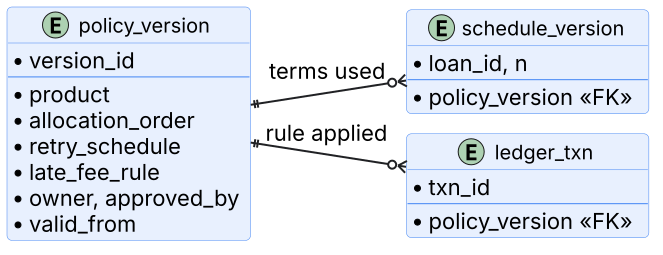

### Three-way reconciliation · SEQUENCE
*Theory · 4 of 5 · mechanism 7 of 7*
- **Protects.** **[L3-every-break-owned]**.
- **How it works.** The ledger produces expectations. The processor's report and the bank's statement are matched to them by reference, then by amount and a date window. Every difference is a typed break with an owner and an age.
- **Rules out.** Silent divergence; a plug posted at month-end to make totals agree.
- **Costs.** A pipeline, a console, and people.

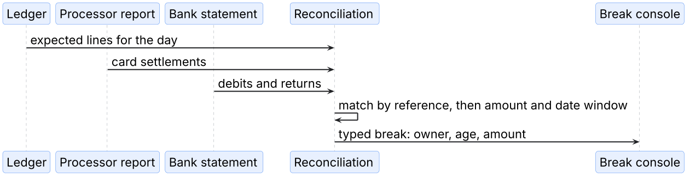

### A · A midnight cron and a balance column · C4
*Theory · 5 of 5 · option A*
**Rejected · fails at the first timeout**
- ✅ Pro: Trivially simple
- ✅ Pro: Fine for a handful of loans
- ➖ Con: No state for unknown or returned
- ➖ Con: A balance in place: no history
- 🔴 Pitfall: 2,000 charges a second against a contract of 100
- 🔴 Pitfall: The first timeout and retry charges twice

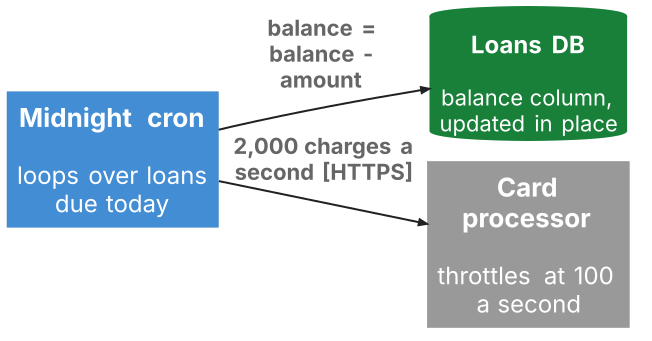

### B · A message broker with 600,000 messages · C4
*Theory · 5 of 5 · option B*
**Rejected · solves a load that is not the problem**
- ✅ Pro: Absorbs bursts
- ✅ Pro: Familiar fan-out to workers
- ➖ Con: Redelivery is the default
- ➖ Con: Still needs its own state and ledger
- 🔴 Pitfall: A redelivery after a crash charges again
- 🔴 Pitfall: Unknown and returned have no home
- 🔴 Pitfall: Built for a peak of 42 a second that a database handles

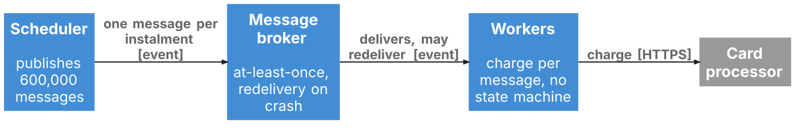

### C · An event-sourced loan aggregate · C4
*Theory · 5 of 5 · option C*
**Rejected · heavier than the need**
- ✅ Pro: Full history by construction
- ➖ Con: A payoff needs the current balance now
- ➖ Con: Corrections mean replays
- ➖ Con: Heavier operations
- 🔴 Pitfall: A stale view quotes the wrong payoff
- 🔴 Pitfall: A replay re-triggers side effects


### D · Relational ledger, state machine, database as the queue · C4
*Theory · 5 of 5 · option D*
**The pick · with an honest alternative in B-simple**
- ✅ Pro: Intent and outbox commit atomically
- ✅ Pro: Every cent explained, every break owned
- ➖ Con: More states to test
- ➖ Con: A reconciliation team
- 🔴 Pitfall: A processor that cannot be queried by our key: the settlement file decides, a day late
- 🔴 Pitfall: A claim with no sweeper strands rows

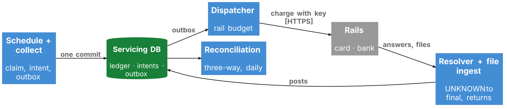

### E · Buy a servicing platform · C4
*Theory · 5 of 5 · option E*
**Rejected · for this scope; the honest first version for a small book**
- ✅ Pro: Fastest to a first version
- ✅ Pro: Standard products are covered
- ➖ Con: Their refund rules, not ours
- ➖ Con: We must own the books of record
- 🔴 Pitfall: Product-specific refunds cannot be expressed
- 🔴 Pitfall: The daily export is a reconciliation job by another name

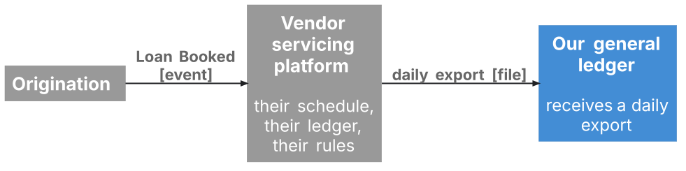

### The matrix, as a summary
*Theory · 5 of 5 · the options, side by side*

| Approach | Once per instalment | Explains every cent | Fails when |
|---|---|---|---|
| A · midnight cron, balance column | no | no | the first timeout and retry |
| B · a message broker | no | no | redelivery after a crash |
| C · an event-sourced aggregate | with keys | yes | a payoff needs a balance now |
| D · ledger, state machine, database as the queue | yes | yes | a processor we cannot query by our key |
| E · buy a platform | yes | theirs | product-specific refunds, books of record |

### D, and what it gives up
*Theory · 5 of 5 · the pick*
- **What D buys.** Never guessing. A retry is harmless, an unknown has an exit, a return has a place, every balance is a sum, and the bank is checked daily.
- **What D gives up.** More states to test. A reconciliation team. “Pending” on statements for days. Every product change becomes a policy version with an owner.

<!-- theory:end -->

# Stage 3: API and data

## The API

Every call carries a tag: the requirement it serves and the entity it reads or writes.

**`LoanBooked` (event from origination) · FR1 · writes Loan, ScheduleVersion, Instalment, LedgerTxn.**

```text
LoanBooked {
  loanId: "ln-5531", principalCents: 120000,
  termsVersion: "bnpl-8m-v3", firstDue: "2026-12-01",
  rail: "bank_debit", mandateId: "md-204" }
```

Idempotent by `loanId`: a duplicate delivery creates nothing. Due dates are moved to business days, because
a bank debit cannot take effect on a weekend or bank holiday.

**`POST /loans/{id}/payments` · FR2, FR3 · writes Intent, LedgerTxn.** A customer payment (an instalment paid
early, or an extra payment), with an `Idempotency-Key` header.

**`POST /loans/{id}/refunds` · FR3 · writes LedgerTxn, ScheduleVersion.** From the merchant. The merchant's own
`merchantRefundId` is the idempotency key, so a merchant retry cannot refund twice.

**`GET /loans/{id}/payoff-quote` · FR3 · reads Balance and in-flight Intents.**

```text
-> { quoteId: "q-31", amountCents: 75000,
     inFlight: [ { kind: "bank_debit", amountCents: 15000 } ],
     validUntil: "2026-12-05" }
```

Paying it uses `quoteId` as the idempotency key. The `inFlight` list is the subject of Challenge 5.

**Rail calls · FR2, FR4, FR5.** Card: `Charge(token, amount, key)` and `Query(key)`, where the key is
`coll:<loan>:<instalment>:<attempt>`. Bank: `SubmitDebitFile(batch)` returning an acknowledgement,
`ImportReturns(file)`, `ImportSettlement(file)`, `ImportStatement(file)`. Every file is stored unchanged
before anything parses it.

**Operations · FR5.** `GET /breaks?age>1d`, and `PUT /rails/{rail}/pause` (the rail switch).

> [!NOTE]
> **Why? What is it?**
>
> **Why is the attempt number in the key?** Because a key identifies a *decision to collect*, not an
> instalment. Resending the same attempt after a timeout must reuse the key, so the processor returns the
> first result instead of charging again. But after a *definite decline*, trying again is a new decision, and
> needs a new key, or the processor would return the old decline forever. The rule is: same attempt, same
> key; new attempt only after a definite answer.


## The data model


| Table | Changes? | Lose it? |
|---|---|---|
| `ledger_line` | insert only | never: it is the book of record |
| `ledger_txn` | insert only | never |
| `account_balance` | updated in the same commit, at a version | rebuildable from lines |
| `due_item` | status changes (DUE, CLAIMED, DONE) | rebuildable from schedule versions |
| `payment_intent` | state machine transitions | never: it is the evidence of what was attempted |
| `outbox` | inserted with the state, deleted after publish | republished at least once |
| raw files | stored once | never: the replay source for ingest |

**The posting transaction:**

```sql
BEGIN;
INSERT INTO ledger_txn (id, idem_key, kind, policy_ver)
  VALUES ('tx-9', 'coll:ln-5531:2:1', 'COLLECTION', 'v3');   -- unique key
INSERT INTO ledger_line (txn_id, account, amount_cents) VALUES
  ('tx-9', 'cash_clearing',            15000),
  ('tx-9', 'loan:ln-5531:principal',  -15000);
UPDATE account_balance
   SET balance_cents = balance_cents - 15000, version = version + 1
 WHERE account = 'loan:ln-5531:principal' AND version = 41;
COMMIT;   -- a deferred check rejects it unless the lines sum to zero
```

> "Lines are facts and never change. The balance is a projection, updated in the same commit, and provable
> from the lines."

### One race the first draft glosses over: the version check

If the `UPDATE ... AND version = 41` touches zero rows, another posting to the same loan committed first.
The transaction must roll back and be retried from a fresh read, *with the same idempotency key*. If the
first attempt actually committed (the client lost the commit acknowledgement), the retry fails at the unique
key and returns the stored result. Run the listing in your head against both cases: a concurrent posting,
and a duplicate. It handles both, because the key insert comes first.

### One more: the deferred zero-sum check

A check that lines sum to zero cannot run on each row insert, because the first line of a transaction never
sums to zero on its own. It runs at commit (a deferred constraint trigger, or a check in the single posting
function that every writer must use). Prefer both: the posting function refuses to build an unbalanced
transaction, and the database refuses to commit one.

**Three rules about money and dates.** Never a float: integer cents, and the rounding of instalments is a rule
(the remainder on the last one). Business days: a due date on a weekend or bank holiday takes effect the next
business day, and late fees count from there. Two dates on every line: the effective date and the booking
date, so a return that arrives today never edits last month.

# Stage 4: High-level design

Build the design in three versions, each introduced by the objection to the one before. The boxes never move:
every later picture is a view of the same baseline.

## Version 1: the simplest thing that works

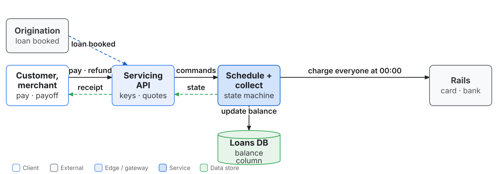

The objection, as a trace: at 00:00:00 the job sends 2,000 card charges a second against a contract of 100; at
00:00:03 the processor throttles 95 % and the job retries at once; at 08:00:10 one charge times out and is
retried as new, and the customer is charged twice; on Dec 3 a debit returns, and the balance column was
already reduced, so there is nowhere to post it; at year end an auditor asks why a balance is 75,000 and there
is no history.

### The objection to V1, as a sequence

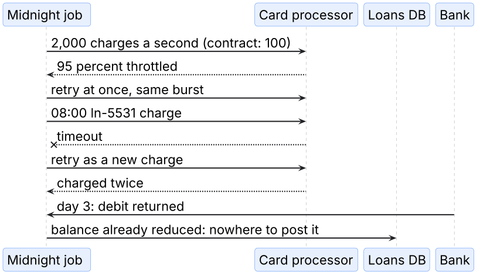

## Version 2: one collection per instalment, at the rail's pace, with books


What V2 adds, and the objection each addition answers:

- **The ledger, with projections**, answers "no history".
- **Due items claimed with `SKIP LOCKED`, and intent plus outbox in one commit**, answers lost and doubled work.
- **A dispatcher with a token bucket per rail** answers the midnight burst.
- **Keys on every send, UNKNOWN on timeout** answers the double charge.

The objection to V2: inside the database it is correct, but four holes remain. Settlements and returns arrive as
files days later and nothing reads them. Nothing ends an unknown: 240 on the 1st, pending forever. Refunds and
payoffs change schedules, while allocation and fees are buried in code. And nobody checks our books against the
bank's.

### The objection to V2, as a sequence

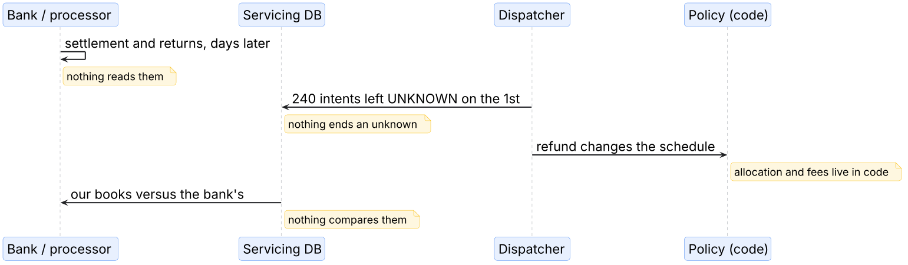

## Version 3: close every loop


The collect path, in code:

```python
def collect(batch):
    with db.transaction():
        rows = db.claim_due(today, shard, limit=500)          # SKIP LOCKED
        for r in rows:
            i = intents.open(r.instalment, attempt=r.attempt) # one open per instalment
            outbox.add("send", i.id, key=i.key)               # same commit

def dispatch(i):                                              # under the rail bucket
    try:
        r = rail.charge(i.token, i.amount, key=i.key)
    except Timeout:
        return db.set(i, "UNKNOWN")                           # the resolver takes over
    ledger.post(i, r, key=i.key)                              # lines + balance + state, one commit
```

Run it against a crash at every line. Before the first commit: nothing happened, the rows are due again.
After the commit, before the send: the outbox row is still there, and the dispatcher sends it later. After the
send, before the post: the intent is not settled, the resolver queries by key and posts once. After the post:
the outbox row is deleted on the next pass; if it is sent again, the processor returns the first result for the
same key. No branch guesses.

## The numbered flows, one per functional requirement

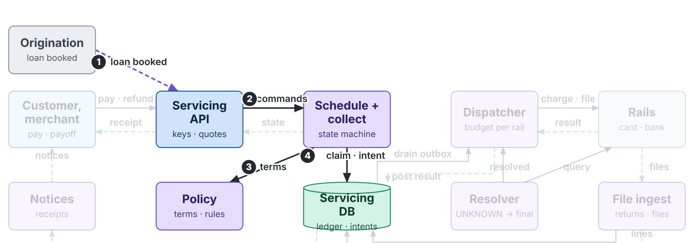

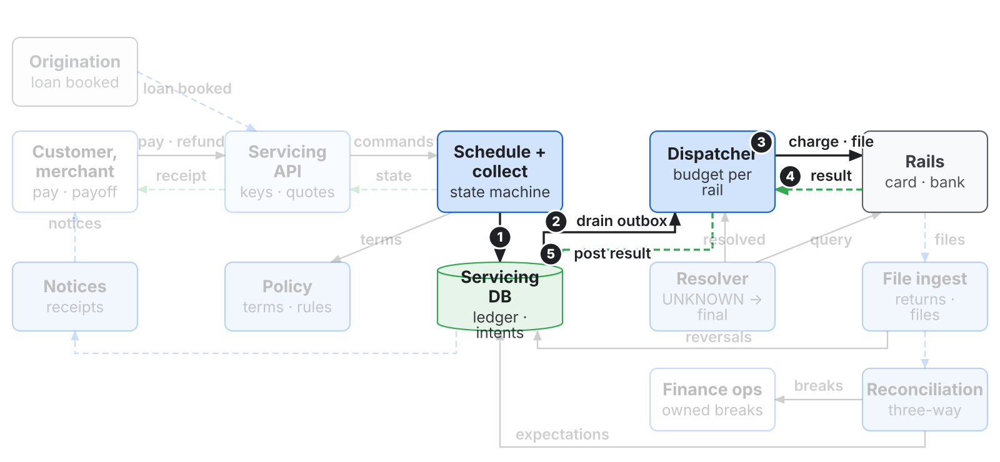

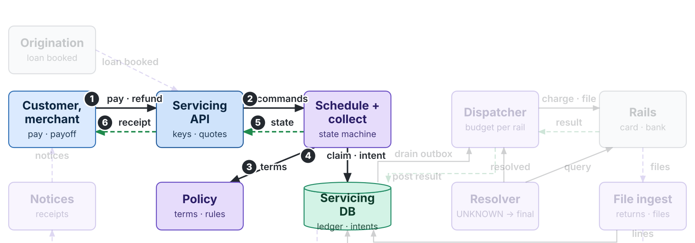

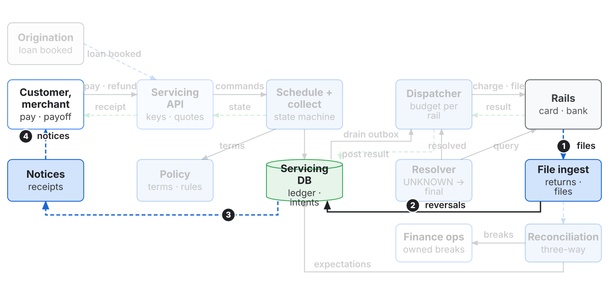

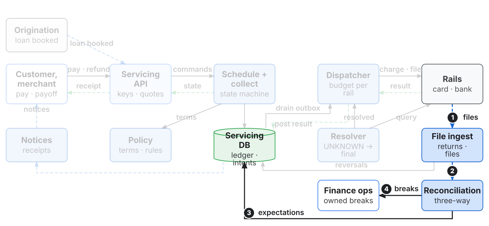

## Where an event ends and an API call begins

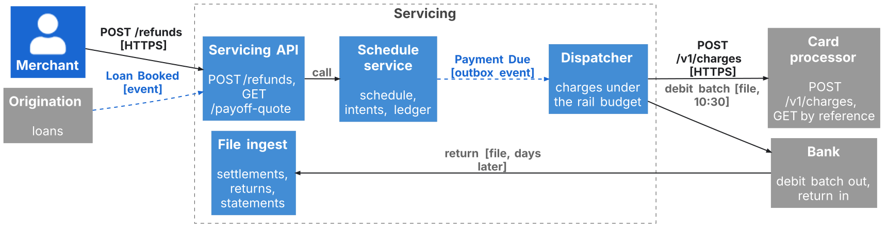

Origination does not call us for a new loan: it emits `Loan Booked`, an event, so a retry cannot book twice. The merchant refunds with a synchronous HTTPS call because it needs an answer now. Between our own services a due payment travels as an outbox event. Out to the card processor it is one HTTPS call per attempt; to the bank it is a debit batch as a file; the answer comes back days later as a return file. Three transports, three failure modes.

The card rail on the wire (one charge per attempt, then a lookup by reference after a timeout):

```http
POST /v1/charges
Idempotency-Key: ln-5531-i3-a1

{"amount": 15000, "source": "tok_81", "reference": "ln-5531-i3-a1"}

HTTP/1.1 200 OK
{"id": "ch_9X2", "status": "pending", "reference": "ln-5531-i3-a1"}

GET /v1/charges?reference=ln-5531-i3-a1       -- after a timeout
{"data": [{"id": "ch_9X2", "status": "succeeded"}]}   -- or {"data": []}
```

The bank rail (a batch out, an acceptance back, a return two days later):

```http
POST /v1/debit-batches
Idempotency-Key: 2026-12-01-b1

{"cutoff": "14:00", "entries": [{"ref": "ln-5531-i3-a1", "cents": 15000, "mandate": "md-204"}]}

HTTP/1.1 202 Accepted
{"batch": "bt_17", "status": "accepted"}

GET /v1/returns?since=2026-12-01
{"returns": [{"ref": "ln-5531-i3-a1", "code": "R01", "days": 2}]}
```

## The C4 views and the sequence

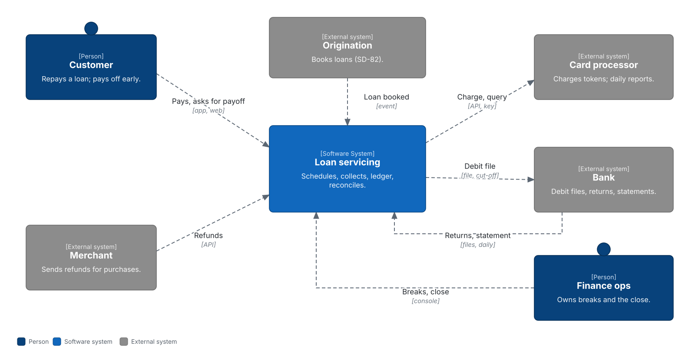


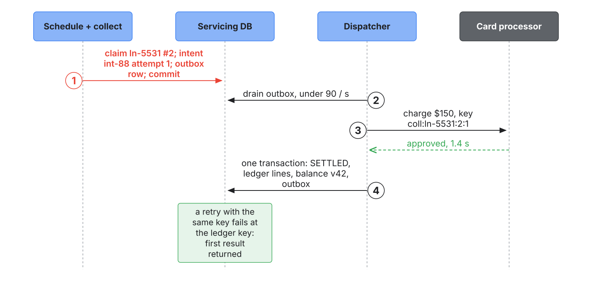

# Stage 5: Why these choices

## A relational database for the ledger and the queue

The ledger needs real transactions (lines and balance together), constraints (a unique key, a zero-sum check)
and seven years of history at about 340 GB. That is the profile of a relational database partitioned by month,
with old partitions archived read-only. The work queue needs 42 operations a second and exactly-one claiming;
`SELECT ... FOR UPDATE SKIP LOCKED` gives both without another system to run. Putting both in one database means
the claim, the intent and the outbox row commit together, which a separate broker cannot give without its own
outbox. **Alternatives:** a distributed SQL database (unjustified at this size; the cost is latency and
operations for scale we don't need); a document store (no multi-row transactions where we need them).

## One writer to the ledger

Every posting goes through one posting function owned by the ledger team. Other services ask for postings; they
never insert lines. This is how the invariants (zero-sum, keys, versions, the policy version on every
transaction) stay true when six teams touch money.

## A message broker: optional, and why

Not needed for load. Worth adding later if other consumers (notifications, analytics, a data warehouse) need
the events: the outbox relay publishes to it, and nothing on the money path depends on it. Say this
distinction aloud; it is the trade-off the interviewer is listening for.

## Files stored raw before parsing

Every file from the bank and the processor is stored unchanged with a checksum before anything reads it. A
parsing bug then costs a replay, not a lost return. It also gives the auditor the original evidence.

## Policy as data, owned by risk and legal

Allocation order, retry schedules, fee amounts and caps, refund treatment: each is a rule with a version, an
effective date and an owner. Engineering owns the mechanism that applies a rule and records which version it
used. A rule change is a new version, approved by its owner, shadow-tested on yesterday's postings, and never a
code deploy.


## Technologies, one level down

Every container with the technology it runs on, how it is built, the alternatives rejected and why, and the question an interviewer asks about it. Generated from `stack.json`.

## The dispatcher, one level down


The dispatcher is the box challenges 1, 2 and 7 open. The **outbox poller** claims sends by shard with `SKIP
LOCKED`. The **day plan** sets each rail's rate from windows planned backwards from the cut-off, and the **rail
budgets** spend it: a token bucket per rail whose rate halves on a throttle response. The **card client** sends
one call per attempt with our idempotency key and turns a timeout into UNKNOWN, never FAILED. The **file builder**
checks counts and totals before a file leaves. The **result poster** writes each outcome to the ledger by key in
one commit and hands every UNKNOWN to the resolver.

<!-- stack:sections -->

## Servicing DB: PostgreSQL for ledger and queue

*How it is built.* Ledger entries are double entry: each transaction's lines sum to zero, checked by a deferred constraint at commit. Payment intents are rows with a state, changed by conditional updates. The due-item queue is a table selected with row locks that skip rows already taken. The outbox row commits with the entry. Tables are partitioned by month, so old months become read-only and cheap. A single logical writer to the ledger removes cross-writer ordering problems; throughput is a few thousand entries a second.

*Why PostgreSQL 16, partitioned by month, one writer to the ledger:* A collection is a state change, a pair of balanced ledger entries and an event. They must commit together, and one writer to the ledger keeps the order simple.

*Rejected:*

- **A message broker as the queue**: A second system to keep consistent with the ledger. The table queue commits with the entry.
- **Multiple ledger writers**: Ordering, locking and deadlock handling for no throughput we need.
- **A key-value store**: No multi-row transaction, so balance and intent could disagree.

*Course:* theory/03 (partitioning and storage) and theory/07 (correctness under failure).

*Drill.* "A worker takes a due item and crashes before finishing. What happens to it?" The row lock is released with the transaction; the item is still due and another worker takes it. The idempotent intent key makes a second attempt harmless. The trap is marking taken before doing the work.

## Dispatcher: a token bucket per rail

*How it is built.* The dispatcher takes due intents and spends tokens from the rail's bucket. The day is planned backwards from each rail's cut-off, with the largest and riskiest items first and a jittered spread. Each call carries our reference. If a rail is down the bucket stops, and intents wait instead of retrying in a storm. A card retry and a bank-debit fallback are separate intents with their own keys.

*Why Go worker, a token bucket per rail, a plan of the day:* A bank-debit rail and a card processor have limits, cut-offs and a cost. Firing everything at midnight on the first would break them.

*Rejected:*

- **Firing every due item at once**: The first of the month would breach the bank limit and the processor's rate.
- **Retrying every failure immediately**: A retry storm on a rail that is already struggling.

*Course:* theory/08 (reliability and operations).

*Drill.* "It is the first of the month and the card processor is down. What does the dispatcher do?" Stop spending that rail's tokens, keep intents waiting, protect the customer from late fees, and resume slowly when it returns. The trap is retrying in a storm.

## Resolver: unknown to final

*How it is built.* The resolver selects unknown intents past a minimum age and asks the rail by our reference. It applies the answer with a conditional update from unknown. Backoff stretches from seconds to hours, and an intent that stays unknown for a day pages a person. The age of the unknown queue is a metric. A late webhook and the resolver cannot both apply; the conditional update decides.

*Why Scheduled worker, inquiry by reference, backoff, an alert at a deadline:* A call that timed out may have moved money. Unknown is a state with an owner, and only an inquiry can end it.

*Rejected:*

- **Retrying the original call**: If it landed, the customer is charged twice.
- **Marking a timeout as failed**: A debit that succeeded is shown as failed, and the loan is wrong.

*Course:* theory/07 (correctness under failure).

*Drill.* "A debit times out. What is the state and what moves money next?" Unknown. The resolver asks the rail by reference until it answers, and only that answer moves money. The trap is a retry or a failed mark.

## File ingest: raw first, then parse

*How it is built.* Each file is stored raw in object storage with a hash, then parsed by a batch job. Counts and totals are checked against the file's trailer before any line is applied. Each line is matched to an intent by reference, and applying a return is an idempotent ledger transaction. A file that fails a check is quarantined, not half applied. The raw copy lets a fixed parser replay old files.

*Why Object storage for raw files, a batch parser, counts and totals checked first:* Returns arrive weeks later, in files. A parse bug must never lose the original.

*Rejected:*

- **Parsing on arrival**: A bug loses the original, and a half-applied file is hard to unwind.
- **Streaming each line as it comes**: Files are daily; a stream adds state for no freshness gain.

*Course:* theory/08 (reliability and operations).

## Reconciliation: three-way

*How it is built.* A daily job matches every ledger entry to the rail's settlement line and to the bank statement by reference. Two-way agreement is a match; a line missing on one side, a different amount or a duplicate is a break. Breaks carry an age and an owner, and each resolution is a new ledger entry. A total that differs from the bank's by four hundred dollars is explained line by line, not plugged. Counts and sums are compared first, so a truncated file stops the job.

*Why Batch pipeline over the ledger, the rail's file and the bank's statement, by reference:* The ledger, the rail and the bank are three versions of the truth. Differences are breaks, and each break has an owner.

*Rejected:*

- **Matching on amount and date alone**: Equal payments on the same day are ambiguous.
- **A monthly reconciliation**: Breaks age for weeks and the month-end close becomes an investigation.

*Course:* theory/08 (reliability and operations).

*Drill.* "Our ledger says four hundred dollars more than the bank. How do you find it?" Match line by line by reference across ledger, rail and bank; the break is a line missing or doubled on one side. Fix it with a new entry. The trap is a plug figure.

## Policy: terms, waterfall and fees as data

*How it is built.* The policy service holds versioned terms: the schedule rules, the waterfall of interest, fees and principal, and the fee table. Every ledger entry records the policy version used. A refund in the middle of a loan is a transaction plus a new schedule version computed from the policy at that date. Risk and legal approve a version; engineering does not edit it.

*Why A rules service, versioned terms, a payment waterfall, a fee table:* Terms, the order in which a payment is applied and fees change with law and product. They must change without a deploy and be reproducible later.

*Rejected:*

- **Terms in code**: A deploy per change, and no way to reproduce what applied on a past date.
- **Terms in each service**: Two services would apply different rules to one payment.

*Course:* theory/08 (reliability and operations).

## Servicing API: idempotent and quote-aware

*How it is built.* Every write carries an idempotency key under a unique constraint. A payoff quote lists the principal, accrued interest and every intent in flight, with the quote's expiry. A payoff with a debit in flight either waits for the debit to resolve or nets it, and says which. A refund is a ledger transaction with a new schedule version, never an edit. Refunds are limited by a conditional update on the refunded total.

*Why Go service, an idempotency key on every write, payoff quotes that list what is in flight:* Customers and agents retry. A payoff quote that ignores a debit in flight is wrong the moment it is paid.

*Rejected:*

- **Quoting from the ledger balance only**: An in-flight debit changes the answer after the customer pays.
- **Editing the schedule in place**: History must be append-only, or a dispute cannot be reproduced.

*Course:* theory/07 (correctness under failure).

<!-- /stack:sections -->

## The stack on one page

<!-- stack:summary -->

| Container | Choice | Rejected | The deciding reason |
|---|---|---|---|
| Servicing DB | PostgreSQL, one ledger writer | Broker as queue; many writers | State, entries and queue commit together |
| Dispatcher | Token bucket per rail | Fire at once; retry storm | The day is planned, not fired |
| Resolver | Inquiry by reference, backoff | Retry call; mark failed | Unknown has an owner and an age |
| File ingest | Raw first; batch parse | Parse on arrival; stream | Replayable; checked first |
| Reconciliation | Daily, three-way, by reference | Amount and date; monthly | Every break has an owner |
| Policy | Versioned data, one service | Terms in code | Reproducible; no deploy |
| Servicing API | Idempotent; quotes list in-flight | Balance-only quote; in-place edit | Retries safe; quote true |

Each fix in Stage 6 rejects one tool by name:

| Deep dive | Rejected | Because |
|---|---|---|
| 6.1 | Treating a timeout as a failure | the debit may have landed; unknown is a state and an inquiry ends it. |
| 6.2 | Firing every due item at midnight on the first | the bank-debit limit and the rail rate break; plan the day backwards from the cut-off. |
| 6.3 | Treating settled as final | returns arrive weeks later; RETURNED is a state and a reversal is a transaction. |
| 6.4 | Editing the schedule in place for a refund | history must be append-only; a refund is a transaction and a new schedule version. |
| 6.5 | Quoting the payoff from the ledger balance alone | an in-flight debit changes it; the quote lists what is in flight. |
| 6.6 | Plugging the difference to the bank | the break is a line missing or doubled; match every line three ways by reference. |
| 6.7 | Retrying a down rail until it returns | a retry storm; pause, resolve, protect the customer, resume slowly. |
| 6.8 | A month-end report | breaks age for weeks; watch the money funnel and the files daily. |

<!-- /stack:summary -->

## When you don't need all this (the alternate path)

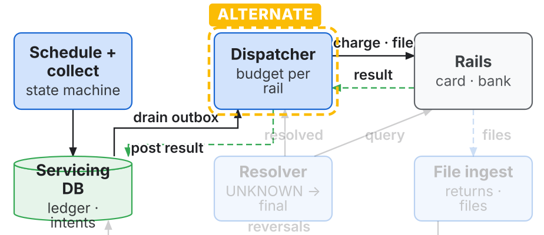

**The simpler design.** Keep the ledger, the state machine with UNKNOWN and RETURNED, file ingest and
reconciliation. Replace the dispatcher, its rail budgets and its day plan with **one scheduled job** that walks
the due items in order, one call at a time, and builds the debit file once a day.

**What it gives up.** No rate control: the processor's throttling decides how fast we go. No day plan: a
rejected file or a burst of retries costs a whole day. What it keeps matters more: unknown and returned are still
states, and reconciliation still runs.

**The crossover number.** One job at about 10 card charges a second clears 36,000 in an hour; at 20 % on card,
that is about 180,000 collections due on the busiest day. The scale line has 600,000 on the 1st, which would
need more than three hours of card window and leave no margin before the cut-off.

> "Below about two hundred thousand collections on the busiest day, I'd ship one scheduled job. I would never ship
> without UNKNOWN, RETURNED and reconciliation."

# Stage 6: Deep dives

The interviewer picks two or three of these; the video walks all eight. They are ordered so that each fix
creates the next question, and each follows the same grammar: the question, the naive answer, a case with
numbers, where it breaks, the fix, why it works, the push on the fix, and the answer to give in the room.

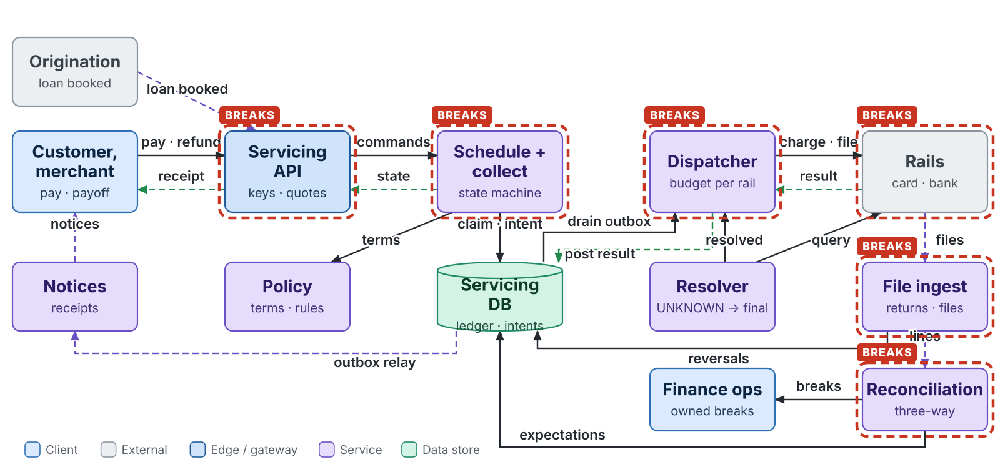

## 6.1 The processor timed out (the crux, part one)

**The question.** *"The processor times out on a card charge. Your worker retries. Was the customer charged
twice?"*

**The naive answer.** "Mark it failed and retry." The retry goes out as a new attempt with a new key.

**The case.**

| Time | Event |
|----|------------------|
| 08:00:00.000 | `ln-5531` instalment 2, $150, key `coll:ln-5531:2:1` sent |
| 08:00:03.200 | the processor approves it |
| 08:00:10.000 | the worker times out; the naive design marks it FAILED |
| 08:00:12.000 | retry as attempt 2, key `coll:ln-5531:2:2`: approved |
| 08:00:12.000 | the customer has paid $300 for one $150 instalment |

**Where it breaks.** Between the dispatcher and the rails. A timeout is not an answer: the request may have
arrived and been approved. A new key gives the processor no way to know the second request is the same
decision.

**The fix.** At the timeout the intent goes to **UNKNOWN**, a state with exits. A **resolver** queries the
processor *by the same key* after 30 seconds, 2 minutes and 10 minutes. Resending the same attempt reuses
its key. Only a *definite decline* allows attempt 2.

```python
def resolve(i):                                    # runs at +30 s, +2 min, +10 min
    r = rail.query(key=i.key)
    if r == "approved":  return ledger.post(i, r, key=i.key)    # idempotent
    if r == "declined":  return db.set(i, "DECLINED")           # attempt 2 now allowed
    if r == "not_found" and i.age > rail.safe_window:
        return rail.charge(i.token, i.amount, key=i.key)        # the SAME key
    schedule_again(i)                                           # still unknown
```

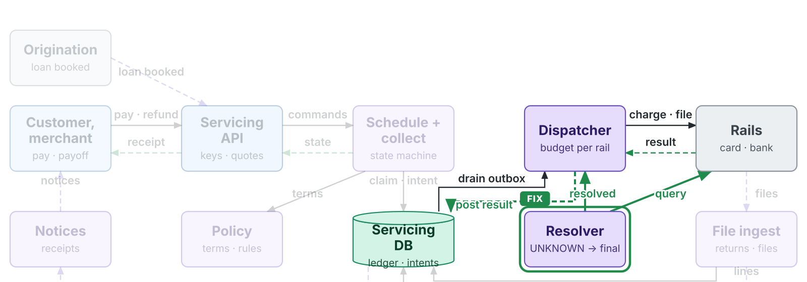

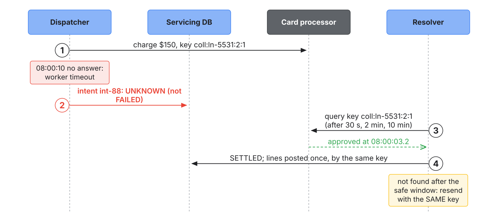

**Why it works.** `[S1-no-twice-collect]` (no instalment collected twice) holds at two layers: the processor de-duplicates by key,
and the ledger's unique key means the result can only be posted once even if the resolver and a late answer
race. `[L2-every-unknown-ends]` (every unknown ends) holds because the resolver runs on a schedule with a bounded number of tries,
and after that the settlement file decides.

**The push.** *"The query says 'not found'. You resend. Tomorrow's settlement file shows the first charge went
through after all."*

**The second fix, and the honest limit.** With the same key, a processor that honours keys returns the first
result, so usually there is no harm. "Not found" should only count as final after the processor's documented
window, which is why the resolver waits for `safe_window` before resending. If a duplicate still happens,
reconciliation finds two settled charges for one instalment the next morning; the duplicate is refunded
automatically the same day and counted as an incident. The limit: a processor that neither honours keys nor
answers queries can only be checked by its file, a day late. That belongs in the processor selection criteria.

> "A timeout is not a failure. The intent goes to unknown, the resolver queries by the same key, and a resend
> reuses that key. The settlement file is the final arbiter."

> [!WARNING]
> **Trap**
>
> **Weak answers.** "Retry with exponential backoff" (with which key?). "Make the charge idempotent" (how, and
> at which layer?). "Use a distributed transaction with the processor" (the processor is not a participant in
> your transaction).


> [!NOTE]
> **Why? What is it?**
>
> **A race worth naming.** The processor's late answer and the resolver's query can both arrive at the
> dispatcher within milliseconds. Both try to post. The ledger's unique key on `coll:ln-5531:2:1` lets exactly
> one commit; the other gets a unique violation and reads the stored result. That is why the key is on the
> ledger transaction and not only at the processor.


## 6.2 The morning of the 1st (overload)

**The question.** *"Six hundred thousand payments are due on the first. Walk me through that morning."*

**The naive answers.** "A cron job at midnight." Or: "It's a thundering herd, so put a message broker in front."

**The case.**

| Time | Event |
|----|------------------|
| 00:00:00 | workers send 2,000 card charges a second; the contract is 100 |
| 00:00:03 | the processor throttles: 95 % rejected; workers retry at once |
| 00:20:00 | 18,000 card charges marked failed; late fees due tomorrow |
| 13:55:00 | the debit file is built; validation fails on one bad record |
| 14:00:00 | cut-off missed: 480,000 collections slip a day |

**Where it breaks.** Not in the database. At the processor's contract, and at the bank's clock.

**The fix: plan the day backwards from the cut-off.** The debit file is built at 09:00, validated, submitted
by 10:30, and acknowledged by 11:00, three hours before the cut-off, so a rejected file can be corrected and
resent. The card window opens at 06:00 at 90 a second (about 22 minutes for 120,000). Soft declines (a
"try again later" from the issuer) are retried around 07:00. Workers claim due rows with `SKIP LOCKED`, and the
intent and outbox row commit with the claim.

```sql
WITH due AS (
  SELECT id FROM due_item
   WHERE due_date = current_date AND status = 'DUE' AND shard = $1
   ORDER BY id LIMIT 500
   FOR UPDATE SKIP LOCKED)
UPDATE due_item d SET status = 'CLAIMED', claimed_by = $2, claimed_at = now()
  FROM due WHERE d.id = due.id
RETURNING d.id, d.loan_id, d.amount_cents, d.rail;
-- same transaction: one intent + one outbox row per claimed row
```

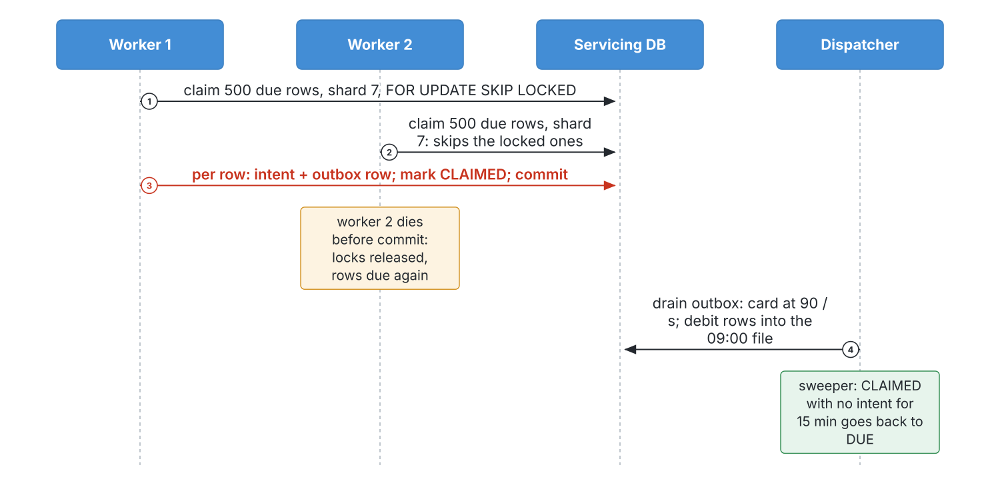

**Why it works.** `[L1-attempt-by-cutoff]` (every instalment attempted before the cut-off) is designed in, with three hours of
margin. `[S3-no-unfair-penalty]` (no penalty for our failure) holds because the declines that a burst would cause were our fault.
`SKIP LOCKED` gives exactly-one claiming without a distributed lock; the sweeper handles a worker that dies
after its commit and before its send.

**The push.** *"At ten past six, the processor lowers your limit to fifty a second."*

**The second fix.** The bucket's rate is live: a throttle response halves it at once. By 06:10, 54,000 are done
(600 s × 90/s); the other 66,000 at 50 a second take 1,320 s, 22 minutes: done by 06:32. The better fix is
upstream: spread due dates when loans are created (let the customer pick a day, default to the booking day).
The peak shrinks at the source.

> "Forty-two a second is nothing for a database. The limits are the processor's contract and the bank's
> cut-off, so I plan backwards from the cut-off, with a budget per rail."

> [!CAUTION]
> **Under load**
>
> **Under load, the 1st:** 42 operations a second on the database (claims, intents, postings); 90 a second to the
> card processor for 22 minutes; one 45 MB file to the bank; 240 timeouts for the resolver; about 14,400 returns
> arriving on days 2 and 3. Every one of these numbers is illustrative.


## 6.3 It settled, then it came back (the crux, part two)

**The question.** *"A bank debit settled on the second. On the third it comes back for insufficient funds.
Another one comes back forty days later as unauthorised."*

**The naive answer.** "Settled means paid: close the instalment. Retry anything that fails."

**The case.**

| Time | Event |
|----|------------------|
| Dec 1 | `ln-7702` instalment 3, $150, in the debit file |
| Dec 2 | settled; the naive design closes the instalment |
| Dec 3 | return R01 (insufficient funds): no state for it; the balance was already reduced |
| Dec 2 | `ln-4410` instalment 2, $150, settled |
| Jan 11 | return R10 (unauthorised), day 40; the naive design retries it: a rule breach and a complaint |

**Where it breaks.** In file ingest and the ledger. A return has nowhere to land, and an automatic retry of an
unauthorised debit breaks the network's rules.

**The fix.** SETTLED → **RETURNED**, a normal state. File ingest matches each return to its attempt by the
trace number, posts a **reversing transaction dated the day the return arrives** (never editing the original),
and moves the instalment from PAID back to DUE with the reason. Then **policy** decides:

| Code | Means | Window | Policy |
|---|---|---|---|
| R01 | insufficient funds | 2 banking days | re-present at most twice within 180 days; after the customer's payday |
| R02, R03 | account closed, not found | 2 banking days | stop; ask for a new payment method |
| R10 and similar | unauthorised | up to 60 days | never retry; a new authorisation; dispute review |
| late fee | after the grace period | — | capped by law where the customer lives; never for our failures |

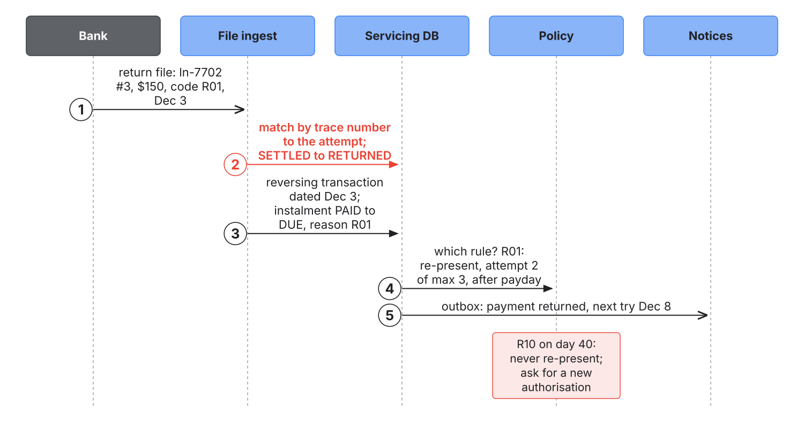

**Why it works.** `[S2-ledger-balanced-immutable]` (no line edited) holds because a return is a new transaction. `[S3-no-unfair-penalty]` (no penalty beyond the
rules) holds because the network's rules live in one table, owned by risk and legal, and applied by one piece
of code. `[L2-every-unknown-ends]` holds because RETURNED has defined exits.

**The push.** *"Finance wants to recognise the cash on settlement day. Risk wants to wait sixty days. Who
wins?"*

**The second fix.** Both, with the exposure on a report. Cash is posted at settlement, because that is when the
bank says it is cash; a return is a later reversal, in the month it arrives. A daily report shows everything
settled within the last sixty days, by age, against the observed return rate. Risk prices that exposure; no
process waits on it.

> "Settled is not final for a bank debit. A return is a state and a reversal dated when it arrives, and
> whether we retry is policy: never for unauthorised."

> [!WARNING]
> **Trap**
>
> **Trap: retrying an unauthorised return.** It looks like ordinary dunning (retrying a failed payment). It is
> not: the customer has said they did not authorise the debit. Retrying it breaks the network's rules and turns
> a dispute into a complaint, or worse.


> [!NOTE]
> **Why? What is it?**
>
> **What is a trace number?** Each entry in a debit file carries an identifier assigned when the file is built,
> and the bank returns it with any return. Storing it on the attempt is what lets ingest match a return to
> exactly one attempt, rather than guessing by amount and date.


**The card rail's version: a dispute.** A card repayment can come back too, by a different clock. The customer
disputes the charge with their card issuer, sometimes months later, and the processor nets the amount from our
next payout before we hear about it.

| Step | What we write | Why |
|---|---|---|
| Notice | The payment moves SETTLED → DISPUTED; the processor's report shows the debit from our payout | The money already left; the notice may come months after the charge |
| Ledger | A reversing transaction dated the day of the notice: the loan receivable goes back up, processor clearing goes down | Nothing is edited; the instalment is due again |
| Customer | No late fee and no automatic re-collection on that instalment while the dispute is open | A disputed amount is not a missed payment; a second charge would turn a dispute into a complaint |
| Evidence | The signed agreement, the schedule, the authorisation and the receipt, by the network's deadline | Win: the amount is re-posted. Lose: the instalment stays due and follows normal collections |
| Reconcile | The payout report's dispute line is matched by dispute ID | Otherwise it is the unexplained $100 in 6.6 |

Scale, illustrative: at 0.1 %, the 1st's 120,000 card charges produce about 120 disputes from that one day.

## 6.4 A refund in the middle of the loan (correctness, changing terms)

**The question.** *"After two instalments, the merchant refunds three hundred dollars of the twelve hundred.
What changes?"*

**The naive answer.** "Subtract three hundred from the balance."

**The case.**

| Time | Event |
|----|------------------|
| Oct 1 | `ln-9100` booked: $1,200 in 8 × $150 |
| Nov 1 | instalment 2 paid; $900 outstanding |
| Nov 14 | the merchant refunds $300; the balance column says $600 |
| Dec–May | the schedule is untouched: 6 × $150 = $900 collected |
| May 1 | the customer has overpaid $300, and noticed before we did |

**Where it breaks.** In the schedule. The balance changed; the plan to collect it did not.

**The fix.** A refund is **a ledger transaction and a new schedule version**. The transaction: the merchant
receivable is debited $300 (the merchant owes it back), and the loan's principal is credited $300, keyed by
the merchant's refund ID. The schedule: the terms say how the refund lands. **Re-amortise**: six remaining
payments of $100. **Shorten**: payments stay at $150 and the loan ends after four more. Which one is a product
and legal decision, written into the terms before any code.

Every payment is also **allocated** by a versioned waterfall:

| Order | Bucket | Why |
|---|---|---|
| 1 | fees due | usually first, but rules differ by state |
| 2 | interest due | accrued daily, by calculation |
| 3 | principal due | this instalment's share |
| 4 | future principal | extra or early: shortens the loan |

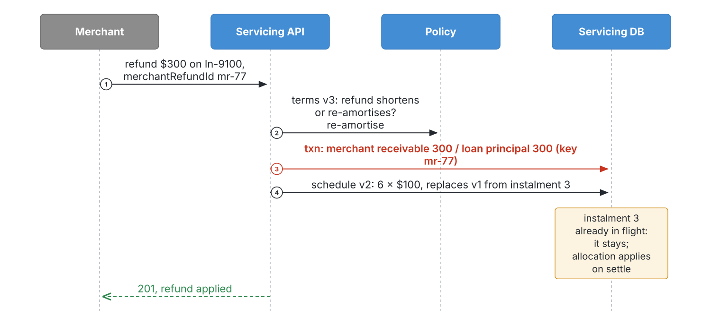

**Why it works.** `[S2-ledger-balanced-immutable]` and the audit: every change is a transaction plus a version that says why. `[S3-no-unfair-penalty]`: the
customer pays what they owe, no more.

**The push.** *"The customer has paid nine hundred. Now the merchant refunds the full twelve hundred."*

**The second fix.** The principal goes to zero, and the $900 the customer paid becomes **customer payable**:
money we owe. It is refunded to the original payment method within the days policy sets, and never held
silently as credit. On the merchant side, they owe $1,200 back; whether the $36 discount fee is returned is
the merchant contract, also versioned.

> "A refund is a ledger transaction and a new schedule version. Re-amortise or shorten is a decision in the
> terms, and any overpayment goes back to the customer."

> [!NOTE]
> **Why? What is it?**
>
> **A race the first draft glosses over.** If instalment 3 is in the debit file when the refund arrives, the new
> schedule version must not cancel or resize it: the debit is already with the bank. It stays as it is; when it
> settles, the waterfall applies it to the new schedule, and any excess becomes a reduction of future principal
> (or customer payable, if nothing is left). Regenerating the schedule "from the next unclaimed instalment" is the
> rule that keeps the two from colliding.


## 6.5 Paying off with a debit in flight (correctness, timing)

**The question.** *"On the third, the customer pays off the loan early. Instalment three's debit from the first
is still pending. What do you quote?"*

**The naive answer.** "Quote the balance." But the balance either counts the pending debit as paid, or it does
not, and both are wrong some of the time.

**The case.**

| Time | Event |
|----|------------------|
| Dec 1 | `ln-5531` instalment 3, $150, in the debit file; $900 outstanding before it |
| Dec 3 | quote A: $900 (ignores the pending debit); paid by card |
| Dec 3 | the debit settles: $150 over-collected |
| Dec 3 | quote B: $750 (counts it as paid); loan CLOSED, lien released |
| Dec 4 | the $150 returns R01: a closed loan that owes $150 |

**The fix.** A payoff quote is a statement about the future, so it **lists what is in flight**. Quote `q-31`:
$750 now, conditional on the $150 debit clearing, valid to Dec 5. Paying it moves the loan to
**PAID_PENDING**, not CLOSED. If the debit clears its insufficient-funds window, the loan closes. If it returns,
$150 reopens as a single due item, with no late mark.

| In flight at payoff | Quote | Loan state | Closes when |
|---|---|---|---|
| nothing | full balance | CLOSED | at payment |
| a card charge | balance − charge | PAID_PENDING | the charge settles (minutes) |
| a bank debit | balance − debit, conditional | PAID_PENDING | the debit is past its insufficient-funds window |
| a debit not yet sent | full balance; cancel it | CLOSED | at payment |

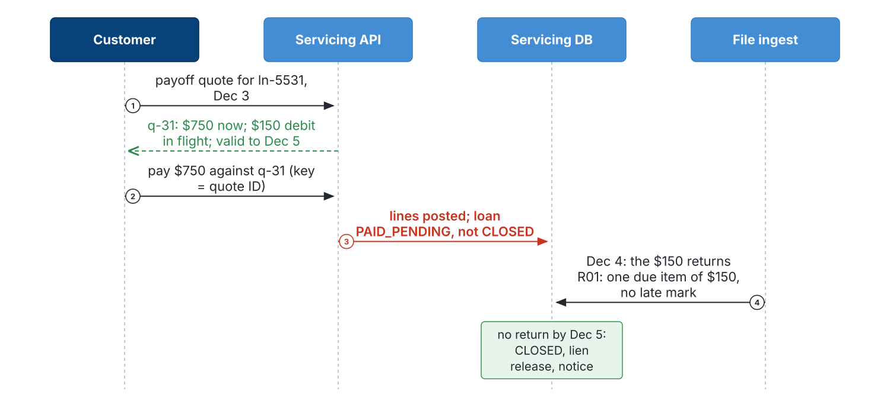

**Why it works.** `[S1-no-twice-collect]`: nothing is collected twice. `[S3-no-unfair-penalty]`: no penalty for a timing gap the customer did not create.
`[L2-every-unknown-ends]`: PAID_PENDING has a defined exit on a known date. The only uncertainty left is the 60-day unauthorised
window, which is handled as a dispute rather than by holding every paid-off loan open for two months.

**The push.** *"The day after the payoff, a merchant refund arrives on the same loan."*

**The second fix.** The refund takes the principal below zero; the excess moves to customer payable and is paid
back automatically to the original method. Every customer payable older than the policy's limit pages its
owner. Money we owe is never left as a quiet credit.

> "A payoff quote lists what's in flight. The loan goes to paid-pending and closes only when nothing can still
> come back, and any overpayment is refunded automatically."

## 6.6 Four hundred dollars more than the bank (reconciliation)

**The question.** *"Month-end. The ledger says we collected four hundred dollars more than the bank received.
Find it."*

**The naive answer.** "Compare the totals, and post a $400 adjustment to close."

**The case.**

| Item | Amount | What it is |
|---|----|----------------|
| ledger | $90,000,400 | cash collected in November |
| bank | $90,000,000 | deposits net of returns |
| +300 | timing | two R01 returns on the bank statement for Nov 30; the return file arrives Dec 1 |
| +100 | real | a card dispute the processor netted from its payout; none in the ledger |
| +150 | real | a card payment we hold as settled; the processor never settled it |
| −150 | real | a charge the processor settled that we hold as declined: a double charge |

300 + 100 + 150 − 150 = 400. The last two cancel in the total, and one of them is a customer charged twice.

**The fix.** Match every line, three ways, by reference. The ledger produces **expectations**. The processor's
report and the bank statement are matched to them by our reference first, then by amount within a three-day
window. Every difference becomes a **typed break** (timing, missing in our ledger, missing at the processor,
wrong amount) with an owner and an age.

| Break | Type | Owner | Action |
|---|---|---|---|
| +$300, two returns | timing | auto | closes when the Dec 1 return file posts |
| +$100, card dispute | missing in ledger | disputes team | post the dispute; contest or accept |
| +$150, never settled | missing at processor | payments team | query; reverse our posting |
| −$150, settled, held declined | double charge | payments team | post it; refund the customer today |

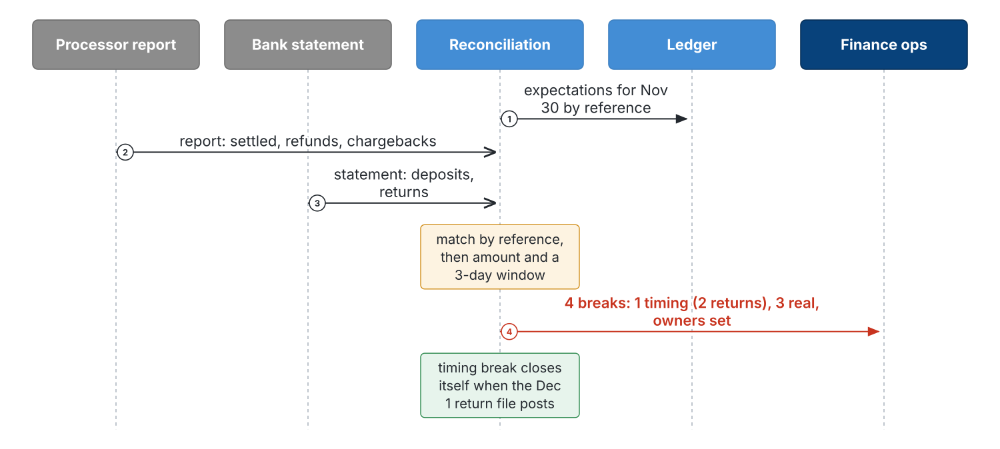

**Why it works.** `[L3-every-break-owned]` (every difference owned within a day) is a process with a clock. Totals cannot hide
offsetting breaks, because nothing is matched by total.

**The push.** *"It's month-end, and the processor's report is two days late. Close is in two days."*

**The second fix, and the honest limit.** Close on what is known. The bank statement still reconciles against
the ledger two ways; card items wait as open timing breaks, listed with amounts and ages, and signed off by
finance. A late file delays certainty, not the close. A file late three months running is a vendor problem for
the contract owner.

> "I never reconcile by totals. I match the ledger, the processor and the bank line by line, by reference, and
> every difference is a typed break with an owner and an age."

> [!WARNING]
> **Trap**
>
> **Trap: the plug.** Posting a $400 adjustment to make totals agree is the most common silent failure in this
> round. It closes the month and hides a double charge.


## 6.7 The card processor is down on the 1st (failure and operations)

**The question.** *"Eleven minutes past six on the first, the card processor goes down with sixty thousand
charges left. What do you do?"*

**The naive answer.** "Keep retrying until it comes back. Whatever failed is late tomorrow."

**The case.**

| Time | Event |
|----|------------------|
| 06:00–06:11 | 59,400 charged at 90 a second (660 s × 90) |
| 06:11 | the processor goes down; 180 in flight: UNKNOWN |
| 06:11–06:20 | blind retries: 9,000 more timeouts, all UNKNOWN |
| 09:00 | the processor is back; workers send everything at once; throttled again |
| Dec 2 | 60,000 late fees at $10 = $600,000 charged to customers for our outage |

**The fix, as a runbook.**

| Step | Who | Why |
|---|---|---|
| Pause the card rail | on-call, one switch | stop creating unknowns |
| Resolve every UNKNOWN | resolver, then payments | know before resending anything |
| Suppress late marks and fees | policy, agreed in advance | our outage is not the customer's fault |
| Resume at 50 a second, ramp to 90 | on-call | avoid a second throttle |
| Tell customers | notices | say what happens next, before they ask |

Note what is missing: failover. The card tokens live at this processor, so card customers cannot move to
another one this morning. Bank debit is a fallback only for customers with a debit mandate.

**Why it works.** `[S1-no-twice-collect]`: no unknown is resent blindly. `[S3-no-unfair-penalty]`: no fee for our failure, because the late clock runs from
our attempt window, not the due date. `[L1-attempt-by-cutoff]`: collection resumes the same day.

**The push.** *"It stays down until three in the afternoon, past the bank's cut-off for any fallback."*

**The second fix.** Collect tomorrow. The day plan re-runs; the 60,000 join tomorrow's card window; the grace
period extends automatically for everyone affected. Longer term: network tokens that work across processors,
and a second processor in the contract. That is a quarter of work, to be priced against what a day like this
costs.

> "Pause the rail, resolve every unknown before sending anything, never charge a late fee for our outage, and
> resume under a lower limit."

## 6.8 How would you know before month-end? (observability)

**The question.** *"How would you know any of this is going wrong, before finance finds it at month-end
close?"*

**The naive answer.** "API error rate and latency."

**The case.**

| Time | Event |
|----|------------------|
| Dec 1 10:30 | debit file submitted, 480,000 entries; API errors 0 % |
| Dec 1 11:00 | acknowledgement: 12,000 rejected after an account-format change; nobody reads it |
| Dec 2 | 12,000 customers get late notices for payments we never sent |
| Dec 30 | found by finance at close |

**The fix: watch the money funnel and the files.** Per rail and day: due, claimed, sent, acknowledged, settled,
returned. A page if the file is not acknowledged by 11:00, or if acknowledged over sent falls below its
baseline. UNKNOWN count and age. Returns by reason code against their baseline. Breaks by age and amount.
Every night: every transaction sums to zero, and every balance equals the sum of its lines.

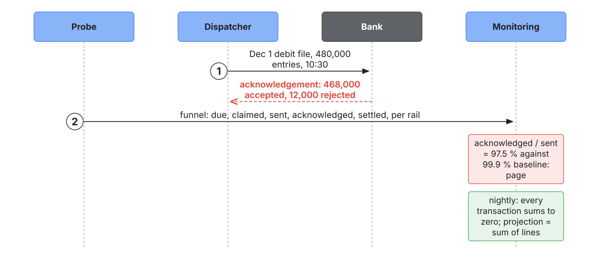

| Metric A | Metric B | Conclusion |
|---|---|---|
| sent normal | acknowledged down | the bank rejected entries: read the file |
| UNKNOWN up | latency at the timeout | the processor is slow |
| unauthorised returns up | concentrated on one merchant | an authorisation-capture bug there |
| breaks up today | returns ingest lagging | ingest is stuck, not the money |
| a transaction that does not sum to 0 | anything | stop posting and page |

**The push.** *"A policy change misallocates four dollars on thirty thousand loans. Every transaction still sums
to zero."*

**The second fix.** Balanced but wrong needs two more checks. Shadow every new policy version over yesterday's
postings and diff the allocations before it goes live; because policy is data, that is a query, not a project.
And a per-loan invariant, nightly: the remaining schedule sums to the outstanding principal. A misallocation
that still balances fails right there.

> "I watch the money, not the servers. A funnel from due to settled per rail, the file acknowledged by eleven,
> unknowns and breaks by age, and nightly invariants on the ledger and every loan."

## 6.9 How the whole system degrades, in priority order

When something fails, protect the properties in the order agreed in Stage 1:

1. **Never charge twice.** Under any doubt, stop sending and ask (UNKNOWN, the resolver, the rail switch).
2. **Never lose or invent a cent.** Postings stop before they go unbalanced; files are stored raw and replayed.
3. **Never penalise a customer for our failure.** Fees and late marks are suppressed by policy during incidents.
4. **Collect on time.** Only after the first three: a collection can always move to tomorrow.

The ledger database is the one component whose loss stops everything; it runs with synchronous replication to a
standby in another zone, and a lost primary costs minutes of collection time, never data.


# Stage 7: Requirements that arrive mid-round

In a "drip" round the interviewer adds requirements while you design. Three likely ones, with the delta stated
the way the interviewer wants to hear it: what changes, what doesn't, what it costs, and which seam absorbs it.

**"Add a hardship programme: customers can pause payments for up to three months."** *Changes:* a new schedule
version with the paused months removed and the remaining instalments moved or re-amortised, per a new terms
rule; due items for the paused months are cancelled. *Doesn't change:* the ledger, the rails, the resolver.
*Costs:* a policy rule owned by risk and legal, and a reporting flag, because paused loans are reported
differently. *Seam:* schedule versions, which were built for refunds.

**"Add instant payments for payoffs: the customer pays from their bank account and it settles in seconds."**
*Changes:* a third rail with its own budget in the dispatcher and its own adapter; payoff quotes no longer need
to be conditional for that rail. *Doesn't change:* returns for bank debits, reconciliation. *Costs:* one adapter,
a reconciliation source. *Seam:* the dispatcher's rail abstraction.

**"Charge interest on some products."** *Changes:* accrual by calculation from the balance and rate, posted at
events and month-end; the waterfall's "interest due" bucket starts to matter; payoff quotes add interest to the
day. *Doesn't change:* everything else. *Costs:* the accrual calculation, its tests, and its month-end job.
*Seam:* policy versions and the waterfall.

> "That's a new schedule version from a new terms rule. The ledger and the rails don't move."

# Stage 8: Failures and reliability

| Failure | Blast radius | Detection | Response |
|---|---|---|---|
| Card processor down | card collections stop | UNKNOWN up, breaker opens | rail switch, resolve unknowns, suppress fees, resume slowly (6.7) |
| Debit file rejected or partly rejected | a day of bank collections | acknowledgement missing or acknowledged/sent below baseline at 11:00 | fix and resend before 14:00 (6.8) |
| Return file late or not ingested | returns not posted; customers wrongly shown as paid | file arrival check; clearing balance not emptying | replay from the raw store |
| Ledger primary lost | all postings stop | database health | fail over to the synchronous standby; minutes |
| A bad policy version | misallocation across many loans | shadow diff; per-loan invariant | roll back the version; reversing transactions for affected postings |
| A bug posts duplicate lines | balances wrong | nightly sum check; unique key violations spike | stop posting; reverse the duplicates, tagged with the incident |
| Worker crash mid-batch | some due rows claimed, not sent | sweeper | rows return to DUE |

**One incident walked through: the bad policy version.** On Nov 12 a new allocation version applies fees after
interest for one state. Every transaction balances, so the sum check is silent. The shadow diff would have
caught it before release; if it was skipped, the nightly per-loan invariant (remaining schedule = outstanding
principal) fails for 30,000 loans the next morning. Response: the version is rolled back (old loans return to
the previous version from the next posting), a correction job posts one reversing and one re-posting transaction
per affected payment, each tagged with the incident ID and the policy version, and customers who were charged a
fee they should not have been are refunded. The audit trail shows the error and the correction; nothing is
edited.

# Stage 9: SLOs, observability, cost

**SLIs, measured from outside where possible:**

| SLI | Target (initial) | How measured |
|---|---|---|
| Debit file acknowledged | by 11:00 every business day | the bank's acknowledgement file |
| Acknowledged / sent | at least 99.9 % | the acknowledgement file against our file |
| UNKNOWN resolved | 99 % within 1 hour | intent state timestamps |
| Collections attempted on due date | 100 % before the cut-off | due items against attempts |
| Breaks older than 3 days | 0 by value above a threshold | reconciliation |
| Ledger sum and projection checks | 0 failures | nightly job |

**The dashboard**, top to bottom: today's funnel per rail; UNKNOWN by age; returns by reason code against
baseline; breaks by age and amount; clearing balance (money in flight) against expectation; customer payable
by age.

**Cost.** Infrastructure is small: one relational database of a few hundred gigabytes with a standby, a few
services, file storage. The real costs are processor fees (a percentage or a fixed fee per card charge, set by
contract) and bank fees per debit, returns, and people: a reconciliation function and on-call. The engineering
levers: move customers from card to bank debit where they agree (cheaper per collection), reduce
self-inflicted declines (the rail budget), and reduce returns (collect after payday, verify accounts at
origination).

**The rails watch us too.** Return and dispute rates have thresholds set by the rails themselves; cross one and
the bank can suspend our ability to collect, an outage no server dashboard shows. The bank-debit thresholds below
are from public summaries of the network rules (checked November 2026; check again before relying on them).

| Rate (trailing 60 days) | Network threshold | Our alert (initial target) | Usually means |
|---|---|---|---|
| Unauthorised debit returns | 0.5 % | 0.25 % | Weak authorisation capture at one merchant or channel |
| Administrative returns (account closed, not found, invalid) | 3 % | 1.5 % | Account details not verified at origination |
| All debit returns | 15 % | 8 % | Collection dates before payday; a drift in risk policy |
| Card disputes | each network's monitoring programme | 0.3 % | A merchant problem that lands on our book |

# Stage 10: The EM layer (auxiliary at Staff)

**Phasing.** V1 (4 engineers, 2 quarters): ledger with projections, schedules, the state machine, the card rail,
the resolver. V2 (6 engineers, 2 quarters): the bank-file rail, returns, policy as data, refunds and payoff. V3
(two teams, 2 quarters, plus finance operations): three-way reconciliation, the finance console, runbooks,
due-date spreading. All illustrative. For a small book with standard products, buying a servicing platform is
the honest V0.

**One-way doors.** The chart of accounts and the ledger schema (seven years of lines and every auditor depend on
them); terms versioning (contracts cite it, and old loans keep old rules forever); the idempotency key format
shared with the processor.

**Team seams.**

| Team | Owns | Contract with the others |
|---|---|---|
| Ledger | accounts, posting interface, invariants, close | nobody else writes lines |
| Collections and payments | scheduler, rails, resolver, returns | intents and the key format |
| Servicing product | refunds, payoff, hardship | schedule versions |
| Finance operations | reconciliation tools, breaks | break types and ageing |
| Risk and legal | retry rules, fees, allocation | policy versions they approve |
| Compliance | debit authorisations, fee caps | rules by state |

**Contracts with the neighbouring systems.** Servicing starts at `LoanBooked` from origination (SD-82), in a schema
registry with consumer contract tests in origination's build, and never reads the application tables. It
publishes `PaymentCollected`, `PaymentReturned`, `RefundApplied` and `LoanPaidOff` through its own outbox; the
merchant webhook platform (SD-99) and notices consume them. A field is added, never renamed; a breaking change is
a new event version run side by side until every consumer has moved.

**With half the team:** keep the ledger, the state machine with UNKNOWN and RETURNED, and reconciliation; cut
due-date spreading, the console (use queries and a spreadsheet for breaks), and the second rail's automation.
Never cut the resolver or the return handling: they are where money is lost.

**On-call.** One rotation for collections and payments, with the rail switch and the runbook in 6.7; finance
operations owns breaks during business hours; the ledger team is paged only by the invariant checks.

# Stage 11: The close

Four sentences, in the order *what · trade-off · risk · next*:

> "Money lives in a double-entry ledger with immutable lines, and each payment is a state machine with unknown
> and returned, with keys at three layers. I traded a broker and a midnight batch for the database as the queue
> and a budget per rail planned back from the bank's cut-off. The risk is the rare paths, returns and unknowns,
> so I test them with real files. Next is three-way reconciliation every day, with an owner for every break."

# Stage 12: Self-check after a simulator run

| Area | Weak | Strong | Exceptional |
|---|---|---|---|
| Framing | charges everyone on the due date | asks rails, limits, returns, refunds, audit | sets the order of what must never happen and uses it later |
| Ledger | balance column | double entry, reversals | projection in the same commit, provable, nightly invariant |
| Collections | cron at midnight, retry on error | keys, UNKNOWN, rate limit per rail | three layers of keys; day plan from the cut-off; spread due dates |
| Returns | settled = paid | RETURNED with a reversal | re-presentment rules as policy; exposure by age |
| Adjustments | subtract from the balance | schedule versions, waterfall | in-flight items in payoff quotes; customer payable with a deadline |
| Reconciliation | not mentioned | match with the bank | three-way, by reference, typed and owned breaks; never by totals |
| Operations | API uptime | file acknowledgement, UNKNOWN age | symptom pairs; "our outage is not your late fee"; shadow-tested policy |

**Common traps:** "thundering herd" and a broker for 42 a second; treating SETTLED as final; editing ledger lines;
a new key on every retry; reconciling by totals; late fees for our own outages; nobody owning the policy.


## Follow-up questions to be ready for

| Follow-up | Where this design answers it |
|---|---|
| What if the processor gives us no way to query by our key? | Challenge 1; the pitfall on option D |
| How do you migrate loans already running on a balance column? | The alternate path; the ledger mechanism |
| A bank adds an instant rail. What changes? | The central tension: fewer pending days, the same states |
| How do you test returns and unknowns that happen once a month? | Challenge 3; the observability challenge |
| Who owns a policy change that costs us money? | Mechanism six; the EM layer |
| When would you buy the platform? | Option E |

# Part III: The internals

## Appendix A: Double-entry bookkeeping, in plain words

Every movement of money is recorded twice: where it came from and where it went. Each record is a *line* on an
*account*, and the lines of one transaction sum to zero when debits are written as positive and credits as
negative. Accounts come in kinds: assets (what we own or are owed, such as a loan's principal receivable, or cash
at the bank), liabilities (what we owe, such as merchant payable or customer payable), and income (such as the
merchant discount). The sign convention matters less than the invariant: if every transaction sums to zero, the
whole ledger sums to zero, and any account's balance is the sum of its lines.

Two consequences make the design. First, a mistake is never fixed by editing a line; it is fixed by a new
transaction that reverses it, so the history shows both the error and the correction. Second, any stored
balance can be checked against the lines at any moment, which is what the nightly invariant does. The stored
balance (the projection) exists only for speed; the lines are the truth.

In loan servicing, three accounts do most of the explaining. *Cash clearing* holds money in flight: a bank debit
moves into clearing when it is submitted and out of it when it settles, so the clearing balance is exactly what
the bank still owes us. *Customer payable* holds money we owe customers (overpayments), and must be paid out
within a deadline. *Merchant receivable* holds refunds merchants owe us.

## Appendix B: Idempotency keys at three layers

An idempotency key names one *decision*. Whoever receives the key a second time returns the first result instead
of acting again. In this design the key `coll:<loan>:<instalment>:<attempt>` is used three times:

1. **In the ledger**, as a unique column on the transaction. A duplicate posting fails at the first insert, and
   the stored result is returned.
2. **At the processor**, sent with the charge. A processor that honours keys returns the original result to a
   resend with the same key.
3. **In the schedule**, as a partial unique index on the intent table: one open intent per instalment, so two
   workers cannot create two collections for the same instalment.

The rule that holds them together: the same attempt always reuses its key; a new attempt number is created only
after a definite answer (a decline), never after a timeout. Keys are kept for at least as long as the processor
can return an answer for them, and in the ledger forever (they are part of the transaction).

## Appendix C: A database as a work queue

A table of due items with a status column, an index on `(due_date, shard, status)`, and a claim query using
`FOR UPDATE SKIP LOCKED` is a reliable queue at tens or hundreds of operations a second. `FOR UPDATE` locks the
selected rows until the transaction ends; `SKIP LOCKED` makes other workers skip those rows instead of waiting,
so many workers can drain one shard without colliding. If a worker dies before committing, its locks are
released and the rows are due again. If it dies after committing but before acting, a sweeper finds rows
claimed long ago with no follow-up and returns them. The outbox pattern completes it: the intent and an
"to send" row commit with the claim, and the dispatcher drains committed rows, so nothing is sent without a
record and nothing recorded is left unsent. The limits are known: polling adds a little latency, and very high
rates (tens of thousands a second) would justify a log-based queue. At 42 a second, none of that applies.

## Appendix D: Token buckets and the day plan

A token bucket allows a steady rate with a small burst: tokens are added at a fixed rate (say 90 a second) up to
a capacity, and each request takes one. The dispatcher keeps one bucket per rail, set below the contract to
leave room for queries and retries. When the processor signals throttling, the rate halves at once and recovers
slowly. The day plan is a schedule worked backwards from the hard deadline: the bank's cut-off minus the time to
fix and resend a rejected file gives the submission deadline; the file build and validation come before it; the
card window fits where the processor is least busy. The plan is data, re-run automatically after an outage.

## Appendix E: Bank-debit returns

A bank debit is an instruction to the customer's bank, sent in a file. It settles one to two business days later.
But it can be returned after settlement: for insufficient funds or a closed account within two banking days, and
as unauthorised (the customer says they did not agree) for up to sixty calendar days. Each return carries a
reason code and the trace number of the original entry. Under the network's rules, a debit returned for
insufficient funds may be presented again at most twice within 180 days; an unauthorised return may not be
presented again without a new authorisation. These rules are summarised from public rule documents as of
November 2026 and belong in the policy table, owned outside engineering, so a rule change is a new policy
version rather than a code change.

## Appendix F: Three-way reconciliation

Three records describe the same money: our ledger (what we expect), the processor's report (what they did), and
the bank statement (what arrived). Reconciliation stores each file raw, builds expectations from the ledger for
the period, and matches line by line: first by our reference (the key, or the trace number), then by amount
within a date window for anything left. Every unmatched line becomes a typed break: *timing* (expected to clear
on its own, and closed automatically when it does), *missing in ledger*, *missing at counterparty*, or *amount
differs*. Each break gets an owner and an age, and the ageing report is what makes a two-day month-end close
possible. Matching by totals is never acceptable: two errors of opposite sign cancel in a total, and one of them
may be a customer charged twice.


# One-page cheat card

**Insight.** Settled is not final for a bank debit. Correctness over months, not throughput.

**Numbers.** 600,000 ÷ 14,400 s = about 42/s → the database is the queue. 120,000 card ÷ 90/s = about 22 min → budget per
rail. $90M on the 1st; 0.1 % = about $90k → correctness beats speed. 340 GB in seven years → one relational database.

**Design.** Ledger (immutable lines, projection in the same commit) · due items claimed with SKIP LOCKED, intent
and outbox in one commit · dispatcher with a token bucket per rail and a day plan from the cut-off · resolver for
UNKNOWN · file ingest for settlements and returns · policy as versioned data · three-way reconciliation.

**States.** SCHEDULED → SUBMITTED → PENDING → SETTLED → (RETURNED). SUBMITTED → UNKNOWN → query by the same key.

**Keys.** `coll:<loan>:<instalment>:<attempt>` in the ledger, at the processor, and one open intent per
instalment. Same attempt, same key.

**The eight challenges.** Timeout → UNKNOWN and the resolver. The 1st → plan back from the cut-off. Returns →
RETURNED, reversal, policy. Refund → transaction plus schedule version. Payoff → quote lists what's in flight,
PAID_PENDING. Month-end → match by reference, typed breaks. Processor down → pause, resolve, no fees, resume
slowly. Observability → funnel, file acknowledgement, invariants.

**Close.** Ledger and state machine · database as the queue, budget per rail · rare paths tested with real files ·
three-way reconciliation with owners.
