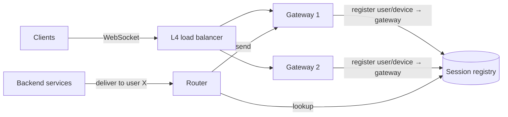

# 9 · Real-time delivery & connections — pushing data to clients

Chat, live comments, presence, notifications, collaborative editing and ride tracking all push data
to clients as it happens. The engineering problem is less the protocol than **the connection tier**:
millions of long-lived, stateful connections that must be routed to, survive deploys, and reconnect
without stampeding.

---

## Choosing a channel

| Channel | Direction | Good for | Limits |
|---|---|---|---|
| **Short polling** | client asks every N s | rare updates, simple infrastructure | wasteful; latency = interval |
| **Long polling** | client asks; server holds until data or timeout | fallback where sockets are blocked | a request per message; connection churn |
| **Server-Sent Events (SSE)** | server → client over HTTP | feeds, notifications, streaming LLM tokens | one direction; per-domain connection limits on HTTP/1.1 |
| **WebSocket** | full duplex over one TCP connection | chat, collaboration, games, trading | stateful servers; load balancers and proxies must support it |
| **Mobile push (APNs/FCM)** | platform → device, even when the app is closed | waking an app, offline users | best-effort, rate-limited, small payloads, no delivery guarantee |
| **HTTP/2 or gRPC streams** | multiplexed streams | service-to-service, modern clients | client support varies |

{: .say }
> "Online clients hold a WebSocket to a gateway; offline clients get a platform push that only says
> 'you have new messages' — the app then syncs over the normal API. The push is a nudge, not the
> delivery path."

## The connection tier

- **Gateways** terminate connections and hold only connection state — authentication, heartbeats,
  per-connection buffers. Business logic lives behind them.
- **The session registry** maps `user/device → gateway` with a TTL refreshed by heartbeats. It is hot
  (updated on every connect/disconnect) and must tolerate being slightly wrong: a delivery to a stale
  gateway fails and the message stays in the durable inbox.
- **Fan-in routing:** backends send to the gateway owning the connection — directly, via a pub/sub
  channel per gateway, or by consistent-hashing users to gateways.

### Capacity arithmetic

Memory per idle connection is roughly **10–50 KB** (kernel buffers, TLS state, app state). A large
host holds a few hundred thousand to ~1 M connections. **100 M concurrent connections ≈ 200–500
gateway hosts** plus headroom for losing a zone.

Heartbeats: 100 M connections × one ping per 30 s ≈ **3.3 M pings/s** — the cost of presence, and
why heartbeat intervals and presence fan-out need care.

## Reconnects — the thundering herd

When a gateway dies or is deployed, its connections (say 500 k) reconnect **at the same moment**.
Each reconnect is a TLS handshake, an auth check and a catch-up query.

Mitigations:

1. **Client-side jittered exponential backoff** on reconnect.
2. **Drain on deploy**: stop accepting new connections, ask clients to reconnect gradually over minutes.
3. **Cheap resumption**: session tickets for TLS; catch-up by **cursor** ("give me everything after
   sequence 1,234") rather than full reload.
4. **Admission limits** on the auth and sync services, shedding with a "retry after" hint.

## Delivery guarantees over an unreliable channel

A socket write succeeding does **not** mean the client displayed the message. Reliable real-time
systems therefore:

- persist first, then push ("store before deliver");
- give every item a **sequence number** per stream (conversation, channel);
- have the client **acknowledge** the highest contiguous sequence it has stored;
- on reconnect, the client asks for everything after its last ack — online and offline become the
  same code path.

{: .key }
> **Cursor-based catch-up is the pattern that makes real-time systems correct.** Push is an
> optimisation that delivers early; the cursor sync is what guarantees nothing is missed.

## Presence

Presence ("online", "typing", "last seen") is high-volume, low-value, and tolerates staleness. Keep
it **separate from messaging**: ephemeral store with TTLs, fan-out only to interested and visible
contacts, coarse granularity, and aggressive batching. Never let presence traffic share capacity
with message delivery.

---

## Traps

{: .warn }
> **Treating the WebSocket as the source of truth** — "deliver if online, else store". A crash between
> the two loses messages. Store first.

{: .warn }
> **Forgetting the reconnect storm** — the gateway tier is sized for steady state and dies on its
> first deploy.
